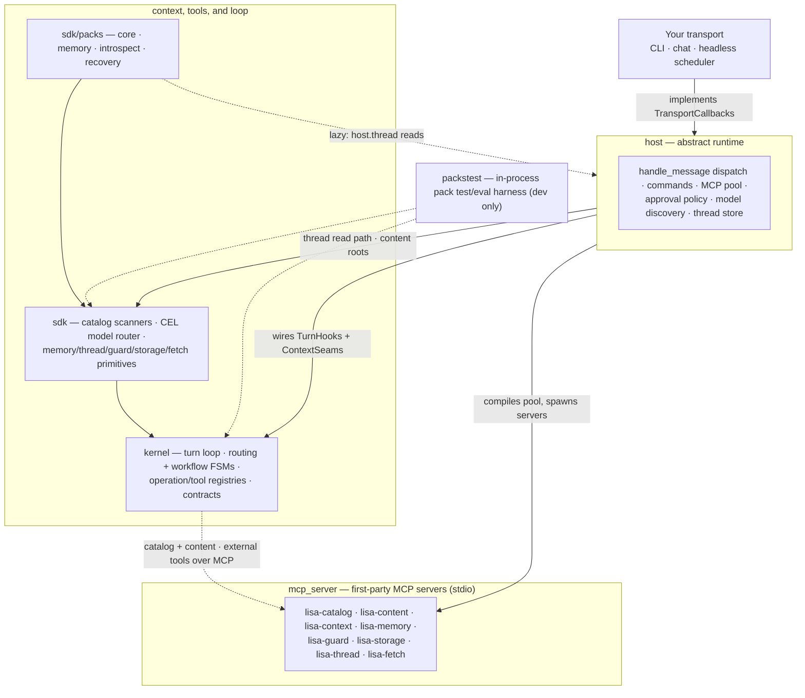

# Lisa Harness

[](https://www.python.org/downloads/)
[](LICENSE)
[](https://docs.astral.sh/ruff/)

Lisa is a portable framework for building *modal* agent hosts and *packs*,
that contain the modes, operations, tools, proxies, and servers they use.
It's built to be extremely composable and connectable.

The [kernel](kernel) defines the turn loop,
model context,
agent mode switching/routing,
operations, and tool calling.
It also launches and/or intermediates MCP servers and model providers and proxies.
It does that by managing packs.
Packs contain any combination of content, i.e., prompts,
agent modes, operations, tools, MCP servers and proxies,
e.g., the *core* pack contains system-prompt and a minimal *session_context*.

The [host](host) loads packs and registers their modes, operations, and tools in the kernel.
It also bootstraps [first-](mcp_server) and third-party MCP servers and proxies.
The [sdk](sdk) contains the core, memory, introspect, and recovery packs.
It also contains the CEL-based [model router](sdk/src/sdk/router/) the host uses.
There is also the `packstest` harness that verifies content packs in-process,
from source, with no model calls.

The [`lisa-harness-cli`][lisa-host-cli] contains the runnable CLI tool.

## Table of contents

- [Lisa Harness](#lisa-harness)
  - [Table of contents](#table-of-contents)
  - [Architecture](#architecture)
  - [Repository layout](#repository-layout)
  - [Installation](#installation)
  - [Quick start](#quick-start)
  - [Configuration](#configuration)
  - [Commands](#commands)
  - [MCP servers](#mcp-servers)
  - [Packs](#packs)
  - [Model providers](#model-providers)
  - [Privacy and surface scope](#privacy-and-surface-scope)
  - [Validation](#validation)
  - [Contributing](#contributing)
  - [License](#license)

## Architecture

Lisa is based on the classic kernel + SDK = host architecture.
The idea is to abstract the core behavior in the kernel,
a basic structure in the (still abstract) host runtime,
and a concrete but completely composable runtime via packs.



Arrows point from a package to what it depends on; dashed edges are lazy or
infrastructural seams rather than whole-layer import dependencies.

| Package | Owns | Depends on | Must not own |
| --- | --- | --- | --- |
| `kernel` | The turn loop (`turn_runner`, `turn_phases`), mode routing and workflow FSMs (`ipsar`, `ipsar_fsm`), the operation and tool registries, the capability manifest, session-plan contracts and their compiler, approval and recovery contracts, the slicing system, and entry-point discovery for content roots, host commands, routers, slice providers, and provider gateways | Nothing in-repo | Host transports, production deployment, model policy, proprietary app behavior |
| `sdk` | Content discovery, tool cataloging, model routing (`lisa-router`), provider gateways, the SQLite memory store, the thread read/storage/fetch primitives | `kernel` | Host wiring, private model policy, production storage |
| `sdk/packs` | Bundled reference packs — `core`, `memory`, `introspect`, `recovery` — contributing modes, operations, tools, authored content, slice providers, and pack-registered slash commands; the memory pack also provides the default memory MCP backend | `kernel`, `sdk` (bundled packs may lazily import `host.thread`) | Product strategy, private app behavior, cross-pack imports |
| `host` | Abstract runtime: typed config (`HostConfig`), mutable state (`HostRuntime`), `handle_message` dispatch and host commands, MCP pool compilation and launch policy, the approval policy engine (`config/policy.yaml`), model discovery, context assembly, the thread store write path, recovery records, and pack management | `kernel`, `sdk`, the bundled packs, `mcp_server` (launch config) | Chat transport, durable memory backends, production-grade model policy |
| `mcp_server` | First-party MCP servers exposing Lisa's surface-scoped tools over stdio — thin facades; domain logic stays in the SDK | `kernel`, `sdk` | Transport, host wiring, cross-server imports |
| `packstest` | The in-process pack test/eval harness: `validate_pack` structure checks, `run_tool`/`run_scenario` behavior driving, diffable `Trajectory` reports, offline git fixtures, and deterministic `eval` cases | `kernel`, `sdk` only | Anything at runtime — pack repos consume it as the dev dependency `lisa-harness-packstest` |

### What a host injects

A real host injects concrete implementations for the runtime seams the
framework leaves open: model completion and resolution callbacks, tool catalog
and execution callbacks, blob/object storage (via the `lisa-storage` MCP
server), memory store/recall when memory operations are enabled,
the transport adapter, and scheduling for signal connector polling.

### The packstest harness

`packstest` (`lisa-harness-packstest`) is a dev-only harness for pack authors. It is
not part of any runtime: it imports `kernel` and `sdk` only, and pack
repositories consume it as a dev dependency.
See [`packstest/README.md`](packstest/README.md) for the full API.

## Repository layout

This is a [uv][uv] workspace; the root `pyproject.toml` ties the member
packages together.

```text
.
├── kernel/              # Runtime-neutral engine: turn loop, routing FSMs, registries
├── sdk/                 # Author-facing helpers, catalog scanners, CEL model router
│   ├── packs/           # Bundled reference packs
│   │   ├── core/        #   baseline mode (default) and shared assets
│   │   ├── memory/      #   memory-backed learning operations + slice provider
│   │   ├── introspect/  #   operational self-model and reflective assessment
│   │   └── recovery/    #   thread-based /resume and recovery records
│   └── router/          # CEL-based model router (lisa-router) and runtime support
├── host/                # Transport-neutral host runtime
├── mcp_server/          # First-party MCP servers (catalog, content, context, ...)
├── packstest/           # In-process pack test/eval harness (dev-only)
├── artifacts/           # Generated manifests, thread store, token usage, overlays
├── docs/                # Architecture and design documents
└── scripts/             # Repo-local tooling
```

## Installation

Lisa requires **Python 3.11 or newer** and is managed with `uv`. Clone the
repo and sync the workspace, including the development extras:

```sh
git clone https://github.com/Lisa-Harness/lisa.git
cd lisa
uv sync --extra dev
```

The framework packages are installed as editable workspace members. To drive
Lisa from a terminal, install the CLI host from the sibling repo:

```sh
uv tool install lisa-harness-cli
```

This provides the `lisa` entry point, which wraps the transport-neutral
`host` runtime with console rendering and a REPL loop.

## Quick start

From the repo root:

```sh
uv sync --extra dev
uv run lisa verify        # smoke-check the installed runtime
uv run lisa modes         # list available modes
uv run lisa models discover
uv run lisa models apply
uv run lisa prompt "what are our next steps?"
```

The first `lisa models discover` / `lisa models apply` cycle generates and
activates the model manifest (see [Configuration](#configuration)). Once that is
in place, the runtime can answer natural-language turns through whichever
provider the manifest points at.

## Configuration

Lisa resolves configuration from environment variables and generated
artifacts under the data directory (`artifacts/` by default, or the path in
`LISA_DATA_DIR`).

- **Model manifest** — `artifacts/models.yaml` declares the `default` and
  `reasoning` model designations. Run `lisa models discover` to probe
  configured providers, then `lisa models apply` to write the active manifest.
  See [`docs/ROUTER_DESIGN.md`](docs/ROUTER_DESIGN.md) for the routing contract.
- **Content roots** — `SDK_CONTENT_ROOTS` is a `;`-separated list of extra pack
  roots. Local action/chat packs discovered this way run when they only need the
  shipped callbacks; heavier workflow modes report the missing host wiring
  they require.
- **Thread store** — append-only JSONL under the data dir. `lisa-pack-memory`
  is bundled and enabled by default.
- **Approval policy** — `config/policy.yaml` decides which actions need
  operator approval: the `ask`/`trust`/`plan` dial, sandbox auto-approval, and
  allow/ask/deny rules. See
  [`docs/POLICY_GUIDE.md`](docs/POLICY_GUIDE.md) for the authoring reference.

## Commands

Host commands are slash-prefixed. Built-ins ship in the host runtime; packs
register their own through the `lisa.extensions.host_commands` entry point.

| Command | Purpose |
| --- | --- |
| `lisa verify` | Smoke-check the installed runtime, manifest, and packs |
| `lisa modes` | List discovered modes and their owning packs |
| `lisa models` | Show the active model manifest |
| `lisa models discover` | Probe providers and propose a manifest |
| `lisa models apply` | Activate the proposed manifest |
| `lisa prompt "<prompt>"` | Execute the next turn with a prompt |

Pack-registered commands (for example `/search`, `/markdown`, `/discuss`,
`/help`) are added through `SDK_CONTENT_ROOTS` and the bundled packs.

## MCP servers

The `mcp_server` package ships first-party [MCP][mcp] servers that expose
Lisa's surface-scoped tools over stdio. Each is an independent entry point:

| Server | Entry point | Surface |
| --- | --- | --- |
| `lisa-context` | `mcp_server.context.server:main` | Context assembly and retrieval |
| `lisa-content` | `mcp_server.content.server:main` | Content loading and rendering |
| `lisa-catalog` | `mcp_server.catalog.server:main` | Mode/operation catalog |
| `lisa-memory` | `mcp_server.memory.server:main` | Surface-scoped memory store/recall |
| `lisa-guard` | `mcp_server.guard.server:main` | Privacy and scope guardrails |
| `lisa-storage` | `mcp_server.storage.server:main` | Blob/object storage |
| `lisa-fetch` | `mcp_server.fetch.server:main` | Fetch-and-cache remote http(s) content |
| `lisa-thread` | `mcp_server.thread.server:main` | Append-only thread store |

## Packs

Packs are the unit of authoring. A pack contributes modes, operations, authored
content, and pack-registered slash commands under a single namespace. Bundled
reference packs:

- **`lisa-pack-core`** — baseline mode (`default`) and shared
  prompt assets.
- **`lisa-pack-memory`** — memory-backed learning operations (`learn`, memory
  ops). Enabled by default.
- **`lisa-pack-introspect`** — operational self-model and reflective
  self-assessment operations.
- **`lisa-pack-recovery`** — thread-based `/resume` and recovery records.

External integration packs live in the public
[`lisa-packs`][lisa-packs] repo (`brave`, `cloudservers`, `letta`, `markdown`,
`mem0`, `okf`, `personas`, `search`, `serper`, `tavily`), under the
`lisa_packs.*` namespace.

## Model providers

Lisa supports live completion through any OpenAI-compatible endpoint plus the
first-party SDK providers:

- `anthropic`
- `azure_openai`
- `google`
- `ollama` (local)
- `openai`
- `openrouter`

Provider credentials and endpoints are resolved from the environment in the
usual way for each SDK (for example `OPENAI_API_KEY`, `ANTHROPIC_API_KEY`,
`AZURE_OPENAI_*`). The active model manifest in `artifacts/models.yaml` pins
which model the `default` and `reasoning` designations resolve to.

## Privacy and surface scope

The public contracts model privacy explicitly — prompt wording is **not** a
privacy control. Hosts must enforce scope in storage keys, retrieval filters,
and delivery routing:

- `SurfaceContext` carries `surface_type`, `surface_id`, and `memory_scope`.
- Memory writes and recalls are scoped by the active surface and memory scope.
- Shared surfaces must not receive personal context unless a host implements
  explicit, audited sharing semantics.
- Proactive delivery targets are host-owned and must be explicit.

See [`docs/BOUNDARIES.md`](docs/BOUNDARIES.md) for the full privacy boundary.

## Validation

The local loop and CI run the same commands in the same order — there is no
warn-only stage. Run all checks from the repo root:

```powershell
# Format check
uv run ruff format --check .

# Lint
uv run ruff check .

# Direct I/O policy (allowlist)
uv run python scripts/check_direct_io_policy.py

# Type check (all public packages)
uv run mypy kernel/src/kernel sdk/src/sdk mcp_server/src/mcp_server

# Dead code check
uv run vulture kernel/src/kernel sdk/src/sdk mcp_server/src/mcp_server host/src/host vulture_allowlist.py

# Tests (no live API calls)
uv run pytest -m "not live" --tb=short -v

# Smoke test
uv run lisa verify
```

Focused sanity checks:

```powershell
uv run python -c "import kernel, sdk; print(kernel.__file__); print(sdk.__file__)"
uv run lisa modes
uv run lisa models
uv run pytest kernel/tests sdk/tests host/tests -m "not live" -q --tb=short
uv run --extra dev ruff check --select F,I kernel sdk mcp_server host
```

Tests marked `live` hit real external signal or provider APIs and are skipped
by default; `integration` tests are multi-module in-process and may require
local services; `eval` tests are deterministic agent regression evals with no
model calls or I/O.

Pack changes are verified with the in-process `packstest` harness before any
installed-package route — see [The packstest harness](#the-packstest-harness)
and [`packstest/README.md`](packstest/README.md).

## Contributing

Contributions are welcome. See [`CONTRIBUTING.md`](CONTRIBUTING.md) for the
full checklist, and [`docs/CODING_WORKFLOW.md`](docs/CODING_WORKFLOW.md) for the
coding pack workflow. In summary:

1. Fork and clone the repo, then `uv sync --extra dev`.
2. Make changes on a feature branch.
3. Run the [validation](#validation) suite from the repo root — any failure
   blocks.
4. Open a pull request with breaking changes noted in the description and
   [`CHANGELOG.md`](CHANGELOG.md).

Keep changes scoped to the current task. Follow the existing module boundaries
and naming patterns; prefer the smallest diff that fixes the root cause and
verify it with the relevant tests. See [`docs/ROADMAP.md`](docs/ROADMAP.md)
for the current work horizons.

## License

Lisa Harness is released under the [MIT License](LICENSE), © 2026 The Migus
Group.

[lisa-host-cli]: https://github.com/Lisa-Harness/lisa-host-cli
[lisa-packs]: https://github.com/Lisa-Harness/lisa-packs
[mcp]: https://modelcontextprotocol.io
[uv]: https://docs.astral.sh/uv
