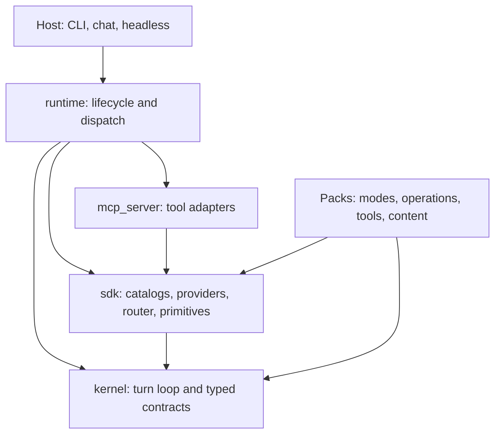

# Lisa Harness

[](https://github.com/Lisa-Harness/lisa/actions/workflows/ci.yml)
[](https://www.python.org/downloads/)
[](LICENSE)

Lisa is an composable, extensible and modular AI agent runtime and host.
It provides an
inspectable tool-enabled turn loop,
intent-driven mode switching,
event-driven model routing,
read, write and execute approvals,
an abstract runtime,
and an SDK that includes a "pack" loader.
A hosts supplies the
user interface / communication transport,
manages the MCP servers and model proxies,
and load the modes, operations, proxies, servers and tools from packs.

## Start here

| Goal | Guide |
| --- | --- |
| Run the agent harness | [Getting started](docs/GETTING_STARTED.md) and the separate [CLI host](https://github.com/Lisa-Harness/lisa-cli) |
| Use the sandbox feature | [Sandbox Trust Workbook](docs/SANDBOX_TRUST_WORKBOOK.md) |
| Create your own modes pack | [Pack authoring](docs/PACK_AUTHORING_GUIDE.md) |
| Configure the session context | [Configuration](docs/CONFIGURATION.md) and [session authoring](docs/SESSION_CONTEXT_AUTHORING_GUIDE.md) |
| Understand/debug the harness | [Architecture](docs/BOUNDARIES.md) and [troubleshooting](docs/TROUBLESHOOTING.md) |
| Use the runtime to create a host | [Host integration](docs/HOST_INTEGRATION.md) |
| Contribute | [Contributing](CONTRIBUTING.md) and [testing](docs/TESTING.md) |

The [documentation index](docs/README.md) links the full reference corpus.

## Use the source

```sh
git clone https://github.com/Lisa-Harness/lisa.git
cd lisa
uv sync --frozen --extra dev
uv run pytest packstest/tests -m "not live" -q
```

## Architecture



Arrows show package dependencies, not every callback or MCP connection.
The kernel has no in-repository package dependency; runtime composes the
engine. Transports implement callbacks without putting UI imports in runtime.
Packs use kernel/SDK contracts, not runtime internals or cross-pack imports.

| Directory | Distribution | Responsibility |
| --- | --- | --- |
| [kernel](kernel/README.md) | `lisa-harness-kernel` | Turn loop, registries, approvals, execution/session contracts |
| [sdk](sdk/README.md) | `lisa-harness-sdk` | Content discovery, provider gateways, CEL router, storage/memory primitives |
| [runtime](runtime/README.md) | `lisa-harness-runtime` | Composition, configuration, MCP lifecycle, commands, thread writes |
| [mcp_server](mcp_server/README.md) | `lisa-harness-mcp-servers` | MCP adapters for catalog, content, memory, guard, storage, and thread |
| [sdk/packs](sdk/packs/README.md) | `lisa-pack-*` | Core, memory, introspect, and recovery reference packs |
| [packstest](packstest/README.md) | `lisa-harness-packstest` | Offline testing and deterministic pack evaluation |
| [e2etest](e2etest/README.md) | `lisa-harness-e2e` | Full-runtime testing with live and scripted models; `lisa-e2e` runner |

### How a turn works

1. Runtime handles control commands and resolves the active mode.
2. It assembles instructions, scoped evidence, history, and allowed capabilities.
3. Kernel iterates model completions and authorized dispatch. `transition_stage`
   can advance a workflow, hand off, or fork independent work. Model selection
   is a separate optional CEL router.
4. Effectful actions follow approval policy. Completion uses receipts;
   checked-commit tasks have additional artifact/check gates.
5. Runtime records outcomes and lossless evidence. Bounded slices perform
   opportunistic housekeeping.

Read [terminology](docs/BOUNDARIES.md), [routing](docs/ROUTER_DESIGN.md),
[context lifecycle](docs/CONTEXT_LIFECYCLE.md), and [memory](docs/MEMORY_ARCHITECTURE.md).

## Extending Lisa

Packs contribute modes, Python or prompt-authored operations, tools,
MCP servers, evidence, and host commands through entry points.
The [bundled packs](sdk/packs/README.md) are references; external integrations
live in [lisa-packs](https://github.com/Lisa-Harness/lisa-packs).
Installation does not imply activation: session selection and host policy
control the catalog.

Provider gateways are pluggable SDK backends. Reference implementations cover
OpenAI-compatible endpoints, Azure OpenAI, Anthropic, Google Gemini, and
optional AWS Bedrock. Availability depends on credentials, dependencies,
and declared [model capabilities](docs/CONFIGURATION.md#models).

## Safety and privacy

Approvals, scope, paths, and guard seams are explicit contracts, not a guarantee
that arbitrary agent code is safe. Installed packs execute Python; default
content guards pass through; sandboxing needs a containment implementation.
Hosts must enforce authenticated identities, scope isolation, and delivery.

Threads and request snapshots can contain sensitive material. Keep data
directories/credentials out of Git and sanitize shared diagnostics.
Read [storage](docs/STORAGE.md) and the [security policy](SECURITY.md).

## Community

- [GitHub issues](https://github.com/Lisa-Harness/lisa/issues): bugs and features,
  with a minimal reproduction, versions, and sanitized evidence.
- [Contributing](CONTRIBUTING.md) and [Code of Conduct](CODE_OF_CONDUCT.md).
- [Private vulnerability reporting](SECURITY.md).
- [Roadmap](docs/ROADMAP.md): priorities, not delivery promises.

## Publishing releases

Prepare releases in a PR, not with direct pushes to `main`. Follow the
[release checklist](docs/RELEASE_CHECKLIST.md#pr-based-releases-and-protected-main):
update versions and release notes, pass the required **Merge gate** and a manual
`Publish` validation, then land the PR by rebase or squash and tag the verified
main commit. `main` keeps a linear history: merge commits are rejected.

The `Publish` workflow validates CI, builds wheels and source distributions for
all ten workspace packages, checks distribution metadata, and retains the build
artifacts. Run it manually on `main` to validate without publishing. Pushing a
`v<version>` tag additionally publishes to PyPI and creates a GitHub release with
the distributions attached. Every package version must match the tag.

Before the first tag, register GitHub pending publishers in
[PyPI publishing settings](https://pypi.org/manage/account/publishing/).
Use owner `Lisa-Harness` and workflow `publish.yml`. For this repository, set
the environment to `pypi-<project-name>` (for example,
`pypi-lisa-harness-kernel`). For the CLI and standalone pack repositories,
leave the environment blank. Each distribution needs its own registration:

| Repository | PyPI project names |
| --- | --- |
| `lisa` | `lisa-harness-kernel`, `lisa-harness-sdk`, `lisa-harness-mcp-servers`, `lisa-harness-runtime`, `lisa-harness-packstest`, `lisa-harness-e2e`, `lisa-pack-core`, `lisa-pack-introspect`, `lisa-pack-memory`, `lisa-pack-recovery` |
| `lisa-cli` | `lisa-cli` |
| Each `lisa-pack-*` repository | The matching repository name: `lisa-pack-bash`, `lisa-pack-brave`, `lisa-pack-bwrap`, `lisa-pack-coding`, `lisa-pack-headroom`, `lisa-pack-letta`, `lisa-pack-markdown`, `lisa-pack-mem0`, `lisa-pack-okf`, `lisa-pack-personas`, `lisa-pack-powershell`, `lisa-pack-search`, `lisa-pack-serper`, `lisa-pack-tavily` |

These 16 repositories publish 25 distributions. No PyPI API token is needed.
Only distribution building is shared through `build-package.yml`; each
repository's own `publish.yml` performs the Trusted Publishing exchange.

PyPI currently permits only three pending publishers at a time and requires
distinct configurations for pending projects. The ten framework distributions
therefore publish in separate jobs with project-specific GitHub environments.
For initial setup, register kernel, SDK, and MCP servers first. After release
validation passes, their first uploads convert these pending registrations to
active publishers and free slots for the next three registrations. Continue
in batches, rerunning only failed publishing jobs after each new registration.
The framework GitHub release is created only after all ten publishing jobs
succeed. Do not move a release tag or try to overwrite an uploaded version.

For the first release, tag and verify `lisa` first, then the standalone packs,
then `lisa-cli`. The CLI's CI resolves dependencies from PyPI, without local
source overrides, so its framework and optional pack dependencies must already
be available there. Keep local `[tool.uv.sources]` overrides for development.
Do not push tags until the initial batch of pending publishers is configured
and release validation has passed. PyPI versions cannot be overwritten after
publication.

## License

[MIT](LICENSE), copyright 2026 The Migus Group. External hosts, packs,
providers, and dependencies have their own licenses and terms.
