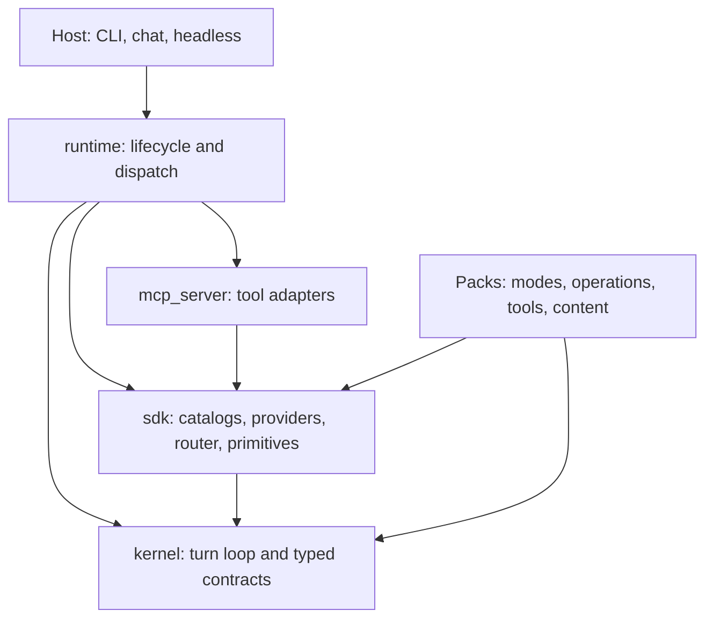

# Lisa Harness

[](https://github.com/Lisa-Harness/lisa/actions/workflows/ci.yml)
[](https://www.python.org/downloads/)
[](LICENSE)

Lisa is a Python framework for building tool-using AI agents. It provides an
inspectable model/tool loop, mode and workflow routing, scoped memory, durable
conversation history, exact-action approvals, and composable capability packs.
Hosts supply the user interface; packs supply tasks, tools, and authored content.

Use Lisa to build a CLI, chat integration, or headless agent with explicit
execution contracts. It is not a hosted service, a model, or an OS sandbox.

## Project status

Workspace packages are version **0.1.0**. Treat API and data contracts as
pre-1.0: breaking changes use hard cutovers, not compatibility shims.
Review the [changelog](CHANGELOG.md) before updating a host or pack.
Python 3.11+ is required; CI tests 3.11 and 3.12 on Linux, macOS, and Windows.
Individual packs can have additional platform requirements.

Core behavior is under a [stabilization freeze](docs/CODING_WORKFLOW.md#freeze).
Documentation, tests, and fixes with regressions are welcome; new core features
or refactors need a recorded maintainer exception.

## Start here

| Goal | Guide |
| --- | --- |
| Run an agent | [Getting started](docs/GETTING_STARTED.md) and the separate [CLI host](https://github.com/Lisa-Harness/lisa-cli) |
| Build a host | [Host integration](docs/HOST_INTEGRATION.md) |
| Add a mode, operation, or tool | [Pack authoring](docs/PACK_AUTHORING_GUIDE.md) |
| Configure a session | [Configuration](docs/CONFIGURATION.md) and [session authoring](docs/SESSION_CONTEXT_AUTHORING_GUIDE.md) |
| Understand/debug the engine | [Architecture](docs/BOUNDARIES.md) and [troubleshooting](docs/TROUBLESHOOTING.md) |
| Contribute | [Contributing](CONTRIBUTING.md) and [testing](docs/TESTING.md) |

The [documentation index](docs/README.md) links the full reference corpus.

## Quick start

**To run Lisa**, install the independently maintained CLI:

```sh
uv tool install lisa-cli
lisa --help
lisa verify
```

Configure provider access and a model manifest before a model turn; follow
[getting started](docs/GETTING_STARTED.md). Live use sends data to the selected
provider and may incur charges.

**To develop the framework**:

```sh
git clone https://github.com/Lisa-Harness/lisa.git
cd lisa
uv sync --frozen --extra dev
uv run pytest packstest/tests -m "not live" -q
```

This installs framework workspace members, **not** `lisa`. A `uv tool install`
environment is separate from the checkout's `.venv`; framework edits do not
automatically change an installed CLI.

## Architecture



Arrows show package dependencies, not every callback or MCP connection.
The kernel has no in-repository package dependency; runtime composes the
engine. Transports implement callbacks without putting UI imports in runtime.
Packs use kernel/SDK contracts, not runtime internals or cross-pack imports.

| Directory | Distribution | Responsibility |
| --- | --- | --- |
| [kernel](kernel/README.md) | `lisa-harness-kernel` | Turn loop, FSMs, registries, approvals, execution/session contracts |
| [sdk](sdk/README.md) | `lisa-harness-sdk` | Content discovery, provider gateways, CEL router, storage/memory primitives |
| [runtime](runtime/README.md) | `lisa-harness-runtime` | Composition, configuration, MCP lifecycle, commands, thread writes |
| [mcp_server](mcp_server/README.md) | `lisa-harness-mcp-servers` | MCP adapters for catalog, content, memory, guard, storage, and thread |
| [sdk/packs](sdk/packs/README.md) | `lisa-pack-*` | Core, memory, introspect, and recovery reference packs |
| [packstest](packstest/README.md) | `lisa-harness-packstest` | Offline pack tests and deterministic evals |
| [e2etest](e2etest/README.md) | `lisa-harness-e2e` | Whole-runtime scenarios with live/scripted models; `lisa-e2e` runner |

### How a turn works

1. Runtime handles control commands and resolves the active mode.
2. It assembles instructions, scoped evidence, history, and allowed capabilities.
3. Kernel iterates model completions and authorized dispatch. `transition_stage`
   can advance a workflow, hand off, or fork independent work. Model selection
   is a separate optional CEL router.
4. Effectful actions follow approval policy. Completion uses receipts;
   checked-commit tasks have additional artifact/check gates.
5. Runtime records outcomes and lossless evidence. Bounded slices perform
   opportunistic housekeeping.

Read [terminology](docs/BOUNDARIES.md), [routing](docs/ROUTER_DESIGN.md),
[context lifecycle](docs/CONTEXT_LIFECYCLE.md), and [memory](docs/MEMORY_ARCHITECTURE.md).

## Extending Lisa

Packs contribute modes, Python or prompt-authored operations, tools,
MCP servers, evidence, and host commands through entry points.
The [bundled packs](sdk/packs/README.md) are references; external integrations
live in [lisa-packs](https://github.com/Lisa-Harness/lisa-packs).
Installation does not imply activation: session selection and host policy
control the catalog.

Provider gateways are pluggable SDK backends. Reference implementations cover
OpenAI-compatible endpoints, Azure OpenAI, Anthropic, Google Gemini, and
optional AWS Bedrock. Availability depends on credentials, dependencies,
and declared [model capabilities](docs/CONFIGURATION.md#models).

## Safety and privacy

Approvals, scope, paths, and guard seams are explicit contracts, not a guarantee
that arbitrary agent code is safe. Installed packs execute Python; default
content guards pass through; sandboxing needs a containment implementation.
Hosts must enforce authenticated identities, scope isolation, and delivery.

Threads and request snapshots can contain sensitive material. Keep data
directories/credentials out of Git and sanitize shared diagnostics.
Read [storage](docs/STORAGE.md) and the [security policy](SECURITY.md).

## Community

- [GitHub issues](https://github.com/Lisa-Harness/lisa/issues): bugs and features,
  with a minimal reproduction, versions, and sanitized evidence.
- [Contributing](CONTRIBUTING.md) and [Code of Conduct](CODE_OF_CONDUCT.md).
- [Private vulnerability reporting](SECURITY.md).
- [Roadmap](docs/ROADMAP.md): priorities, not delivery promises.

## License

[MIT](LICENSE), copyright 2026 The Migus Group. External hosts, packs,
providers, and dependencies have their own licenses and terms.
