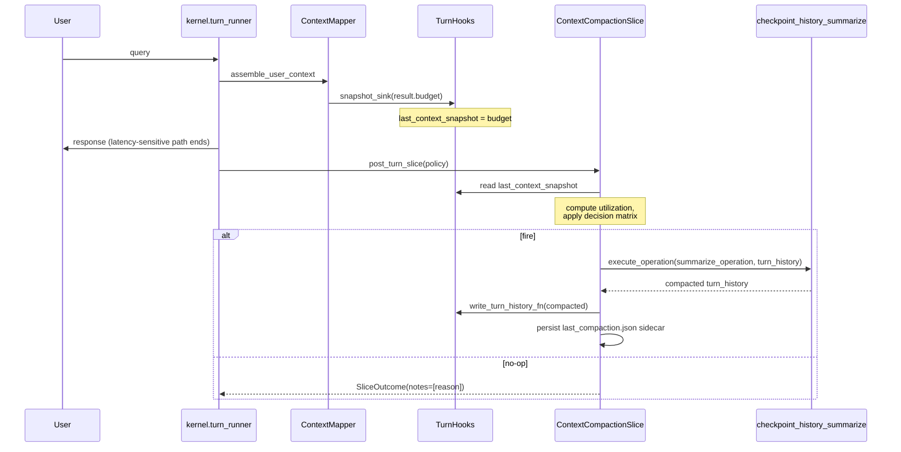

# Context Compaction Guide

Context compaction is the system that keeps long conversations from overflowing the model's context window. Lisa's compaction is **utilization-triggered**, **pressure-driven**, and **post-turn** — it runs *after* you've seen your answer, paid for by the idle time since the last house-keeping slice, not by adding latency to your turn.

This guide covers what the system does, how to enable and configure it, every knob, the slash commands, and how to observe what it's doing.

---

## Why this exists

Every long-running agent session eventually hits the model's context window. The question is *when* and *how* the framework responds:

| Strategy | Who does it | Lisa's take |
| --- | --- | --- |
| Fixed buffer + synchronous overflow compaction | LangChain, LlamaIndex | Pays latency on the user's turn; blind to actual utilization |
| Turn-count or stage-transition triggers | AutoGen, LangGraph, Lisa's own `CheckpointTuning` | Fires whether or not the context is actually full |
| Bespoke memory architecture with model-decided eviction | MemGPT/Letta | Heavy, not composable, spends a model round-trip on the user's turn |
| **Utilization + pressure curve, post-turn slice** | **Lisa (this pack)** | **Fires only when the context is actually filling, runs after the user has their answer, composable as a pack** |

Lisa already had every primitive — the slice pressure curve (`kernel/slice.py`), the `ContextBudgetSnapshot` (`kernel/context/models.py`), and the `checkpoint_history_summarize` operation — but they weren't wired together. The compaction pack is the wire.

---

## Conceptual model

Three ideas, in order of importance:

### 1. Utilization

Each turn, the context mapper computes a `ContextBudgetSnapshot` that carries:

- `model_context_window_tokens` — the model's full window size
- `conversation_tokens` — tokens already consumed by the live conversation
- `used_context_tokens` — tokens consumed by admitted context lanes (memory, retrieval, operational, etc.)

The compaction slice reads this snapshot and computes:

```text
utilization = (conversation_tokens + used_context_tokens) / model_context_window_tokens
```

A `utilization` of `0.75` means 75% of the model's window is spoken for. This is the signal that drives every decision.

### 2. The pressure curve (from `kernel/slice.py`)

The slice system's budget is **a function of how long it has been since the last slice finished**, not a fixed per-turn value. A user who idles for an hour and then runs one turn pays the deferred cost on that turn (clamped by a hard cap). A user hammering the REPL pays the minimum per turn.

The curve is monotonic and predictable from the knobs alone — there is no background scheduler, no cron, no wall-clock tick. The compaction slice *piggybacks* on this curve: when utilization is between the two thresholds, compaction only fires if the pressure-derived slice budget is large enough to actually run the LLM summarize call (the floor is 150ms). Idle user → big slice budget → compaction runs. Hammering user → tiny slice budget → compaction defers to a less-pressured turn.

### 3. Thresholds and the guardrail override

Two thresholds control when compaction fires:

- **`pressure_threshold`** (default `0.75`) — the "context is getting full" line. Between this and the hard threshold, compaction fires subject to the pressure curve and `min_interval_turns`.
- **`hard_threshold`** (default `0.90`) — the guardrail. At or above this, compaction fires **regardless** of the pressure curve or interval. The session is about to overflow; the guardrail overrides the "do it off-peak" preference. This is the one place the pressure curve is not authoritative.

The invariant `hard_threshold >= pressure_threshold` is enforced at session-plan compilation; an inverted pair fails with a validation error.

---

## Enabling compaction

Compaction is **off by default**. A host opts in by adding a `compaction` block under `context.history` in its `session_context.md`:

```yaml
context:
  history:
    recent_message_limit: 6
    digest_max_lines: 200
    digest_summary_max_chars: 240
    compaction:
      enabled: true
      pressure_threshold: 0.65
      hard_threshold: 0.85
      min_interval_turns: 3
      retention_count: 4
```

The `enabled: true` line is the master switch. Without it (or with `enabled: false`), the compaction slice is never wired and the host's existing deterministic thread compaction (`FileBackedStateProvider`) runs unchanged — no behavior change.

---

## Configuration reference

All keys live under `context.history.compaction` in the session manifest. The model is `kernel.session_plan.CompactionTuning` — a strict (`extra="forbid"`, frozen) Pydantic model. Unknown keys fail plan compilation.

| Key | Type | Default | Description |
| --- | --- | --- | --- |
| `enabled` | `bool` | `false` | Master switch. A host opts in by setting `true`. |
| `trigger` | `post_turn` \| `pre_turn` \| `explicit` \| `never` | `post_turn` | Which slice slot fires compaction. `post_turn` (default) runs after the user sees the response — zero latency cost to the user. |
| `pressure_threshold` | `float 0.0-1.0` | `0.75` | Utilization fraction at which compaction becomes eligible, subject to the pressure curve and `min_interval_turns`. |
| `hard_threshold` | `float 0.0-1.0` | `0.90` | Guardrail: fire regardless of pressure budget or interval when utilization reaches this fraction. Must be `>= pressure_threshold`. |
| `min_interval_turns` | `int >= 0` | `4` | Don't re-compact more often than every N turns. Ignored when the hard threshold overrides. |
| `retention_count` | `int >= 1` | `6` | Most-recent turns kept verbatim; older turns are summarized into one record. |
| `preferred_model_id` | `string` | `default` | Model ID used for the summarize operation. |
| `summarize_operation` | `string` | `checkpoint_history_summarize` | Operation ID invoked to compact. Override to `context_compact` for the utilization-aware prompt shipped by the compaction pack. |

### Choosing thresholds

- **Conservative (default)**: `pressure_threshold: 0.75`, `hard_threshold: 0.90`. Compaction is rare and off-peak. Good for short-to-medium sessions.
- **Aggressive**: `pressure_threshold: 0.50`, `hard_threshold: 0.75`. Compaction fires earlier and more often. Good for very long sessions on models with smaller windows.
- **Maximal**: `pressure_threshold: 0.30`, `hard_threshold: 0.50`, `min_interval_turns: 2`. Compaction keeps the window mostly empty. Good for bounded-context agentic loops.

The `retention_count` is the number of recent turns kept verbatim — the model needs these for short-term continuity. The default of 6 is sensible for chat; lower it to 3-4 for agentic loops where the summary carries the state.

---

## The decision matrix (when compaction fires)

Each turn, after the user has their answer, the compaction slice runs through this matrix:

```text
utilization = (conversation_tokens + used_context_tokens) / model_context_window_tokens

if utilization < pressure_threshold:
    no-op (most turns)

elif utilization >= hard_threshold:
    fire immediately (guardrail override)
    - ignores the pressure curve
    - ignores min_interval_turns

else:  # between thresholds
    if slice_budget_ms < 150:
        defer (not enough pressure to run the LLM call)
    elif turns_since_last_fire < min_interval_turns:
        defer (too soon since the last compaction)
    else:
        fire (piggyback on the pressure curve)
```

Every decision is recorded in the slice outcome's `notes` field so you can see *why* compaction did or didn't fire on a given turn (see Observability below).

---

## What happens when compaction fires

1. The slice loads the live turn history (the thread JSONL).
2. It splits the history into:
   - **old turns** — everything except the most-recent `retention_count`
   - **recent turns** — the most-recent `retention_count`, kept verbatim
3. It invokes the configured `summarize_operation` (default: `checkpoint_history_summarize`) with the old turns. The model returns a structured summary: a short `condensed_narrative` plus a list of `key_points`.
4. The pack writes back a new turn history: one summary record followed by the retained recent turns. The summary record carries `source: "checkpoint_history_summarize"` (or `"context_compact"` if you overrode the operation), the `summarized_turn_count`, the `summary`, and the `summary_bullets`.
5. A pack-local sidecar (`last_compaction.json`, beside the thread JSONL) records the turn counter and timestamp of the last successful fire, so `min_interval_turns` is honored across turns and across restarts.

The write-back uses the host's `write_turn_history_fn` seam. Failures in any step are caught — the slice returns a no-work `SliceOutcome` with a diagnostic note and never breaks the turn.

---

## Relationship to the existing deterministic compaction

Lisa's `FileBackedStateProvider` already runs a **deterministic, line-based** thread compaction on every post-turn slice: when the thread exceeds `max_thread_entries` lines, it moves the overflow into a `thread_digest.md` sidecar and truncates the JSONL. This is the **floor** — it never goes away.

The compaction pack **augments** this, it does not replace it:

| | Deterministic (`FileBackedStateProvider`) | Utilization-triggered (`lisa-pack-compaction`) |
| --- | --- | --- |
| Trigger | Line count exceeds `max_thread_entries` | Context-window utilization crosses threshold |
| Method | Truncate overflow into a digest sidecar | LLM-summarize old turns into one structured record |
| Runs | Every post-turn slice | Only when utilization warrants |
| Latency cost | ~0 (no LLM call) | One LLM call, paid out of the slice pressure budget |

Both run; their outcomes are merged in the post-turn slice. The deterministic compaction handles the raw line count; the utilization-triggered compaction handles the semantic window pressure. You do not need to disable one to use the other.

---

## Slash commands

The compaction pack registers two slash commands, discovered via the `lisa.extensions.host_commands` entry-point group.

### `/compact-now [prompt]`

Runs context compaction immediately, regardless of utilization or interval. Useful when you want to compact on demand — for example, before a long-running task that you know will fill the window.

- Loads the live turn history.
- Reads the current `ContextBudgetSnapshot` for utilization framing (the operation's prompt gets a "session is at N% utilization" line).
- Invokes the `context_compact` operation (the utilization-aware wrapper).
- Writes the compacted history back to the thread JSONL via the `write_turn_history_fn` seam (with a direct-JSONL fallback).
- Reports whether the result was persisted.

The optional `prompt` argument overrides the summarize prompt for this one invocation.

### `/compaction-status`

Reports the current state of the compaction system:

- The live `ContextBudgetSnapshot`: window size, used+conversation tokens, and utilization as a percentage.
- The last compaction fire: turn count, last-fired turn, last-fired timestamp (read from the `last_compaction.json` sidecar).

Use this to see whether compaction is likely to fire on the next turn and to verify your thresholds are tuned for your session.

### `/summarize-history [prompt]` (checkpoint pack, fixed)

The checkpoint pack's existing `/summarize-history` command is still available and now uses the same `write_turn_history_fn` seam. A pre-existing bug where it discarded the compacted history and never persisted it was fixed alongside this work; it now persists the result and reports `(persisted)` or `(write-back unavailable; result not persisted)`.

---

## Observability

Every compaction decision is visible in three places:

1. **Slice outcome notes.** The `SliceOutcome.notes` tuple carries the reason: `below_pressure_threshold(utilization=0.42)`, `deferred_low_slice_budget(budget_ms=120,utilization=0.78)`, `deferred_min_interval(turns_since_last=2,min_interval=4)`, `hard_threshold_override(utilization=0.92)`, `pressure_threshold(utilization=0.80)`, or `compacted:18->7` on a successful fire. These flow into the turn telemetry.
2. **The `last_compaction.json` sidecar.** Beside the thread JSONL. Holds `turn_count`, `last_fired_turn`, `last_fired_at`. Read it directly or via `/compaction-status`.
3. **The thread JSONL itself.** After a fire, the first record is a `source: "checkpoint_history_summarize"` (or `"context_compact"`) summary record with the `summarized_turn_count`, `summary`, and `summary_bullets`. The recent turns follow verbatim.

When compaction does not fire, the slice returns a no-work outcome with a note explaining why — you will never see a silent no-op.

---

## Troubleshooting

**Compaction never fires.**

- Run `/compaction-status`. If utilization is below `pressure_threshold`, that's expected.
- Check `enabled: true` is set in your `session_context.md` under `context.history.compaction`.
- Check the pack is installed: `uv sync` should list `lisa-pack-compaction`.
- Check the `summarize_operation` you configured (default `checkpoint_history_summarize`) is allowed in the active mode — see the operation's `mode_allowlist` in its `.yml`.

**Compaction fires too often.**

- Raise `pressure_threshold` (e.g. from `0.65` to `0.80`).
- Raise `min_interval_turns` (e.g. from `3` to `8`).
- The hard threshold overrides the interval, so also check `hard_threshold` isn't too low.

**Compaction fires too late / the window overflows.**

- Lower `pressure_threshold` so compaction starts earlier.
- Lower `hard_threshold` so the guardrail kicks in sooner.
- Lower `min_interval_turns` so re-compaction is allowed more often.
- Consider whether `retention_count` is too high — the model needs recent turns for continuity, but a high count leaves less room for the summary.

**`/compact-now` reports "write-back unavailable".**

- The host has not wired `write_turn_history_fn`. This should not happen for the standard CLI/web hosts (they wire it in `hosts/core/turn_hooks_builder.py`), but a custom host may need to add it. The compaction slice and `/summarize-history` both degrade to a no-op with a warning in this case.

**The summary is low quality.**

- The default `checkpoint_history_summarize` prompt is conservative. Override `summarize_operation` to `context_compact` to use the compaction pack's utilization-aware prompt, which tells the model to summarize "aggressively" when the session is near full.
- You can also pass a custom prompt to `/compact-now` for a one-off: `/compact-now Focus on the decisions and file paths; drop the pleasantries.`

---

## Architecture (for advanced users)

The compaction system is a thin wire over four existing primitives. Nothing new was invented; the work was connecting them.



### The seams (all additive, all default to no-op)

1. **`TurnHooks.last_context_snapshot`** (`kernel/turn_runner.py`) — the host stashes the mapper's `ContextBudgetSnapshot` here each turn via a `snapshot_sink` callback threaded through `hosts/core/context_assembly.py`. The slice reads it to compute utilization. Default `None` → slice no-ops with `no_context_snapshot`.
2. **`TurnHooks.write_turn_history_fn`** — host-owned write-back for the live thread JSONL. Default `None` → slice and `/summarize-history` no-op with a warning.
3. **`lisa.extensions.slice_providers` entry-point group** (`kernel/slice_provider_discovery.py`) — a pack's factory receives `(turn_hooks, session_plan)` and returns a slice provider or `None`. The host loader chains non-`None` providers ahead of `FileBackedStateProvider` in the trigger slot selected by `CompactionTuning.trigger`. A provider returns `None` when its tuning is disabled → no behavior change for that session.

### The decision matrix is pure policy

The pressure curve (`kernel/slice.py`) owns the *mechanism* — how much budget a slice gets. The compaction slice owns the *policy* — whether to spend that budget on compaction. The `hard_threshold` is the one place policy overrides mechanism (the guardrail). Everything else respects the pressure curve.

### Reuse, not fork

The pack defaults to reusing `checkpoint_history_summarize` as its `summarize_operation`. The compaction pack's own `context_compact` operation is a thin utilization-aware wrapper around the same model-call path and the same `HistorySummary` structured-output contract. One compaction primitive, two prompts, two triggers (manual `/summarize-history` and automatic via this pack). Override `summarize_operation` in the session plan only if you want the utilization-aware prompt.

### Sidecar, not `UnifiedState`

The `last_compaction_turn_count` counter lives in a pack-local sidecar (`last_compaction.json` beside the thread JSONL), not on `UnifiedState`. `UnifiedState` has no natural field for compaction metadata and is not pack-extensible. The sidecar mirrors the existing `thread_digest.md` pattern in `FileBackedStateProvider` — pack-local state stays pack-local.

---

## Summary

Context compaction is the system that lets Lisa run long sessions without overflowing the model's window, without paying latency on the user's turn, and without a bespoke memory architecture. It's a pack, configured in `session_context`, driven by actual context-window utilization, and paid for by the idle-time pressure curve. Enable it with one line (`enabled: true` under `context.history.compaction`), tune the thresholds to your session shape, and observe it with `/compaction-status`.
