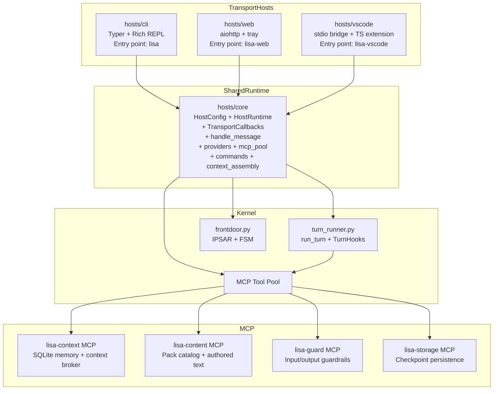

# Hosts Guide

The Lisa framework ships four host packages that all share a single transport-neutral runtime (`hosts/core`). Each host is a thin transport adapter — terminal, web, VS Code — that wires the same `HostRuntime` and calls the same `handle_message` dispatcher. The runtime never imports Rich, Typer, aiohttp, or any transport-specific code.

## Architecture



All three transport hosts import only from `hosts.core`. The kernel and SDK never import from any host. The transport boundary is enforced by the `TransportCallbacks` protocol — `hosts.core` calls `on_stage`, `on_text_chunk`, `on_response`, `on_debug_context`, and `on_error`; the transport host implements those methods to render in its native surface.

## Package Layout

| Package | Purpose | Entry point | Transport |
| --- | --- | --- | --- |
| `hosts/core` | Transport-neutral runtime: config, runtime state, provider dispatch, MCP pool, command dispatch, context assembly | — (library) | None |
| `hosts/cli` | Terminal REPL with Rich rendering | `lisa` | Rich + prompt_toolkit + Typer |
| `hosts/web` | Localhost web server with browser UI + system tray | `lisa-web` | aiohttp |
| `hosts/vscode` | VS Code Chat participant via stdio JSON-RPC bridge | `lisa-vscode` | VS Code extension API |

## Quick Start

### CLI (terminal REPL)

```powershell
uv sync --extra dev

# Interactive REPL
uv run lisa cli --debug

# Single-turn commands
uv run lisa once "/search recent Python packaging guidance"
uv run lisa once "/markdown Draft a short incident-review outline"
uv run lisa once "/deep Evaluate migration risks"
uv run lisa once "/discuss capability tradeoffs" --session-context system

# Environment and config
uv run lisa verify
uv run lisa modes
uv run lisa models
```

### Web (localhost browser)

```powershell
# Start the web server (opens a browser tab automatically)
uv run lisa-web desktop

# Custom host/port
uv run lisa-web desktop --host 0.0.0.0 --port 9000

# Without auto-opening a browser
uv run lisa-web desktop --no-open-browser
```

The server prints a URL with an auth token: `http://127.0.0.1:8765/?token=<generated-token>`. See `docs/WEB_HOST_GUIDE.md` for the full API reference.

### VS Code (Chat participant)

See `docs/VSCODE_HOST_GUIDE.md` for extension build and installation instructions. Once installed, type `@lisa` in the VS Code Chat view to start a turn.

## Core Runtime

### HostConfig

`HostConfig` is a frozen dataclass constructed once at startup from CLI args and env vars. It owns all resolved configuration — paths, timezone, log level, streaming mode, slice tuning, pack policy, surface identity.

```python
from hosts.core import HostConfig

config = HostConfig.from_env(debug=True, data_dir="/path/to/artifacts")
```

Environment variables use the `LISA_*` prefix (e.g. `LISA_TIMEZONE`, `LISA_LOG_LEVEL`, `LISA_DATA_DIR`). There are no legacy `LITTLE_LISA_*` aliases — the cutover is hard.

### HostRuntime

`HostRuntime` is the mutable runtime state. It owns cached provider clients, the model manifest cache, MCP pool handles, token counters, thread/log paths, and last-turn diagnostics. It has an async lifecycle that must run inside the host's real event loop:

```python
from hosts.core import HostConfig, HostRuntime

config = HostConfig.from_env()
runtime = HostRuntime(config)

await runtime.start()        # starts MCP pool in host's event loop
result = await handle_message(runtime, "/search test")
await runtime.aclose()       # closes MCP pool in same loop
```

### TransportCallbacks

The `TransportCallbacks` protocol is the Option B seam — the runtime delivers turn events to the transport host through five methods:

| Method | When called | Purpose |
| --- | --- | --- |
| `on_stage(label, data)` | At pipeline stage transitions | Notify transport of frontdoor, model_call, tool_loop, post_turn, slice |
| `on_text_chunk(text)` | Per streamed token (when streaming enabled) | Deliver token-by-token text |
| `on_response(text, data)` | Once per successful turn | Deliver the final response text |
| `on_debug_context(context)` | When debug mode is active | Deliver structured turn context for diagnostics |
| `on_error(message, exc)` | On non-fatal turn errors | Deliver error info for transport rendering |

`NullTransport` absorbs all events silently (headless/test mode). `DelegatingTransport` fans out to multiple transports.

### handle_message

`handle_message(runtime, message, transport)` is the transport-neutral entry point all hosts call. It:

1. Dispatches host shortcut commands (`/help`, `/settings`, `/tokens`, `/debug`, `/consolidate`, `/checkpoint`, `/restore`, `/pack`, `/models`).
2. Routes natural-language turns through the front-door router.
3. Executes the mode turn via `kernel.turn_runner.run_turn`.
4. Persists thread entries and updates token counters.
5. Emits transport callbacks at each pipeline stage.

## Model Manifest

Model selection is intentionally small and explicit.

- Active manifest path: `<data-dir>/models.yaml`.
- Proposal manifest path: `<data-dir>/models.proposed.yaml`.
- Supported providers: `azure_openai`, `openai`, `anthropic`, `ollama`, `google`.
- Supported designations: `front-door`, `default`, `deep`, `reasoning`.

Model manifests are now generated and managed through host commands:

- `/models discover` probes configured providers and writes `models.proposed.yaml`.
- You can edit `models.proposed.yaml` manually to resolve non-obvious choices.
- `/models apply` validates and promotes the proposal to `models.yaml`.
- `/models reload` reloads `models.yaml` from disk.

Example manifest:

```yaml
version: 1
mode_models:
  default: gpt-chat-latest
  discuss: gpt-5.4
  markdown: gpt-5.4-mini
  search: gpt-5.4-pro
models:
  - model_id: gpt-chat-latest
    provider: azure_openai
    designations: [front-door, default]

  - model_id: gemma4:latest
    provider: ollama
    designations: [deep]

  - model_id: gpt-5.4
    provider: azure_openai
    reasoning_model: true
```

## Provider Configuration

Set credentials in PowerShell before running live completions:

```powershell
$env:LISA_AZURE_OPENAI_ENDPOINT = "https://<resource>.openai.azure.com/"
$env:LISA_AZURE_OPENAI_API_KEY = "<azure-openai-key>"
$env:LISA_AZURE_OPENAI_API_VERSION = "2024-10-21"
$env:LISA_OPENAI_API_KEY = "<openai-key>"           # only needed for provider: openai
$env:LISA_ANTHROPIC_API_KEY = "<anthropic-key>"     # only needed for provider: anthropic
$env:LISA_OLLAMA_HOST = "127.0.0.1:11434"          # only needed for provider: ollama
$env:LISA_TIMEZONE = "America/New_York"             # optional: IANA timezone
$env:LISA_LOG_LEVEL = "info"                        # optional: debug|info|warning|error
```

Fallback env vars are also supported: `AZURE_OPENAI_ENDPOINT`, `AZURE_OPENAI_API_KEY`, `OPENAI_API_KEY`, `ANTHROPIC_API_KEY`, and `OLLAMA_HOST`.

> **Azure AI Foundry / AI Services endpoint:** Use the **resource root** URL (e.g. `https://<resource>.services.ai.azure.com`), **not** the Foundry project path (`/api/projects/<project>`). The OpenAI SDK appends `/openai/deployments/<model>/chat/completions?api-version=...` to the endpoint — including the project path causes `API version not supported` errors.

## CLI Flags

All hosts share the same runtime flags via `HostConfig.from_env()`:

| Flag | Env var | Default | Purpose |
| --- | --- | --- | --- |
| `--debug` | — | `false` | Print turn context above each response |
| `--log-level` | `LISA_LOG_LEVEL` | `info` | JSONL log threshold |
| `--log` | — | — | Append JSONL turn logs to this file |
| `--no-log` | — | `false` | Suppress turn logging |
| `--data-dir` | `LISA_DATA_DIR` | `~/.lisa` | Data root for artifacts, memory, logs |
| `--memory-db` | `LISA_MEMORY_DB` | `<data-dir>/memory.json` | Memory database file |
| `--thread-dir` | `LISA_THREAD_DIR` | `<data-dir>/threads` | Thread log directory |
| `--no-thread` | — | `false` | Disable thread persistence |
| `--timezone` | `LISA_TIMEZONE` | system-local | IANA timezone |
| `--session-context` | — | — | Session context slug or path |
| `--state-snapshot` | — | — | JSON snapshot file for context injection |
| `--streaming` | — | `none` | Streaming mode: none, stage, text, hybrid |

### Remote Session Context

The `--session-context` flag supports loading authored contexts from multiple shapes:

1. **Local Files & Slugs**: Literal path to an `.md` file or directory, or a slug (searches `user_contexts/` local packs or cwd discovery).
2. **Remote Registry**: A slug name not found locally will automatically attempt to fetch from the remote registry at `https://raw.githubusercontent.com/lisa-framework/sessions/main`.
3. **Exact URL**: `--session-context https://raw.githubusercontent.com/.../foo.md` will download and activate the specific context file.

**Remote specific config:**
- **Refresh**: Re-fetching a remote context uses a conditional-GET at startup. To force a refresh, use `--session-context-refresh`. There are no background update cron tasks.
- **Trust Policy**: Remote fetching uses an allowlist. You can configure allowable hosts via `LISA_SESSION_CONTEXT_ALLOWED_HOSTS` (default `github.com, raw.githubusercontent.com`). HTTP is explicitly blocked unless `LISA_SESSION_CONTEXT_ALLOW_HTTP=1`.
- **Private repos**: Pass an auth token via `LISA_SESSION_CONTEXT_TOKEN` or provide raw headers via `LISA_SESSION_CONTEXT_AUTH_HEADER`.
- **Caching**: Files are cached under `<data-dir>/session_context_cache/` for future conditional-GET headers.

---

## Commands

All commands are handled by `hosts/core/commands.py` and produce plain text (not rendered panels). Transport hosts render the output:

| Command | Purpose |
| --- | --- |
| `/help` | Show capability-accurate help from the live workflow catalog |
| `/help capabilities` | Show runtime capability snapshot |
| `/settings` | Show effective runtime settings |
| `/tokens` | Show token usage breakdown by model, mode, and stage |
| `/debug context` | Show last assembled prompt sections |
| `/debug frontdoor` | Show front-door routing diagnostics |
| `/debug capabilities` | Show full capability snapshot JSON |
| `/debug self` | Show compact self-model summary |
| `/consolidate` | Run explicit slice (thread/memory compaction) |
| `/checkpoint [label]` | Create an enriched checkpoint (pack-registered) |
| `/restore <id>` | Restore state from a checkpoint (pack-registered) |
| `/checkpoints` | List all saved checkpoints (pack-registered) |
| `/summarize-history [prompt]` | Condense older turns into a summary (pack-registered) |
| `/pack list` | List discovered packs and activation state |
| `/pack enable <name>` | Enable a pack (restart required) |
| `/pack disable <name>` | Disable a pack (restart required) |
| `/pack install <spec>` | Install a pack from package, git, or local folder |
| `/pack uninstall <name>` | Uninstall a pack |
| `/models show` | Show active model manifest from `<data-dir>/models.yaml` |
| `/models discover` | Probe providers and write `<data-dir>/models.proposed.yaml` |
| `/models apply` | Validate and promote proposal manifest |
| `/models reload` | Reload active manifest from disk |
| `/deep <query>` | Route through the deep-designated model |
| `/quit` | Exit (transport-owned) |

## MCP Memory

Memory is capability-owned by policy. The bundled learning pack provides the `lisa_memory` fallback in `sdk/packs/learning/mcp_servers.yaml`; external providers (for example `lisa-pack-mem0`) can be installed and selected as the memory owner via host policy/lock state. The host wires generic `memory.*` aliases to the selected provider's backend config.

## Session Context Front Matter

A `session_context.md` file (or `session_context/` directory) in the project root or data directory is auto-discovered at startup. The file's YAML front matter can declare runtime controls that override the host's defaults:

```yaml
---
name: my-session
surface:
  type: personal_dm
  id: host-console
  memory_scope: personal
start_mode: default
applies_to:
  - default
  - discuss
packs:
  lisa-pack-search:
    enabled: true
  lisa-pack-mem0:
    enabled: false
policy:
  always_on_packs:
    - lisa-pack-core
    - lisa-pack-learning
  exclude_servers:
    - lisa-pack-mem0.memory
  preferred_capability_providers:
    memory: lisa-pack-learning
---
```

| Key | Type | Effect | Scope |
| --- | --- | --- | --- |
| `name` | `str` | Thread file name + status display | Per-turn |
| `applies_to` | `list[str]` | Mode filter — file only loads when current mode is in the list | Per-turn |
| `surface.type` | `str` | Overrides `surface_type` for tool/guard/token identity | Per-turn |
| `surface.id` | `str` | Overrides `surface_id` | Per-turn |
| `surface.memory_scope` | `str` | Overrides `memory_scope` for tool/guard identity | Per-turn |
| `start_mode` | `str` | Initial mode; **bypasses front-door routing** entirely | Startup |
| `packs.<name>.enabled` | `bool` | `false` disables the pack for this runtime | Startup |
| `policy.always_on_packs` | `list[str]` | Packs that cannot be disabled | Startup |
| `policy.exclude_servers` | `list[str]` | Pack MCP server IDs to suppress | Startup |
| `policy.preferred_capability_providers` | `map[str,str]` | Capability → pack ownership preference | Startup |

Precedence: session-context front matter > CLI/env > defaults. Flat top-level `surface_type`/`surface_id`/`memory_scope` keys are accepted as a convenience when no `surface` block is present.

When `start_mode` is set, the runtime seeds `current_mode_id` to that mode and `_route_model_turn` skips the front-door planner entirely. An explicit `/mode` command overrides `start_mode` for the remainder of the session.

## Building a New Host

A new host (e.g. Slack, Microsoft Teams, custom web app) follows this pattern:

1. Create `hosts/<name>/` with a `pyproject.toml` depending on `lisa-host-core`.
2. Build a `HostConfig.from_env(...)` from the host's config source.
3. Construct a `HostRuntime(config)`.
4. Call `hosts.core.mcp_pool.setup_framework(runtime)` and `compile_mcp_configs(runtime)`.
5. Implement `TransportCallbacks` for the host's native surface.
6. Call `await runtime.start()` inside the host's event loop.
7. Call `hosts.core.handle_message(runtime, message, transport)` per turn.
8. Call `await runtime.aclose()` at shutdown.

The runtime handles routing, model execution, MCP tools, memory, commands, and thread persistence. The host only owns config construction and output rendering.
