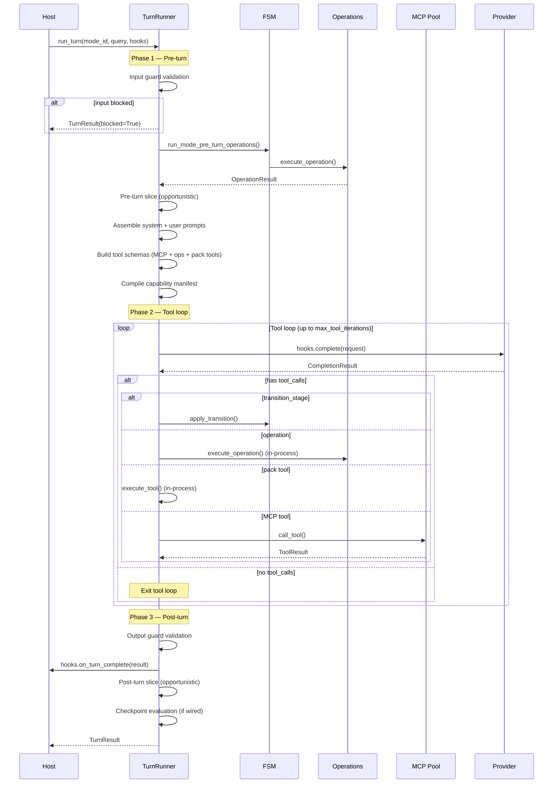
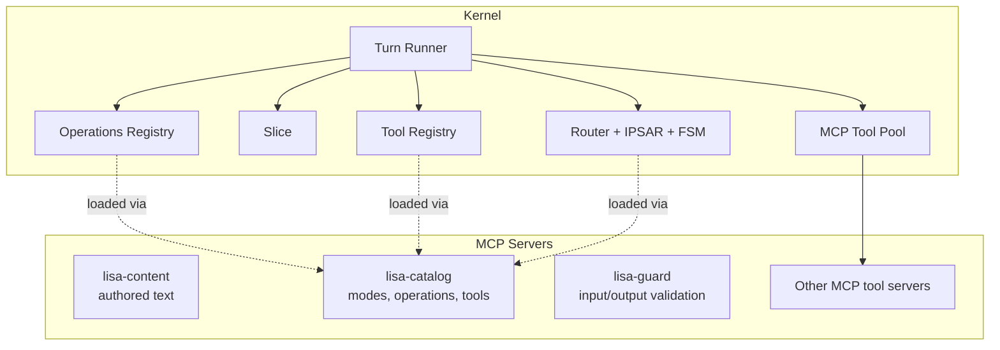
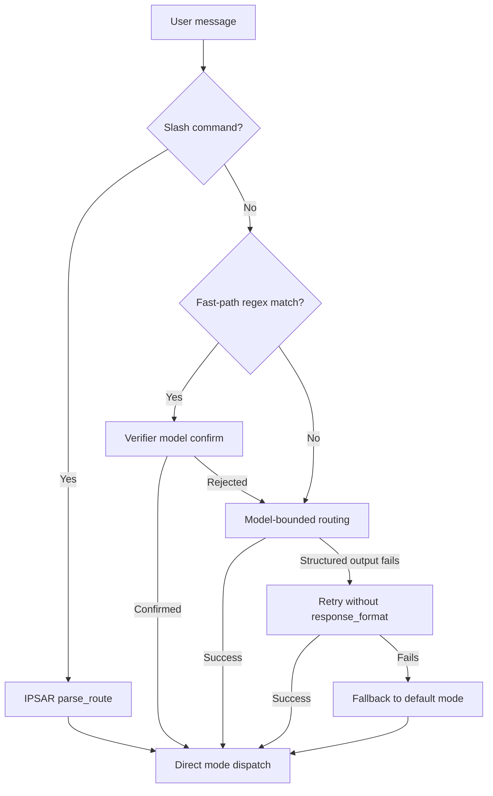
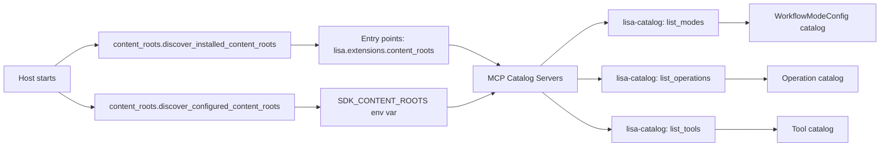

# Kernel Architecture

`lisa-kernel` is the runtime-neutral engine at the center of the Lisa Framework.

## Design Philosophy

The kernel is **runtime-neutral** by design. It owns all contracts, abstractions, and core built-ins. It imports nothing from host apps, SDK extensions, or private packages. Hosts inject concrete implementations through protocols and callbacks.

Key principles:

- **Contracts over implementations**: The kernel defines Pydantic models, protocols, and dataclasses. Hosts provide the concrete wiring (model completion, tool execution, MCP backend policy). Packs provide behavior such as memory recall and synthesis workflows.
- **No compat or migration layers**: When a pattern changes, old code goes away. No shim layers, no dual-path code.
- **Externalize aggressively**: Defaults minimally; configurability is essential. If a feature requires host-specific logic, it should be a callback or protocol seam, not an `if` statement in the kernel code.

## Module Map

### Core Engine

| Module | Responsibility |
| --- | --- |
| `turn_runner.py` | The single model+tool loop shared by all hosts. Executes pre-turn → tool loop → post-turn phases. Hosts wire behavior through `TurnHooks` and `ContextSeams`. |
| `router.py` | Shared routing engine. Chooses which mode owns a natural-language turn using fast-path regex → verifier model → model-bounded routing fallback. |
| `ipsar.py` | IPSAR route resolution. Detects which user-facing mode a slash-command or pattern-matched message targets. |
| `ipsar_fsm.py` | Workflow FSM loader and runtime. Loads mode definitions from the `lisa-catalog` MCP server (never touches the filesystem directly). Validates stage transitions, provides operation lifecycle hooks, and parses front-matter from instruction markdown. |
| `slice.py` | Opportunistic house-keeping system. Budget is `base + max_deferred * (1 - 0.5^(gap/half_life))`, clamped to `hard_cap_ms`. |

### Contracts & Models

| Module | Responsibility |
| --- | --- |
| `models.py` | All runtime-neutral Pydantic contracts: surface context, route decisions, operation/tool execution, workflow FSM, workshop fan-out, memory, unified state, context evidence, anomaly alerts, capability manifest, introspection snapshots, token usage events, call ledger, and approval contracts. |
| `provider_core.py` | Provider gateway abstractions: `AzureOpenAIGateway`, `AnthropicGateway`, `GoogleGeminiGateway`, `BedrockGateway`, `OpenAICompatibleGateway`, completion/embedding request/result dataclasses, streaming support, message normalization, and usage extraction. |
| `extension_runtime.py` | Minimal extension runtime surface (stripped down 2026-07-11): `ExtensionRuntimeContext` for host services injection, `ExtensionAnomalyDetector` callable shape, and `ExtensionContextEvidenceBuilder` callable shape. The bottom half is now `kernel.intake.contracts.ProcessingLoop`. |

### Discovery & Configuration

| Module | Responsibility |
| --- | --- |
| `content_roots.py` | Discovers pack and extension roots from `lisa.extensions.content_roots` entry points and `SDK_CONTENT_ROOTS` env var. Supports pack exclusion via `excluded_packs`. |
| `model_manifest.py` | Loads and validates model manifests (YAML/JSON). Resolves models by key, model_id, alias, or display_alias. Supports per-mode model overrides via `mode_models`. |
| `config.py` | Kernel-owned settings: `sdk_content_roots`, `workspace_id_fallback`, and workshop budget parameters. Loads from environment with unknown-key filtering. |
| `pack_activation.py` | Shared helpers for reading disabled-pack state from `installed-packs.json` and `LISA_DISABLED_PACKS` env var. Used by all entry-point discovery mechanisms. |
| `pack_configuration.py` | Immutable, pack-scoped configuration resolved from a session plan. `SessionPackConfigurationResolver` freezes configuration at construction time. |
| `session_plan.py` | Strict session-manifest contracts (`SessionManifestV2`) and deterministic plan compilation. Defines `SessionPlan`, `PackSelection`, `ResourceSelection`, `ContextPlan`, and related models. |

### Built-in Capabilities

| Module | Responsibility |
| --- | --- |
| `tools/mcp_client.py` | MCP tool-pool/client transport for stdio and HTTP servers. `MCPToolPool` manages subprocess lifecycle (spawn, health check, restart, graceful shutdown). Supports warm (long-lived) and cold (per-turn) pools, synthetic tools, and namespaced tool names. |
| `tools/registry.py` | In-process tool registry. Tools are discovered from packs via the `lisa-catalog` MCP server and dispatched in-process through imported implementation modules. |
| `tools/schema_translator.py` | Translates MCP tool schemas to/from provider-specific formats (OpenAI function-calling, Anthropic tool-use). |
| `tools/synthetic.py` | Synthetic tool builders for host-owned aliases. `mcp_alias_tool` creates well-known names (e.g. `memory.search`) that redirect to MCP server tools with optional argument/result mapping. |
| `openai_function_tools.py` | OpenAI function-tool schema builder with strict-mode support. |
| `state_providers.py` | `BlankStateProvider` for hosts that don't need state or opportunistic house-keeping. |
| `telemetry.py` | OpenTelemetry span helpers. |
| `token_usage.py` | Durable token-usage telemetry: `TokenUsageTelemetryHandler` appends events as JSONL, plus coercion helpers. |
| `approval.py` | Exact-action approval contracts. `ApprovalInvocation`, `ApprovalReceipt`, `ApprovalService` protocol, `InMemoryApprovalService`, digest construction, and receipt validation. |
| `capability_manifest.py` | Dynamic capability manifest compiler. Cross-references live tool schemas against operation/tool catalogs to produce a deterministic `CapabilityManifest` for the current turn. |
| `code_artifacts.py` | Pack-neutral artifacts for approved local code changes. `CodeChangeArtifact`, `CodeChangeArtifactStore` protocol, and `CodeCheckRecord`. |
| `host_commands.py` | Protocol for pack-registered host command handlers. `HostCommandHandler`, `HostCommandSpec`, and `PackCommandEntry`. |
| `host_command_discovery.py` | Discovery for pack-registered host commands via `lisa.extensions.host_commands` entry points. |
| `introspect.py` | Live Python-level introspection for Lisa's self-model. Gathers process memory, asyncio tasks, thread count, MCP pool health, token usage trends, and log errors. |

### Subpackages

| Subpackage | Responsibility |
| --- | --- |
| `operations/` | Operation registry for discovering and executing operations from packs via the `lisa-catalog` MCP server. Includes `registry.py` (discovery, execution, tool-schema building), `declarative.py` (prompt-authored operations runtime), and `structured_output.py` (JSON parsing with retry). |
| `intake/` | External data collection contracts: `SignalCollector` (stateless, repeatable monitors), `ProcessingLoop` (background processing chains triggered after collection), and `connector_discovery.py` (entry-point discovery). The bottom half is a one-shot process triggered by a systemd timer or cron. |
| `seams/` | Host-injection protocols: `StateProvider`, `InputGuard`, `OutputGuard`, `ContentRegistry`, `ModelPolicy`, `ProviderGatewayProvider`, `EventBus`, `DataSanitizer`, `ExtensionEvidenceBuilder`, plus `CompleteFn`, `ResolveModelFn`, `ExecuteToolFn`, and `ExecuteOperationFn` callable protocols. |
| `context/` | Public default implementations of kernel context seams and in-process context assembly: `MCPContentRegistry`, `MCPModeCatalog`/`MCPOperationCatalog`/`MCPToolCatalog`, `MCPInputGuard`/`MCPOutputGuard`, `ManifestModelPolicy`, `KernelProviderGatewayProvider`, `InProcessEventBus`, `PassThroughSanitizer`, `NoOpExtensionEvidenceBuilder`, `PassThroughInputGuard`/`PassThroughOutputGuard`, plus `context_broker.py` (query-aware brokerage over `UnifiedState`), `context_budget.py` (token budget allocation), `context_frames.py` (authored context-frame helpers), `context_mapper.py` (deterministic candidate mapping and selection), `context_models.py` (immutable mapper contracts), and `provenance.py` (XML-tagged context envelopes). |
| `mcp_launch/` | MCP launch contract: `policy.py` (approved server specs, `EnvPolicy`, `CwdPolicy`, `ToolPolicy`, `ProxyPolicy`, `MCPServerRegistry`), `compiler.py` (runtime adapter compiling specs into `MCPClientConfig`), `tool_filter.py` (allow/deny filtering), and `server_manifest.py` (declarative YAML manifest loader for external MCP servers and memory backends). |
| `testing/` | `extension_harness.py` for validating signal collectors without a host app, `endpoint_registry.py`, `import_boundaries.py`, and `stubs.py`. |

## Turn Execution Flow

A turn through the kernel follows this path:



### Turn Phases in Detail

**Phase 1 — Pre-turn:**

1. **Input guard**: `ContextSeams.input_guard.validate()` runs before anything else. A block short-circuits the turn.
2. **Action mode fast path**: If the mode is an action mode with entry operations, those run immediately and the turn returns.
3. **Pre-turn operations**: `run_mode_pre_turn_operations()` executes mode-bound pre-turn operations.
4. **Pre-turn slice**: Opportunistic house-keeping fires (bounded by the pressure curve).
5. **Prompt assembly**: System prompt is assembled from mode instruction + optional stage instruction. Tool schemas are built from MCP-discovered tools, in-process operations, and pack-contributed tools. A capability manifest is compiled from the live tool surface.
6. **User context**: `assemble_user_context` injects host-specific context (surface blocks, memory recall, self-model, etc.).

**Phase 2 — Tool loop:**

1. Model completion via `hooks.complete` (or `hooks.complete_stream` for streaming).
2. Tool calls are dispatched by kind: `transition_stage` → FSM transition, operation → in-process `execute_operation`, pack tool → in-process `execute_tool`, everything else → MCP pool.
3. A `CallLedger` enforces per-target `max_calls_per_turn` uniformly across all dispatch branches.
4. A `TurnBudget` (when set) enforces tool call, token, and wall-time limits.
5. Stuck-session guard: after 4 turns in the same stage, a nudge is injected; after 6, tools are stripped to force a final response.
6. Per-iteration model selection: when the host wires `ModelPolicy.choose`, the loop can switch models mid-turn.

**Phase 3 — Post-turn:**

1. **Output guard**: `ContextSeams.output_guard.validate()` runs. Blocked outputs are replaced with a safe fallback and a `guardrail.audit` event is published.
2. **`on_turn_complete`**: Host persists the turn (thread history, conversation digest, provenance).
3. **Post-turn slice**: Opportunistic house-keeping fires (skipped if output was blocked).
4. **Checkpoint evaluation**: Turn-anchored (not wall-clock). Fires on stage transitions or every-N-turns boundaries when the host has wired checkpointing.

## TurnHooks

`TurnHooks` is a dataclass that hosts populate with callbacks. Every hook is optional — hosts wire only what they need. The kernel provides sensible defaults for all hooks.

### Model Resolution & Completion

| Hook | Purpose |
| --- | --- |
| `resolve_model` | Resolve a model alias to a model definition. Default: stub with `model_id="default"`. |
| `complete` | Execute a model completion. **Required** — raises `NotImplementedError` if not wired. |
| `complete_stream` | Streaming completion (async generator yielding `StreamedChunk`). v1 streams tokens only; tool-call streaming deferred to v2. |

### Prompt Assembly

| Hook | Purpose |
| --- | --- |
| `assemble_system_prompt` | Build the system prompt from mode instruction + optional stage instruction. Default: mode instruction only. |
| `assemble_user_context` | Build user-specific context injected before the query. Receives the live `CapabilityManifest`. Default: empty string. |

### MCP Tool Infrastructure

| Hook | Purpose |
| --- | --- |
| `mcp_tool_servers` | List of `MCPClientConfig` for per-turn (cold) MCP servers. Default: empty list. |
| `mcp_tool_pool` | Optional host-owned long-lived `MCPToolPool` for warm servers. When set, reused across turns. |

### Operation & Tool Dispatch

| Hook | Purpose |
| --- | --- |
| `execute_operation` | Execute a named operation. Default: delegates to `kernel.operations.registry.execute_operation`. |

### Post-Turn

| Hook | Purpose |
| --- | --- |
| `on_turn_complete` | Called after every successful turn with `(mode_id, query, response_text, messages)`. Default: no-op. |

### Opportunistic House-Keeping (Slice)

| Hook | Purpose |
| --- | --- |
| `slice_tuning` | `SliceTuning` instance controlling budget shape and trigger modes. |
| `pre_turn_slice` | Slice fired before the model call. |
| `post_turn_slice` | Slice fired after the response is committed. |
| `explicit_slice` | Slice fired only when explicitly requested. |
| `last_slice_finished_at` | Monotonic timestamp of the last completed slice. |

### Workflow FSM

| Hook | Purpose |
| --- | --- |
| `workflow_session` | Returns the current `WorkflowSessionState` for the active user/mode. Required for workflow FSM stages to be injected into prompts. |
| `workflow_session_updater` | Persists an updated `WorkflowSessionState` after a `transition_stage` call. |
| `workflow_turn_runner` | Callable for workshop child-workflow execution. |
| `workflow_session_factory` | Creates isolated child workflow sessions for workshop fan-out. |

### Host State & Services

| Hook | Purpose |
| --- | --- |
| `state_provider` | Returns a `UnifiedState` for the current host session. |
| `pack_configuration_resolver` | Session-owned resolver for immutable pack configuration. |
| `approval_service` | Host-owned persistence for exact-action approval. |
| `code_change_artifact_store` | Host-owned store for coding workflow artifacts. |
| `build_workshop_context_bundle_fn` | Builds a `WorkshopContextBundle` from a plan and state. |
| `introspect` | Returns an `IntrospectSnapshot` from the host's live runtime. |

### Checkpoints

| Hook | Purpose |
| --- | --- |
| `checkpoint_tuning` | `CheckpointTuning` controlling automatic checkpoint creation. Default: disabled. |
| `on_checkpoint` | Called with a `CheckpointBundle` after a qualifying turn. Host persists it. |

### Identity Fields

`TurnHooks` also carries ambient identity fields: `workspace_id`, `user_id`, `user_slug`, `user_name`, `principal_key`, `conversation_id`, `surface_type`, `surface_id`, `memory_scope`, and `session_plan_digest`.

## ContextSeams

`ContextSeams` is a dataclass bundled inside `TurnHooks` that inverts the private `app.*` dependencies the kernel previously took. Every seam has a public default implementation shipped under `kernel.context`; production hosts override any of them.

| Seam | Protocol | Default | Purpose |
| --- | --- | --- | --- |
| `content_registry` | `ContentRegistry` | `MCPContentRegistry` | Load authored text assets from content roots via `lisa-content` MCP server. |
| `model_policy` | `ModelPolicy` | `ManifestModelPolicy` | Resolve model aliases and check availability from a model manifest. |
| `provider_gateways` | `ProviderGatewayProvider` | `KernelProviderGatewayProvider` | Return provider gateway classes by name. |
| `event_bus` | `EventBus` | `InProcessEventBus` | Lightweight pub/sub for salience events and guardrail audits. |
| `data_sanitizer` | `DataSanitizer` | `PassThroughSanitizer` | Apply redaction before memory writes or context assembly. |
| `extension_evidence_builder` | `ExtensionEvidenceBuilder` | `NoOpExtensionEvidenceBuilder` | Build context evidence records from installed extensions. |
| `input_guard` | `InputGuard` | `PassThroughInputGuard` | Validate user input before the model call (Phase 1). |
| `output_guard` | `OutputGuard` | `PassThroughOutputGuard` | Validate model output before it reaches the user (Phase 3). |

### Guardrails

The kernel defines two guardrail seams. Both default to pass-through so public hosts run without a private safety pipeline. MCP-backed implementations (`MCPInputGuard`, `MCPOutputGuard`) are also available, delegating to a `lisa-guard` MCP server.

A `GuardResult` carries `allowed: bool`, an optional `blocked_reason`, an optional `sanitized_text` (for rewriting input/output in place), and `annotations` for provider-specific metadata.

- **Input block**: the turn short-circuits with `TurnResult(blocked=True)` and the `blocked_reason` as the response text. The model is never called and the pre-turn slice does not fire.
- **Output block**: the response is replaced with a safe fallback, a `guardrail.audit` event is published on the `EventBus`, and the post-turn slice is skipped. `on_turn_complete` still fires with the safe-fallback text.
- **Sanitization**: when `sanitized_text` is set, the original text is replaced in place for the remainder of the turn.

Enterprise implementations (Azure AI Content Safety, AWS Bedrock Guardrails, Cloudflare AI Gateway, Presidio PII redaction, custom regex) are host-owned; the kernel only defines the contract and the insertion points.

## MCP-Native Architecture

The kernel is MCP-native for content loading and external tool execution. Content (modes, operations, tools, authored text) is loaded through `lisa-content` and `lisa-catalog` MCP servers. External tools run through MCP servers managed by `MCPToolPool`. The kernel never touches the filesystem directly for content discovery.

In-process dispatch is used for operations and pack-contributed tools — these are discovered via MCP but executed in-process for performance and to give them access to host callbacks.



### Content Loading

All content access is mediated through MCP servers:

- **`lisa-content`**: Handles `read_authored_text` and `invalidate_cache`. Used by `MCPContentRegistry`.
- **`lisa-catalog`**: Handles `list_modes`, `list_operations`, and `list_tools`. Used by `MCPModeCatalog`, `MCPOperationCatalog`, and `MCPToolCatalog`.

The kernel imports implementation modules locally using `module_path` fields from catalog responses — the MCP server does the filesystem scanning; the kernel does the Python import.

### Tool Dispatch

Tools are dispatched through three paths, tried in order:

1. **`transition_stage`**: Intercepted by the turn loop for FSM transitions.
2. **Operation catalog**: Dispatched in-process via `hooks.execute_operation`.
3. **Tool catalog**: Dispatched in-process via `tools.registry.execute_tool` if the tool has an `implementation_module`; otherwise falls through to MCP.
4. **MCP pool**: Everything else goes through `pool.call_tool`.

Synthetic tools (host-owned aliases like `memory.search`) are registered on the pool and dispatch to MCP server tools with optional argument/result mapping.

## Route Resolution

For natural-language turns (non-slash-commands), the host first resolves the mode through the router:



## The Slice System

The slice system (`slice.py`) is the kernel's approach to background work. Instead of cron or wall-clock timers, it uses a **pressure model**: the longer it has been since the last slice finished, the more budget the next slice gets.

```plaintext
budget_ms = base_budget_ms + max_deferred_ms * (1 - 0.5^(gap_seconds / pressure_half_life_seconds))
```

The budget is clamped to `hard_cap_ms`. The policy is split between pre-turn and post-turn shares (default: 30% pre-turn, 70% post-turn).

Slice modes:

- `NEVER`: slicing is disabled
- `PRE_TURN`: run before each turn
- `POST_TURN`: run after each turn
- `EXPLICIT`: run only when explicitly requested

This pattern is the canonical approach for all opportunistic house-keeping: reindex, eviction, sync, compaction. Heartbeat-driven jobs (wall-clock bound) stay on traditional schedulers.

## Pack and Extension Discovery



Extensions are discovered through their own entry-point groups:

- `lisa.extensions.signal_connectors` — signal collectors for the bottom half
- `lisa.extensions.processing_loops` — background processing chains
- `lisa.extensions.host_commands` — pack-registered slash commands

All discovery mechanisms respect the disabled-pack exclusion set from `pack_activation.py`.

## Bottom Half: Intake & Processing

The bottom half is a one-shot process (`little-lisa bottom --tick`) triggered by a systemd timer or cron — no long-running threads.

1. **Signal Collectors** (`intake/connectors.py`): Stateless, repeatable monitors for external systems (Cloudflare, GitHub, Stripe, etc.). Each returns a typed Pydantic snapshot.
2. **Processing Loops** (`intake/contracts.py`): Background processing chains triggered after collection. Produce `ProcessedState` that gets merged into `UnifiedState`.
3. **State Store** (host-owned): Where processed results land. The top half (turn loop) reads from here via `hooks.state_provider`.

## Host Responsibilities

A real host must inject concrete implementations for these seams:

| Seam | Kernel contract | Example |
| --- | --- | --- |
| Model completion | `TurnHooks.complete` | Azure OpenAI, OpenAI, Anthropic, Ollama |
| Model resolution | `TurnHooks.resolve_model` | Manifest-based or database-backed |
| Tool execution | MCP tool servers | Web search, surf, custom tools |
| Operation execution | `TurnHooks.execute_operation` | `operations.registry.execute_operation` |
| Memory | MCP memory server with synthetic aliases | SQLite-backed MCP store, Mem0 |
| Input guard | `ContextSeams.input_guard` | `PassThroughInputGuard` (default), `MCPInputGuard`, Azure AI Content Safety, Bedrock Guardrails |
| Output guard | `ContextSeams.output_guard` | `PassThroughOutputGuard` (default), `MCPOutputGuard`, Azure AI Content Safety, Bedrock Guardrails, Presidio |
| Content registry | `ContextSeams.content_registry` | `MCPContentRegistry` (default) |
| Model policy | `ContextSeams.model_policy` | `ManifestModelPolicy` (default) |
| Provider gateways | `ContextSeams.provider_gateways` | `KernelProviderGatewayProvider` (default) |
| Event bus | `ContextSeams.event_bus` | `InProcessEventBus` (default) |
| Data sanitizer | `ContextSeams.data_sanitizer` | `PassThroughSanitizer` (default) |
| Transport adapter | Host-owned | Teams, Slack, WebSocket, console |
| Scheduler | Host-owned | For signal connector polling and heartbeat jobs |

The shared host runtime (`hosts/core`) is the reference host. It wires a minimal subset of these seams for local development and pack authoring, shared by the CLI, web, and VS Code transport hosts.

## Privacy Model

The kernel models privacy explicitly in its contracts:

- `SurfaceContext` carries `surface_type`, `surface_id`, and `memory_scope`.
- Memory writes and recalls are scoped by the active surface and memory scope.
- Shared surfaces must not receive personal context unless a host implements explicit, audited sharing semantics.
- Proactive delivery targets are host-owned and must be explicit.

Prompt wording is not a privacy control. Hosts must enforce scope in storage keys, retrieval filters, and delivery routing.

## Testing

The kernel ships with:

- `kernel/tests/`: unit tests for contracts, FSM validation, route parsing, slice math, provider gateways, MCP adapters, guardrails, streaming, and turn runner behavior.
- `kernel/testing/extension_harness.py`: public harness for validating signal collectors without a host app.
- `kernel/testing/import_boundaries.py`: import-boundary test shared across all packages.

Import-boundary tests across all packages (`sdk/tests/test_import_boundaries.py`, extension `tests/test_import_boundaries.py`) enforce that public packages never import private app modules.

## Further Reading

- [BOUNDARIES.md](BOUNDARIES.md) — public/private boundary definition
- [PACK_AUTHORING_GUIDE.md](PACK_AUTHORING_GUIDE.md) — how to create modes, operations, content packs, signal connectors, and processing loops
- [HOSTS_GUIDE.md](HOSTS_GUIDE.md) — reference host usage and configuration
