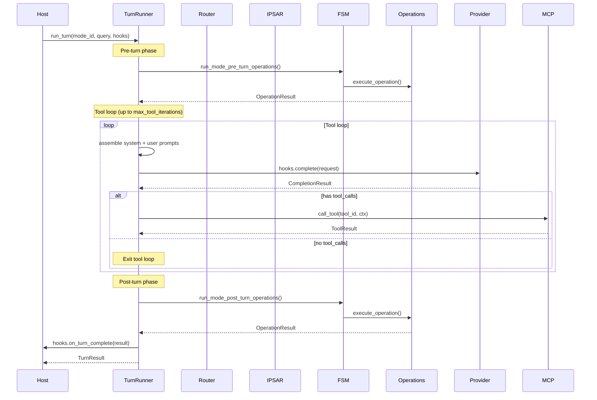
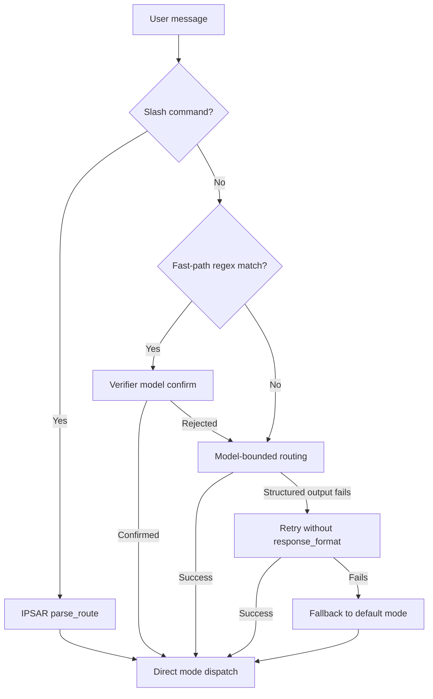
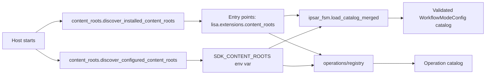

# Kernel Architecture

`lisa-kernel` is the runtime-neutral engine at the center of the Lisa Framework.

## Design Philosophy

The kernel is **runtime-neutral** by design. It owns all contracts, abstractions, and core built-ins. It imports nothing from host apps, SDK extensions, or private packages. Hosts inject concrete implementations through protocols and callbacks.

Key principles:

- **Contracts over implementations**: The kernel defines Pydantic models, protocols, and dataclasses. Hosts provide the concrete wiring (model completion, tool execution, MCP backend policy). Packs provide behavior such as memory recall and synthesis workflows.
- **No compat or migration layers**: When a pattern changes, old code goes away. No shim layers, no dual-path code.
- **Externalize aggressively**: Defaults minimally; configurability is essential. If a feature requires host-specific logic, it should be a callback or protocol seam, not an `if` statement in the kernel code.

## Module Map

### Core Engine

| Module | Responsibility |
| --- | --- |
| `turn_runner.py` | The single model+tool loop shared by all hosts. Executes pre-turn → tool loop → post-turn phases. Hosts wire behavior through `TurnHooks`. |
| `router.py` | Shared routing engine. Chooses which mode owns a natural-language turn using fast-path regex → verifier model → model-bounded routing fallback. |
| `ipsar.py` | IPSAR route resolution. Detects which user-facing mode a slash-command or pattern-matched message targets. |
| `ipsar_fsm.py` | Workflow FSM loader and runtime. Discovers mode definitions from disk, validates stage transitions, and provides operation lifecycle hooks. |
| `slice.py` | Opportunistic house-keeping system. Budget is `base + max_deferred * (1 - 0.5^(gap/half_life))`, clamped to `hard_cap_ms`. |

### Contracts & Models

| Module | Responsibility |
| --- | --- |
| `models.py` | All runtime-neutral Pydantic contracts: surface context, route decisions, operation/tool execution, workflow FSM, workshop fan-out, memory, web search, intelligence pipeline, unified state, context evidence, anomaly alerts, domain knowledge, self-model. |
| `provider_core.py` | Provider gateway abstractions: `AzureOpenAIGateway`, `OpenAICompatibleGateway`, completion/embedding request/result dataclasses, message normalization, and usage extraction. |
| `extension_runtime.py` | Extension job and rendering contracts: `ScheduledExtensionJob`, `ExtensionRuntimeContext`, state hydration, heartbeat context, digest sections, debug context, anomaly detectors, context evidence builders. |

### Discovery & Configuration

| Module | Responsibility |
| --- | --- |
| `content_roots.py` | Discovers pack and extension roots from `lisa.extensions.content_roots` entry points and `SDK_CONTENT_ROOTS` env var. |
| `model_manifest.py` | Loads and validates model manifests (YAML/JSON). Resolves models by designation (`router`, `default`, `deep`, `reasoning`) and per-mode overrides. |
| `config.py` | Kernel-owned settings: surf, web search, and workshop budgets. Loads from environment. |

### Built-in Capabilities

| Module | Responsibility |
| --- | --- |
| `web_search.py` | Brave Web Search integration. Configurable endpoint, market, and result count. |
| `tools/mcp_client.py` | MCP tool-pool/client transport for stdio and HTTP servers, including memory backends routed by host policy. |
| `openai_function_tools.py` | OpenAI function-tool schema builder with strict-mode support. |
| `state_providers.py` | `BlankStateProvider` for hosts that don't need memory. |
| `telemetry.py` | OpenTelemetry span helpers. |

### Subpackages

| Subpackage | Responsibility |
| --- | --- |
| `operations/` | Operation registry for discovering and executing operations from packs. See [OPERATIONS.md](OPERATIONS.md) and [OPERATION_AUTHORING_GUIDE.md](OPERATION_AUTHORING_GUIDE.md). |
| `intake/` | External data collection: `SignalConnector` (stateless monitors), `DataSource` (stateful fetchers), and `DomainKnowledgeProvider` (pack-owned orientation material). |
| `seams/` | Host-injection protocols: `StateProvider`, `InputGuard`, `OutputGuard`, `ContentRegistry`, `ModelPolicy`, `ProviderGatewayProvider`, `EventBus`, `DataSanitizer`, `ExtensionEvidenceBuilder`, and completion/tool/operation callbacks. Storage is an MCP feature (`lisa-storage`), not a kernel seam. |
| `synthesis/` | Post-collection intelligence pipeline: extension-owned stages (local analysis → synthesis → memory) and stage execution contracts. |
| `testing/` | `extension_harness` for validating connectors and data sources without a host app. |
| `context/` | Context seam defaults (guards, event bus, content registry). Context brokerage lives in MCP. |
| `mcp_launch/` | MCP launch contract: policy types (`MCPServerSpec`, `EnvPolicy`, `ToolPolicy`), registry (`MCPServerRegistry`), runtime adapter (`compile_command`, `compile_env`, `compile_cwd`), config compiler (`compile_mcp_config`, `compile_registry`), and tool filter (`filter_tools`). |
| `inference_profiles/` | Inference profile definitions. |

## Turn Execution Flow

A turn through the kernel follows this path:



## MCP-Native Architecture

The kernel is MCP-native by design. All tool, memory, and context operations
cross a process boundary through MCP servers. The kernel is a pure client that
orchestrates a turn; the MCP servers own execution, storage, and brokerage.

```mermaid
flowchart TD
  subgraph Kernel
    TR[Turn Runner]
    FD[Router + IPSAR + FSM]
    SLICE[Slice]
    TOOLS[MCP Tool Pool]
  end

  subgraph MCP
    Mem[lisa-context MCP
      (SQLite memory + context broker)]
    Tools[Other MCP tool servers]
  end
  Ops[Operations
    (in-process, dispatched via
    hooks.execute_operation)]

  TR --> FD
  TR --> SLICE
  TR --> TOOLS
  TOOLS --> Mem
  TOOLS --> Ops
  TOOLS --> Tools
```

### Context Broker MCP Contract

The kernel does not assemble context in-process. It sends a request to the
`lisa-context` MCP server and receives a brokered payload. The MCP contract is
explicit so hosts can swap the server without changing kernel behavior.

**Request**: `ContextBrokerRequest`

- `query`: user query for relevance scoring
- `mode_id` / `stage_id`: routing metadata
- `surface`: `SurfaceContext` for privacy scoping
- `user_slug` / `workspace_id`: multi-tenant isolation
- `connectors`: connector allow-list (optional)
- `context_budget`: limits, tags, and render strategy hints

**Response**: `ContextBrokerResponse`

- `packet`: structured `ContextPacket` with ranked evidence
- `packet_markdown`: prompt-safe markdown for injection
- `context_tag`: trace tag for debugging
- `warnings`: non-fatal broker warnings

The kernel only consumes the response payload; it does not interpret or rank
evidence locally.

### Route Resolution

For natural-language turns (non-slash-commands), the host first resolves the mode through the router:



### TurnHooks Extension Points

`TurnHooks` is a dataclass that hosts populate with callbacks. Every hook is optional — hosts wire only what they need.

| Hook | Signature | Purpose |
| --- | --- | --- |
| `resolve_model` | `(mode_id, preferred_model_id) -> model_def` | Resolve which model to use for a mode |
| `complete` | `async (request: CompletionRequest) -> CompletionResult` | Execute a model completion |
| `assemble_system_prompt` | `(mode_id, stage_id, ...) -> str` | Build the system prompt for a turn |
| `assemble_user_context` | `(mode_id, query, ...) -> str` | Build user-specific context |
| `mcp_tool_servers` | `list[MCPClientConfig]` | MCP servers to spawn for tool discovery/dispatch |
| `execute_operation` | `async (operation_id, ctx) -> OperationResult` | Execute an operation |
| `on_turn_complete` | `async (result: TurnResult) -> None` | Post-turn callback |
| `slice_tuning` | `() -> SliceTuning` | Return slice tuning parameters |
| `pre_turn_slice` | `async (policy) -> SliceOutcome` | Run pre-turn house-keeping |
| `post_turn_slice` | `async (policy) -> SliceOutcome` | Run post-turn house-keeping |
| `explicit_slice` | `async (policy) -> SliceOutcome` | Run explicit house-keeping |
| `last_slice_finished_at` | `() -> float \| None` | Return last slice completion time |

### Guardrails

The kernel defines two guardrail seams in `ContextSeams` that hosts override
with real safety implementations. Both default to pass-through (allow
everything) so public hosts run without a private safety pipeline.

| Seam | Protocol | When it runs | Default |
| --- | --- | --- | --- |
| `input_guard` | `InputGuard.validate(query, surface) -> GuardResult` | Phase 1, before the pre-turn slice and system prompt assembly | `PassThroughInputGuard` |
| `output_guard` | `OutputGuard.validate(text, surface) -> GuardResult` | Phase 3, after the tool loop | `PassThroughOutputGuard` |

A `GuardResult` carries `allowed: bool`, an optional `blocked_reason`, an
optional `sanitized_text` (for rewriting input/output in place), and
`annotations` for provider-specific metadata.

- **Input block**: the turn short-circuits with `TurnResult(blocked=True)` and
  the `blocked_reason` as the response text. The model is never called and the
  pre-turn slice does not fire.
- **Output block**: the response is replaced with a safe fallback, a
  `guardrail.audit` event is published on the `EventBus`, and the post-turn
  slice is skipped. `on_turn_complete` still fires with the safe-fallback
  text so the audit trail is complete.
- **Sanitization**: when `sanitized_text` is set, the original text is
  replaced in place for the remainder of the turn.

Enterprise implementations (Azure AI Content Safety, AWS Bedrock Guardrails,
Cloudflare AI Gateway, Presidio PII redaction, custom regex) are host-owned;
the kernel only defines the contract and the insertion points.

## The Slice System

The slice system (`slice.py`) is the kernel's approach to background work. Instead of cron or wall-clock timers, it uses a **pressure model**: the longer it has been since the last slice finished, the more budget the next slice gets.

```plaintext
budget_ms = base_budget_ms + max_deferred_ms * (1 - 0.5^(gap_seconds / pressure_half_life_seconds))
```

The budget is clamped to `hard_cap_ms`. The policy is split between pre-turn and post-turn shares (default: 40% pre-turn, 60% post-turn).

Slice modes:

- `NEVER`: slicing is disabled
- `PRE_TURN`: run before each turn
- `POST_TURN`: run after each turn
- `EXPLICIT`: run only when explicitly requested

This pattern is the canonical approach for all opportunistic house-keeping: reindex, eviction, sync, compaction. Heartbeat-driven jobs (wall-clock bound) stay on traditional schedulers.

## Pack and Extension Discovery



Extensions are discovered through their own entry-point groups (`lisa.extensions.signal_connectors`, `lisa.extensions.data_sources`, etc.) and are loaded by the host's extension runtime, not by the kernel directly.

## Host Responsibilities

A real host must inject concrete implementations for these seams:

| Seam | Kernel contract | Example |
| --- | --- | --- |
| Model completion | `TurnHooks.complete` | Azure OpenAI, OpenAI, Anthropic, Ollama |
| Model resolution | `TurnHooks.resolve_model` | Manifest-based or database-backed |
| Tool execution | MCP tool servers | Web search, surf, custom tools |
| Operation execution | `TurnHooks.execute_operation` | `operations.registry.execute_operation` |
| Memory | MCP memory server (`lisa-context`) | SQLite-backed MCP store |
| Input guard | `ContextSeams.input_guard` | `PassThroughInputGuard` (default), Azure AI Content Safety, Bedrock Guardrails, regex |
| Output guard | `ContextSeams.output_guard` | `PassThroughOutputGuard` (default), Azure AI Content Safety, Bedrock Guardrails, Presidio |
| Transport adapter | Host-owned | Teams, Slack, WebSocket, console |
| Scheduler | Host-owned | For signal connector polling and heartbeat jobs |

The shared host runtime (`hosts/core`) is the reference host. It wires a minimal subset of these seams for local development and pack authoring, shared by the CLI, web, and VS Code transport hosts.

## Privacy Model

The kernel models privacy explicitly in its contracts:

- `SurfaceContext` carries `surface_type`, `surface_id`, and `memory_scope`.
- Memory writes and recalls are scoped by the active surface and memory scope.
- Shared surfaces must not receive personal context unless a host implements explicit, audited sharing semantics.
- Proactive delivery targets are host-owned and must be explicit.

Prompt wording is not a privacy control. Hosts must enforce scope in storage keys, retrieval filters, and delivery routing.

## Testing

The kernel ships with:

- `kernel/tests/`: unit tests for contracts, FSM validation, route parsing, and slice math.
- `kernel/testing/extension_harness.py`: public harness for validating connectors and data sources without a host app.

Import-boundary tests across all packages (`sdk/tests/test_import_boundaries.py`, extension `tests/test_import_boundaries.py`) enforce that public packages never import private app modules.

## Further Reading

- [BOUNDARIES.md](BOUNDARIES.md) — public/private boundary definition
- [PACK_AUTHORING_GUIDE.md](PACK_AUTHORING_GUIDE.md) — how to create modes, operations, and content packs
- [SDK_EXTENSIONS_GUIDE.md](SDK_EXTENSIONS_GUIDE.md) — how to create signal connectors and data sources
- [HOSTS_GUIDE.md](HOSTS_GUIDE.md) — reference host usage and configuration
