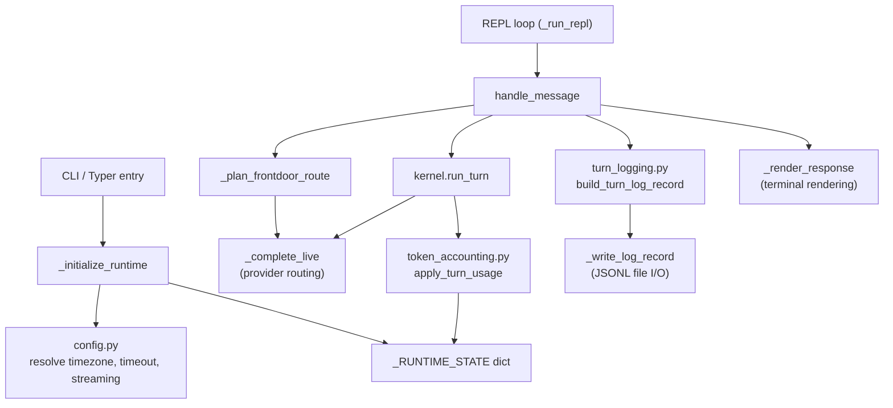

# Little Lisa Guide

Little Lisa is a local terminal harness for public package authors. It proves that the framework packages can be discovered, routed, and lightly executed without the private Lisa app.

It is not production quality. It uses a console transport, a file-backed artifact directory, and manifest-driven model routing with live provider calls.

## Run It

From `lisa_framework/`:

```powershell
uv sync --extra dev
uv run little-lisa verify
uv run little-lisa setup
uv run little-lisa modes
uv run little-lisa models
uv run little-lisa once "/search recent Python packaging guidance"
uv run little-lisa once "/markdown Draft a short incident-review outline"
uv run little-lisa once "/deep Evaluate migration risks"
uv run little-lisa once "/discuss capability tradeoffs" --session-context system
uv run little-lisa cli --debug --log-level debug --log .\artifacts\turns.jsonl
uv run little-lisa desktop --port 8765
uv run little-lisa
```

- `little-lisa` with no arguments launches tray-first desktop mode.
- `little-lisa cli` launches the enhanced terminal REPL.
- `little-lisa desktop` launches the localhost web interface directly.
- `little-lisa verify` runs environment and configuration checks.
- `little-lisa setup` launches an interactive provider configuration wizard.
- `little-lisa modes` lists supported and installed modes.
- `little-lisa models` lists configured models with designations and aliases.
- `little-lisa --version` prints the version and exits.

### Windows EXE Build

Build a standalone executable from `lisa_framework/`:

```powershell
uv sync --extra dev
uv run pyinstaller --name little_lisa --onefile examples/little_lisa/main.py
```

The resulting executable is available at `dist/little_lisa.exe`.

Generated Markdown documents are written under:

```plaintext
examples/little_lisa/artifacts/markdown/
```

## What It Wires

The host wires these public framework seams:

- `sdk_packs/core/modes` and `sdk_packs/search/modes` for mode discovery.
- `sdk_packs/core/operations` and `sdk_packs/search/operations` for operation discovery.
- Additional local pack roots from `SDK_CONTENT_ROOTS` for hello-world pack authoring.
- Stub tool definitions required for operation-catalog validation.
- Manifest-based model resolution callbacks.
- Live model completion callbacks for `azure_openai`, `openai`, `anthropic`, and local `ollama` providers.
- Local authored-content loading from public pack `content/` folders.
- Local file-backed blob helpers for Markdown artifacts.

## Model Manifest

Little Lisa keeps model selection intentionally small and explicit.

- Default manifest path: `examples/little_lisa/models.yaml`.
- Override path with `LITTLE_LISA_MODELS_FILE`.
- Supported provider values: `azure_openai`, `openai`, `anthropic`, `ollama`.
- Supported designations: `front-door`, `default`, `deep`, `reasoning`.
- Natural-language chat uses `front-door`.
- Explicit routed commands use `default`.
- `/deep <query>` routes through default mode using `deep`.
- Workshop panels resolve through `reasoning` (the pack default panel model alias).

Example manifest:

```yaml
version: 1
mode_models:
  default: gpt-chat-latest
  discuss: gpt-5.4
  markdown: gpt-5.4-mini
  search: gpt-5.4-pro
models:
  - model_id: gpt-chat-latest
    provider: azure_openai
    designations: [front-door, default]

  - model_id: gemma4:latest
    provider: ollama
    designations: [deep]

  - model_id: gpt-5.4
    provider: azure_openai
    reasoning_model: true

  - model_id: gpt-5.4-mini
    provider: azure_openai
    reasoning_model: true

  - model_id: gpt-5.4-pro
    provider: azure_openai
    reasoning_model: true
```

The `deep` designation can stay on a local model such as `gemma4:latest`; the Markdown and
image-generation packs still need `gpt-5.4-mini` present even though it is not a designated
routing model.

If the host cannot resolve a designated model it fails fast with a validation error.

## Provider Configuration

Set credentials in PowerShell before running live completions:

```powershell
$env:LITTLE_LISA_AZURE_OPENAI_ENDPOINT = "https://<resource>.openai.azure.com/"
$env:LITTLE_LISA_AZURE_OPENAI_API_KEY = "<azure-openai-key>"
$env:LITTLE_LISA_AZURE_OPENAI_API_VERSION = "2024-10-21"
$env:LITTLE_LISA_OPENAI_API_KEY = "<openai-key>"  # only needed for provider: openai
$env:LITTLE_LISA_ANTHROPIC_API_KEY = "<anthropic-key>"  # only needed for provider: anthropic
$env:LITTLE_LISA_OLLAMA_HOST = "127.0.0.1:11434"  # only needed for provider: ollama
$env:LITTLE_LISA_TIMEZONE = "America/New_York"  # optional: IANA timezone
$env:LITTLE_LISA_LOG_LEVEL = "info"  # optional: debug|info|warning|error
```

- Fallback env vars are also supported: `AZURE_OPENAI_ENDPOINT`, `AZURE_OPENAI_API_KEY`, `OPENAI_API_KEY`, `ANTHROPIC_API_KEY`, and `OLLAMA_HOST`.

### Turn Runner (kernel/turn_runner.py)

As of 2026-06-19, Little Lisa delegates all turn execution to
`kernel.turn_runner.run_turn()`.  It provides a `TurnHooks` instance with:

- `resolve_model` — resolves mode-preferred model IDs to a stub definition.
- `complete` — executes live chat completions against the provider configured for the selected model manifest entry.
- `execute_tool` — executes `web_search` through `kernel.web_search` when configured; other tools remain stubbed.
- `execute_operation` — delegates to `kernel.operations.registry.execute_operation`.
- Memory is MCP-backed via the `lisa-context` MCP server.

This means action, chat, and workflow modes all flow through the same
three-phase loop (pre-turn → tool loop → post-turn) as the production app.
The only difference is which hooks are wired.

### MCP Memory (lisa-context)

File-backed JSON memory with keyword-overlap matching.  Intentionally
minimal — no embeddings, no semantic search, no multi-tenant isolation,
no TTL.  Use `app/memory_store.py` for production.

## Expected Behavior

- `modes` separates supported Little Lisa modes from installed modes that require a fuller host.
- `--debug` prints turn context above each response and, unless overridden by `--log-level`, defaults JSONL logging to `debug` for full request/response diagnostics.
- `--log <file>` appends structured JSONL records with `event` and `level` fields plus route metadata, completion summaries, and runtime metadata.
- `--log-level debug|info|warning|error` controls JSONL verbosity. `debug` is tell-all and includes full provider request/response diagnostics.
- `--no-log` suppresses JSONL logging entirely.
- `--streaming none|stage|text|hybrid[:delay]` controls terminal streaming mode. `none` disables streaming, `stage` streams stage-level progress, `text` streams token-by-token, `hybrid` combines both. An optional `:N` suffix sets the character delay in milliseconds.
- `/help` prints Little Lisa's actual capability surface.
- Natural-language turns first pass through a front-door router prompt before the selected mode runs.
- `/help capabilities` prints a deterministic runtime capability matrix preview.
- `/settings` prints effective runtime settings (profile, timezone, debug, user).
- `/debug context` prints the last assembled prompt sections (briefing, recall, dynamic context, query).
- `/debug frontdoor` prints the last front-door planning diagnostics payload (planner reasoning, confidence, fallback status).
- `/debug capabilities` prints the full capability snapshot JSON.
- `/debug self` prints a compact self-model summary for the local host runtime.
- Action and chat modes added through `SDK_CONTENT_ROOTS` run when they only need Little Lisa callbacks.
- `/search <query>` exercises route parsing and the prompt-authored search operation through the turn runner.
- Live `web_search` tool calls are available when `WEB_SEARCH_API_KEY` is configured.
- `/markdown <request>` writes a local Markdown artifact using the authoring operation.
- `/discuss <topic>` parses discuss mode and runs its optional pre-turn briefing through the turn runner.
- `/quit` exits the interactive console loop.
- `little-lisa cli` uses `prompt_toolkit` when installed for command history and slash-command completion.
- Default chat and discuss modes use live model completion when provider credentials are configured.
- Installed but unsupported modes return an explicit host-wiring gap instead of pretending to run.
- Workflow modes run when they only rely on shared turn-runner callbacks; modes that require app-only workflow fan-out behavior still report an explicit gap.
- Local thread continuity is persisted to `examples/little_lisa/artifacts/threads/<user>.jsonl` and used for lightweight ranked-context hints.
- `--timezone <IANA>` pins status-line local time and timezone display.
- `--state-snapshot <file.json>` injects compact local snapshot context into prompt assembly.
- `--user <slug>` selects authored context from `content/user_contexts/<slug>.md` and controls local thread-log keying.
- `--data-dir <path>` overrides the artifacts root directory.
- `--memory-db <path>` overrides the memory store file path.
- `--thread-dir <path>` overrides the thread persistence directory.
- `--no-thread` disables thread persistence entirely.
- `--session-context <slug>` sets the session context slug for the turn.

## Front-Door Routing

Natural-language turns (non-slash commands) run through a bounded front-door planning pass before mode execution.

- Front-door system prompt sources:
  - `content/frontdoor/route.md` boilerplate template
  - Routable mode catalog markdown generated from loaded mode metadata
  - Mode-authored routing hints and examples generated from mode front matter
  - `content/prompts/agent/turn_input_contract.md`
- Front-door user prompt includes:
  - user slug (or `none`)
  - raw message
  - optional recent thread excerpt
  - explicit `## User Query` section

### Model Alias Mapping

The host keeps a small alias map for deterministic model intent by mode:

- `default` and `discuss` use `front-door`
- `search` and `markdown` use `default`
- `/deep` uses `deep`

These aliases are resolved against `examples/little_lisa/models.yaml` designations.

## Front-Door Diagnostics

Use `--debug` and `/debug frontdoor` together to explain why a route landed on a mode.

The diagnostic payload records:

- `model_alias` and resolved model metadata
- planner `reasoning` and `confidence_score`
- selected mode and normalized query
- `fallback_used` and `fallback_reason`
- `structured_output_retry_used` and `structured_output_retry_succeeded`
- `coerced_to_default_reason` when planner output is remapped to `default`
- preview snippets of planner input/output payloads
- `planner_completion_error` (and optional `planner_retry_error`) when provider calls fail

Fallback reasons include:

- `planner_completion_error`: provider/runtime call failed
- `planner_output_validation_error`: planner returned invalid or partial structured JSON

When the first structured-output call fails, the front door automatically retries once without
`response_format` and with explicit JSON-only instructions before deciding fallback.

### Turn Log Fields

When `--log <file>` is enabled, natural-language turns include:

- `frontdoor_route`: compact routing outcome (`selected_mode_id`, normalized query, reasoning, confidence, fallback fields)
- `frontdoor_debug`: full planner diagnostics payload
- `mode_model` / `frontdoor_model`: resolved provider:model values (not just designation aliases)
- `mode_prompt_tokens`, `mode_completion_tokens`, `mode_total_tokens`: token counts for the mode invocation
- `frontdoor_prompt_tokens`, `frontdoor_completion_tokens`, `frontdoor_total_tokens`: token counts for the front-door invocation

This is the check-of-record surface for proving whether a `default` route was intentionally chosen or forced by fallback.

## Architecture

Little Lisa is intentionally organised as a **thin orchestration shell** (`main.py`) backed by focused, single-responsibility modules.  The decomposition is designed to be instructional: each module has a clear purpose, a single dependency direction, and well-commented entry points.

### Module Map

| Module | Responsibility | Depends on |
| --- | --- | --- |
| `main.py` | CLI entry point, REPL loop, turn orchestration, provider routing, front-door planning, `handle_message` dispatch | `config`, `token_accounting`, `turn_logging`, `model_runtime`, `model_manifest`, `desktop`, `tray` |
| `config.py` | Pure configuration resolution: timezone, log level, streaming mode, slice tuning — all deterministic, no side effects, no global state | stdlib only |
| `token_accounting.py` | Token ledger accumulation, session counter roll-up, session-summary Markdown generation — accepts state dict as parameter, fully testable in isolation | stdlib only |
| `turn_logging.py` | JSONL log-record assembly and turn-log payload construction — accepts a resolved context dict so it's pure and testable without the full host | stdlib only |
| `model_runtime.py` | Model manifest loading, model resolution by designation/alias/concrete ID | kernel `model_manifest` |
| `model_manifest.py` | Manifest file discovery and loading from `models.yaml` | kernel `model_manifest` |
| `desktop.py` | Localhost web-host callbacks and token-auth for the desktop UI | kernel models |
| `tray.py` | System-tray launcher that manages the desktop host subprocess | `desktop` |

### Design Principles

1. **Config is pure.** `config.py` contains only deterministic functions that map user input (CLI flags, env vars) to normalised values.  No global mutable state, no side effects.  Precedence rules (CLI > env > default) are explicit in each resolver's docstring.

2. **Token accounting is stateless.** `token_accounting.py` functions accept the runtime state dict as an explicit parameter.  This makes the ledger logic independently testable without importing the full host.

3. **Test seams are module-level.** Tests use `monkeypatch.setattr(little_lisa, "_resolve_model", fake)` to replace individual functions.  All test-visible names remain on the `main` module surface (re-imported from submodules) so monkeypatching works unchanged.

4. **Direct-script fallback.** All submodule imports in `main.py` use `try: from .module import ... / except ImportError: from module import ...` so the file can be run as a standalone script (`python main.py --list-modes`) without package context.

5. **Runtime state stays a dict.** `_RUNTIME_STATE` is a plain dict (not a typed dataclass) because tests directly mutate it via `monkeypatch.setitem`.  Accessor functions (`_runtime_debug_enabled()`, `_runtime_timezone()`, etc.) provide type-safe reads without changing the dict contract.

### Data Flow



### Adding a New Module

When extracting a new concern from `main.py`:

1. Create `examples/little_lisa/<concern>.py` with a module-level docstring describing its responsibility, dependency direction, and re-exported names.
2. Write pure functions that accept state/config as parameters — avoid global state references.
3. In `main.py`, import the new module's functions using the `try/except ImportError` fallback pattern.
4. Keep thin wrapper functions in `main.py` for any name that tests monkeypatch directly.
5. Run `uv run pytest examples/little_lisa/ -q` to verify zero regressions.

## Runtime Options

- `--user <slug>` selects authored context from `content/user_contexts/<slug>.md` and controls local thread-log keying.
- Omit `--user` to skip authored user context entirely.
- `--timezone <IANA>` sets runtime timezone used for status-line local time.
- `--state-snapshot <file.json>` loads one local JSON object for compact state-context hints.
- `--log-level debug|info|warning|error` sets the JSONL logging threshold.
- `--log <file>` appends structured JSONL turn records.
- `--no-log` suppresses JSONL logging entirely.
- `--data-dir <path>` overrides the artifacts root directory.
- `--memory-db <path>` overrides the memory store file path.
- `--thread-dir <path>` overrides the thread persistence directory.
- `--no-thread` disables thread persistence entirely.
- `--session-context <slug>` sets the session context slug for the turn.
- `--streaming none|stage|text|hybrid[:delay]` controls terminal streaming mode.
- `--version` prints the Little Lisa version and exits.

Settings precedence:

1. CLI flags (`--timezone`, `--log-level`)
2. Explicit Little Lisa env vars (`LITTLE_LISA_TIMEZONE`, `LITTLE_LISA_LOG_LEVEL`)
3. OS timezone env vars when present (`TZ`, `TIMEZONE`, `LOCAL_TIMEZONE`, `APPSETTING_WEBSITE_TIME_ZONE`) for timezone only
4. Built-in defaults (`UTC`, and `info` log level, unless `--debug` is set)

## Hello World Pack Smoke

The quickest pack-authoring proof is a local pack under `sdk_packs/` plus one `SDK_CONTENT_ROOTS` entry:

```powershell
$env:SDK_CONTENT_ROOTS = (Resolve-Path .\sdk_packs\hello_world)
uv run little-lisa modes
uv run little-lisa once "/hello framework"
```

See [PACK_AUTHORING_GUIDE.md](PACK_AUTHORING_GUIDE.md) for the complete hello-world file set.

## Intentional Limits

Little Lisa does not include:

- Browser automation.
- Production memory (file-backed keyword matching only; see Lite Memory above).
- App-only workflow fan-out execution and synthesis callbacks.
- Production proactive delivery.
- Production signal connector polling.
- Teams, Azure, or CloudServers-specific logic.

A real host should replace the stubs with concrete callbacks and protocol implementations while keeping the same framework-facing contracts.
