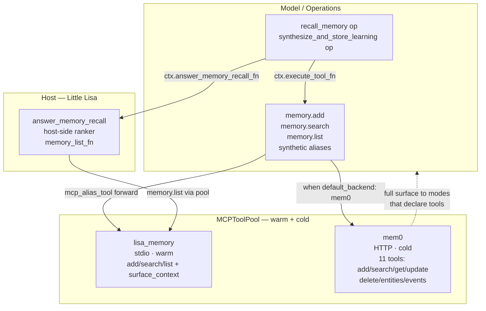

# Memory Architecture

Status: Implemented 2026-07-08
Owner: Architecture

This document specifies the memory architecture after the 2026-07-08 hard
cutover: memory is an ordinary MCP feature, not a kernel seam. It captures
the design, the lessons that drove it, and the pitfalls discovered along the
way so a future implementer does not re-litigate the same decisions.

It is self-contained: a new implementation thread can execute against this
doc without prior conversation context.

## Design Verdicts

| Question | Answer |
| --- | --- |
| Is memory a kernel seam? | **No.** Memory is an MCP feature. There is no in-process `MemoryStore` protocol, no `MemoryStoreRouter`, no `MCPMemoryClient` in the kernel. Storage is just MCP tool calls. |
| How do modes get memory? | **By listing operations/tools like any other.** `allowed_operation_ids` for the operation path (`recall_memory`, `synthesize_and_store_learning`); tool allowlists for direct backend tools (`mem0.update_memory`, etc.). No special memory field on the operation context. |
| What is the indirection layer? | **Three synthetic aliases** — `memory.add` / `memory.search` / `memory.list` — built as `mcp_alias_tool` entries that forward through the MCP tool pool to the default backend's tool names. This is the only indirection; everything else is direct. |
| Are backends tool servers too? | **Yes.** A memory backend is dual-registered: as a `memory.backends` entry (for the synthetic aliases) AND as a `servers` entry (so its full tool surface is discoverable). One connection, two roles. |
| Is there a host-side ranker? | **Yes, one.** `answer_memory_recall` is preserved as host policy — it ranks records by lexical overlap. It is not backend semantics. Backends stay dumb; the host owns ranking. |
| What is the minimal built-in? | **`lisa_memory`** — a stdio MCP server with three core tools (`add_memory` / `search_memory` / `list_memories`) plus `get_surface_context`, backed by local SQLite. The default backend. |
| What happened to `lisa_context`? | **Split.** `lisa_context` is now broker-only (`broker_context`). Its former memory store and tools moved to `lisa_memory`. |
| How does the pool reach HTTP backends? | **`RuntimeKind.HTTP`.** The pool speaks streamable-HTTP via `streamable_http_client` in its `AsyncExitStack`, the same discipline as stdio. |
| Is there memory eviction? | **No host-side eviction.** `lisa_memory`'s SQLite store enforces TTL via its `expires_at` column (daily/weekly/long_term). The former `_consolidate_memory` reached into private in-process state and is gone. |

## Layered Architecture



## The Two Layers

### Layer 1 — Backends as tool servers

A memory backend is an MCP server in the pool, no different from
`lisa-search` or `lisa-operations`. Its full tool surface is discoverable by
any mode that declares the tools in its `allowed_operation_ids` or tool
allowlist. There is no memory-specific gating.

- **`lisa_memory`** (`lisa_sdk/lisa_memory/`): stdio, warm, the minimal
  built-in. Three core tools + `get_surface_context`, local SQLite with TTL.
  The default backend.
- **`mem0`** (`https://mcp.mem0.ai/mcp`): HTTP, cold. Serves the three core
  calls plus `update_memory`, `delete_memory`, `delete_all_memories`,
  `delete_entities`, `list_entities`, `list_events`, `get_event_status` —
  all 11 available to modes that declare them.

### Layer 2 — Synthetic aliases

`memory.add` / `memory.search` / `memory.list` are `mcp_alias_tool` entries
registered on the warm pool after `pool.start()`. Each forwards through the
pool to the default backend's actual tool name (from `memory.tool_names` in
the manifest). A mode that says `memory.add` gets the default backend; a
mode that says `mem0.update_memory` gets Mem0 directly. The aliases are the
indirection layer — nothing else is.

## The One Preserved Hook: `answer_memory_recall`

The ranker (`LittleLisaTurnHooks.answer_memory_recall`) is the single
memory-specific host hook. It is **not** a memory call — it is host policy:

1. Calls `memory.list` through the pool (via `memory_list_fn`).
2. Parses the JSON array into `MemoryRecord` objects.
3. Tokenizes the query, scores lexical overlap + salience bonus.
4. Returns a structured `MemoryRecallAnswer` with scored evidence.

Why this cannot be an MCP tool: the ranking algorithm is host policy, not
backend semantics. If ranking lived in a backend, every backend would
re-implement the same ranker, and a backend like Mem0 (which already does its
own server-side ranking) would have to be forced through a foreign ranker or
bypass it. The host owns one ranker; backends stay dumb. The `recall_memory`
operation calls `ctx.answer_memory_recall_fn`; storage operations call
`ctx.execute_tool_fn("memory.add")` like any other tool.

## What Was Deleted (hard cutover, no shim)

| Deleted | Why |
| --- | --- |
| `kernel/mcp_client.py` (`MCPMemoryClient`, `MCPHttpMemoryClient`) | Memory is an MCP server now; the generic `MCPToolPool` speaks both stdio and HTTP. |
| `kernel/memory_router.py` (`MemoryStoreRouter`) | The router's job (default selection) is done by the synthetic-alias wiring at pool start. |
| `kernel/memory_protocol.py` (`MemoryStore` protocol for operations) | Nothing in the kernel needs it once operations go through the tool pool. |
| `ContextSeams.memory_store` + `_lazy_memory_store` | No in-process memory seam. |
| `OperationExecutionContext.memory_store` | Operations reach memory via `execute_tool_fn`. (`answer_memory_recall_fn` stays.) |
| `LittleLisaStateProvider._consolidate_memory` | Reached into `MCPMemoryClient._records`/`_save` — impossible across the MCP boundary; redundant with `lisa_memory`'s TTL `expires_at`. |

## What Was NOT Deleted

`kernel/seams/protocols.py` `MemoryStore` Protocol,
`DataSourceHooks.memory_store`, and `kernel/testing/stubs.py` `NullMemoryStore`
are **kept**. They serve the **data-source seam** (`DataSourceHooks`), which
is orthogonal to the operation/turn memory seam that was removed. Do not
delete these without auditing `kernel/intake/`.

## Lessons Learned

### 1. The pool was stdio-only — HTTP was the prerequisite blocker

The single biggest lesson: the `MCPToolPool` only spoke stdio. `MCPClientConfig`
had `command`/`args`/`env`/`cwd` and `_connect` used `stdio_client`. There was
no `url`/`headers`, no `RuntimeKind.HTTP`. The only HTTP memory path that
existed was the separate `MCPHttpMemoryClient` — the very thing being deleted.

**Lesson:** "make X an MCP server" is not achievable by declaration. If the
target server is HTTP, the pool must support HTTP first. Adding
`RuntimeKind.HTTP` + `_connect_http` (streamable_http_client in the
`AsyncExitStack`) was step 0, not a nice-to-have. Without it, Mem0 becomes
unreachable entirely — neither as a backend (router deleted) nor as a tool
server (pool is stdio-only).

### 2. The anyio cancel-scope discipline (carry-forward from the prior fix)

HTTP MCP connections must live in the pool's long-lived `AsyncExitStack`,
not in per-call `asyncio.run`. The prior commit
(`fix: use asynccontextmanager for HTTP memory client sessions`) discovered
that `streamable_http_client` + `ClientSession` bind background tasks to a
cancel scope; tearing that scope down from a different task raises
`RuntimeError: Attempted to exit cancel scope in a different task`.

The pool's `_connect_http` enters `streamable_http_client` and
`ClientSession` into the same `AsyncExitStack` that owns the stdio sessions
— entered once in `start()`, closed once in `aclose()`. The HTTP client's
fix carried forward verbatim into the pool. **Never** start an MCP
connection in a throwaway loop and close it in another.

### 3. Env expansion must handle embedded refs, not just whole strings

The original `_expand_env_value` only handled whole-string `${VAR}`:

```python
if raw.startswith("${") and raw.endswith("}") and len(raw) > 3:
    return os.getenv(raw[2:-1], "")
return raw
```

A header value like `Bearer ${MEM0_API_KEY}` is **not** a whole-string ref —
it is `Bearer ` + a ref. The original returned the literal unchanged,
producing `Authorization: Bearer ${MEM0_API_KEY}` (the variable name, not the
secret). This was caught only by a test asserting the expanded value.

**Lesson:** use regex substring expansion (`_ENV_REF_RE.sub(...)`) for
header-like values. Whole-string matching is too narrow for composite
strings. Any future env-expansion helper should default to in-place
expansion.

### 4. The empty-auth-header guard — refuse to wire rather than crash

When `MEM0_API_KEY` is unset, `${MEM0_API_KEY}` expands to `""`, producing
`Authorization: Bearer `. Sending that header yields a 401 from the server.
Because the 401 fires inside `streamable_http_client`'s anyio task group, it
cascades into a cross-task cancel-scope `RuntimeError` that masks the real
cause (the empty key).

The host has an explicit guard: any header value that
`_is_empty_auth_header` flags → log `memory.backend_auth_missing` and skip
wiring that backend, falling back to `lisa_memory`. **Always** refuse to
wire a backend with empty auth rather than sending the broken header. The
anyio cascade is invisible at runtime; the guard makes the failure loud and
early. The `verify` command surfaces this as a FAIL check before the user
runs into it.

### 5. Reaching into private state across a process boundary is impossible

The former `LittleLisaStateProvider._consolidate_memory` evicted low-salience
memories by reaching into `MCPMemoryClient._records` and calling
`_save()` — private attributes of the in-process client. Once memory moves
behind MCP, those attributes do not exist; the store is a subprocess (or a
remote HTTP server). The eviction logic was impossible to preserve as-is.

**Lesson:** the MCP boundary is real. Any host-side logic that pokes private
state of an in-process client breaks the moment that client becomes a
server. The right eviction mechanism is server-side TTL (`expires_at`), not
host-side introspection. If explicit eviction is ever needed, it becomes a
`lisa_memory` tool (`delete_old_memories`), not a host-side reach-through.

### 6. Dual registration is intentional, not redundant

Mem0 appears twice in the manifest: as a `memory.backends` entry (for the
synthetic aliases) and as a `servers` entry (for its full surface). This is
not duplication — it is two roles:

- The `memory.backends` entry maps the three generic aliases to Mem0's tool
  names (`add` → `add_memory`, etc.) and designates it as default when
  `default_backend: mem0`.
- The `servers` entry registers Mem0 in the tool pool so `list_tools()`
  discovers all 11 tools and modes can call `mem0.update_memory` etc. by
  name.

One HTTP connection, two roles. Removing either entry breaks a path:
without the backend entry, the aliases cannot target Mem0; without the
server entry, Mem0's extra tools are invisible to the catalog.

### 7. The `get_surface_context` decision — move it to the memory server

`get_surface_context` ("recent memories for a surface") is pure memory — it
reads the store and formats lines. It moved to `lisa_memory`, leaving
`lisa_context` as broker-only. The decision matters because it draws the
boundary: anything that reads the memory store belongs with the memory
server; anything that assembles context from `UnifiedState` belongs with the
broker. Do not split memory-reading tools across both servers.

### 8. The ranker cannot be an MCP tool — it is host policy

The strongest temptation during this cutover was "push the ranker into
`lisa_memory`." It fails for two reasons:

1. **Every backend re-implements the same ranker.** `lisa_memory` would rank
   one way; Mem0 another. There is no canonical ranking across backends.
2. **Mem0 already ranks server-side.** `search_memories` returns its own
   ranked results. Forcing those through a foreign host ranker is either
   redundant (if the host re-ranks) or wrong (if the host overrides).

The resolution: the host owns **one** ranker. It decides whether to re-rank
the backend's raw `list_memories` output or pass through the backend's
`search` results. Backends stay dumb — they return rows; the host scores
them. The ranker is the indirection for *ranking*, the synthetic aliases
are the indirection for *storage*. Two different concerns, two different
layers.

### 9. Test the expanded value, not just the structure

The env-expansion bug (lesson 3) shipped green through structural tests that
asserted "the header key is `Authorization`" and "a backend with that
header is parsed." It was caught only by a test that asserted the *expanded
value* (`Bearer secret123`, not `Bearer ${MEM0_API_KEY}`). **Always** assert
the resolved value of env-expanded fields, not just their presence. A
parsed-but-unexpanded header is the worst kind of bug: it looks correct in
config, fails opaquely at runtime (the anyio 401 cascade).

## Manifest Shape

```yaml
memory:
  default_backend: lisa_memory   # or mem0 (needs MEM0_API_KEY)
  backends:
    - id: lisa_memory
      kind: stdio
      command: "${LISA_MCP_COMMAND:lisa-memory}"
      args: ["--data-dir", "${LISA_DATA_DIR}"]
      tool_names: {add: add_memory, search: search_memory, list: list_memories}
    - id: mem0
      kind: http
      url: https://mcp.mem0.ai/mcp
      headers: {Authorization: "Bearer ${MEM0_API_KEY}"}
      tool_names: {add: add_memory, search: search_memories, list: get_memories}
servers:
  - server_id: mem0
    runtime_kind: http
    url: https://mcp.mem0.ai/mcp
    headers: {Authorization: "Bearer ${MEM0_API_KEY}"}
```

## Key Files

| File | Role |
| --- | --- |
| `lisa_sdk/lisa_memory/server.py` | The minimal built-in memory server (3 core tools + `get_surface_context`). |
| `lisa_sdk/lisa_memory/store.py` | `SqliteMemoryStore` — extracted verbatim from the former `lisa_context`. |
| `lisa_sdk/lisa_context/server.py` | Broker-only now (`broker_context`); no SQLite store. |
| `kernel/mcp_launch/policy.py` | `RuntimeKind.HTTP`, `MCPServerSpec.url`/`.headers`. |
| `kernel/mcp_launch/server_manifest.py` | Parses `runtime_kind: http` + `url`/`headers`; `_ENV_REF_RE` in-place expansion. |
| `kernel/mcp_launch/compiler.py` | Emits `MCPClientConfig` with `url`/`headers` for HTTP specs. |
| `kernel/tools/mcp_client.py` | `MCPClientConfig.url`/`.headers`, `_connect_http` via `streamable_http_client`. |
| `kernel/tools/synthetic.py` | `mcp_alias_tool` — the builder the synthetic aliases use. |
| `examples/little_lisa/main.py` | `_register_memory_synthetic_tools` (pool-backed aliases), `_memory_list_fn`, warm-pool wiring. |
| `examples/little_lisa/turn_hooks.py` | `LittleLisaTurnHooks.answer_memory_recall` (the preserved ranker). |
| `sdk_packs/core/operations/memory/synthesize_learning.py` | Persists via `ctx.execute_tool_fn("memory.add")`. |
| `sdk_packs/core/operations/memory/recall.py` | Calls `ctx.answer_memory_recall_fn` (the ranker hook). |
| `examples/little_lisa/mcp_servers.yaml` | The manifest: `memory.backends` + `servers` (dual registration). |

## Switching the Default Backend

1. **To Mem0:** set `MEM0_API_KEY` in `.env` or the shell, set
   `memory.default_backend: mem0` in `mcp_servers.yaml`, restart. The
   `verify` command checks the key is set and the header expanded before
   runtime.
2. **To `lisa_memory` (default):** no key needed. The three core aliases
   route to local SQLite. Mem0's full surface is still available as tools to
   modes that declare them (if `MEM0_API_KEY` is set and the server connects;
   otherwise the empty-header guard drops it from the pool).