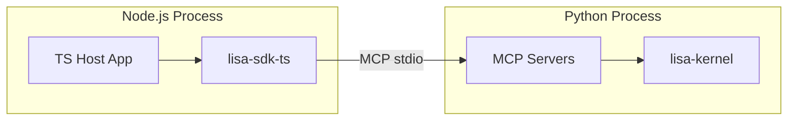
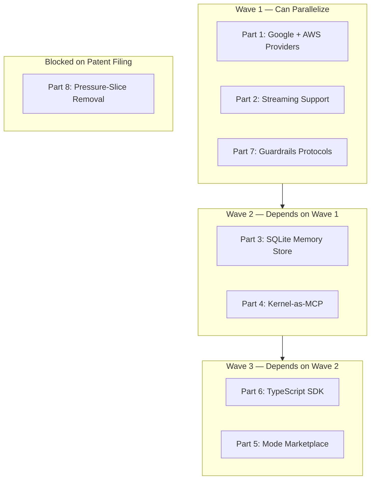

# Lisa Framework — Post-Assessment Implementation Specification

Status: Proposed 2026-07-05
Owner: Architecture

This document specifies all changes agreed upon during the 2026-07-05 framework
assessment. It covers provider expansion, streaming, memory open-sourcing,
kernel-as-MCP, the mode marketplace, TypeScript SDK, guardrails, and the
pressure-slice patent strategy. Each section is self-contained and can be
assigned to a separate agent workflow.

---

## Part 1 — Provider Plugins: Google Gemini & AWS Bedrock

### Design Verdicts

| Question | Answer |
| --- | --- |
| New provider gateways or plugins? | **Gateways in `kernel/provider_core.py`.** The existing pattern (`AzureOpenAIGateway`, `OpenAICompatibleGateway`) is the right abstraction. No plugin system needed — providers are gateway classes. |
| Google: REST or SDK? | **REST (via `httpx`).** The Google AI Python SDK brings `grpcio` and `proto-plus` as transitive deps. The REST API (`generativelanguage.googleapis.com`) is stable, well-documented, and avoids the dependency weight. |
| AWS: REST or SDK? | **`boto3` (bedrock-runtime).** The AWS Bedrock REST API requires SigV4 signing, which is non-trivial. `boto3` is the standard Python AWS SDK and is already a common dependency in production environments. |
| Anthropic: finish or defer? | **Finish.** The Anthropic gateway already has usage extraction. Complete the tool-use path (Phase 5 of MCP cutover). |

### 1.1 Google Gemini Gateway ✅ Implemented

#### Location

`kernel/provider_core.py` — new class `GoogleGeminiGateway`

#### API

```python
@dataclass
class GoogleGeminiGateway:
    """Google Gemini REST API gateway (generativelanguage.googleapis.com).

    Uses the v1beta generateContent endpoint with httpx. Supports:
    - Text generation (gemini-2.5-flash, gemini-2.5-pro, etc.)
    - Tool calling (function declarations → functionCall/firstTurn → functionResponse)
    - System instructions
    - Safety settings (configurable thresholds)
    - Thinking mode (gemini-2.5-pro thinking budget)
    """

    def __init__(
        self,
        *,
        api_key: str,
        base_url: str = "https://generativelanguage.googleapis.com",
        api_version: str = "v1beta",
        client: httpx.AsyncClient | None = None,
    ) -> None: ...

    async def complete(self, request: CompletionRequest) -> CompletionResult:
        """Send a generateContent request and return a normalized CompletionResult.

        Translates:
        - CompletionRequest.messages → Gemini contents[] format
        - CompletionRequest.tools → Gemini functionDeclarations[]
        - CompletionRequest.system_prompt → Gemini systemInstruction
        - Gemini functionCall responses → CompletionResult.tool_calls
        - Gemini usageMetadata → CompletionUsage
        """

    async def embed(self, request: EmbeddingRequest) -> EmbeddingResult:
        """Send a batchEmbedContents request for text embeddings."""

    @staticmethod
    def supports(model_id: str) -> bool:
        """Return True if model_id is a known Gemini model."""
```

#### Message translation

| OpenAI/Lisa concept | Gemini concept |
| --- | --- |
| `system` role | `systemInstruction` (top-level field) |
| `user` role | `contents[].role = "user"` |
| `assistant` role | `contents[].role = "model"` |
| `tool` role | `contents[].role = "tool"` → `functionResponse` |
| `tool_calls` on assistant | `functionCall` in model content |
| `name` field on messages | Not supported — use `functionResponse.name` |

#### Tool calling translation

```plaintext
OpenAI tool_calls:
  [{id: "call_1", function: {name: "search", arguments: '{"q":"test"}'}}]

Gemini functionCall:
  contents[].parts[].functionCall = {name: "search", args: {"q": "test"}}

Gemini functionResponse (tool result):
  contents[].parts[].functionResponse = {name: "search", response: {"result": "..."}}
```

The gateway must track `tool_call.id → tool_name` mapping because Gemini doesn't
have tool call IDs — it uses `functionCall.name` for correlation. The gateway
synthesizes IDs (`gemini_call_N`) for the normalized `CompletionResult.tool_calls`.

#### Safety settings

```python
@dataclass
class GeminiSafetySettings:
    """Per-category harm block thresholds."""
    harassment: str = "BLOCK_MEDIUM_AND_ABOVE"
    hate_speech: str = "BLOCK_MEDIUM_AND_ABOVE"
    sexually_explicit: str = "BLOCK_MEDIUM_AND_ABOVE"
    dangerous_content: str = "BLOCK_MEDIUM_AND_ABOVE"
    civic_integrity: str = "BLOCK_MEDIUM_AND_ABOVE"
```

Passed through `CompletionRequest` metadata or gateway constructor defaults.

#### Model manifest entries

```yaml
models:
  - model_id: gemini-2.5-flash
    provider: google
    designations: [default]
    capabilities: [chat, tools, vision]
    cost_tier: low
    aliases: [gemini-flash]

  - model_id: gemini-2.5-pro
    provider: google
    designations: [deep]
    capabilities: [chat, tools, vision, thinking]
    cost_tier: high
    aliases: [gemini-pro]
```

### 1.2 AWS Bedrock Gateway ✅ Implemented

#### Location

`kernel/provider_core.py` — new class `BedrockGateway`

#### API

```python
@dataclass
class BedrockGateway:
    """AWS Bedrock runtime gateway via boto3.

    Supports:
    - Claude models (Anthropic) via Bedrock
    - Llama models (Meta) via Bedrock
    - Nova models (Amazon) via Bedrock
    - Titan models (Amazon) via Bedrock

    Uses the Bedrock Converse API (bedrock:Converse) which provides a
    normalized interface across all Bedrock models, avoiding per-model
    request format differences.
    """

    def __init__(
        self,
        *,
        region_name: str = "us-east-1",
        aws_access_key_id: str | None = None,
        aws_secret_access_key: str | None = None,
        aws_session_token: str | None = None,
        client: Any | None = None,  # boto3 bedrock-runtime client
    ) -> None: ...

    async def complete(self, request: CompletionRequest) -> CompletionResult:
        """Send a Converse request and return a normalized CompletionResult.

        The Converse API normalizes across Claude, Llama, Nova, and Titan:
        - messages[] → Converse messages[]
        - tools[] → Converse toolConfig.tools[]
        - system_prompt → Converse system[]
        - Converse toolUse → CompletionResult.tool_calls
        - Converse token usage → CompletionUsage
        """

    async def embed(self, request: EmbeddingRequest) -> EmbeddingResult:
        """Send an embed request via the model-specific embedding endpoint.

        Falls back to Titan Embeddings G1 for models without native embedding.
        """

    @staticmethod
    def supports(model_id: str) -> bool:
        """Return True if model_id is a known Bedrock model."""
```

#### Model manifest entries

```yaml
models:
  - model_id: us.anthropic.claude-sonnet-4-20250514-v1:0
    provider: aws
    designations: [default]
    capabilities: [chat, tools, vision]
    cost_tier: medium
    aliases: [claude-sonnet-4-bedrock]

  - model_id: us.anthropic.claude-opus-4-20250514-v1:0
    provider: aws
    designations: [deep]
    capabilities: [chat, tools, vision, thinking]
    cost_tier: high
    aliases: [claude-opus-4-bedrock]

  - model_id: us.meta.llama4-maverick-17b-instruct-v1:0
    provider: aws
    designations: [default]
    capabilities: [chat, tools]
    cost_tier: low
    aliases: [llama4-bedrock]

  - model_id: us.amazon.nova-pro-v1:0
    provider: aws
    designations: [default]
    capabilities: [chat, tools, vision]
    cost_tier: medium
    aliases: [nova-pro]
```

### 1.3 Anthropic Gateway — Complete Tool-Use Path ✅ Implemented

The existing `provider_core.py` Anthropic path currently only extracts usage. The
tool-use path (Phase 5 of MCP cutover) must be completed:

| Gap | Fix | Status |
| --- | --- | --- |
| `AnthropicGateway.complete()` returns `CompletionResult` with `tool_calls` | Implement message translation: Anthropic `tool_use` content blocks → `CompletionResult.tool_calls` | ✅ Done |
| Tool results fed back to Anthropic | Implement `tool_result` content blocks in the next request's messages | ✅ Done (`_build_anthropic_messages`) |
| `mcp_tool_to_anthropic_tool` in `schema_translator.py` | Already stubbed; implement the full translation | ✅ Already present |
| `anthropic_tool_use_to_mcp` in `schema_translator.py` | Already stubbed; implement the full translation | ✅ Already present |
| System prompt | Anthropic `system` top-level parameter (not a message) | ✅ Done |
| Thinking budget | Anthropic `thinking.budget_tokens` parameter | ✅ Done |
| Provider routing | `gateway_for("anthropic")` returns `AnthropicGateway` (was incorrectly routed to `OpenAICompatibleGateway`) | ✅ Done |

### 1.4 Provider Gateway Provider Updates

`KernelProviderGatewayProvider` in `kernel/context/provider_gateway_provider.py`
gains two new gateway factories:

```python
class KernelProviderGatewayProvider:
    def gateway_for(self, provider: str) -> ProviderGateway | None:
        if provider == "google":
            return self._build_google_gateway()
        if provider == "aws":
            return self._build_bedrock_gateway()
        # ... existing openai, azure_openai, anthropic, ollama ...
```

### 1.5 Dependencies

| Gateway | New dependency | Import style |
| --- | --- | --- |
| Google Gemini | None (httpx already in kernel) | N/A |
| AWS Bedrock | `boto3` + `botocore` | Optional import — `BedrockGateway.__init__` raises `ImportError` with install instructions if `boto3` is missing |
| Anthropic (complete) | `anthropic` (already in kernel) | N/A |

---

## Part 2 — Streaming Support ✅ Implemented (v1: OpenAI + Anthropic)

### Design Verdicts

| Question | Answer |
| --- | --- |
| Streaming: new hook or modify `complete`? | **New hook `complete_stream` on `TurnHooks`.** The existing `complete` hook stays for non-streaming hosts. Streaming hosts wire `complete_stream` instead. |
| What streams? | **Tokens only in v1.** Tool-call streaming and intermediate progress are deferred to v2. |
| Provider support | All four providers support streaming: OpenAI (SSE), Anthropic (SSE), Google (SSE), Bedrock Converse (SSE via `ConverseStream`). |
| Turn runner changes | The tool loop gains a streaming path: if `hooks.complete_stream` is set, use it; otherwise fall back to `hooks.complete`. |

### 2.1 New Types

```python
# kernel/models.py

@dataclass
class StreamedChunk:
    """One chunk from a streaming completion."""
    content: str = ""
    """Delta text for this chunk."""
    finish_reason: str | None = None
    """'stop', 'length', 'tool_calls', or None (mid-stream)."""
    usage: CompletionUsage | None = None
    """Final usage (only present on the last chunk for providers that
    include usage in the stream)."""


@dataclass
class StreamedCompletion:
    """The aggregated result of a streaming completion.

    Built by the turn runner as chunks arrive. The runner yields each
    chunk to the host for delivery, then uses the aggregated result
    for the tool loop (checking tool_calls, recording usage).
    """
    content: str = ""
    tool_calls: list[dict[str, Any]] | None = None
    usage: CompletionUsage | None = None
    finish_reason: str = "stop"
    chunks: list[StreamedChunk] = field(default_factory=list)
```

### 2.2 TurnHooks Changes

```python
@dataclass
class TurnHooks:
    # ... existing fields ...

    # NEW — streaming completion
    complete_stream: (
        Callable[
            [CompletionRequest],
            Awaitable[AsyncIterator[StreamedChunk]],  # noqa: F821
        ]
        | None
    ) = None
    """Async generator that yields StreamedChunk as tokens arrive.

    When set, the turn runner uses this instead of complete().
    The host is responsible for delivering chunks to the user
    (e.g., via WebSocket, SSE, or terminal output).

    When None (default), the turn runner uses complete() for
    non-streaming operation.
    """
```

### 2.3 Turn Runner Streaming Path

The tool loop in `turn_runner.py` gains a streaming branch:

```python
# Pseudocode for the streaming path in run_turn()

if hooks.complete_stream is not None:
    # Streaming path
    chunks: list[StreamedChunk] = []
    async for chunk in hooks.complete_stream(request):
        chunks.append(chunk)
        # Host delivers chunk to user (the hook itself handles delivery;
        # the runner just drives the iteration)
    aggregated = _aggregate_streamed_chunks(chunks)
    response_text = aggregated.content
    tool_calls = aggregated.tool_calls
    usage = aggregated.usage
else:
    # Non-streaming path (existing)
    result = await hooks.complete(request)
    response_text = result.content
    tool_calls = result.tool_calls
    usage = result.usage
```

### 2.4 Provider Streaming Implementations

| Provider | Endpoint | Chunk format | Notes |
| --- | --- | --- | --- |
| OpenAI / Azure OpenAI | `chat.completions.create(stream=True)` | SSE: `data: {"choices": [{"delta": {"content": "..."}}]}` | Standard; already partially supported |
| Anthropic | `messages.stream()` | SSE: `data: {"type": "content_block_delta", "delta": {"text": "..."}}` | Anthropic SDK handles this natively |
| Google Gemini | `generateContent` with `alt=sse` | SSE: `data: {"candidates": [{"content": {"parts": [{"text": "..."}]}}]}` | REST API SSE mode |
| AWS Bedrock | `ConverseStream` | SSE: `{"contentBlockDelta": {"delta": {"text": "..."}}}` | boto3 `converse_stream()` |

Each gateway's `complete_stream()` method is an `async def` generator that yields
`StreamedChunk` objects. The gateway handles provider-specific SSE parsing
internally.

### 2.5 Little Lisa Streaming

Little Lisa's `_complete_live` gains a streaming mode:

```python
async def _complete_live_streaming(
    request: CompletionRequest,
    gateway: ProviderGateway,
) -> AsyncIterator[StreamedChunk]:
    """Stream tokens to the terminal via rich.live."""
    # Use rich's Live context manager for in-place token rendering
```

When `--stream` flag is passed (or streaming is enabled in config), Little Lisa
wires `complete_stream` instead of `complete`.

---

## Part 3 — Open-Source SQLite+Embeddings Memory System ✅ Implemented

**Status: Implemented 2026-07-05.**

### Design Verdicts

| Question | Answer |
| --- | --- |
| Import from private app or rewrite? | **Import, then adapt.** The production memory store is proven. Import it into the kernel, strip CloudServers-specific auth/blob wiring, and ship it as the default `MemoryStore` implementation. |
| Embedding model? | **Pluggable.** The store accepts an `EmbeddingProvider` Protocol. Ship a default that uses the host's configured embedding model (via `ProviderGatewayProvider`). |
| Vector search? | **sqlite-vec.** The production store already uses it. It's a single-file SQLite extension, MIT-licensed, no external services. |
| Replaces `LiteMemoryStore`? | **No.** `LiteMemoryStore` stays as the zero-dependency fallback for local testing. The SQLite store is the production-grade default. |

### 3.1 Location

`kernel/sqlite_memory.py` — new module

### 3.2 API

```python
@dataclass
class SqliteMemoryStore:
    """Production-grade memory store backed by SQLite + sqlite-vec.

    Features:
    - Vector embeddings for semantic search (via sqlite-vec extension)
    - Keyword fallback for when embeddings are unavailable
    - TTL-based expiration (daily, weekly, long_term tiers)
    - Multi-tenant isolation (user_slug × workspace_id × memory_scope × surface_id)
    - Salience-weighted recall ordering
    - Automatic embedding generation via the host's embedding model
    - JSON content column for structured memory payloads

    Implements the MemoryStore Protocol from kernel/seams/protocols.py.
    """

    def __init__(
        self,
        *,
        db_path: str | Path,
        embedding_provider: EmbeddingProvider | None = None,
        embedding_dimension: int = 1536,
        default_ttl_days: dict[str, int] | None = None,
    ) -> None:
        """Open (or create) the SQLite database at db_path.

        If embedding_provider is None, the store operates in keyword-only
        mode (no semantic search). Embeddings are generated lazily on
        write and stored in a vec0 virtual table.

        default_ttl_days maps memory_tier → days until expiration:
        - 'daily': 7 days
        - 'weekly': 30 days
        - 'long_term': 365 days
        - 'permanent': never expires
        """

    # MemoryStore Protocol implementation
    async def record_memory(self, request: MemoryWriteRequest) -> MemoryRecord: ...
    async def list_memories(self, *, user_slug, workspace_id, memory_scope, surface_id, limit) -> list[MemoryRecord]: ...
    async def list_recent_memories(self, *, user_slug, operation_id, limit, workspace_id, memory_scope, surface_id) -> list[MemoryRecord]: ...
    async def recall(self, query: str, *, user_slug, workspace_id, memory_scope, surface_id, limit, budget_ms) -> str: ...

    # Maintenance
    async def evict_expired(self) -> int:
        """Remove expired memories. Returns count of evicted rows."""

    async def vacuum(self) -> None:
        """Run SQLite VACUUM to reclaim disk space."""


@runtime_checkable
class EmbeddingProvider(Protocol):
    """Generate embeddings for text content."""

    async def embed(self, texts: list[str]) -> list[list[float]]:
        """Return embedding vectors for each input text."""
```

### 3.3 Schema

```sql
-- Memories table
CREATE TABLE IF NOT EXISTS memories (
    id INTEGER PRIMARY KEY AUTOINCREMENT,
    entry_id TEXT NOT NULL UNIQUE,
    user_slug TEXT NOT NULL,
    workspace_id TEXT NOT NULL DEFAULT 'default',
    memory_scope TEXT NOT NULL DEFAULT 'personal',
    surface_id TEXT NOT NULL DEFAULT '',
    operation_id TEXT NOT NULL DEFAULT '',
    instruction_id TEXT NOT NULL DEFAULT '',
    memory_tier TEXT NOT NULL DEFAULT 'long_term',
    content TEXT NOT NULL,
    content_json TEXT DEFAULT '{}',
    salience REAL NOT NULL DEFAULT 0.5,
    created_at TEXT NOT NULL,
    expires_at TEXT,
    access_count INTEGER NOT NULL DEFAULT 0,
    last_accessed_at TEXT
);

-- Indexes for scoped queries
CREATE INDEX IF NOT EXISTS idx_memories_scope
    ON memories(user_slug, workspace_id, memory_scope, surface_id);

CREATE INDEX IF NOT EXISTS idx_memories_operation
    ON memories(user_slug, operation_id);

CREATE INDEX IF NOT EXISTS idx_memories_expires
    ON memories(expires_at) WHERE expires_at IS NOT NULL;

-- Vector table (sqlite-vec)
CREATE VIRTUAL TABLE IF NOT EXISTS memory_embeddings
    USING vec0(
        memory_id INTEGER PRIMARY KEY,
        embedding FLOAT[1536]
    );
```

### 3.4 Recall Algorithm

```plaintext
1. If embedding_provider is available:
   a. Generate embedding for the recall query
   b. Query memory_embeddings for top-K by cosine similarity
   c. Join with memories table for scoped, non-expired rows
   d. Order by (salience * similarity) DESC
2. If embedding_provider is None (keyword fallback):
   a. Tokenize query into keywords (≥3 chars)
   b. Full-text search on memories.content
   c. Order by (salience * match_score) DESC
3. Format top-N results as context string
4. Update access_count and last_accessed_at
```

### 3.5 Dependencies

| Dependency | Purpose | License |
| --- | --- | --- |
| `sqlite-vec` | Vector search extension | MIT |
| `sqlite3` (stdlib) | Database driver | Python stdlib |

`sqlite-vec` is loaded as a runtime extension. The store checks for its presence at
init and falls back to keyword-only mode if unavailable.

### 3.6 Migration from LiteMemoryStore

`LiteMemoryStore` stays in `kernel/lite_memory.py` unchanged. The `ContextSeams`
default changes:

```python
@dataclass
class ContextSeams:
    # ... existing fields ...

    # Changed default: SqliteMemoryStore instead of LiteMemoryStore
    memory_store: MemoryStore = field(
        default_factory=lambda: SqliteMemoryStore(
            db_path=Path("lsa-state/memory.db"),
        )
    )
```

Hosts that want the lightweight fallback explicitly wire `LiteMemoryStore`. Hosts
that want production memory get `SqliteMemoryStore` by default.

---

## Part 4 — Kernel-as-MCP (KaMCP) ✅ Implemented

**Status: Implemented 2026-07-05.**

### Design Verdicts

| Question | Answer |
| --- | --- |
| What does the kernel expose over MCP? | **Memory, operations, search, and surf.** The four kernel-owned capabilities that already have MCP server stubs in `mcp_server/`. |
| Is the kernel itself an MCP server? | **No.** The kernel exposes its capabilities *through* MCP servers. The kernel remains an in-process engine. The MCP servers are separate processes that import the kernel. |
| New MCP servers vs. existing stubs? | **Complete the existing stubs.** `mcp_server/` already has a `lisa-context` stub. Add `lisa-operations`, `lisa-search`, and `lisa-surf`. |

### 4.1 MCP Server Inventory

| Server | Package | Tools | Status |
| --- | --- | --- | --- |
| `lisa-context` | `mcp_server/src/lisa_context/` | `add_memory`, `search_memory`, `list_memories`, `get_surface_context` | ✅ Implemented |
| `lisa-operations` | `mcp_server/src/lisa_operations/` | `list_operations`, `run_operation` (dynamic operation execution) | ✅ Implemented |
| `lisa-search` | `mcp_server/src/lisa_search/` | `web_search`, `web_search_configured` | ✅ Implemented |
| `lisa-surf` | `mcp_server/src/lisa_surf/` | `surf_url`, `flush_session`, `get_session_state` | ✅ Implemented |

### 4.2 lisa-operations Design

The `lisa-operations` server dynamically exposes every operation in the kernel's
operation registry as an MCP tool. When the server starts:

1. Import `kernel.operations.registry`
2. Call `get_operation_catalog()` to discover all operations
3. For each operation, register an MCP tool with:
   - `name`: `operation_id`
   - `description`: from the operation's `.operation.md` or `.yml` metadata
   - `input_schema`: from the operation's Pydantic response-format contract (if any)
4. On `call_tool`, execute the operation via `execute_operation()` and return the result

```python
# mcp_server/src/lisa_operations/server.py

from mcp.server import Server
from kernel.operations.registry import get_operation_catalog, execute_operation
from kernel.models import OperationExecutionContext

server = Server("lisa-operations")

@server.list_tools()
async def list_tools() -> list[Tool]:
    catalog = get_operation_catalog()
    tools = []
    for op_id, op_def in catalog.items():
        tools.append(Tool(
            name=op_id,
            description=op_def.description or f"Execute {op_id}",
            inputSchema=op_def.input_schema or {"type": "object", "properties": {}},
        ))
    return tools

@server.call_tool()
async def call_tool(name: str, arguments: dict) -> list[TextContent]:
    ctx = OperationExecutionContext(
        operation_id=name,
        parameters=arguments,
        # surface context from MCP session metadata
    )
    result = await execute_operation(name, ctx)
    return [TextContent(type="text", text=result.output_text)]
```

### 4.3 lisa-search Design

Wraps `kernel.web_search` as an MCP tool:

```python
# mcp_server/src/lisa_search/server.py

from mcp.server import Server
from kernel.web_search import WebSearchService

server = Server("lisa-search")

@server.list_tools()
async def list_tools() -> list[Tool]:
    return [Tool(
        name="web_search",
        description="Search the web using Brave Search",
        inputSchema={
            "type": "object",
            "properties": {
                "q": {"type": "string", "description": "Search query"},
                "count": {"type": "integer", "description": "Number of results (max 20)"},
            },
            "required": ["q"],
        },
    )]

@server.call_tool()
async def call_tool(name: str, arguments: dict) -> list[TextContent]:
    search = WebSearchService()
    results = await search.search(arguments["q"], count=arguments.get("count", 10))
    return [TextContent(type="text", text=results.model_dump_json())]
```

### 4.4 lisa-surf Design

Wraps `kernel.surf_workflow` as MCP tools:

```python
# mcp_server/src/lisa_surf/server.py

from mcp.server import Server
from kernel.surf_workflow import SurfSession

server = Server("lisa-surf")

@server.list_tools()
async def list_tools() -> list[Tool]:
    return [
        Tool(name="surf_url", description="Fetch and parse a web page", ...),
        Tool(name="flush_session", description="End the current surf session", ...),
        Tool(name="get_session_state", description="Get current surf session state", ...),
    ]
```

### 4.5 MCP Server Configuration

Each server ships with a `pyproject.toml` that declares:

- An `[project.scripts]` entry point (e.g., `lisa-operations = "lisa_operations.server:main"`)
- Dependencies: `lisa-kernel`, `mcp`

Hosts wire these servers via `TurnHooks.mcp_tool_servers`:

```python
hooks = TurnHooks(
    mcp_tool_servers=[
        MCPClientConfig(
            server_id="lisa-context",
            command="lisa-context",
            args=[],
        ),
        MCPClientConfig(
            server_id="lisa-operations",
            command="lisa-operations",
            args=[],
        ),
        MCPClientConfig(
            server_id="lisa-search",
            command="lisa-search",
            args=[],
        ),
    ],
)
```

---

## Part 5 — Mode Marketplace (Separate Packs Repo)

### Design Verdicts

| Question | Answer |
| --- | --- |
| Separate repo or monorepo? | **Separate repo.** `lisa-packs` — a community-contributed mode pack registry. The framework repo keeps `lisa-pack-core` and `lisa-pack-extras` as reference implementations. |
| Distribution mechanism? | **PyPI packages + git clone.** Each pack is a Python package installable via pip. The repo is also cloneable for filesystem discovery. |
| Curation model? | **Community PRs + maintainer review.** Lightweight CODEOWNERS, a PACK_AUTHORING_GUIDE.md, and a CI check that validates `_mode.md` front matter. |

### 5.1 Repo Structure

```plaintext
lisa-packs/
    README.md
    CONTRIBUTING.md
    PACK_AUTHORING_GUIDE.md
    pyproject.toml          # workspace root
    packs/
        customer-support/
            pyproject.toml
            modes/
                support/
                    _mode.md
                    triage.md
                    escalate.md
                operations/
                    create_ticket.operation.md
                    lookup_order.operation.md
            README.md
        code-review/
            pyproject.toml
            modes/
                review/
                    _mode.md
                    analyze.md
                    suggest.md
            README.md
        writing-assistant/
            pyproject.toml
            modes/
                write/
                    _mode.md
                    draft.md
                    revise.md
            README.md
        # ... community contributions ...
```

### 5.2 Pack Validation CI

Each PR runs:

1. **Front matter validation**: Every `_mode.md` has valid YAML front matter with
   required fields (`mode_id`, `start_stage_id`, `mode_kind`)
2. **Stage reference validation**: Every stage referenced in `_mode.md` exists as a
   `.md` file in the mode folder
3. **Operation reference validation**: Every operation referenced in `_mode.md`
   exists in the pack's `operations/` folder
4. **Import boundary check**: Pack imports only `lisa-sdk` and `lisa-kernel`; no
   private app imports
5. **Eval dataset presence**: Pack includes at least one eval dataset
   (`tests/eval/datasets/{mode_id}.csv`)

### 5.3 Discovery

Packs are discovered via two paths (same as today):

1. **Entry points**: `lisa.extensions.content_roots` group — installed packages
   export `get_content_root()`
2. **Environment variable**: `SDK_CONTENT_ROOTS` — semicolon-separated paths

A user installs a community pack:

```bash
pip install lisa-pack-customer-support
```

And the pack's modes appear in the mode catalog automatically.

### 5.4 What Moves from the Framework Repo

| Current location | New location | Rationale |
| --- | --- | --- |
| `sdk_packs/core/` | Stays in framework repo | Reference implementation; always shipped with the framework |
| `sdk_packs/extras/` | Stays in framework repo | Optional general-purpose modes; shipped with the framework |
| New community packs | `lisa-packs/` repo | Community-contributed; separate release cadence |

---

## Part 6 — TypeScript SDK (`lisa-sdk-ts`)

### Design Verdicts

| Question | Answer |
| --- | --- |
| What does the TS SDK cover? | **SDK layer only.** `lisa-sdk-ts` mirrors `lisa_sdk/`: rendering contracts, workshop execution, settings. It does NOT reimplement the kernel. |
| Runtime target? | **Node.js 18+, TypeScript 5.x, ESM.** No CommonJS. |
| Package manager? | **pnpm** (consistent with Adam's preferences). |
| MCP integration? | **Yes.** The TS SDK includes an MCP client that speaks to Lisa's MCP servers. |
| Where does it live? | **Separate repo: `lisa-sdk-ts`.** Not in the Python monorepo. |

### 6.1 Package Structure

```plaintext
lisa-sdk-ts/
    package.json
    tsconfig.json
    pnpm-workspace.yaml
    packages/
        lisa-sdk/
            package.json
            tsconfig.json
            src/
                index.ts
                rendering.ts       # RichAttachment, RefreshSummarySection
                workshop.ts        # WorkshopExecutionService
                config.ts          # Settings, config types
                mcp/
                    client.ts      # MCP client for Node.js
                    types.ts       # MCP protocol types
                types/
                    models.ts      # Mirror of kernel/models.py contracts
                    protocols.ts   # Mirror of kernel/seams/protocols.py
            tests/
                rendering.test.ts
                workshop.test.ts
                mcp/
                    client.test.ts
        lisa-pack-templates/
            package.json
            templates/
                mode-basic/
                mode-with-operations/
                extension-basic/
    examples/
        little-lisa-ts/
            package.json
            src/
                main.ts           # TypeScript port of Little Lisa
```

### 6.2 Core Types (mirror of Python contracts)

```typescript
// packages/lisa-sdk/src/types/models.ts

export interface SurfaceContext {
  surface_type: string;
  surface_id: string;
  memory_scope: 'personal' | 'team' | 'workspace';
  workspace_id?: string;
  user_slug?: string;
}

export interface TurnResult {
  response_text: string;
  tool_call_count: number;
  iteration_count: number;
  mode_id: string;
  cached_tokens: number;
  reasoning_tokens: number;
  duration_ms: number;
  latency_ms: number;
}

export interface RichAttachment {
  content_type: string;
  content: unknown;
  title?: string;
  subtitle?: string;
}

export interface RefreshSummarySection {
  section_id: string;
  title: string;
  content: string;
  priority: number;
}
```

### 6.3 MCP Client

```typescript
// packages/lisa-sdk/src/mcp/client.ts

export interface MCPClientConfig {
  server_id: string;
  command: string;
  args: string[];
  env?: Record<string, string>;
  cwd?: string;
}

export interface MCPToolSpec {
  name: string;
  description: string;
  inputSchema: Record<string, unknown>;
  server_id: string;
}

export interface MCPToolResult {
  content: Array<{ type: string; text?: string; data?: string }>;
  isError?: boolean;
}

export class MCPToolPool {
  constructor(configs: MCPClientConfig[]);
  async start(): Promise<void>;
  async listTools(): Promise<MCPToolSpec[]>;
  async callTool(toolId: string, args: Record<string, unknown>): Promise<MCPToolResult>;
  async close(): Promise<void>;
}
```

### 6.4 Workshop Execution Service

```typescript
// packages/lisa-sdk/src/workshop.ts

export interface WorkshopPanel {
  panel_id: string;
  mode_id: string;
  query: string;
  context?: Record<string, unknown>;
}

export interface WorkshopExecutionSummary {
  panels: WorkshopPanelResult[];
  total_duration_ms: number;
}

export class WorkshopExecutionService {
  constructor(options?: {
    maxParallel?: number;
    timeoutMs?: number;
  });

  async execute(panels: WorkshopPanel[]): Promise<WorkshopExecutionSummary>;
}
```

### 6.5 What the TS SDK Does NOT Include

| Excluded | Why |
| --- | --- |
| Kernel reimplementation | The kernel is Python. TS hosts talk to Lisa over MCP or REST. |
| Provider gateways | TS hosts use their own model clients (OpenAI Node SDK, Anthropic Node SDK). |
| Turn runner | The turn loop is kernel-owned. TS hosts either call the Python kernel over MCP or implement their own loop using the TS SDK types. |
| Memory store | TS hosts use the `lisa-context` MCP server for memory. |
| Mode discovery | TS hosts either call the Python kernel over MCP or implement their own filesystem discovery using the TS SDK types. |

### 6.6 Relationship to Python Kernel



The TS SDK is an MCP client that speaks to Lisa's MCP servers. It does not embed
the kernel. A TS host gets:

- Type-safe contracts (models, protocols)
- MCP client for tool/memory/search/surf
- Workshop execution service
- Rendering helpers

---

## Part 7 — Guardrails

**Status: Sections 7.1–7.4 implemented 2026-07-05.** Section 7.5 (MCP
Guardrail Server) remains future work.

### Design Verdicts

| Question | Answer |
| --- | --- |
| Kernel-level or MCP-level? | **Both.** Kernel Protocols for mandatory guard points (input/output validation). MCP tools for mode-optional guardrail calls. |
| Default implementations? | **Pass-through.** `PassThroughInputGuard` and `PassThroughOutputGuard` allow everything. Hosts override with real implementations. |
| Enterprise vs. consumer? | **Same Protocols, different implementations.** The kernel doesn't distinguish. The host picks the implementation that matches its threat model. |

### 7.1 New Protocols

```python
# kernel/seams/protocols.py — additions

@dataclass
class GuardResult:
    """The outcome of a guardrail check."""
    allowed: bool
    """If False, the turn is blocked or the output is suppressed."""
    blocked_reason: str | None = None
    """Human-readable reason for blocking (for audit/logging)."""
    sanitized_text: str | None = None
    """If the guard sanitized the text, the sanitized version."""
    annotations: dict[str, Any] = field(default_factory=dict)
    """Provider-specific metadata (toxicity scores, PII findings, etc.)."""


@runtime_checkable
class InputGuard(Protocol):
    """Validate user input before it reaches the model.

    Called by the turn runner in Phase 1 (pre-turn), before system
    prompt assembly. If the guard returns allowed=False, the turn
    is aborted and the blocked_reason is returned to the user.
    """

    async def validate(
        self,
        query: str,
        surface: SurfaceContext,
    ) -> GuardResult: ...


@runtime_checkable
class OutputGuard(Protocol):
    """Validate model output before it reaches the user.

    Called by the turn runner in Phase 3 (post-turn), after the tool
    loop produces final text and before store_memory(). If the guard
    returns allowed=False, the output is replaced with a safe fallback
    message and the original output is logged for audit.
    """

    async def validate(
        self,
        text: str,
        surface: SurfaceContext,
    ) -> GuardResult: ...
```

### 7.2 Default Implementations

```python
# kernel/context/input_guard.py

class PassThroughInputGuard:
    """Default input guard — allows everything."""
    async def validate(self, query: str, surface: SurfaceContext) -> GuardResult:
        return GuardResult(allowed=True)


# kernel/context/output_guard.py

class PassThroughOutputGuard:
    """Default output guard — allows everything."""
    async def validate(self, text: str, surface: SurfaceContext) -> GuardResult:
        return GuardResult(allowed=True)
```

### 7.3 ContextSeams Wiring

```python
@dataclass
class ContextSeams:
    # ... existing fields ...
    input_guard: InputGuard = field(default_factory=PassThroughInputGuard)
    output_guard: OutputGuard = field(default_factory=PassThroughOutputGuard)
```

### 7.4 Turn Runner Integration

In `run_turn()`, Phase 1 (pre-turn):

```python
# After mode resolution, before system prompt assembly
if hooks.context_seams.input_guard is not None:
    guard_result = await hooks.context_seams.input_guard.validate(
        query, surface
    )
    if not guard_result.allowed:
        return TurnResult(
            response_text=guard_result.blocked_reason
            or "Input blocked by safety policy.",
            mode_id=mode_id,
            blocked=True,
        )
    if guard_result.sanitized_text is not None:
        query = guard_result.sanitized_text
```

In `run_turn()`, Phase 3 (post-turn):

```python
# After tool loop, before store_memory
if hooks.context_seams.output_guard is not None:
    guard_result = await hooks.context_seams.output_guard.validate(
        response_text, surface
    )
    if not guard_result.allowed:
        response_text = "I'm unable to provide that response. "
        "Please rephrase your request."
        # Log original response_text for audit
    elif guard_result.sanitized_text is not None:
        response_text = guard_result.sanitized_text
```

### 7.5 MCP Guardrail Server (Future)

A `lisa-guardrails` MCP server (separate from this spec — deferred to a follow-up)
would expose:

| Tool | Purpose |
| --- | --- |
| `scan_for_pii` | Detect and redact PII in text |
| `check_toxicity` | Return toxicity scores per category |
| `detect_injection` | Return prompt injection likelihood |
| `audit_output` | Log output for compliance review |

These are mode-optional — a customer-support mode might call `check_toxicity` on
every user message; a code-review mode might not.

### 7.6 Enterprise Implementation Guide

The spec does not prescribe enterprise implementations, but documents the
integration points:

| Enterprise concern | Integration point |
| --- | --- |
| Azure AI Content Safety | `InputGuard` + `OutputGuard` implementations that call Azure AI |
| AWS Bedrock Guardrails | `InputGuard` + `OutputGuard` implementations that call Bedrock Guardrails |
| Cloudflare AI Gateway | `InputGuard` implementation that calls AI Gateway's prompt shield |
| Presidio PII redaction | `DataSanitizer` implementation (already a seam) |
| Custom regex-based guard | `InputGuard` implementation with compiled regex patterns |
| Audit logging | `OutputGuard` annotations + `EventBus.publish("guardrail.audit", ...)` |

---

## Part 8 — Pressure-Slice Patent Strategy

### Design Verdicts

| Question | Answer |
| --- | --- |
| Move `slice.py` out of public kernel? | **Yes.** Move to private `app/_slice.py`. The public kernel gets generic lifecycle hooks with no pressure/slice semantics. |
| What replaces the slice hooks? | **Three generic `TurnHooks` callbacks:** `on_turn_start`, `on_turn_complete`, `on_explicit_housekeeping`. |
| When to file? | **Before any public commit that references pressure, slices, or the budget formula.** The provisional patent application must be filed first. |
| What do the public docs say? | The hooks are "turn lifecycle callbacks for host-specific preparation and cleanup." No mention of pressure, budgets, deferred work, exponential decay, or opportunistic scheduling. |

### 8.1 What Moves

| File | Action |
| --- | --- |
| `kernel/slice.py` | **Move to private `app/_slice.py`.** Removed from the public framework repo entirely. |
| `kernel/tests/test_slice.py` | **Move to private `app/tests/test_slice.py`.** (If it exists; currently there are no slice-specific tests in the public tree.) |
| References in `kernel/turn_runner.py` | **Replaced with generic hook calls.** |
| References in `kernel/__init__.py` | **Removed.** Slice types are no longer exported. |
| References in `docs/KERNEL_ARCHITECTURE.md` | **Updated.** Remove slice references; document the generic hooks instead. |

### 8.2 New Generic Hooks

```python
# kernel/turn_runner.py — TurnHooks additions

@dataclass
class TurnHooks:
    # ... existing fields ...

    # NEW — generic turn lifecycle hooks
    # These replace the pressure-slice machinery in the public kernel.
    # The private production app wires its pressure-driven house-keeping
    # through these hooks. The hooks themselves carry no pressure/slice
    # semantics in their names, signatures, or docstrings.

    on_turn_start: Callable[[], Awaitable[None]] | None = None
    """Called before the model call (Phase 1, after pre-turn operations).

    Hosts may use this for cache warming, state refresh, or other
    pre-turn preparation work. The hook runs before system prompt
    assembly so its effects are visible to the model.
    """

    on_turn_complete: Callable[[], Awaitable[None]] | None = None
    """Called after the response is committed (Phase 3, after post-turn
    operations and memory storage).

    Hosts may use this for cleanup, persistence, or other post-turn
    work. The hook runs after the user has received the response so
    its latency is not user-visible.
    """

    on_explicit_housekeeping: Callable[[], Awaitable[None]] | None = None
    """Called when an operation or CLI command explicitly requests
    house-keeping.

    Hosts may use this for on-demand maintenance tasks that are too
    expensive to run on every turn. The hook is only invoked when
    explicitly triggered, never automatically.
    """
```

### 8.3 Turn Runner Integration

The turn runner calls these hooks at the same points it currently calls the slice
machinery. The timing is identical; the mechanism is hidden.

```python
# In run_turn(), Phase 1 (pre-turn):

# After pre-turn operations, before system prompt assembly
if hooks.on_turn_start is not None:
    await hooks.on_turn_start()

# In run_turn(), Phase 3 (post-turn):

# After memory storage, before returning TurnResult
if hooks.on_turn_complete is not None:
    await hooks.on_turn_complete()
```

### 8.4 Private Production Wiring

In the private `app/` layer (not in the public repo):

```python
# app/agent.py — production TurnHooks wiring

from app._slice import (
    SliceTuning,
    build_policy_for_trigger,
    SliceMode,
)

tuning = SliceTuning(
    pre_turn_enabled=True,
    post_turn_enabled=True,
    hard_cap_ms=500,
)

last_slice_finished_at: float | None = None

async def pre_turn_slice() -> None:
    nonlocal last_slice_finished_at
    policy = build_policy_for_trigger(
        trigger=SliceMode.PRE_TURN,
        tuning=tuning,
        last_slice_finished_at=last_slice_finished_at,
        has_pre_turn=True,
        has_post_turn=True,
    )
    outcome = await state_provider.slice(policy)
    last_slice_finished_at = time.monotonic()

async def post_turn_slice() -> None:
    nonlocal last_slice_finished_at
    policy = build_policy_for_trigger(
        trigger=SliceMode.POST_TURN,
        tuning=tuning,
        last_slice_finished_at=last_slice_finished_at,
        has_pre_turn=True,
        has_post_turn=True,
    )
    outcome = await state_provider.slice(policy)
    last_slice_finished_at = time.monotonic()

hooks = TurnHooks(
    on_turn_start=pre_turn_slice,
    on_turn_complete=post_turn_slice,
    # ... other hooks ...
)
```

### 8.5 Documentation Updates

`docs/KERNEL_ARCHITECTURE.md` changes:

- Remove `slice.py` from the "Core Engine" module map
- Remove "Pressure, not a clock" from Design Philosophy
- Add `on_turn_start`, `on_turn_complete`, `on_explicit_housekeeping` to the
  TurnHooks documentation
- Describe them as "turn lifecycle callbacks for host-specific preparation and
  cleanup"

`docs/BOUNDARIES.md` — no changes needed (slice was never listed as a boundary
concern).

### 8.6 Patent Filing Checklist

| Step | Owner | Status |
| --- | --- | --- |
| Draft provisional patent application covering the pressure model | Adam + patent attorney | Not started |
| File provisional with USPTO | Adam + patent attorney | Not started |
| Move `kernel/slice.py` to private `app/_slice.py` | Engineering | **Blocked on filing** |
| Add generic hooks to `TurnHooks` | Engineering | **Blocked on filing** |
| Update `turn_runner.py` to call generic hooks | Engineering | **Blocked on filing** |
| Update `docs/KERNEL_ARCHITECTURE.md` | Engineering | **Blocked on filing** |
| Remove all pressure/slice language from public docs | Engineering | **Blocked on filing** |
| Tag the commit before the cutover as the "pre-slice-removal" baseline | Engineering | **Blocked on filing** |

---

## Part 9 — Implementation Order and Dependencies



| Wave | Parts | Can start when | Estimated effort |
| --- | --- | --- | --- |
| Wave 1 | Providers, Streaming, Guardrails | Immediately | 3–5 days each |
| Wave 2 | SQLite Memory, KaMCP | Wave 1 complete | 2–3 days each |
| Wave 3 | TS SDK, Marketplace | Wave 2 complete | 3–5 days (TS SDK), 1–2 days (Marketplace) |
| Blocked | Pressure-Slice Removal | Patent filed | 1 day (mechanical) |

---

## Part 10 — What Does NOT Go in This Spec

| Out of scope | Why |
| --- | --- |
| Eval framework | Covered in `docs/TESTING_FRAMEWORK_SPEC.md` |
| Test harness improvements | Covered in `docs/TESTING_FRAMEWORK_SPEC.md` |
| Production deployment (ACA, Key Vault) | Private app concern |
| Teams transport adapter | Private app concern |
| Proactive/autopilot loops | Private app concern |
| MCP Phase 6 (browser automation) | Separate spec; not part of this assessment |
| MCP Phase 3 (discoverable memory systems) | Partially covered by Part 4 (KaMCP); full Phase 3 is a follow-up |
| Real-model eval (LLM-as-judge) | Host concern; not a kernel feature |
| CI/CD pipeline configuration | Ops concern |
| Documentation site / API reference | Separate content work |
