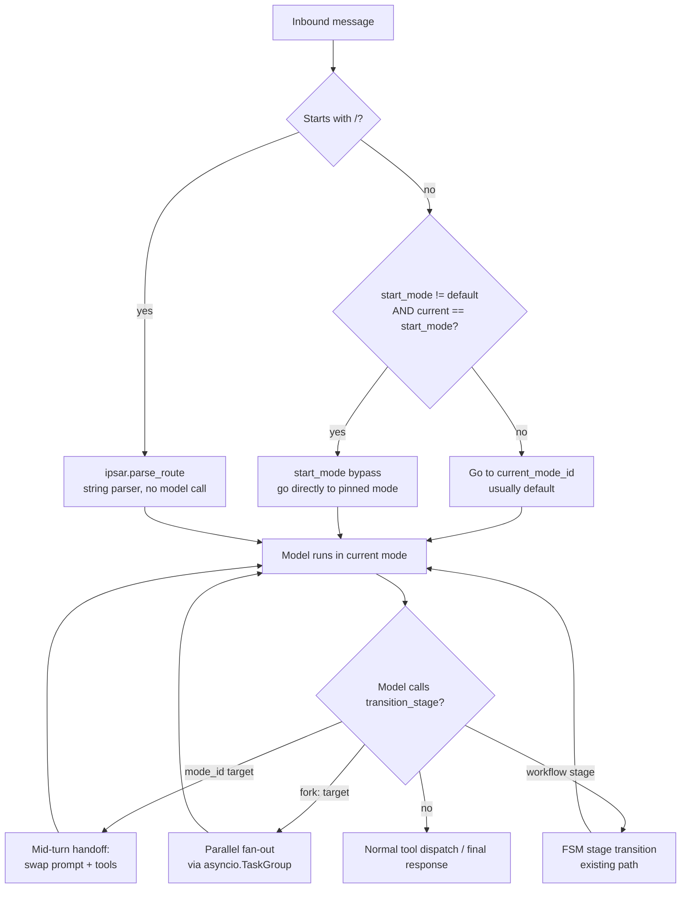
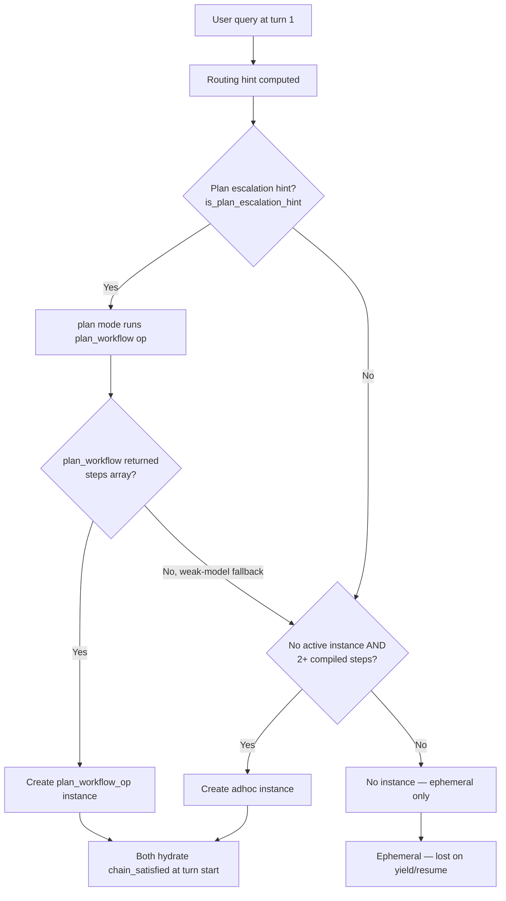
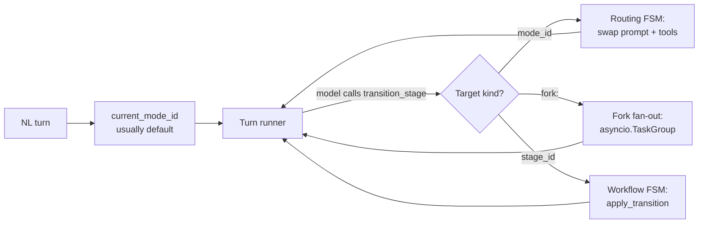
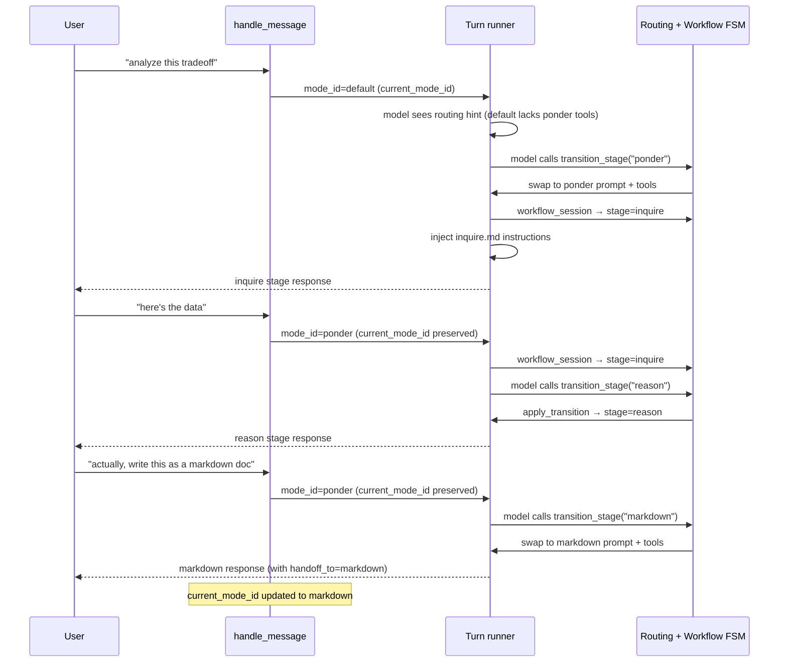

# Router Design

This document is the consolidated reference for the Lisa Framework's routing
system. It covers the turn-time dispatch contract, the unified FSM routing
mechanism (mode handoff via `transition_stage`), the interaction with staged
workflow modes, the session-context controls that gate routing, and the
fork fan-out pattern.

> **What changed.** The old separate stateless router planner
> (`kernel/router.py:plan_route`) was removed in a hard cutover. There is no
> longer a pre-turn model call to decide which mode owns a turn. Instead,
> natural-language turns go directly to `current_mode_id` (defaults to
> `default`), and the model hands off between modes mid-turn by calling
> `transition_stage` — the same mechanism already used for workflow stage
> advancement. One mechanism, one interception point, zero extra model calls.
> See `docs/SPEC/ROUTING_RFC_HANDOFF.md` for the full design rationale (now implemented; the RFC is retained as a historical record).

---

## 1. Overview

Routing decides which **user-facing mode** owns one natural-language turn.
Under the unified FSM, routing is an **emergent property of the turn loop**,
not a separate pre-turn planner.

The model starts every NL turn in `current_mode_id` (usually `default`).
If the current mode can handle the request, the model just does the work.
If a better-suited mode exists, the model calls `transition_stage` with the
target `mode_id` — the turn loop intercepts it, swaps the system prompt and
tool surface, and continues the loop in the new mode. Chat history is
preserved across the handoff.

### Design Principles

- **One mechanism.** `transition_stage` handles workflow stage advancement,
  mode handoff, and fork fan-out. There is no separate router, no separate
  handoff primitive, no separate fan-out operation.
- **No compat or migration layers.** The old `kernel/router.py`,
  `host/routing.py`, `RouteDecision` model, and `WorkshopExecutionService`
  were all removed in a hard cutover. No shims, no dual-path.
- **Zero extra model calls.** The old router spent one planner call per NL
  turn before the real turn. The unified FSM folds routing into the main
  turn's tool-call loop — the model hands off as part of its normal work.
- **Full conversation context.** The old router saw only a short excerpt.
  The unified FSM sees the full chat history because routing happens inside
  the turn loop.
- **Proactive hints, not reactive discovery.** A capability-manifest-aware
  hint is injected into the system prompt *before* the model call when the
  current mode lacks tools the query seems to need. The model doesn't waste
  an iteration discovering it can't do something.

---

## 2. Turn-Time Dispatch Contract

All hosts route inbound messages through `host/handle_message.py`. The
dispatch order is fixed:



| Priority | Path | Mechanism | Model call? |
| --- | --- | --- | --- |
| 1 | `/<command> <query>` | `kernel.ipsar.parse_route()` — string parser | No |
| 2a | NL, `start_mode != default` and `current_mode_id == start_mode` | Start-mode bypass — direct to pinned mode | No |
| 2b | NL, otherwise (incl. `start_mode == default`) | Go to `current_mode_id` (usually `default`) | No (for routing) |

The key change from the old design: branch 3b no longer calls a router
planner. It goes directly to `current_mode_id`. The model decides during
the turn whether to hand off to a different mode.

---

## 3. Session Context Controls

Routing behavior is configured in the session context's YAML front matter under
the `routing:` namespace. The compiled plan model is `SessionRouting`
(`kernel/session_plan.py`).

```yaml
routing:
  start_mode: default      # the pinned mode (bypass pin)
  aliases:
    go: discuss             # slash-command aliases
  priority_adjustments:
    discuss: 50             # override mode priority for catalog ordering
  hints:
    ponder:             # per-mode hint strings (used by fast-path, not a planner)
      - "Prefer ponder for tradeoff analysis."
```

### `start_mode` — the bypass pin

```python
class SessionRouting(_StrictSessionModel):
    start_mode: str = "default"
    aliases: dict[str, str] = Field(default_factory=dict)
    priority_adjustments: dict[str, int] = Field(default_factory=dict)
    hints: dict[str, tuple[str, ...]] = Field(default_factory=dict)
```

`start_mode` defaults to `"default"` and seeds `current_mode_id` at runtime
initialization:

```python
# host/runtime.py
self.current_mode_id: str = self.session_plan.manifest.routing.start_mode
```

The `start_mode` key is a **bypass pin**: when `current_mode_id == start_mode`
and `start_mode != "default"`, the turn goes directly to the pinned mode. This
keeps the user pinned in a declared owning mode (e.g. `learn`, `coding`,
`research`) unless they explicitly `/switch` away.

### `default` is exempt from the bypass

`default` is not a real owning mode — it's the routing hub. Pinning it would
silently disable handoff routing on every turn. The bypass guard in
`handle_message.py` exempts `default`:

```python
if (
    start_mode
    and start_mode != "default"
    and runtime.current_mode_id == start_mode
):
    # bypass: go directly to start_mode
```

This means `start_mode: default` (the implicit default) means "let the model
decide via handoff," not "pin to default."

### How `current_mode_id` changes

After each turn, `_execute_mode_turn` checks `TurnResult.handoff_to`. If the
model called `transition_stage` with a `mode_id` target, the host updates
`current_mode_id`:

```python
# host/handle_message.py — after run_turn returns
if result.handoff_to and result.handoff_to != mode.mode_id:
    runtime.current_mode_id = result.handoff_to
```

The next NL turn starts in the new mode. The model can hand off back to
`default` or to any other routable mode.

---

## 4. Unified FSM Routing

### The routing FSM

The routing FSM is a **meta-FSM** that sits above the per-mode workflow FSM.
It is synthesized from the mode catalog at startup by
`kernel/ipsar_fsm.py:synthesize_routing_transitions()`. The current
implementation builds a **full routable mesh**: every routable mode
(including `default`) can hand off to every other routable mode. This unblocks
the proactive fork routing hint from every entry mode — e.g. a
remember+write request issued from `coding` can fork to `learn` + `markdown`
instead of falling back to the current mode's approval-gated write tool.

Per-edge restrictions (e.g. forbidding `search` → `coding`) are a future,
smaller, authored opt-in; the default is permissive.

```python
# kernel/ipsar_fsm.py
def synthesize_routing_transitions(catalog) -> dict[str, list[str]]:
    routable_ids = get_routable_mode_ids(catalog)
    transitions: dict[str, list[str]] = {}
    for mode_id, mode_config in catalog.items():
        if mode_config.routable:
            # Every routable mode can hand off to every other routable mode.
            transitions[mode_id] = [m for m in routable_ids if m != mode_id]
        else:
            transitions[mode_id] = []
    return transitions
```

`default` is the routing hub (it is not an owning mode) but is otherwise a
normal participant in the mesh.

### How `transition_stage` handles three target kinds

The `transition_stage` tool is now advertised to **all routable modes** (not
just workflow modes). The interception block in `kernel/turn_runner.py`
distinguishes three cases based on the `target_stage_id` argument:

| Target kind | Example `target_stage_id` | What happens |
| --- | --- | --- |
| **Mode handoff** | `"markdown"` | Swap system prompt + tool surface for the new mode. Set `handoff_to` on `TurnResult`. Continue the loop. |
| **Fork fan-out** | `"fork:coding/implement,ponder/review"` | Parse targets, fan out children via `asyncio.TaskGroup`, collect results into `fork_results`. Continue the loop. |
| **Workflow stage** | `"reason"` (a stage in the current mode's FSM) | Existing `apply_transition` path. Update `workflow_session`. Continue the loop. |

The interception checks in this order:

1. Is it a fork target? (`is_fork_target()` — starts with `fork:`)
2. Is it a routable mode? (`is_routable_mode()` — in the mode catalog with `routable: true`)
3. Is it a workflow stage? (existing `is_workflow` path)

### Mid-turn mode handoff (Case 1)

When the model calls `transition_stage(target_stage_id="markdown")`:

1. The loop validates the handoff is allowed (`target in get_routing_targets(current_mode_id)`).
2. `messages[0]` (system prompt) is swapped to the new mode's `_mode.md` body.
3. Tool schemas are rebuilt for the new mode's `allowed_tool_ids`.
4. The capability manifest is recompiled for the new tool surface.
5. `mode_id` and `mode_config` are updated to the new mode.
6. `handoff_to` is set on the `TurnResult`.
7. The loop continues — the next model call uses the new prompt + tools.

**Chat history is preserved.** Only `messages[0]` (system prompt) changes.
All prior user/assistant/tool messages stay in the `messages` list.

### Fork fan-out (Case 2)

When the model calls `transition_stage(target_stage_id="fork:coding,markdown")`:

1. The fork string is parsed into `(mode_id, stage_id)` pairs.
2. Each target is validated against the mode catalog.
3. Children are fanned out via `asyncio.TaskGroup` — each child runs
   `run_turn()` with its own mode's system prompt and tool surface.
4. The parent turn's `TurnBudget` is divided equally across N children.
5. Results are collected into `fork_results: list[ForkChildResult]`.
6. If any child is `no_tools`, `blocked`, or `interrupted`, the parent
   aborts with a deterministic failure message (the model cannot
   paraphrase a failure into a false "completed"). Otherwise the loop
   continues — the model sees the fork results as the tool output and
   can synthesize from them.

Fork target syntax:

```plaintext
fork:coding,markdown                         # two modes, default start_stage
fork:coding/implement,ponder/review       # with explicit stages
fork:search,calendar,email                   # heterogeneous parallel workers
```

Per-worker queries can be passed in `tool_arguments.queries` (a list parallel
to the fork targets). When not provided, each worker receives the user's
original message.

#### Forced fork (when the model refuses)

The routing hint is advisory prose — it *asks* the model to call
`transition_stage` with a `fork:` target. Weak models (e.g.
`gpt-5.4-mini` in `plan` mode, faced with a strict tool schema) sometimes
refuse: they do "useful" read-only work instead (`fetch_page`,
`web_search`), burn iterations, and return an empty completion. The
turn then exits at the iteration cap with no fork ever running, and the
no-tools final-completion fallback hallucinates the tool call as prose.
See Invariant 2 in `docs/lessons/fork-incident-digest.md` — the
forced-fork enforcer is the load-bearing guard for this refusal mode.

The kernel does not beg the model via nudges when it has already
computed the deterministic next step. The fork target is derivable from
the same intent-gap / disjoint-coverage logic that built the hint, so the
kernel forces the fork itself:

- **`_compute_fork_target_string`** (`kernel/turn_phases/_routing_hint.py`)
  is the pure, prose-free core of the fork branch. It returns the
  `fork:mode,mode,...` string (or `None`) for a query + routing_targets
  + current mode. The hint emitter wraps it in advisory prose; the
  enforcer calls it directly. They share one truth.
- When a fork hint is injected, the turn loop stores the computed fork
  target in `_TurnState.forced_fork_target` and resets a
  `non_fork_tool_dispatches` counter. The chained-hint recomputation
  block refreshes both after each handoff so the enforcer tracks the
  post-handoff routing decision.
- **Tool-dispatch path**: each non-`transition_stage` tool call while a
  forced fork is pending increments `non_fork_tool_dispatches`. At
  `_FORCED_FORK_NON_FORK_TOOL_CAP` (default 2), the kernel synthesizes
  the `transition_stage(fork:...)` call by overriding the current tool
  call's name/arguments and lets the existing transition interception
  dispatch the fan-out.
- **Empty-completion path**: when the model returns no tool calls with a
  forced fork pending, the kernel synthesizes the fork call and
  dispatches it on the next iteration instead of accepting the empty
  turn.

Both paths clear `forced_fork_target` after firing, so the enforcer runs
at most once per turn and the post-fork hint recomputation can set a
fresh target if the chain continues.

> **Philosophy.** This is the same lesson as the completion-contract guard
> (which catches children that hallucinated success via effect receipts,
> not tool-name heuristics), applied one layer earlier:
> *don't hand the model advisory prose and trust it.* When the kernel has
> already decided the routing, the model is the executor. When the
> executor won't execute a deterministic next step, the kernel takes
> over. The hint *is* the pressure; once the model has shown it won't act
> on it, the kernel acts. This matches the framework's standing
> preference for **opportunistic, pressure-driven** kernel action over
> repeated nudges.

### Workflow stage transition (Case 3)

This is the existing path, unchanged. When the model calls
`transition_stage(target_stage_id="reason")` and `reason` is a stage in the
current workflow mode's FSM:

1. `apply_transition()` validates the transition against `allowed_next_stages`.
2. `workflow_session_updater` persists the new `stage_id`.
3. If the new stage is terminal, the loop forces one final no-tools completion.
4. A stuck-session guard injects a soft nudge after `stage_nudge_threshold`
   (default 7) turns in the same stage without advancing, and pauses the
   turn (or terminates for action modes with no yield escape) at
   `stage_nudge_cap` (default 10). Both are `kernel.config.Settings` fields
   (override via `STAGE_NUDGE_THRESHOLD` / `STAGE_NUDGE_CAP`), enforced by
   the lifecycle resolver (`kernel/turn_phases/_lifecycle.py`) — not module
   constants. Caps pause/terminate; they never silently truncate.

---

## 5. Capability-Manifest-Aware Proactive Hints

Before the model call, the turn runner compiles a `CapabilityManifest` from
the live tool schemas. It then compares the manifest against the user's query:

- If the current mode lacks file-writing tools and the query mentions "write",
  "save", "document", "file", "code", or "read" → inject a routing hint.
- If the current mode lacks search tools and the query mentions "search" →
  inject a routing hint.

The hint is a conditional string appended to the system prompt:

```text
## Routing Hint

Your current mode may lack the tools needed for this request. You can hand
off to a better-suited mode by calling `transition_stage` with one of these
target_stage_id values: markdown, coding, search.
```

This is **proactive** — the model knows before it tries. And it's **zero-cost**
when the current mode can handle the request (no hint is injected, no extra
tokens).

### 5b. Plan-mode escalation

When the gap is complex (3+ remaining gap intents, or 2+ gap intents in a
sequential query — "search … then code … then write"), the hint escalates to
the `plan` action mode instead of routing directly to the first target:

```text
## Routing Hint

This is a complex multi-step request. Hand off to `plan` by calling
`transition_stage` with target_stage_id `plan`. The plan mode will analyze
the query and determine the best routing target.
```

`plan` mode's `plan_workflow` entry operation makes one cheap model call that
returns a `target_stage_id` and an optional `steps` array. The kernel then
synthesizes a `transition_stage` handoff to the first step (kernel-driven, not
model-driven — weak models that stop after planning without calling the tool
were the 2026-07-28 stall). See §5c for how the `steps` array becomes a durable
`WorkflowInstance`.

The escalation gate is tag-blind and prose-blind:

```python
# kernel/turn_phases/_routing_hint.py
if (
    "plan" in routing_targets
    and "plan" not in current_satisfied               # not already planned
    and is_plan_reliable_for_model(planner_model_id)  # not blocklisted
    and (len(gap_intents) >= 3 or (len(gap_intents) >= 2 and _query_is_sequential(query)))
):
    return _PLAN_ESCALATION_HINT
```

A model is marked unreliable for planning when `plan_workflow` previously
failed to produce a parseable `target_stage_id` (e.g. a local backend
returning `StubCompletion` instead of JSON). The registry
(`kernel.routing_vocabulary._unreliable_plan_models`) is per-model and cleared
on process restart. Unknown models are assumed reliable.

---

## 5c. Durable Workflow Chains (ad-hoc vs planned)

Multi-step queries (search → code review → write report) need chain memory
that survives across turns. A turn that hits the iteration limit **yields**
(asks the user "how would you like me to proceed?"); the user replies
"continue" and the next turn must resume from the right step, not restart.

The chain memory has two forms:

| Form | Scope | Reset behavior |
| --- | --- | --- |
| `chain_satisfied` (set on `_TurnState`) | One turn | Reset to `set()` at the start of every turn |
| `WorkflowInstance.completed_steps` | Cross-turn, cross-restart | Persisted to disk via the host's store; hydrated at turn start |

The ephemeral `chain_satisfied` set accumulates which intents each mode
satisfied during this turn's handoffs (entry mode + each handoff target). It
prevents the post-handoff hint from re-suggesting a step that already ran
within the same turn. But it resets every turn — so a yield → "continue"
resume wipes it.

The durable `WorkflowInstance` is the cross-turn form. It carries
`declared_steps`, `completed_steps`, `current_step_id`, and
`current_mode_id`. At turn start, the hydration block reads
`completed_steps` and populates `chain_satisfied` from each completed step's
`satisfies_intents` **before** the routing hint is computed, so the hint sees
the remaining gap (not the full original query).

### Two creation paths



**Planned** (`spawned_from="plan_workflow_op"`): Created when the `plan`
mode's `plan_workflow` entry op returns a `steps` array. The steps are
model-authored (each has `mode_id`, `description`, `rationale`). The kernel
converts them to `WorkflowStep` objects via `_plan_steps_to_workflow_steps`
and persists the instance via `workflow_instance_updater`.

**Ad-hoc** (`spawned_from="adhoc"`): Created at turn 1 when the routing hint
detects a multi-step chain and no instance is already active. The kernel
compiles the chain via `compile_steps_from_routing_targets`
(`kernel/workflow_instance.py`), which reuses the same routing helpers as the
hint: detects intents, orders producers before consumers, picks the
earliest-keyword target for each intent, marks the last step terminal. The
ad-hoc block is gated on:

- No active instance (turn 1, not a resume).
- The routing hint is not a plan-escalation hint (`is_plan_escalation_hint`
  returns `False`) — plan mode owns the instance when escalation fires.
- The compiled chain has 2+ steps (a real multi-step request).
- The updater is wired (the host owns the lifecycle).
- Suppressed for fork children (`suppress_routing_hint`).

The ad-hoc path is the fallback for when `plan` is not available, the model is
unreliable for planning, or `plan_workflow` returned no `steps` (weak-model
fallback). Without it, those cases have no durable chain and a yield → resume
skips the middle step (the 2026-08-01 incident).

### Advancement and completion

Both instance types advance the same way: when the model calls
`transition_stage` with a new `mode_id` target, the handoff path calls
`advance_step(instance, instance.current_step_id)`, which marks the current
step as completed and moves the pointer to the next remaining step. The
advanced instance is persisted via `workflow_instance_updater`.

When the last step completes, `is_complete` returns `True` and the host clears
the active ref so the next turn starts fresh.

### Per-step budget exhaustion

When the current step exhausts its per-step iteration or tool-call budget but
the global cap has not fired, the kernel synthesizes a handoff to the next
remaining step instead of letting the model keep looping in the same mode.
This prevents a 6-step chain from starving its final step because earlier
steps consumed the whole shared 15-iteration budget. The per-step budget is
configured via `per_step_max_iterations` / `per_step_max_tool_calls` on
`run_turn`.

### Host wiring

The host (`host/runtime.py`) owns the instance lifecycle:

- `workflow_instance` hook: returns the active `WorkflowInstance` (or `None`).
- `workflow_instance_updater` hook: persists an advanced instance and swaps
  the in-memory active ref. When the instance is complete, clears the ref.
- `FileWorkflowInstanceStore` (`host/workflow_instance_store.py`):
  atomically persists instances to `<data-dir>/workflow-instances.json`,
  scoped by `RecoveryIdentity` (one active instance per user/surface).
- Boot-load: `_boot_load_active_workflow_instance` resumes a mid-flight
  instance on host restart and overrides `current_mode_id` from the
  instance's current step's mode.

### Coordinator resume

When a `plan_workflow_op` instance is active and the user sends a
continuation query ("proceed", "continue"), the `_coordinator_routing_hint`
helper reads the next target from the instance's `current_step_id` (which
was advanced when the previous step completed), not from the route
coordinator's saved `next_target` (which points at the first step and goes
stale after advancement). This is the cross-turn plan resume path.

---

## 6. What the Model Sees

The model sees `transition_stage` as a tool with a `target_stage_id` parameter.
The tool description tells it what values are valid. For a `default` mode
session, the valid targets include every routable mode:

```json
{
  "name": "transition_stage",
  "description": "Move to the next workflow stage or hand off to another mode...",
  "parameters": {
    "type": "object",
    "properties": {
      "target_stage_id": {
        "type": "string",
        "description": "The target stage or mode_id..."
      },
      "rationale": { "type": "string" }
    }
  }
}
```

The model discovers routing targets from:

1. The **system prompt** — the mode's `_mode.md` body describes what it can do.
2. The **routing hint** — injected when the current mode lacks tools the query needs.
3. The **tool surface** — the `transition_stage` tool is present, signaling
   that handoff is available.

---

## 7. Mode Authoring for Routing

### Making a mode routable

A mode is routable when its `_mode.md` front matter has `routable: true`:

```yaml
---
mode_id: markdown
mode_kind: chat
routable: true              # required for handoff targets
priority: 6                 # higher = earlier in catalog ordering
fast_path_patterns:         # regex list for zero-cost pre-turn hint
  - '\bmarkdown\b'
command_pattern: '^(?:/)?markdown(?:[\s,:;]+(?P<query>.+))?$'
allowed_tool_ids:
  - markdown_generate
  - write_file
tools_authoritative: true
---
```

### Front-matter keys for routing

| Key | Purpose | Required for routing? |
| --- | --- | --- |
| `routable` | Must be `true` to appear as a handoff target | Yes |
| `priority` | Catalog ordering (higher = earlier) | No (default 0) |
| `fast_path_patterns` | Regex list for zero-cost pre-turn hint | No |
| `command_pattern` | Slash-command regex for `parse_route` | No (for `/mode` entry) |
| `allowed_tool_ids` | Tool surface for this mode | No (but recommended) |
| `tools_authoritative` | When `true`, empty `allowed_tool_ids` = no tools | No (default `true`) |
| `accept_default_capabilities` | When `true` (default), inherit `default_available` ops/tools | No (default `true`) |
| `excluded_operation_ids` | Ops to subtract from the default-available merge | No (default `[]`) |
| `excluded_tool_ids` | Tools to subtract from the default-available merge | No (default `[]`) |
| `routing_intent_tags` | Tag vocabulary advertising what intents this mode satisfies (used by the proactive hint) | No (default `[]`) |
| `routing_intent_keywords` | Lexical keywords that signal this mode's intents | No (default `[]`) |
| `satisfies_intents` | Intents this mode can satisfy (matched against a query's required intents) | No (default `[]`) |
| `required_capabilities` | Capabilities a query needs that this mode provides (matched by the capability gate) | No (default `[]`) |
| `default_intent_bridges` | Bridges from `default` to this mode on intent match | No (default `[]`) |

### Fast-path patterns (kept as a zero-cost hint)

`fast_path_patterns` are still evaluated as a zero-cost regex match before
the turn. If a message matches a mode's patterns, the host can short-circuit
directly to that mode without even starting the turn in `default`. This is a
*hint*, not a *gate* — if it misses, the model can still hand off mid-turn
via `transition_stage`.

### What was removed from `_mode.md`

The following front-matter keys were removed in the hard cutover and are no
longer recognized:

- `workshop_panels` — replaced by `fork:` targets in `transition_stage`
- `workshop_budget` — replaced by `TurnBudget` sub-allocation
- `workshop_rendering` — synthesis is now a workflow stage
- `workshop_planner_prompt_file` — no longer needed
- `workshop_synthesis_prompt_file` — no longer needed

---

## 8. Staged Workflow Modes and Routing

### How routing and workflow FSMs compose

The routing FSM (mode handoff) and the per-mode workflow FSM (stage
advancement) are **two layers of the same mechanism**. `transition_stage`
checks the routing FSM first (is the target a `mode_id`?), then falls through
to the workflow FSM (is the target a stage in the current mode?).



### Example: ponder workflow with handoff

`ponder` is a `mode_kind: workflow` mode with stages:
`inquire → reason → formulate → exit`.



### Stage files

Each stage is a Markdown file in the mode directory with YAML front matter:

```yaml
# sdk/packs/search/modes/ponder/reason.md
---
stage_id: reason
allowed_next_stages: [formulate, exit]
description: "Discuss findings, identify trade-offs, and align on logical paths."
---

# Ponder Mode: Reason Stage

You are in the Reason stage. Analyze findings, brainstorm 2-3 logical paths...
```

The body text becomes `WorkflowStageConfig.instruction_body`, injected at
runtime. Stage files starting with `_` are skipped.

### Stuck-session guards (free from the FSM)

Because routing uses the same `transition_stage` interception as workflow
stage advancement, all existing guardrails apply automatically:

- **`stage_nudge_threshold` / `stage_nudge_cap`** (defaults 7 / 10,
  `kernel.config.Settings`; override via `STAGE_NUDGE_THRESHOLD` /
  `STAGE_NUDGE_CAP`) — the lifecycle resolver injects a soft nudge at the
  threshold; the cap pauses the turn (terminates for action modes with no
  yield escape). Caps pause/terminate, never silently truncate. See
  `kernel/turn_phases/_lifecycle.py` (`resolve_lifecycle_action`).
- **`TurnBudget`** — tool calls, tokens, and wall time are tracked across
  mode switches within the same turn. A budget-exhausted turn pauses (or
  terminates for action modes) regardless of which mode it's in.
- **`max_tool_iterations`** — the global iteration cap still applies; mode
  switches don't reset it.

---

## 9. Fork Fan-Out (Replaces Workshop)

The old `workshop_run` operation and `WorkshopExecutionService` were removed.
Fan-out is now a first-class `transition_stage` target.

### When to use fork

- "Research this topic AND write a markdown summary" → `fork:search,markdown`
- "Code-review this PR from security, performance, and style perspectives" → `fork:ponder/security,ponder/performance,ponder/style`
- "Search the web, check my calendar, and draft an email" → `fork:search,calendar,email`

Each fork target is a `(mode_id, stage_id, query)` tuple. The `mode_id`
determines the system prompt and tool surface. The `stage_id` (optional,
defaults to the mode's `start_stage_id`) determines the workflow stage. The
query is the scoped prompt for that worker.

### Budget enforcement

The parent turn's `TurnBudget` is divided equally across N children. Each
child gets a sub-budget. If a child exhausts its sub-budget, it returns a
partial result. The parent turn's budget is the hard cap — fan-out doesn't
grant extra resources.

### Failure handling

The FSM collects all child results (including failures) into `fork_results`
and aborts the turn with a deterministic failure message when any child is
`no_tools`, `blocked`, or `interrupted`. The model cannot paraphrase a
failure into a false "completed" (the 2026-07-25 incident).

Child status is classified by `kernel/turn_phases/_child_turn.py ::
classify_child_turn` — the single shared classifier called by both the
fork and delegate paths. Its fixed classification order:

1. **`blocked`** — the capability gate stopped the child before the tool
   loop (the router declined to escalate to a model with the required
   capabilities). Carries a `BlockDiagnostic` with the missing capabilities
   and resolved model so the parent surfaces the actual cause.
2. **`model_yield`** — the model called the `yield` tool to ask the user
   a question. The parent propagates the child's `YieldAction`.
3. **`interrupted`** — the harness force-yielded (iteration cap / budget /
   stuck-in-stage). The child never finished, so its tool-call pattern is
   inconclusive.
4. **`timeout`** / **`error`** / **`cancelled`** — exception-based outcomes.
5. **`complete`** / **`no_tools`** — completion-contract validation.

The completion contract uses `EffectReceipt`s collected at dispatch time
from each capability's declared `effect`, not tool-name heuristics. The
required set is resolved by `kernel/operations/registry.py ::
mode_completion_effects` — the single canonical source that reads authored
bindings plus `mode_allowlist`-admitted operations and tools, excluding
ambient `default_available` capabilities. This ensures the advertiser
(`build_operation_tool_schemas`) and the validator see the same action-tool
set.

### Fork vs delegate

Fork and delegate share the same child-turn infrastructure —
`classify_child_turn`, the `sub_turn_kind` contract seam, the
`mode_completion_effects` action-tool resolver, and the
`ForkChildResult` / `DelegationResult` status union. The differences are
narrow and mostly flow from one irreducible axis: **does the target mode
need a path to ask the user?**

| Axis | fork | delegate |
| --- | --- | --- |
| Parent stays alive | No — parent turn ends after fan-out | Yes — parent waits and consumes the child's result |
| Children | N (parallel fan-out) | 1 (sequential) |
| Concurrency | `asyncio.TaskGroup` — N children run at once | one `run_turn` awaited sequentially |
| Budget per child | `TurnBudget ÷ N` (every axis halved by child count) | full remaining parent budget |
| Result shape | `list[ForkChildResult]` | one `DelegationResult` |
| Sub-turn contract | `prompts/sub_turn/fork_contract.md` — "your output is discarded as unverified" | `prompts/sub_turn/delegate_contract.md` — "return `status=no_tools` so your parent can decide" |
| Recursion | not bounded (fork children suppress routing hints; no re-fork) | bounded by `delegate_max_depth`; children may themselves delegate |
| Consent | `fork_allowed: true` in `_mode.md` — the mode commits to completing or failing without asking | no consent needed; any routable mode may be a delegate target |
| Yield | `YieldPolicy(allowed=False)` unconditionally — the `yield` tool is never advertised to a fork child | foreground `yield_policy` — the child may emit `model_yield`, which propagates to the user through the parent |
| Trigger | routing syntax — `fork:mode,mode,...` via `transition_stage` | pack operation — LLM tool call with structured `Parameters` |

**Why fork needs `fork_allowed`.** Fork children run concurrently with no
interactive channel — the user cannot answer one child's question without
blocking the others. A mode that declares `fork_allowed: true` commits to
completing or failing without asking; the routing fork decision
(`_build_fork_target`) and the fork enforcer refuse a fork when any
candidate target lacks this. The fork child's `run_turn` call receives
`yield_policy_override=YieldPolicy(allowed=False)` unconditionally, so the
`yield` tool is never advertised. A mode that may need to ask the user
must NOT set `fork_allowed`; it is reachable only via delegate or
single-handoff.

**Why delegate is the interactive path.** Delegate children run
sequentially while the parent waits, so they inherit the mode's foreground
`yield_policy`. When a delegate child emits `model_yield`, the parent turn
intercepts it and surfaces the child's question to the user — the parent
is the interactive proxy. The `YieldAction.context` is enriched with the
original delegated query ("the delegate was asked 'X'; it asks 'Y'") so
the user has the surrounding input to answer. The yield state is recorded
on the thread entry (`yielded=True` plus `yield_question`) and is resumable
via `/resume`.

**Why delegate needs recursion bounding.** A delegate child can itself
call `delegate`, forming an agent tree of arbitrary depth.
`_default_delegate_fn` threads `delegate_depth` and enforces
`delegate_max_depth` (`kernel/config.py`), returning `status="max_depth"`
at the cap. Fork children suppress routing hints and do not re-fork, so
no depth bound is needed today.

**Ambiguity yield.** When the routing hint detects a gap but cannot
confidently resolve a target (no single covering target, no fork, no
producer-first, no sequential chain), the turn yields to the user with a
clarification question naming the available routing targets — instead of
proceeding silently and letting the model guess. This is the last resort;
all common routing paths return concrete hints and never reach it.

---

## 10. Model Manifest Integration

The model used for each turn is resolved by **designation**, not by a
hardcoded ID. The model manifest (`<data-dir>/models.yaml`) supports
designations:

| Designation | Used by |
| --- | --- |
| `default` | Default chat mode |
| `reasoning` | Reasoning-heavy modes |

There is no separate planner model: natural-language turns route directly
to the current mode, and the `default` model hands off mid-turn via
`transition_stage` tool calls. The legacy `router` designation was removed
in the unified-FSM cutover — manifests carrying it will fail validation.

Hosts manage manifests through commands:

- `/models discover` — probes providers, writes `models.proposed.yaml`.
- `/models apply` — validates and promotes the proposal to `models.yaml`.
- `/models reload` — reloads from disk.

---

## 11. Module Reference

| Module | Role |
| --- | --- |
| `kernel/turn_runner.py` | Turn execution loop. Intercepts `transition_stage` for mode handoff, fork fan-out, and workflow stage transitions. Compiles capability manifest and injects routing hints. Captures `EffectReceipt`s at dispatch time. |
| `kernel/turn_phases/_child_turn.py` | Shared child-turn classifier (`classify_child_turn`). Called by both fork and delegate paths. Fixed order: blocked → model_yield → interrupted → timeout/error → completion-contract → complete. |
| `kernel/turn_phases/_fork.py` | Fork fan-out orchestration. Budget division, child turn execution, unconditional `YieldPolicy(allowed=False)` override. Delegates classification to `classify_child_turn`. |
| `kernel/operations/registry.py` | Operation catalog, admission gates, `mode_completion_effects` (the canonical action-tool resolver shared with `classify_child_turn`). |
| `kernel/ipsar_fsm.py` | FSM loader and runtime. Synthesizes routing transitions (`synthesize_routing_transitions`, `get_routing_targets`, `is_routable_mode`). Parses fork targets (`parse_fork_target_string`, `is_fork_target`). Validates workflow stage transitions (`apply_transition`). |
| `kernel/models.py` | `ForkTarget`, `ForkChildResult`, `ChildTurnOutcome`, `EffectReceipt`, `BlockDiagnostic`, `WorkflowModeConfig`, `WorkflowStageConfig`, `WorkflowTransitionRequest`, `TurnBudget`, `CallLedger`. |
| `kernel/ipsar.py` | Slash-command route resolution (`parse_route`). String parser, no model call. |
| `kernel/session_plan.py` | `SessionRouting` model (compiled from session context front matter). Owns `start_mode`, `aliases`, `priority_adjustments`, `hints`. |
| `kernel/capability_manifest.py` | Compiles `CapabilityManifest` from live tool schemas. Used for proactive routing hints. |
| `host/handle_message.py` | Turn-time dispatch contract. The fixed priority order: slash commands → `start_mode` bypass → `current_mode_id`. Persists `handoff_to` after the turn. |
| `host/runtime.py` | `HostRuntime.start_mode_id` property and `current_mode_id` initialization + update. |

### Removed

| Module | Status |
| --- | --- |
| `kernel/router.py` | Removed. The stateless router planner (`plan_route`) was replaced by mid-turn `transition_stage` handoff. No shim, no dual-path. |
| `host/routing.py` | Removed. The host wrapper around `plan_route`. |
| `sdk/workshop_execution.py` | Removed. `WorkshopExecutionService` replaced by `fork:` targets in `transition_stage`. |
| `sdk/packs/core/operations/research/workshop_run.py` | Removed. The `workshop_run` operation replaced by `transition_stage` with `fork:` targets. |
| `sdk/packs/core/modes/workshop/` | Removed. The workshop mode. |
| `RouteDecision`, `RouteDecisionAlternative`, `RoutePlannerSource`, `RouterPromptProfile`, `OptionalContextLane` | Removed from `kernel/models.py`. No longer needed — routing is a tool call, not a structured output schema. |
| `WorkshopPanelModeConfig`, `WorkshopBudgetConfig`, `WorkshopRenderConfig`, `WorkshopPlan`, `WorkshopPanelSpec`, `WorkshopPanelContext`, `WorkshopContextBundle`, `WorkshopChildResult`, `WorkshopExecutionSummary` | Removed from `kernel/models.py`. Replaced by `ForkTarget` and `ForkChildResult`. |
