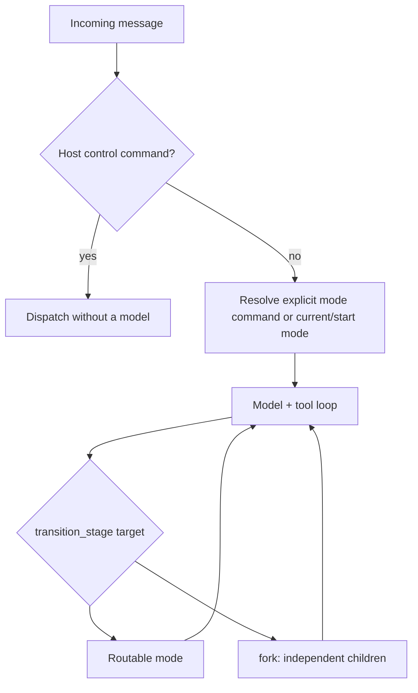

# Mode and workflow routing

This is the current routing contract. The superseded pre-turn planner RFC
and incident-specific fork report have been consolidated into this guide
and the [turn-loop invariants](lessons/turn-loop-invariants.md).

**Mode routing** assigns work and capabilities. **Model routing** chooses
a provider/model per iteration and has its own
[CEL reference](../sdk/src/sdk/router/README.md).

## Turn-time dispatch

All transports use [handle_message](../runtime/src/runtime/handle_message.py).
Host control commands are handled before model work. Mode command patterns
are parsed without a routing model call. Natural-language turns continue in
the active `current_mode_id`; the session's `routing.start_mode` seeds
startup and provides the non-default start-mode bypass.

`default` is not a permanent pin: the model can hand off to a more suitable
mode. The runtime records the owning mode after a handoff and can restore it
from thread state on a later startup. Do not assume every message restarts
the same prompt or routes through a separate planner.



See [session routing configuration](SESSION_CONTEXT_AUTHORING_GUIDE.md#routing)
for aliases, priority adjustments, hints, and authored intent vocabulary.

## One transition primitive

The intercepted `transition_stage` tool now has one intra-turn meaning — a
routable mode handoff — plus the fan-out form:

1. A routable mode: change the active mode, instructions, allowed capabilities,
   and model resolution while preserving conversation evidence.
2. A `fork:` target: execute independent child turns and aggregate structured
   outcomes before continuing the parent.

The intra-mode **workflow stage** target was removed. `WorkflowStageConfig`,
`start_stage_id`, `allowed_next_stages`, `terminal`, the per-mode stage
loader/validator, `is_terminal_stage`, and the stage-instruction injection
into the system prompt are all gone, along with `WorkflowPosition.stage_id`.
The mechanism never carried real work: no installed pack shipped stage files,
19 of 20 modes declaring `start_stage_id` declared `none`, and the thread
records 13 `transitioned_to` events across 1,043 turns — all of them
mode-level re-entries, never a stage advance.

`transitioned_to` and `RecoveryRecord.stage_id` survive as *read-only legacy
fields* so persisted thread and recovery records from before the removal still
load; nothing writes them. A handoff reports `handoff_to`.

The routing FSM synthesizes a full mesh among routable modes, not just
edges back to `default`.

## Capability hints and enforcement

The kernel compiles the live capability manifest and detects gaps between
query intents and the current mode's declared in-place abilities.
It can propose a single handoff, a sequential chain, independent fork,
or planner escalation **before** a completion. No separate routing model
call is required.

Intent vocabulary comes from the session; coverage claims come from mode
metadata. This is a deterministic hint system, not a semantic proof of
user intent. High-precision command patterns and careful intent declarations
reduce false matches.

For a deterministic pending action, the forced-action enforcer limits
non-compliant dispatches and can synthesize the transition rather than
nudge forever. Forced forks share the same target computation as hints.
Do not recreate old fork-specific counters/settings from an incident report;
consult [kernel Settings](../kernel/src/kernel/config.py) and the
[invariant registry](lessons/turn-loop-invariants.md).

## Authoring a routable mode

These are fields in `_mode.md` front matter, not a complete mode:

```yaml
mode_id: example
mode_kind: action
routable: true
command_pattern: '^(?:/)?example(?:[\s,:;]+(?P<query>.+))?$'
allowed_operation_ids: [example_operation]
routing_intent_tags: [example_intent]
satisfies_intents: [example_intent]
routing_intent_keywords:
  example_intent: [example]
```

| Field | Contract |
| --- | --- |
| `command_pattern` | Direct command parsing, no routing model |
| `routable` | Eligibility for routing transitions |
| `routing_intent_tags` | Intents covered when routing to the mode |
| `satisfies_intents` | Intents handled in-place; normally use the same vocabulary |
| `routing_intent_keywords` | Intent-tagged query matching |
| `fast_path_patterns` | High-precision hint candidates, not a separate planner |
| `required_capabilities` | Capabilities expected from the selected manifest model |
| `fork_allowed` | Claim that the mode can run without an interactive child channel |
| `yield_policy` | Whether/how the mode may ask the user |
| `approval_continuation` | Post-approval report versus resumed work |
| `task_completion` / `task_artifact_tool_id` | Checked-commit task gate and its exposed artifact producer |

See [pack authoring](PACK_AUTHORING_GUIDE.md) for full validation, defaults,
capability visibility, and mode examples. A mode with a nontrivial
tool surface but no `satisfies_intents` can repeatedly request unnecessary
handoffs; broad keywords can route a mention rather than an actual request.

## Fork versus delegate

| Property | Fork | Delegate |
| --- | --- | --- |
| Shape | Parallel independent children | Sequential child work with parent mediation |
| Input dependence | Children must not need each other's output | Parent can pass previously produced evidence |
| Interactive yield | Disallowed for children | Can propagate through the parent |
| Completion | Structured child status and receipt checks | Shared child classifier and completion checks |

A `fork:mode/stage,mode/stage` target can supply per-child queries. A fork
requires eligible targets and receives bounded child budgets. Partial
failure, timeout, interruption, blocked capability, and missing action
evidence remain visible; aggregation must not present all children as
successful just because they produced text.

The producer/consumer guard rejects parallelization when a consumer needs
another step's evidence. For example, research followed by writing a report
is sequential even if the query does not contain the word "then".
Independent work can still fork. Never remove this distinction to make
more queries fan out.

### What a child inherits

A fork or delegate child starts with fresh model history: the turn runner skips
`prior_messages` when a child turn kind is set, so the parent conversation is
not replayed into the child's request.

Fresh history is not isolation. A child runs through the same host-owned turn
hooks and reassembles its own context, so it shares the parent's hook instances
and ambient state — memory recall, context digests, capability manifests, and
the system prompt all come from the shared host. Treat a child as a fresh
conversation, not a sandbox and not a security boundary. Parent message history
is deliberately not inherited; changing that would change what the model sees
and requires a benchmark first.

## Durable workflow chains

Multi-step work uses a typed `WorkflowPosition` and a thread-derived
`WorkflowView`, not the retired `WorkflowInstance` file-store contract.

A workflow originates from a **`## Plan` block** written into the thread by the
`planner` mode's `plan_workflow` operation. That is the only origin: ad-hoc
step compilation (the kernel deriving steps from routing intents) has been
removed. It was unreachable in every real install — it required a
host-supplied `workflow_position_updater`, which the shipped host does not
wire, *and* the absence of `planner` from the catalog, which cannot happen
because `planner` ships in the always-on `lisa-pack-core`. Keeping a second,
dormant origin in the code implied a behaviour that did not exist.

Only a plan block that **opens** the turn counts. The turn runner prepends the
rendered plan, so a `## Plan` heading anywhere later in a response is a
quotation, an example, or a discussion of a plan — not the active one. (This
also excludes fenced examples, which by construction follow prose.)

The position combines declared/completed steps with the current mode/stage.
At turn start the host derives an immutable view from the thread: plans,
matching write receipts, read-step handoffs, and addressed completing turns.
A yield or continuation can recover remaining work rather than restart it.
The thread is the durable source of truth; there is no separate mutable
workflow-position store.

Completion is matched by **consuming thread entries**, and each entry may
complete at most one step. Receipts are scoped by the mode that *dispatched*
them (`EffectReceipt.mode_id`), not by the entry's `mode_id`: one turn can span
several modes by handing off mid-turn, and the entry records only the mode it
started in. Two rules follow from that:

- A single receipt cannot satisfy two steps that share a `mode_id` (two
  `coding` steps and one commit previously ticked both boxes and could collapse
  a whole plan to "done").
- A step's evidence counts even when an earlier step never finished. Completion
  reports what happened, not what the declared order predicted. A step is still
  scoped by mode, so one mode's work cannot complete another's step.

Step budgets prevent a chain from spending the whole turn on one target.
When a step stalls, recovery and lifecycle policy determine whether it can
advance, pause, or require the operator. Consult current dispatch/recovery
evidence rather than silently marking the step complete.

### Ending a workflow

A plan ends in one of three ways:

| Ending | How |
| --- | --- |
| **Complete** | Every declared step gains its completion evidence; the view then derives to `None`. |
| **Concluded** | `/workflow conclude [reason]` appends a thread entry carrying `provenance.workflow_conclusion`. |
| **Superseded** | A new `## Plan` becomes the latest plan; derivation only reads the newest. |

Concluding exists because the first and third are not always available: work
can become moot. Before it, an abandoned plan stayed active indefinitely, and
because the derived view is injected into every turn's briefing and steers
handoffs toward the declared steps, it kept costing context and misdirecting
routing. The marker is a thread entry rather than in-process state, so the
decision survives restarts and the reason stays auditable. A conclusion only
retires plans that precede it — an older conclusion cannot kill a newer plan.

## Completion and failure contracts

A declared action mode must satisfy the receipt-based completion contract;
calling a random read tool does not prove a write occurred. Honest read-only
work has an explicit exemption. A checked-commit task additionally requires
one task-owned artifact with the real changed commit, current required
checks bound to its revision/tree, and a clean owned worktree.

Approval, yield, pause, block, error, and completion are distinct states.
Capability gates run against the resolved model; lifecycle guards prevent
repeated handoffs, stalled reads/writes, and silent cap expiry.
See [invariants](lessons/turn-loop-invariants.md),
[policy](POLICY_GUIDE.md), [budgets](TOKEN_BUDGET.md), and
[recovery commands](../sdk/packs/recovery/src/sdk/packs/recovery/README.md).

## Implementation references

- [Turn runner](../kernel/src/kernel/turn_runner/): loop and transition interception.
- [Routing/workflow FSM](../kernel/src/kernel/ipsar_fsm.py): catalogs, edges, transitions.
- [Routing hints](../kernel/src/kernel/turn_phases/_routing_hint.py): intent gaps and target computation.
- [Child classifier](../kernel/src/kernel/turn_phases/_child_turn.py): fork/delegate outcomes.
- [Workflow position](../kernel/src/kernel/workflow_position.py) and
  [workflow view](../kernel/src/kernel/workflow_view.py): typed progress and thread-derived state.
- [Session plan](../kernel/src/kernel/session_plan.py): author-owned routing vocabulary.
