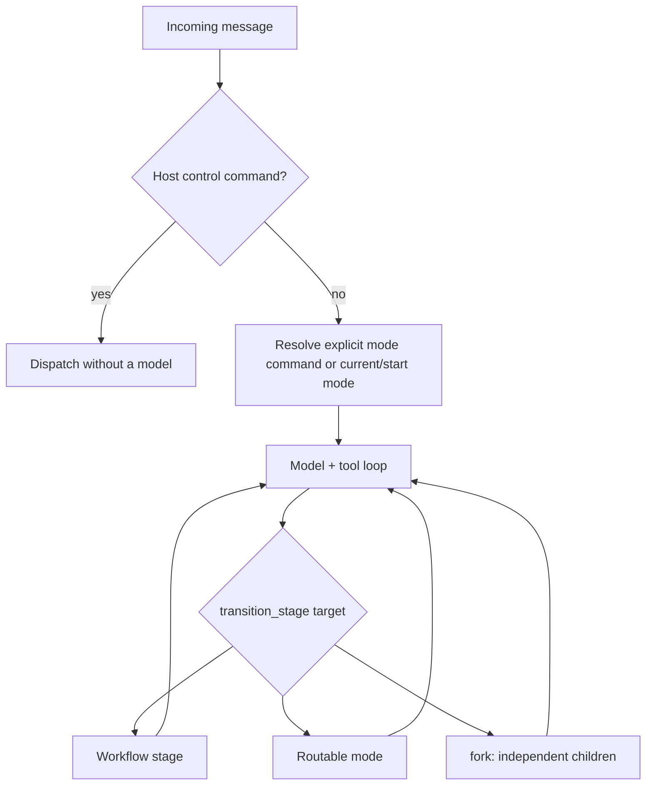

# Mode and workflow routing

This is the current routing contract. The superseded pre-turn planner RFC
and incident-specific fork report have been consolidated into this guide
and the [turn-loop invariants](lessons/turn-loop-invariants.md).

**Mode routing** assigns work and capabilities. **Model routing** chooses
a provider/model per iteration and has its own
[CEL reference](../sdk/src/sdk/router/README.md).

## Turn-time dispatch

All transports use [handle_message](../runtime/src/runtime/handle_message.py).
Host control commands are handled before model work. Mode command patterns
are parsed without a routing model call. Natural-language turns continue in
the active `current_mode_id`; the session's `routing.start_mode` seeds
startup and provides the non-default start-mode bypass.

`default` is not a permanent pin: the model can hand off to a more suitable
mode. The runtime records the owning mode after a handoff and can restore it
from thread state on a later startup. Do not assume every message restarts
the same prompt or routes through a separate planner.



See [session routing configuration](SESSION_CONTEXT_AUTHORING_GUIDE.md#routing)
for aliases, priority adjustments, hints, and authored intent vocabulary.

## One transition primitive

The intercepted `transition_stage` tool distinguishes:

1. A workflow stage in the active mode: validate the edge and update stage
   instructions/state.
2. A routable mode: change the active mode, instructions, allowed capabilities,
   and model resolution while preserving conversation evidence.
3. A `fork:` target: execute independent child turns and aggregate structured
   outcomes before continuing the parent.

The routing FSM synthesizes a full mesh among routable modes, not just
edges back to `default`. Workflow-stage edges remain the authored workflow's
own contract. A handoff reports `handoff_to`; a stage change reports
`transitioned_to`. These fields are not interchangeable.

## Capability hints and enforcement

The kernel compiles the live capability manifest and detects gaps between
query intents and the current mode's declared in-place abilities.
It can propose a single handoff, a sequential chain, independent fork,
or planner escalation **before** a completion. No separate routing model
call is required.

Intent vocabulary comes from the session; coverage claims come from mode
metadata. This is a deterministic hint system, not a semantic proof of
user intent. High-precision command patterns and careful intent declarations
reduce false matches.

For a deterministic pending action, the forced-action enforcer limits
non-compliant dispatches and can synthesize the transition rather than
nudge forever. Forced forks share the same target computation as hints.
Do not recreate old fork-specific counters/settings from an incident report;
consult [kernel Settings](../kernel/src/kernel/config.py) and the
[invariant registry](lessons/turn-loop-invariants.md).

## Authoring a routable mode

These are fields in `_mode.md` front matter, not a complete mode:

```yaml
mode_id: example
mode_kind: action
routable: true
command_pattern: '^(?:/)?example(?:[\s,:;]+(?P<query>.+))?$'
allowed_operation_ids: [example_operation]
routing_intent_tags: [example_intent]
satisfies_intents: [example_intent]
routing_intent_keywords:
  example_intent: [example]
```

| Field | Contract |
| --- | --- |
| `command_pattern` | Direct command parsing, no routing model |
| `routable` | Eligibility for routing transitions |
| `routing_intent_tags` | Intents covered when routing to the mode |
| `satisfies_intents` | Intents handled in-place; normally use the same vocabulary |
| `routing_intent_keywords` | Intent-tagged query matching |
| `fast_path_patterns` | High-precision hint candidates, not a separate planner |
| `required_capabilities` | Capabilities expected from the selected manifest model |
| `fork_allowed` | Claim that the mode can run without an interactive child channel |
| `yield_policy` | Whether/how the mode may ask the user |
| `approval_continuation` | Post-approval report versus resumed work |
| `task_completion` / `task_artifact_tool_id` | Checked-commit task gate and its exposed artifact producer |

See [pack authoring](PACK_AUTHORING_GUIDE.md) for full validation, defaults,
capability visibility, and mode/stage examples. A mode with a nontrivial
tool surface but no `satisfies_intents` can repeatedly request unnecessary
handoffs; broad keywords can route a mention rather than an actual request.

## Fork versus delegate

| Property | Fork | Delegate |
| --- | --- | --- |
| Shape | Parallel independent children | Sequential child work with parent mediation |
| Input dependence | Children must not need each other's output | Parent can pass previously produced evidence |
| Interactive yield | Disallowed for children | Can propagate through the parent |
| Completion | Structured child status and receipt checks | Shared child classifier and completion checks |

A `fork:mode/stage,mode/stage` target can supply per-child queries. A fork
requires eligible targets and receives bounded child budgets. Partial
failure, timeout, interruption, blocked capability, and missing action
evidence remain visible; aggregation must not present all children as
successful just because they produced text.

The producer/consumer guard rejects parallelization when a consumer needs
another step's evidence. For example, research followed by writing a report
is sequential even if the query does not contain the word "then".
Independent work can still fork. Never remove this distinction to make
more queries fan out.

## Durable workflow chains

Multi-step work uses a typed `WorkflowPosition` and a thread-derived
`WorkflowView`, not the retired `WorkflowInstance` file-store contract.

- **Planned:** the planner operation supplies explicit declared steps.
- **Ad hoc:** the kernel compiles steps from routing targets for a multi-step
  request that does not use planner escalation.

The position combines declared/completed steps with the current mode/stage.
At turn start the host derives an immutable view from the thread: plans,
matching write receipts, read-step handoffs, and addressed completing turns.
A yield or continuation can recover remaining work rather than restart it.
The thread is the durable source of truth; there is no separate mutable
workflow-position store.

Step budgets prevent a chain from spending the whole turn on one target.
When a step stalls, recovery and lifecycle policy determine whether it can
advance, pause, or require the operator. Consult current dispatch/recovery
evidence rather than silently marking the step complete.

## Completion and failure contracts

A declared action mode must satisfy the receipt-based completion contract;
calling a random read tool does not prove a write occurred. Honest read-only
work has an explicit exemption. A checked-commit task additionally requires
one task-owned artifact with the real changed commit, current required
checks bound to its revision/tree, and a clean owned worktree.

Approval, yield, pause, block, error, and completion are distinct states.
Capability gates run against the resolved model; lifecycle guards prevent
repeated handoffs, stalled reads/writes, and silent cap expiry.
See [invariants](lessons/turn-loop-invariants.md),
[policy](POLICY_GUIDE.md), [budgets](TOKEN_BUDGET.md), and
[recovery commands](../sdk/packs/recovery/src/sdk/packs/recovery/README.md).

## Implementation references

- [Turn runner](../kernel/src/kernel/turn_runner/): loop and transition interception.
- [Routing/workflow FSM](../kernel/src/kernel/ipsar_fsm.py): catalogs, edges, transitions.
- [Routing hints](../kernel/src/kernel/turn_phases/_routing_hint.py): intent gaps and target computation.
- [Child classifier](../kernel/src/kernel/turn_phases/_child_turn.py): fork/delegate outcomes.
- [Workflow position](../kernel/src/kernel/workflow_position.py) and
  [workflow view](../kernel/src/kernel/workflow_view.py): typed progress and thread-derived state.
- [Session plan](../kernel/src/kernel/session_plan.py): author-owned routing vocabulary.
