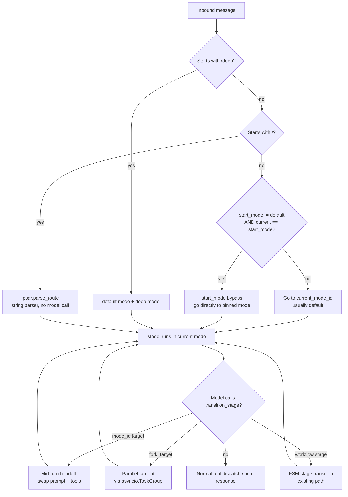
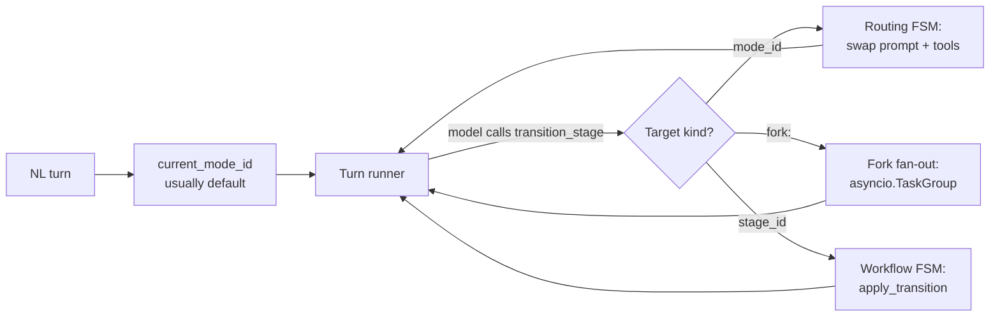
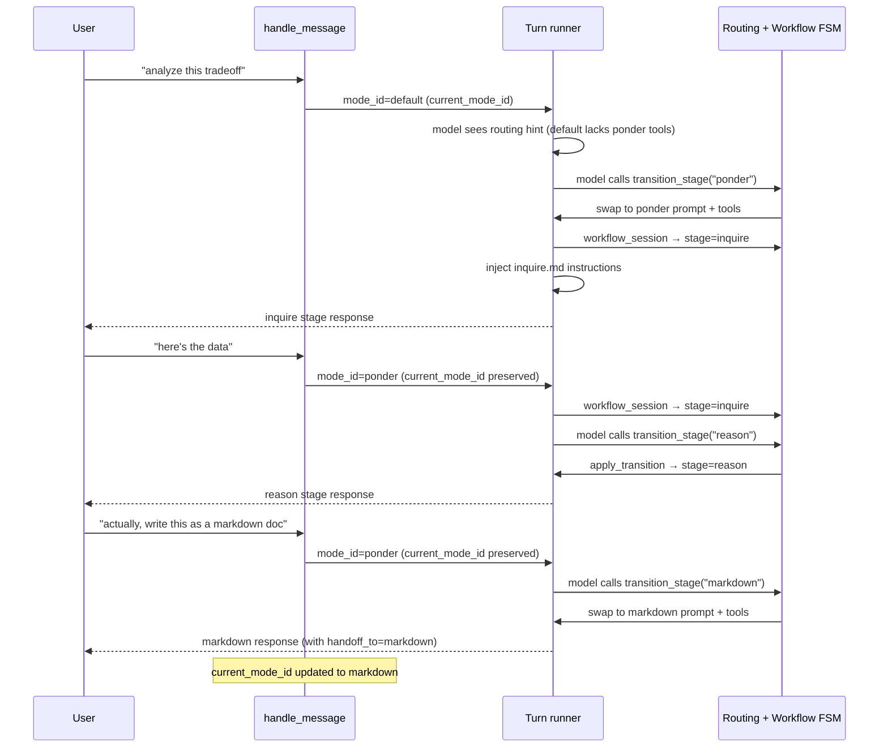

# Router Design

This document is the consolidated reference for the Lisa Framework's routing
system. It covers the turn-time dispatch contract, the unified FSM routing
mechanism (mode handoff via `transition_stage`), the interaction with staged
workflow modes, the session-context controls that gate routing, and the
fork fan-out pattern.

> **What changed.** The old separate stateless router planner
> (`kernel/router.py:plan_route`) was removed in a hard cutover. There is no
> longer a pre-turn model call to decide which mode owns a turn. Instead,
> natural-language turns go directly to `current_mode_id` (defaults to
> `default`), and the model hands off between modes mid-turn by calling
> `transition_stage` — the same mechanism already used for workflow stage
> advancement. One mechanism, one interception point, zero extra model calls.
> See `docs/ROUTING_RFC_HANDOFF.md` for the full design rationale.

---

## 1. Overview

Routing decides which **user-facing mode** owns one natural-language turn.
Under the unified FSM, routing is an **emergent property of the turn loop**,
not a separate pre-turn planner.

The model starts every NL turn in `current_mode_id` (usually `default`).
If the current mode can handle the request, the model just does the work.
If a better-suited mode exists, the model calls `transition_stage` with the
target `mode_id` — the turn loop intercepts it, swaps the system prompt and
tool surface, and continues the loop in the new mode. Chat history is
preserved across the handoff.

### Design Principles

- **One mechanism.** `transition_stage` handles workflow stage advancement,
  mode handoff, and fork fan-out. There is no separate router, no separate
  handoff primitive, no separate fan-out operation.
- **No compat or migration layers.** The old `kernel/router.py`,
  `hosts/core/routing.py`, `RouteDecision` model, and `WorkshopExecutionService`
  were all removed in a hard cutover. No shims, no dual-path.
- **Zero extra model calls.** The old router spent one planner call per NL
  turn before the real turn. The unified FSM folds routing into the main
  turn's tool-call loop — the model hands off as part of its normal work.
- **Full conversation context.** The old router saw only a short excerpt.
  The unified FSM sees the full chat history because routing happens inside
  the turn loop.
- **Proactive hints, not reactive discovery.** A capability-manifest-aware
  hint is injected into the system prompt *before* the model call when the
  current mode lacks tools the query seems to need. The model doesn't waste
  an iteration discovering it can't do something.

---

## 2. Turn-Time Dispatch Contract

All hosts route inbound messages through `hosts/core/handle_message.py`. The
dispatch order is fixed:



| Priority | Path | Mechanism | Model call? |
| --- | --- | --- | --- |
| 1 | `/deep <query>` | `explicit_deep_query()` → default mode + deep model | No (for routing) |
| 2 | `/<command> <query>` | `kernel.ipsar.parse_route()` — string parser | No |
| 3a | NL, `start_mode != default` and `current_mode_id == start_mode` | Start-mode bypass — direct to pinned mode | No |
| 3b | NL, otherwise (incl. `start_mode == default`) | Go to `current_mode_id` (usually `default`) | No (for routing) |

The key change from the old design: branch 3b no longer calls a router
planner. It goes directly to `current_mode_id`. The model decides during
the turn whether to hand off to a different mode.

---

## 3. Session Context Controls

Routing behavior is configured in the session context's YAML front matter under
the `routing:` namespace. The compiled plan model is `SessionRouting`
(`kernel/session_plan.py`).

```yaml
routing:
  start_mode: default      # the pinned mode (bypass pin)
  aliases:
    go: discuss             # slash-command aliases
  priority_adjustments:
    discuss: 50             # override mode priority for catalog ordering
  hints:
    ponder:             # per-mode hint strings (used by fast-path, not a planner)
      - "Prefer ponder for tradeoff analysis."
```

### `start_mode` — the bypass pin

```python
class SessionRouting(_StrictSessionModel):
    start_mode: str = "default"
    aliases: dict[str, str] = Field(default_factory=dict)
    priority_adjustments: dict[str, int] = Field(default_factory=dict)
    hints: dict[str, tuple[str, ...]] = Field(default_factory=dict)
```

`start_mode` defaults to `"default"` and seeds `current_mode_id` at runtime
initialization:

```python
# hosts/core/runtime.py
self.current_mode_id: str = self.session_plan.manifest.routing.start_mode
```

The `start_mode` key is a **bypass pin**: when `current_mode_id == start_mode`
and `start_mode != "default"`, the turn goes directly to the pinned mode. This
keeps the user pinned in a declared owning mode (e.g. `learn`, `coding`,
`research`) unless they explicitly `/switch` away.

### `default` is exempt from the bypass

`default` is not a real owning mode — it's the routing hub. Pinning it would
silently disable handoff routing on every turn. The bypass guard in
`handle_message.py` exempts `default`:

```python
if (
    start_mode
    and start_mode != "default"
    and runtime.current_mode_id == start_mode
):
    # bypass: go directly to start_mode
```

This means `start_mode: default` (the implicit default) means "let the model
decide via handoff," not "pin to default."

### How `current_mode_id` changes

After each turn, `_execute_mode_turn` checks `TurnResult.handoff_to`. If the
model called `transition_stage` with a `mode_id` target, the host updates
`current_mode_id`:

```python
# hosts/core/handle_message.py — after run_turn returns
if result.handoff_to and result.handoff_to != mode.mode_id:
    runtime.current_mode_id = result.handoff_to
```

The next NL turn starts in the new mode. The model can hand off back to
`default` or to any other routable mode.

---

## 4. Unified FSM Routing

### The routing FSM

The routing FSM is a **meta-FSM** that sits above the per-mode workflow FSM.
It is synthesized from the mode catalog at startup by
`kernel/ipsar_fsm.py:synthesize_routing_transitions()`:

- **`default`** can hand off to every routable mode.
- **Every routable mode** can hand off back to `default`.
- **Mode-to-mode transitions** (e.g. `coding → markdown`) are a future
  authored opt-in. The initial FSM is conservative: `default ↔ all`.

```python
# kernel/ipsar_fsm.py
def synthesize_routing_transitions(catalog) -> dict[str, list[str]]:
    routable_ids = get_routable_mode_ids(catalog)
    transitions = {}
    for mode_id, mode_config in catalog.items():
        if mode_id == "default":
            transitions[mode_id] = [m for m in routable_ids if m != "default"]
        elif mode_config.routable:
            transitions[mode_id] = ["default"]
        else:
            transitions[mode_id] = []
    return transitions
```

### How `transition_stage` handles three target kinds

The `transition_stage` tool is now advertised to **all routable modes** (not
just workflow modes). The interception block in `kernel/turn_runner.py`
distinguishes three cases based on the `target_stage_id` argument:

| Target kind | Example `target_stage_id` | What happens |
| --- | --- | --- |
| **Mode handoff** | `"markdown"` | Swap system prompt + tool surface for the new mode. Set `handoff_to` on `TurnResult`. Continue the loop. |
| **Fork fan-out** | `"fork:coding/implement,ponder/review"` | Parse targets, fan out children via `asyncio.TaskGroup`, collect results into `fork_results`. Continue the loop. |
| **Workflow stage** | `"reason"` (a stage in the current mode's FSM) | Existing `apply_transition` path. Update `workflow_session`. Continue the loop. |

The interception checks in this order:

1. Is it a fork target? (`is_fork_target()` — starts with `fork:`)
2. Is it a routable mode? (`is_routable_mode()` — in the mode catalog with `routable: true`)
3. Is it a workflow stage? (existing `is_workflow` path)

### Mid-turn mode handoff (Case 1)

When the model calls `transition_stage(target_stage_id="markdown")`:

1. The loop validates the handoff is allowed (`target in get_routing_targets(current_mode_id)`).
2. `messages[0]` (system prompt) is swapped to the new mode's `_mode.md` body.
3. Tool schemas are rebuilt for the new mode's `allowed_tool_ids`.
4. The capability manifest is recompiled for the new tool surface.
5. `mode_id` and `mode_config` are updated to the new mode.
6. `handoff_to` is set on the `TurnResult`.
7. The loop continues — the next model call uses the new prompt + tools.

**Chat history is preserved.** Only `messages[0]` (system prompt) changes.
All prior user/assistant/tool messages stay in the `messages` list.

### Fork fan-out (Case 2)

When the model calls `transition_stage(target_stage_id="fork:coding,markdown")`:

1. The fork string is parsed into `(mode_id, stage_id)` pairs.
2. Each target is validated against the mode catalog.
3. Children are fanned out via `asyncio.TaskGroup` — each child runs
   `run_turn()` with its own mode's system prompt and tool surface.
4. The parent turn's `TurnBudget` is divided equally across N children.
5. Results are collected into `fork_results: list[ForkChildResult]`.
6. The loop continues — the model sees the fork results as the tool output
   and can synthesize from them.

Fork target syntax:

```plaintext
fork:coding,markdown                         # two modes, default start_stage
fork:coding/implement,ponder/review       # with explicit stages
fork:search,calendar,email                   # heterogeneous parallel workers
```

Per-worker queries can be passed in `tool_arguments.queries` (a list parallel
to the fork targets). When not provided, each worker receives the user's
original message.

### Workflow stage transition (Case 3)

This is the existing path, unchanged. When the model calls
`transition_stage(target_stage_id="reason")` and `reason` is a stage in the
current workflow mode's FSM:

1. `apply_transition()` validates the transition against `allowed_next_stages`.
2. `workflow_session_updater` persists the new `stage_id`.
3. If the new stage is terminal, the loop forces one final no-tools completion.
4. A stuck-session guard nudges after `_STAGE_NUDGE_THRESHOLD` (4) turns and
   forces completion after `_STAGE_NUDGE_CAP` (6).

---

## 5. Capability-Manifest-Aware Proactive Hints

Before the model call, the turn runner compiles a `CapabilityManifest` from
the live tool schemas. It then compares the manifest against the user's query:

- If the current mode lacks file-writing tools and the query mentions "write",
  "save", "document", "file", "code", or "read" → inject a routing hint.
- If the current mode lacks search tools and the query mentions "search" →
  inject a routing hint.

The hint is a conditional string appended to the system prompt:

```text
## Routing Hint

Your current mode may lack the tools needed for this request. You can hand
off to a better-suited mode by calling `transition_stage` with one of these
target_stage_id values: markdown, coding, search.
```

This is **proactive** — the model knows before it tries. And it's **zero-cost**
when the current mode can handle the request (no hint is injected, no extra
tokens).

---

## 6. What the Model Sees

The model sees `transition_stage` as a tool with a `target_stage_id` parameter.
The tool description tells it what values are valid. For a `default` mode
session, the valid targets include every routable mode:

```json
{
  "name": "transition_stage",
  "description": "Move to the next workflow stage or hand off to another mode...",
  "parameters": {
    "type": "object",
    "properties": {
      "target_stage_id": {
        "type": "string",
        "description": "The target stage or mode_id..."
      },
      "rationale": { "type": "string" }
    }
  }
}
```

The model discovers routing targets from:

1. The **system prompt** — the mode's `_mode.md` body describes what it can do.
2. The **routing hint** — injected when the current mode lacks tools the query needs.
3. The **tool surface** — the `transition_stage` tool is present, signaling
   that handoff is available.

---

## 7. Mode Authoring for Routing

### Making a mode routable

A mode is routable when its `_mode.md` front matter has `routable: true`:

```yaml
---
mode_id: markdown
mode_kind: chat
routable: true              # required for handoff targets
priority: 6                 # higher = earlier in catalog ordering
fast_path_patterns:         # regex list for zero-cost pre-turn hint
  - '\bmarkdown\b'
command_pattern: '^(?:/)?markdown(?:[\s,:;]+(?P<query>.+))?$'
allowed_tool_ids:
  - markdown_generate
  - write_file
tools_authoritative: true
---
```

### Front-matter keys for routing

| Key | Purpose | Required for routing? |
| --- | --- | --- |
| `routable` | Must be `true` to appear as a handoff target | Yes |
| `priority` | Catalog ordering (higher = earlier) | No (default 0) |
| `fast_path_patterns` | Regex list for zero-cost pre-turn hint | No |
| `command_pattern` | Slash-command regex for `parse_route` | No (for `/mode` entry) |
| `allowed_tool_ids` | Tool surface for this mode | No (but recommended) |
| `tools_authoritative` | When `true`, empty `allowed_tool_ids` = no tools | No (default `true`) |

### Fast-path patterns (kept as a zero-cost hint)

`fast_path_patterns` are still evaluated as a zero-cost regex match before
the turn. If a message matches a mode's patterns, the host can short-circuit
directly to that mode without even starting the turn in `default`. This is a
*hint*, not a *gate* — if it misses, the model can still hand off mid-turn
via `transition_stage`.

### What was removed from `_mode.md`

The following front-matter keys were removed in the hard cutover and are no
longer recognized:

- `workshop_panels` — replaced by `fork:` targets in `transition_stage`
- `workshop_budget` — replaced by `TurnBudget` sub-allocation
- `workshop_rendering` — synthesis is now a workflow stage
- `workshop_planner_prompt_file` — no longer needed
- `workshop_synthesis_prompt_file` — no longer needed

---

## 8. Staged Workflow Modes and Routing

### How routing and workflow FSMs compose

The routing FSM (mode handoff) and the per-mode workflow FSM (stage
advancement) are **two layers of the same mechanism**. `transition_stage`
checks the routing FSM first (is the target a `mode_id`?), then falls through
to the workflow FSM (is the target a stage in the current mode?).



### Example: ponder workflow with handoff

`ponder` is a `mode_kind: workflow` mode with stages:
`inquire → reason → formulate → exit`.



### Stage files

Each stage is a Markdown file in the mode directory with YAML front matter:

```yaml
# sdk/packs/search/modes/ponder/reason.md
---
stage_id: reason
allowed_next_stages: [formulate, exit]
description: "Discuss findings, identify trade-offs, and align on logical paths."
---

# Ponder Mode: Reason Stage

You are in the Reason stage. Analyze findings, brainstorm 2-3 logical paths...
```

The body text becomes `WorkflowStageConfig.instruction_body`, injected at
runtime. Stage files starting with `_` are skipped.

### Stuck-session guards (free from the FSM)

Because routing uses the same `transition_stage` interception as workflow
stage advancement, all existing guardrails apply automatically:

- **`_STAGE_NUDGE_CAP`** (6) — if the model ping-pongs between modes without
  making progress, the loop forces a final response.
- **`TurnBudget`** — tool calls, tokens, and wall time are tracked across
  mode switches within the same turn. A budget-exhausted turn forces a final
  no-tools completion regardless of which mode it's in.
- **`max_tool_iterations`** — the global iteration cap still applies; mode
  switches don't reset it.

---

## 9. Fork Fan-Out (Replaces Workshop)

The old `workshop_run` operation and `WorkshopExecutionService` were removed.
Fan-out is now a first-class `transition_stage` target.

### When to use fork

- "Research this topic AND write a markdown summary" → `fork:search,markdown`
- "Code-review this PR from security, performance, and style perspectives" → `fork:ponder/security,ponder/performance,ponder/style`
- "Search the web, check my calendar, and draft an email" → `fork:search,calendar,email`

Each fork target is a `(mode_id, stage_id, query)` tuple. The `mode_id`
determines the system prompt and tool surface. The `stage_id` (optional,
defaults to the mode's `start_stage_id`) determines the workflow stage. The
query is the scoped prompt for that worker.

### Budget enforcement

The parent turn's `TurnBudget` is divided equally across N children. Each
child gets a sub-budget. If a child exhausts its sub-budget, it returns a
partial result. The parent turn's budget is the hard cap — fan-out doesn't
grant extra resources.

### Failure handling

The FSM collects all child results (including failures) into `fork_results`
and continues the loop. The model sees which children succeeded and which
failed, and can decide to retry, ask the user, or synthesize from partial
results.

---

## 10. Model Manifest Integration

The model used for each turn is resolved by **designation**, not by a
hardcoded ID. The model manifest (`<data-dir>/models.yaml`) supports
designations:

| Designation | Used by |
| --- | --- |
| `default` | Default chat mode |
| `deep` | `/deep` prefix |
| `reasoning` | Reasoning-heavy modes |

There is no separate planner model: natural-language turns route directly
to the current mode, and the `default` model hands off mid-turn via
`transition_stage` tool calls. The legacy `router` designation was removed
in the unified-FSM cutover — manifests carrying it will fail validation.

Hosts manage manifests through commands:

- `/models discover` — probes providers, writes `models.proposed.yaml`.
- `/models apply` — validates and promotes the proposal to `models.yaml`.
- `/models reload` — reloads from disk.

---

## 11. Module Reference

| Module | Role |
| --- | --- |
| `kernel/turn_runner.py` | Turn execution loop. Intercepts `transition_stage` for mode handoff, fork fan-out, and workflow stage transitions. Compiles capability manifest and injects routing hints. |
| `kernel/ipsar_fsm.py` | FSM loader and runtime. Synthesizes routing transitions (`synthesize_routing_transitions`, `get_routing_targets`, `is_routable_mode`). Parses fork targets (`parse_fork_target_string`, `is_fork_target`). Validates workflow stage transitions (`apply_transition`). |
| `kernel/models.py` | `ForkTarget`, `ForkChildResult`, `WorkflowModeConfig`, `WorkflowStageConfig`, `WorkflowTransitionRequest`, `TurnBudget`, `CallLedger`. |
| `kernel/ipsar.py` | Slash-command route resolution (`parse_route`). String parser, no model call. |
| `kernel/session_plan.py` | `SessionRouting` model (compiled from session context front matter). Owns `start_mode`, `aliases`, `priority_adjustments`, `hints`. |
| `kernel/capability_manifest.py` | Compiles `CapabilityManifest` from live tool schemas. Used for proactive routing hints. |
| `hosts/core/handle_message.py` | Turn-time dispatch contract. The fixed priority order: `/deep` → slash commands → `start_mode` bypass → `current_mode_id`. Persists `handoff_to` after the turn. |
| `hosts/core/runtime.py` | `HostRuntime.start_mode_id` property and `current_mode_id` initialization + update. |

### Removed

| Module | Status |
| --- | --- |
| `kernel/router.py` | Removed. The stateless router planner (`plan_route`) was replaced by mid-turn `transition_stage` handoff. No shim, no dual-path. |
| `hosts/core/routing.py` | Removed. The host wrapper around `plan_route`. |
| `sdk/workshop_execution.py` | Removed. `WorkshopExecutionService` replaced by `fork:` targets in `transition_stage`. |
| `sdk/packs/core/operations/research/workshop_run.py` | Removed. The `workshop_run` operation replaced by `transition_stage` with `fork:` targets. |
| `sdk/packs/core/modes/workshop/` | Removed. The workshop mode. |
| `RouteDecision`, `RouteDecisionAlternative`, `RoutePlannerSource`, `RouterPromptProfile`, `OptionalContextLane` | Removed from `kernel/models.py`. No longer needed — routing is a tool call, not a structured output schema. |
| `WorkshopPanelModeConfig`, `WorkshopBudgetConfig`, `WorkshopRenderConfig`, `WorkshopPlan`, `WorkshopPanelSpec`, `WorkshopPanelContext`, `WorkshopContextBundle`, `WorkshopChildResult`, `WorkshopExecutionSummary` | Removed from `kernel/models.py`. Replaced by `ForkTarget` and `ForkChildResult`. |