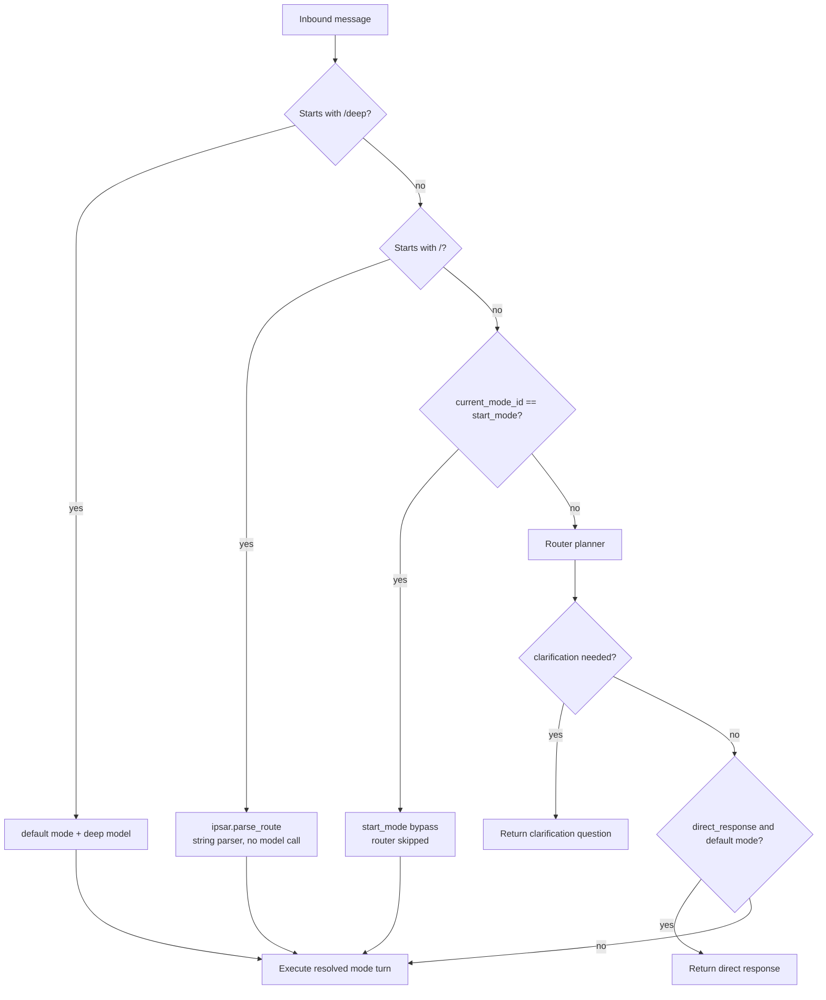
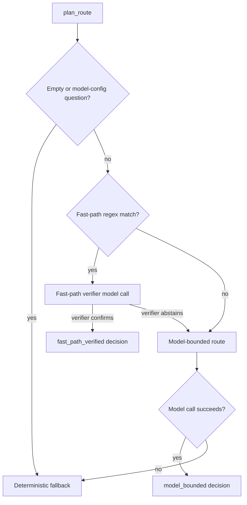
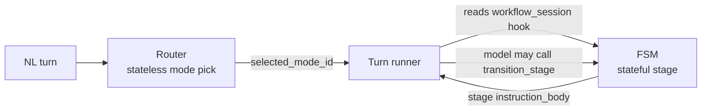
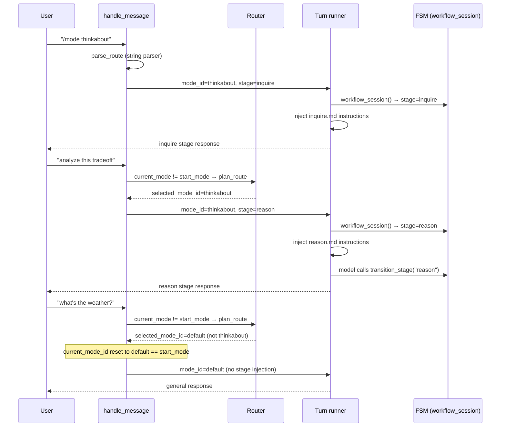

# Router Design

This document is the consolidated reference for the Lisa Framework's routing
system. It covers the turn-time dispatch contract, the router planner engine,
the interaction with staged workflow modes, the session-context controls that
gate routing, and the known design tensions.

---

## 1. Overview

The router decides which **user-facing mode** owns one natural-language turn.
It is a bounded, stateless planner: one model call (or a fast-path shortcut) per
turn, producing a `RouteDecision` that selects a mode, optionally normalizes the
query, and may request clarification or return a direct response.

The router is **not** a general dispatcher. Slash commands, deep-mode prefixes,
and the `start_mode` pin all bypass it entirely. It only runs on natural-language
turns, and only when the user is not sitting in the session's pinned start mode.

### Design Principles

- **Contracts over implementations.** The kernel defines `RouteDecision`,
  `SurfaceContext`, and the planner protocol. Hosts inject completion functions
  and prompt loaders.
- **No compat or migration layers.** The old `kernel/frontdoor.py` was removed
  in a hard cutover. There is no shim, no dual-path, no fallback to the old name.
- **Bounded by default.** The planner model gets a tight token budget, a
  structured output schema (`RouteDecision`), and a catalog of routable modes.
  It cannot call tools or invent capabilities.
- **Stateless.** The router has no memory of prior turns, active workflow
  sessions, or FSM stage. Each NL turn is a fresh mode-ownership decision.

---

## 2. Turn-Time Dispatch Contract

All hosts route inbound messages through `hosts/core/handle_message.py`. The
dispatch order is fixed:



| Priority | Path | Mechanism | Model call? |
| --- | --- | --- | --- |
| 1 | `/deep <query>` | `explicit_deep_query()` → default mode + deep model | No |
| 2 | `/<command> <query>` | `kernel.ipsar.parse_route()` — string parser | No |
| 3a | NL, `current_mode_id == start_mode` | Start-mode bypass — direct to mode | No |
| 3b | NL, `current_mode_id != start_mode` | Router planner (`plan_route`) | Yes |

The key guard is branch 3a. When `current_mode_id == start_mode`, the router is
**skipped entirely** and the turn goes straight to the declared mode. This means
the router only spends a model call when the user has deliberately switched away
from the pinned start mode.

---

## 3. Session Context Controls

Routing behavior is configured in the session context's YAML front matter under
the `routing:` namespace. The compiled plan model is `SessionRouting`
(`kernel/session_plan.py`).

```yaml
routing:
  start_mode: default      # the pinned mode (bypass pin)
  aliases:
    go: discuss             # slash-command aliases
  priority_adjustments:
    discuss: 50             # override mode priority for catalog ordering
  hints:
    thinkabout:             # per-mode routing hints injected into the planner prompt
      - "Prefer thinkabout for tradeoff analysis."
```

### `start_mode` — the bypass pin

```python
class SessionRouting(_StrictSessionModel):
    start_mode: str = "default"
    aliases: dict[str, str] = Field(default_factory=dict)
    priority_adjustments: dict[str, int] = Field(default_factory=dict)
    hints: dict[str, tuple[str, ...]] = Field(default_factory=dict)
```

`start_mode` defaults to `"default"` and is **never `None`** at the plan level.
The runtime initializes `current_mode_id` to the same value:

```python
# hosts/core/runtime.py
self.current_mode_id: str = self.session_plan.manifest.routing.start_mode
```

This is why not defining `routing.start_mode` does not engage the router — it
defaults to `"default"`, the bypass fires on every turn you remain in default,
and the router is never called. The `start_mode` key is a **bypass pin**, not a
router trigger.

### Other routing keys

| Key | Purpose |
| --- | --- |
| `aliases` | Maps short slash commands to mode IDs (e.g. `go: discuss`). |
| `priority_adjustments` | Overrides mode `priority` from `_mode.md` front matter for catalog ordering. |
| `hints` | Per-mode hint strings injected into the router system prompt via `{{ROUTER_ROUTE_HINTS}}`. |

---

## 4. Router Planner Engine

The planner lives in `kernel/router.py`. Its entry point is `plan_route()`.

### Three-tier resolution



| Tier | Source | Model call | How it decides |
| --- | --- | --- | --- |
| 1. Fast-path regex | `fast_path_deterministic` / `fast_path_verified` | 0 or 1 (verifier) | Mode-authored `fast_path_patterns` regex match → optional verifier confirmation. |
| 2. Model-bounded | `model_bounded` | 1 | Full router prompt with catalog + hints + examples; model returns `RouteDecision` JSON. |
| 3. Deterministic fallback | `deterministic` | 0 | Preserve `current_route_mode` or fall back to `"default"`. |

### Fast-path tier

Each mode may declare `fast_path_patterns` in `_mode.md` front matter — a list
of regexes. On each NL turn, the router tests the normalized message against all
routable modes' patterns in priority order. If exactly one matches (and the
message has no multi-intent disqualifiers like "and", "also", "versus", or
multiple question marks), the router sends a **bounded verifier** call to the
planner model with just the candidate mode's description. If the verifier
returns `outcome: "confirm"`, routing is decided without the full prompt.

```yaml
# _mode.md front matter
fast_path_patterns:
  - "\\bthink\\s+about\\b"
  - "\\bgo\\s+in\\s+depth\\b"
  - "\\banalyze\\s+(?:this|tradeoffs?)\\b"
```

Multi-intent disqualifiers (`_FAST_PATH_MULTI_INTENT_RE`): `and`, `also`,
`plus`, `as well as`, `along with`, `then`, `after that`, `vs.`, `versus`.
When any of these appear, the fast path is skipped and the full model-bounded
route runs.

### Model-bounded tier

The full router prompt is composed from `sdk/packs/core/content/router/route.md`
with three placeholders filled:

| Placeholder | Injected content |
| --- | --- |
| `{{ROUTER_ROUTE_CATALOG}}` | Markdown summary of all routable modes (id, description, kind, query-required). |
| `{{ROUTER_ROUTE_HINTS}}` | Mode-authored `route_hints` bullets, plus session-authored `routing.hints`. |
| `{{ROUTER_ROUTE_EXAMPLES}}` | Mode-authored `examples` (JSON `RouteDecision`-shaped few-shot examples). |

The planner model returns a `RouteDecision` JSON object. If the selected mode
is not in the allowed set, it falls back to `"default"`. If the model call fails
(ValidationError, RuntimeError, etc.), the deterministic fallback preserves the
current mode.

### Prompt profiles

The router prompt verbosity adapts to the planner model:

```python
def select_prompt_profile(model_id: str) -> RouterPromptProfile:
    if "nano" in lowered: return "compact"
    if "mini" in lowered: return "standard"
    return "rich"
```

| Profile | Catalog detail | Example content |
| --- | --- | --- |
| `compact` | Mode id + one-sentence description | None |
| `standard` | + mode kind, query-required flag | None |
| `rich` | + direct command hint (`/<mode_id>`) | Full examples |

### Direct-response shortcut

When the router planner returns a `direct_response` and the selected mode is
`default`, the turn runner **skips the full model turn** and returns the
planner's response directly. This is the `_try_router_shortcut` path in
`handle_message.py`. It avoids a second model call for trivial questions the
planner can answer inline.

### Model configuration guard

Messages asking about model selection ("which model", "switch to", "default
chat", etc.) are detected by `looks_like_model_configuration_question()` and
routed deterministically to `default` — the router never spends a planner call
on meta-questions about routing itself.

---

## 5. RouteDecision Contract

The structured output schema returned by the router planner. Defined in
`kernel/models.py`.

```python
class RouteDecision(BaseModel):
    reasoning: str = ""
    selected_mode_id: str = "default"
    normalized_query: str = ""
    confidence_score: float = Field(default=0.0, ge=0.0, le=1.0)
    alternatives: list[RouteDecisionAlternative] = Field(default_factory=list)
    clarification_needed: bool = False
    clarification_question: str = ""
    direct_response: str = ""
    planner_source: RoutePlannerSource = "deterministic"
    prompt_profile: RouterPromptProfile = "standard"
    optional_context_include: list[OptionalContextLane] = Field(default_factory=list)
    optional_context_exclude: list[OptionalContextLane] = Field(default_factory=list)
```

### Planner sources

```python
RoutePlannerSource = Literal[
    "deterministic",        # fallback, no model call
    "fast_path_verified",    # regex + verifier confirmed
    "fast_path_deterministic",  # regex only (reserved)
    "model_bounded",        # full planner model call
    "user_preset",          # start_mode bypass or slash command
    "active_session",       # (reserved, not yet wired)
]
```

### Optional context lanes

The router can hint which optional context lanes to include or exclude for the
executing mode. Sanitized against a fixed order:

```python
_OPTIONAL_CONTEXT_LANE_ORDER = (
    "reflection",
    "passive_intelligence",
    "memory_recall",
    "architecture_context",
    "capability_snapshot",
)
```

---

## 6. Router Prompt

The base prompt is authored in
`sdk/packs/core/content/router/route.md`. It is intentionally narrow and
bounded:

```markdown
You are the Router. Your job is narrow and bounded:

1. Think carefully first and document your thinking in `reasoning`.
2. Decide which user-facing mode should own this turn.
3. Rewrite the request only when a tiny normalization makes the chosen mode
   easier to run.
4. Ask a clarification question only when routing would otherwise be
   meaningfully wrong.

Rules:
- Do not answer the user unless you are also the default executor and choose
  to fulfill the request directly in `direct_response`.
- Do not invent capabilities.
- Do not call tools.
```

The output format is strictly one JSON object matching `RouteDecision`. No
Markdown fences, no prose, no commentary. The `reasoning` field is capped at
one sentence (under 40 words) to stay within the token budget.

### Mode-authored routing metadata

Packs declare routing metadata in each mode's `_mode.md` front matter:

```yaml
routable: true                    # must be true to appear in the router catalog
priority: 8                       # higher = earlier in catalog ordering
fast_path_patterns: [...]          # regex list for fast-path tier
route_hints: [...]                 # injected into {{ROUTER_ROUTE_HINTS}}
examples: [...]                     # JSON RouteDecision objects for {{ROUTER_ROUTE_EXAMPLES}}
command_pattern: "^/mode_name..."  # slash-command regex for ipsar.parse_route
```

Only modes with `routable: true` and `mode_kind` in `{workflow, chat, action}`
appear in the router catalog. The `router_mode_ids()` function returns them
sorted by descending priority.

---

## 7. Staged Workflow Modes and the Router

This is the critical architectural relationship. The router and the workflow FSM
(`kernel/ipsar_fsm.py`) are **two independent layers** that do not communicate.

### What each layer owns

| Layer | Scope | Stateful? | Key module |
| --- | --- | --- | --- |
| Router | Mode selection (which mode owns this turn) | No | `kernel/router.py` |
| FSM | Stage progression (which stage within a mode) | Yes | `kernel/ipsar_fsm.py` |
| Turn runner | Stage instruction injection + transition handling | Yes (via hooks) | `kernel/turn_runner.py` |

### How they compose



The router picks the mode. The turn runner reads the current stage from the
`workflow_session` hook and injects the stage's `instruction_body` into the
system prompt. The model can call the `transition_stage` tool to advance the
FSM. The router never sees the stage.

### Example: thinkabout workflow

`thinkabout` is a `mode_kind: workflow` mode with stages:
`inquire → reason → formulate → exit`.



### Stage files

Each stage is a Markdown file in the mode directory with YAML front matter:

```yaml
# sdk/packs/search/modes/thinkabout/reason.md
---
stage_id: reason
allowed_next_stages: [formulate, exit]
description: "Discuss findings, identify trade-offs, and align on logical paths."
---

# Thinkabout Mode: Reason Stage

You are in the Reason stage. Analyze findings, brainstorm 2-3 logical paths...
```

The body text becomes `WorkflowStageConfig.instruction_body`, injected at
runtime. Stage files starting with `_` are skipped.

### Stage transition mechanism

The turn runner intercepts `transition_stage` tool calls before the
operation/tool/MCP dispatch branches (`_TRANSITION_TOOL_NAME`). When the model
calls it:

1. The turn runner validates the transition against `allowed_next_stages`.
2. It calls `workflow_session_updater` to persist the new `stage_id`.
3. If the new stage is terminal (`exit`), the loop forces one final no-tools
   completion.
4. A stuck-session guard nudges the model after
   `_STAGE_NUDGE_THRESHOLD` (4) turns in the same stage, and forces completion
   after `_STAGE_NUDGE_CAP` (6).

### Checkpoints

Checkpoints are turn-anchored (not wall-clock). They fire in the post-turn phase,
piggybacking on the turn cadence. Stage transitions are the primary trigger;
every-N-turns is secondary and off by default. The host opts in via
`CheckpointTuning(enabled=True)`.

---

## 8. Model Manifest Integration

The planner model is resolved by **designation**, not by a hardcoded ID. The
model manifest (`<data-dir>/models.yaml`) supports four designations:

| Designation | Used by |
| --- | --- |
| `router` | Router planner model |
| `default` | Default chat mode |
| `deep` | `/deep` prefix |
| `reasoning` | Reasoning-heavy modes |

Hosts manage manifests through commands:

- `/models discover` — probes providers, writes `models.proposed.yaml`.
- `/models apply` — validates and promotes the proposal to `models.yaml`.
- `/models reload` — reloads from disk.

The `resolve_planner_model` hook (injected by the host) returns the model
definition for the `router` designation. If resolution fails, the router falls
back to the deterministic path.

---

## 9. Known Design Tensions

### 9.1 Router re-evaluates every NL turn in non-start modes

When the user is in a non-default mode (via `/mode` or fast-path entry), every
subsequent NL turn pays a planner call to re-confirm mode ownership. The router
has no memory of the active workflow session.

**Cost**: Mid-workflow back-and-forth (e.g. in `thinkabout` stage `reason`)
spends one planner call per turn just to re-confirm "yes, this is still
thinkabout."

**Potential mitigation**: Feed `workflow_session` state into `plan_route`'s
`surface_context`, or add a pre-router guard in `handle_message.py` that skips
the planner when an active, non-terminal workflow session exists. Neither
exists today.

### 9.2 Router and FSM are not integrated

The two systems are wired in sequence, not integrated:

```plaintext
NL turn → router (mode pick, stateless) → turn_runner (stage read, stateful) → model → maybe transition_stage
```

The router does not consult FSM state. The FSM does not influence the router.
A mode could be mid-workflow in stage `reason` and the router could still route
the turn away to `default` if the NL message looks like a general question.

### 9.3 `start_mode` is a bypass, not a default

The `start_mode` key is a **bypass pin**, not a "default mode to route from."
Because it defaults to `"default"` and is never `None`, the bypass always fires
in the common case. This is intentional — it ensures the default chat path
never pays a planner tax — but it means the router is structurally a
mode-switch evaluator, not a general NL→mode classifier.

### 9.4 `active_session` planner source is reserved

`RoutePlannerSource` includes `"active_session"` but no code path produces it
yet. This is the intended slot for a future "preserve current mode because
there's an active workflow session" decision — see 9.1.

---

## 10. Module Reference

| Module | Role |
| --- | --- |
| `kernel/router.py` | Router planner engine: `plan_route`, `build_router_system_prompt`, `build_user_prompt`, fast-path/verifier/model-bounded tiers, deterministic fallback. |
| `kernel/models.py` | `RouteDecision`, `RouteDecisionAlternative`, `RoutePlannerSource`, `RouterPromptProfile`, `SurfaceContext`, `OptionalContextLane`. |
| `kernel/ipsar.py` | Slash-command route resolution (`parse_route`). String parser, no model call. |
| `kernel/ipsar_fsm.py` | Workflow FSM loader and runtime. Discovers mode definitions from disk, validates stage transitions, provides operation lifecycle hooks. |
| `kernel/session_plan.py` | `SessionRouting` model (compiled from session context front matter). Owns `start_mode`, `aliases`, `priority_adjustments`, `hints`. |
| `kernel/turn_runner.py` | Turn execution loop. Reads `workflow_session` hook for stage injection. Intercepts `transition_stage` tool calls. Owns stuck-session guard. |
| `hosts/core/handle_message.py` | Turn-time dispatch contract. The fixed priority order: `/deep` → slash commands → `start_mode` bypass → router planner. |
| `hosts/core/runtime.py` | `HostRuntime.start_mode_id` property and `current_mode_id` initialization. |
| `hosts/core/session_context.py` | `SessionContextControls` dataclass — extracts `start_mode` from front matter. |
| `sdk/packs/core/content/router/route.md` | Router system prompt template with three placeholders. |
| `sdk/packs/search/modes/thinkabout/` | Example staged workflow mode (`inquire → reason → formulate → exit`). |

### Removed

| Module | Status |
| --- | --- |
| `kernel/frontdoor.py` | Removed. Renamed to `kernel/router.py` in a hard cutover. No shim, no dual-path. Only a stale mypy cache entry (`frontdoor.data.json`) remains. |
