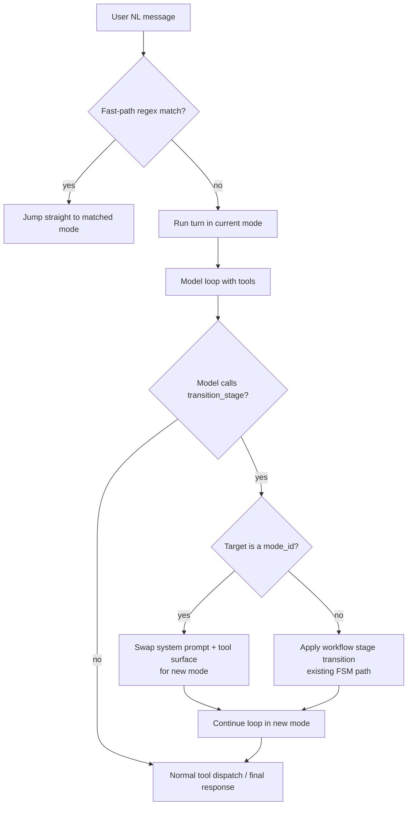

# RFC: Unified FSM Routing (Handoff via `transition_stage`)

Status: Draft
Date: 2026-07-16
Author: Lisa Framework

## Problem

The current router (`kernel/router.py:plan_route`) is a **separate stateless
planner** that runs before every natural-language turn. It has structural
limitations that the industry has moved past:

1. **Blind to conversation context.** The planner receives a normalized message
   and a short `conversation_excerpt_markdown` — no full chat history, no active
   workflow state, no FSM stage. It cannot resolve references like "write *that*
   to a markdown document" where "that" refers to the prior turn's output.

2. **No composition.** The fast-path disqualifier (`_FAST_PATH_MULTI_INTENT_RE`)
   rejects messages containing "and", "also", "plus", "then", "vs". The
   model-bounded planner picks exactly one mode. The architecture cannot express
   "do two things in one turn."

3. **No handoff-back.** Once routed to `markdown`, there is no mechanism for the
   markdown agent to say "I'm done, transfer back to default."
   `current_mode_id` stays `markdown` until the user manually `/commands` or the
   router moves them.

4. **Extra model call per turn.** The planner is a separate LLM call before the
   real turn. The handoff pattern folds routing into the main turn's tool-call
   loop — zero extra calls.

5. **Modes are opaque to the planner.** The planner sees `description` +
   `route_hints` + `fast_path_patterns`, not the actual tool surface. It cannot
   know "default mode already has `write_file` available — no need to switch."

## Industry Survey

Four patterns are in production across major frameworks:

| Pattern | Who ships it | Routing decision lives in | Extra call/turn | Stateful |
| --- | --- | --- | --- | --- |
| Separate stateless planner | Lisa (current) | Dedicated pre-turn planner | Yes (1 planner call) | No |
| Handoff / swarm | OpenAI Agents SDK (ex-Swarm), LlamaIndex `AgentWorkflow`, LangGraph swarm | Current agent calls `transfer_to_X` tool | No | Chat history carries |
| Supervisor / orchestrator | LangGraph supervisor, LlamaIndex orchestrator, CrewAI `@router` | Top-level agent calls sub-agents as tools | No | Supervisor state |
| Custom planner | LlamaIndex pattern 3, CrewAI Flows | LLM emits structured plan; code parses + executes | Yes | Yes |

**The converged direction is handoff-as-tool-call.** OpenAI Swarm's entire
model is two primitives: `Agent` + handoff. An agent returns another `Agent`
from a function call and the loop transfers control. The Agents SDK is the
production evolution. LlamaIndex's `AgentWorkflow` does the same with
`can_handoff_to=["WriteAgent"]` declarations. LangGraph's swarm multi-agent
architecture is the same idea in graph form.

The supervisor/orchestrator pattern is the fallback when central control and
composition are needed — the orchestrator calls sub-agents as tools, sub-agents
always return to it, and it can call several in one turn.

The separate-stateless-planner pattern (Lisa's) is the **least common** in
current frameworks. It is the most latent and the most brittle because it
decides ownership blind.

## Recommended Pattern: Unify Routing with the FSM

The industry converged on handoff-as-tool-call. Lisa can go further: **make
routing an emergent property of the FSM, not a separate mechanism.**

The key insight: Lisa already has a battle-tested intercepted-tool-call that
changes runtime state mid-turn — `transition_stage` at
`kernel/turn_runner.py:1532`. The workflow FSM advances when the model calls
`transition_stage`; the turn loop intercepts it before the MCP/operation
dispatch branches, calls `apply_transition` in-process, swaps the stage
instruction, and continues the loop. A mode switch *is* a stage transition —
just in a different FSM.

**One mechanism. One interception point. One tool.** The model already knows
how to call `transition_stage`. The stuck-session guard (`_STAGE_NUDGE_CAP`)
already prevents ping-pong. The `workflow_session_updater` already persists
transitions. Mode-routing persistence comes for free.

### Design

#### Core mechanism: extend `transition_stage`, don't add `transfer_to_mode`

The `transition_stage` tool already accepts `target_stage_id`. Extend it so
`target_stage_id` can be a `mode_id` (e.g. `"markdown"`) in addition to a
workflow stage (e.g. `"reason"`). The interception block at line 1532
distinguishes the two cases:

1. **Target is a workflow stage** (in the current mode's `stages` dict) →
   existing `apply_transition` path. No change.

2. **Target is a routable mode** (in the mode catalog, not the current
   workflow) → **mid-turn mode switch**:
   - Swap `messages[0]` (system prompt) to the new mode's `_mode.md` body.
   - Rebuild the tool schema list for the new mode's `allowed_tool_ids`.
   - Set `runtime.current_mode_id = target_mode_id`.
   - Record `handoff_to = target_mode_id` on `TurnResult`.
   - Continue the loop — the next `hooks.complete` call uses the new prompt +
     tools. Chat history is unchanged.

This is the OpenAI Swarm pattern (mid-turn prompt + tool swap) but implemented
through the existing FSM machinery rather than a special `transfer_to_X`
primitive. In Swarm, handoff is a *special mechanism* the framework treats
differently from normal tool calls. In Lisa, routing is *the same mechanism*
as workflow stage advancement — it's just another state machine.

#### Synthesized routing FSM

Every routable mode gets a synthesized set of `allowed_next_stages` — the
modes it can hand off to. This is not authored per-mode; it's computed from
the mode catalog at startup:

- **`default` mode** → can transition to every routable mode.
- **Every routable mode** → can transition back to `default`.
- **Future: mode-to-mode transitions** → authored opt-in (e.g. `coding` can
  hand off to `markdown` for documentation).

The routing FSM is a meta-FSM that wraps the per-mode workflow FSM. When the
model is in `default` mode (no workflow), the only FSM is the routing FSM.
When the model is in a workflow mode, the routing FSM sits above the workflow
FSM — `transition_stage` first checks if the target is a mode (routing FSM),
then falls through to the workflow FSM.

### Three forward-leaning enhancements

These leverage unique Lisa primitives that no other framework has:

#### 1. Capability-manifest-aware proactive hints (zero wasted iterations)

Lisa already compiles a `CapabilityManifest` from live tool schemas every turn
(`turn_runner.py` line ~1280). This manifest knows *exactly* what the current
mode can and cannot do. Before the model call, compare the manifest against
the user's query:

- If the current mode lacks file-writing tools and the query mentions "write",
  "save", "document" → inject a routing hint into the system prompt:
  *"You don't have file-writing tools. If the user needs files written, call
  `transition_stage` to switch to markdown or coding."*
- If the current mode has the tools → no hint needed, the model just does the
  work.

This is **proactive** rather than reactive. The model doesn't waste an
iteration discovering it can't do something — it knows before it tries. Swarm
can't do this because it doesn't compile capability manifests.

The hint injection is a simple keyword-to-capability-gap lookup. No model
call. No extra tokens when the current mode can handle the request. The
manifest is already computed — the hint is just a conditional string append
to the system prompt.

#### 2. Slice-driven pre-computed routing context (stateful, zero-cost)

The opportunistic slice mechanism (`kernel/slice.py`) is Lisa's most unique
architectural feature — pressure-driven work that piggybacks on the natural
turn cadence. A post-turn slice could:

- Analyze the last N turns of conversation.
- Detect topic shifts ("we were coding, now we're discussing architecture").
- Pre-compute a routing hint for the next turn.
- Write it into a small state blob that `assemble_user_context` reads.

This is **stateful routing context** that costs zero extra model calls. No
other framework has this because no other framework has turn-anchored
opportunistic slices. Swarm is stateless between turns. Lisa can carry routing
context across turns for free.

This is a future enhancement (not in the initial cutover). The initial
implementation relies on the capability-manifest hints + the model's own
conversation awareness from full chat history.

#### 3. Stuck-detection and budget enforcement (free from the FSM)

Because routing uses the same `transition_stage` interception as workflow
stage advancement, all existing guardrails apply automatically:

- **`_STAGE_NUDGE_CAP`** — if the model ping-pongs between modes without
  making progress, the loop forces a final response after 6 turns in the
  same "stage" (mode).
- **`TurnBudget` enforcement** — tool calls, tokens, and wall time are
  tracked across mode switches within the same turn. A budget-exhausted
  turn forces a final no-tools completion regardless of which mode it's in.
- **`max_tool_iterations`** — the global iteration cap still applies; mode
  switches don't reset it.

### What changes

| Component | Change |
| --- | --- |
| `kernel/turn_runner.py` `transition_stage` interception (line 1532) | Extend to handle `target_stage_id` that is a `mode_id` (not in current workflow). Swap system prompt + tool surface mid-loop. |
| `kernel/turn_runner.py` schema injection | Synthesize routing FSM transitions: every routable mode can transition to every other routable mode (initially: default ↔ all). Inject `transition_stage` schema with the synthesized `allowed_next_stages` enum. |
| `kernel/turn_runner.py:TurnResult` | Add `handoff_to: str \| None = None` |
| `kernel/turn_runner.py` system prompt assembly | Add capability-manifest-aware proactive hint injection (conditional, zero-cost when not needed) |
| `hosts/core/handle_message.py` `_execute_mode_turn` | Check `TurnResult.handoff_to`, persist `current_mode_id` update |
| `hosts/core/handle_message.py` `_route_model_turn` | Remove router planner call; NL turns go directly to `current_mode_id` |
| `kernel/router.py` `plan_route` | Remove (hard cutover) |
| `kernel/router.py` `_try_router_shortcut`, `_try_router_clarification` | Remove |
| `kernel/router.py` fast-path regex | Keep as zero-cost pre-turn hint that short-circuits to a mode without a tool-call round-trip |
| `kernel/models.py` `RouteDecision`, `RouteDecisionAlternative`, `RoutePlannerSource` | Remove |
| Router planner prompt, verifier prompt | Remove |

### What stays

- **Fast-path regex** — kept as an optional zero-cost hint. If a message
  matches a mode's `fast_path_patterns`, jump straight to that mode without
  even a tool-call round-trip. This is a *hint* that short-circuits the
  handoff, not a *gate* that blocks it.
- **Slash commands** (`/markdown`, `/search`) — unchanged, string parser.
- **`/deep` prefix** — unchanged, default mode + deep model.
- **Explicit `/mode` switching** — unchanged, sets `current_mode_id` directly.
- **`start_mode` bypass for real owning modes** — unchanged. Only `default` is
  exempt (see `ROUTER_DESIGN.md` §3).
- **`transition_stage` for workflow FSMs** — unchanged. The interception
  block gains a new branch for mode routing; the existing workflow path is
  untouched.

### Migration: hard cutover

Per the project's "no compat or migration" preference:

1. Extend `transition_stage` interception to handle `mode_id` targets.
2. Synthesize the routing FSM from the mode catalog.
3. Add capability-manifest-aware proactive hints.
4. Remove `plan_route` and its call site in `handle_message.py`.
5. Remove the router planner prompt, verifier prompt, `RouteDecision` model,
   `_try_router_shortcut`, and `_try_router_clarification`.
6. Natural-language turns go directly to `current_mode_id` (defaulting to
   `default`). The model hands off via `transition_stage` if needed.
7. Keep `fast_path_patterns` as the deterministic short-circuit.

### Why this is better

| Limitation | Current (planner) | Industry (Swarm handoff) | Lisa (unified FSM) |
| --- | --- | --- | --- |
| Conversation context | Blind (short excerpt only) | Full chat history in the loop | Full chat history in the loop |
| Composition | Disqualified (one mode per turn) | Model calls multiple tools across modes | Model calls multiple tools across modes |
| Handoff-back | None | Special `transfer_to_X` primitive | Same `transition_stage` mechanism as workflow advancement |
| Extra model call | 1 planner call per NL turn | 0 | 0 |
| Mode opacity | Sees description only | Sees actual tool surface | Sees actual tool surface **plus** proactive capability-gap hints |
| Cross-turn routing state | None | None (stateless between turns) | Slice-driven routing context (future) |
| Stuck detection | None | None | `_STAGE_NUDGE_CAP` + `TurnBudget` (free from FSM) |
| Mechanism count | 2 (planner + FSM) | 2 (handoff + FSM) | **1** (FSM only) |

## Open Questions

1. **Should the routing FSM allow arbitrary mode-to-mode transitions?**
   Initially: `default ↔ all`. Every routable mode can hand off back to
   `default`. Mode-to-mode (e.g. `coding → markdown`) is an authored opt-in
   for future iterations. The synthesized FSM starts conservative.

2. **Should the fast path still run before the turn?** Yes — it's zero-cost
   (regex, no model call) and short-circuits the obvious cases. But it's a
   *hint*, not a *gate*: if it misses, the model can still hand off mid-turn
   via `transition_stage`.

3. **What about the `start_mode` bypass?** Keep it for real owning modes
   (learn, coding, research). The `default` exemption (already implemented)
   means `start_mode: default` lets the model decide via handoff. A pinned
   `start_mode: learn` keeps the user in `learn` until they `/switch` or the
   learn agent hands off via `transition_stage`.

4. **Does the capability-manifest hint need its own model call?** No. The
   manifest is already computed every turn for tool schema injection. The
   hint is a conditional string append — a keyword-to-capability-gap lookup
   that costs zero tokens when the current mode can handle the request.

5. **Supervisor pattern for composition?** The unified FSM handles simple
   handoff. If composition ("search AND write markdown") becomes common, a
   future enhancement could add a supervisor mode that calls sub-modes as
   tools — but this is out of scope for the initial cutover. The slice-driven
   routing context (enhancement 2) is the more uniquely-Lisa investment.

## References

- OpenAI Swarm: <https://github.com/openai/swarm> (handoff primitive)
- OpenAI Agents SDK: <https://github.com/openai/openai-agents-python> (production evolution)
- LlamaIndex multi-agent patterns: <https://developers.llamaindex.ai/python/framework/understanding/agent/multi_agent/>
- LangGraph multi-agent: <https://langchain-ai.github.io/langgraph/concepts/multi_agent/>
- Lisa `transition_stage` precedent: `kernel/turn_runner.py:1532`
- Lisa router design: `docs/ROUTER_DESIGN.md`
