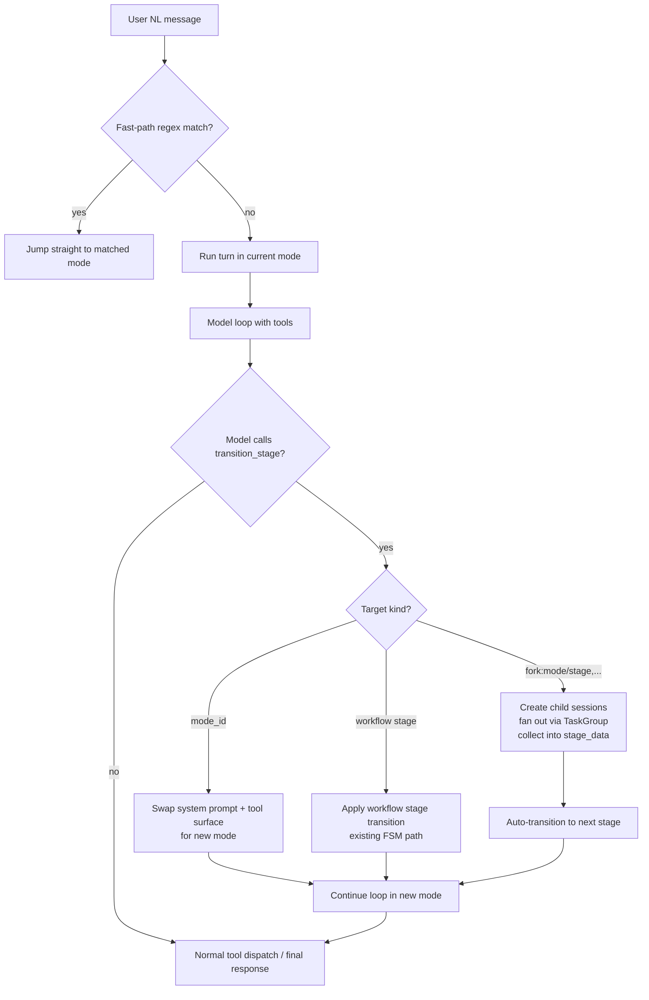
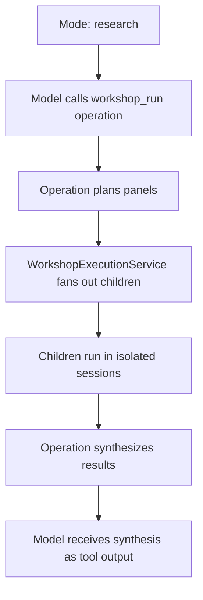
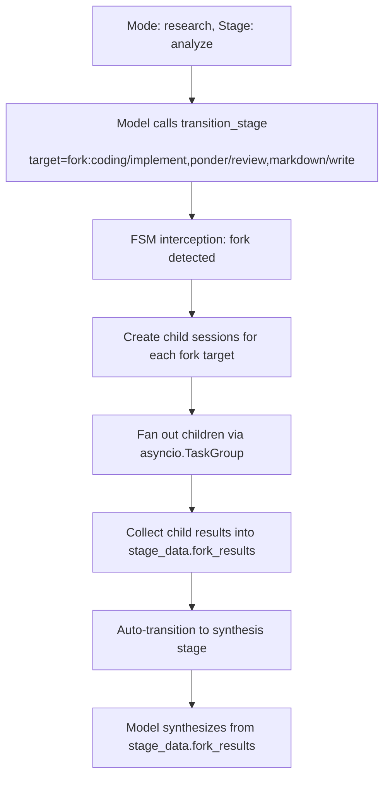

# RFC: Unified FSM Routing (Handoff via `transition_stage`)

Status: Draft
Date: 2026-07-16
Author: Lisa Framework

## Problem

The current router (`kernel/router.py:plan_route`) is a **separate stateless
planner** that runs before every natural-language turn. It has structural
limitations that the industry has moved past:

1. **Blind to conversation context.** The planner receives a normalized message
   and a short `conversation_excerpt_markdown` — no full chat history, no active
   workflow state, no FSM stage. It cannot resolve references like "write *that*
   to a markdown document" where "that" refers to the prior turn's output.

2. **No composition.** The fast-path disqualifier (`_FAST_PATH_MULTI_INTENT_RE`)
   rejects messages containing "and", "also", "plus", "then", "vs". The
   model-bounded planner picks exactly one mode. The architecture cannot express
   "do two things in one turn."

3. **No handoff-back.** Once routed to `markdown`, there is no mechanism for the
   markdown agent to say "I'm done, transfer back to default."
   `current_mode_id` stays `markdown` until the user manually `/commands` or the
   router moves them.

4. **Extra model call per turn.** The planner is a separate LLM call before the
   real turn. The handoff pattern folds routing into the main turn's tool-call
   loop — zero extra calls.

5. **Modes are opaque to the planner.** The planner sees `description` +
   `route_hints` + `fast_path_patterns`, not the actual tool surface. It cannot
   know "default mode already has `write_file` available — no need to switch."

## Industry Survey

Four patterns are in production across major frameworks:

| Pattern | Who ships it | Routing decision lives in | Extra call/turn | Stateful |
| --- | --- | --- | --- | --- |
| Separate stateless planner | Lisa (current) | Dedicated pre-turn planner | Yes (1 planner call) | No |
| Handoff / swarm | OpenAI Agents SDK (ex-Swarm), LlamaIndex `AgentWorkflow`, LangGraph swarm | Current agent calls `transfer_to_X` tool | No | Chat history carries |
| Supervisor / orchestrator | LangGraph supervisor, LlamaIndex orchestrator, CrewAI `@router` | Top-level agent calls sub-agents as tools | No | Supervisor state |
| Custom planner | LlamaIndex pattern 3, CrewAI Flows | LLM emits structured plan; code parses + executes | Yes | Yes |

**The converged direction is handoff-as-tool-call.** OpenAI Swarm's entire
model is two primitives: `Agent` + handoff. An agent returns another `Agent`
from a function call and the loop transfers control. The Agents SDK is the
production evolution. LlamaIndex's `AgentWorkflow` does the same with
`can_handoff_to=["WriteAgent"]` declarations. LangGraph's swarm multi-agent
architecture is the same idea in graph form.

The supervisor/orchestrator pattern is the fallback when central control and
composition are needed — the orchestrator calls sub-agents as tools, sub-agents
always return to it, and it can call several in one turn.

The separate-stateless-planner pattern (Lisa's) is the **least common** in
current frameworks. It is the most latent and the most brittle because it
decides ownership blind.

## Recommended Pattern: Unify Routing with the FSM

The industry converged on handoff-as-tool-call. Lisa can go further: **make
routing an emergent property of the FSM, not a separate mechanism.**

The key insight: Lisa already has a battle-tested intercepted-tool-call that
changes runtime state mid-turn — `transition_stage` at
`kernel/turn_runner.py:1532`. The workflow FSM advances when the model calls
`transition_stage`; the turn loop intercepts it before the MCP/operation
dispatch branches, calls `apply_transition` in-process, swaps the stage
instruction, and continues the loop. A mode switch *is* a stage transition —
just in a different FSM.

**One mechanism. One interception point. One tool.** The model already knows
how to call `transition_stage`. The stuck-session guard (`_STAGE_NUDGE_CAP`)
already prevents ping-pong. The `workflow_session_updater` already persists
transitions. Mode-routing persistence comes for free.

### Design



#### Core mechanism: extend `transition_stage`, don't add `transfer_to_mode`

The `transition_stage` tool already accepts `target_stage_id`. Extend it so
`target_stage_id` can be a `mode_id` (e.g. `"markdown"`) in addition to a
workflow stage (e.g. `"reason"`). The interception block at line 1532
distinguishes the two cases:

1. **Target is a workflow stage** (in the current mode's `stages` dict) →
   existing `apply_transition` path. No change.

2. **Target is a routable mode** (in the mode catalog, not the current
   workflow) → **mid-turn mode switch**:
   - Swap `messages[0]` (system prompt) to the new mode's `_mode.md` body.
   - Rebuild the tool schema list for the new mode's `allowed_tool_ids`.
   - Set `runtime.current_mode_id = target_mode_id`.
   - Record `handoff_to = target_mode_id` on `TurnResult`.
   - Continue the loop — the next `hooks.complete` call uses the new prompt +
     tools. Chat history is unchanged.

This is the OpenAI Swarm pattern (mid-turn prompt + tool swap) but implemented
through the existing FSM machinery rather than a special `transfer_to_X`
primitive. In Swarm, handoff is a *special mechanism* the framework treats
differently from normal tool calls. In Lisa, routing is *the same mechanism*
as workflow stage advancement — it's just another state machine.

#### Synthesized routing FSM

Every routable mode gets a synthesized set of `allowed_next_stages` — the
modes it can hand off to. This is not authored per-mode; it's computed from
the mode catalog at startup:

- **`default` mode** → can transition to every routable mode.
- **Every routable mode** → can transition back to `default`.
- **Future: mode-to-mode transitions** → authored opt-in (e.g. `coding` can
  hand off to `markdown` for documentation).

The routing FSM is a meta-FSM that wraps the per-mode workflow FSM. When the
model is in `default` mode (no workflow), the only FSM is the routing FSM.
When the model is in a workflow mode, the routing FSM sits above the workflow
FSM — `transition_stage` first checks if the target is a mode (routing FSM),
then falls through to the workflow FSM.

### Three forward-leaning enhancements

These leverage unique Lisa primitives that no other framework has:

#### 1. Capability-manifest-aware proactive hints (zero wasted iterations)

Lisa already compiles a `CapabilityManifest` from live tool schemas every turn
(`turn_runner.py` line ~1280). This manifest knows *exactly* what the current
mode can and cannot do. Before the model call, compare the manifest against
the user's query:

- If the current mode lacks file-writing tools and the query mentions "write",
  "save", "document" → inject a routing hint into the system prompt:
  *"You don't have file-writing tools. If the user needs files written, call
  `transition_stage` to switch to markdown or coding."*
- If the current mode has the tools → no hint needed, the model just does the
  work.

This is **proactive** rather than reactive. The model doesn't waste an
iteration discovering it can't do something — it knows before it tries. Swarm
can't do this because it doesn't compile capability manifests.

The hint injection is a simple keyword-to-capability-gap lookup. No model
call. No extra tokens when the current mode can handle the request. The
manifest is already computed — the hint is just a conditional string append
to the system prompt.

#### 2. Slice-driven pre-computed routing context (stateful, zero-cost)

The opportunistic slice mechanism (`kernel/slice.py`) is Lisa's most unique
architectural feature — pressure-driven work that piggybacks on the natural
turn cadence. A post-turn slice could:

- Analyze the last N turns of conversation.
- Detect topic shifts ("we were coding, now we're discussing architecture").
- Pre-compute a routing hint for the next turn.
- Write it into a small state blob that `assemble_user_context` reads.

This is **stateful routing context** that costs zero extra model calls. No
other framework has this because no other framework has turn-anchored
opportunistic slices. Swarm is stateless between turns. Lisa can carry routing
context across turns for free.

This is a future enhancement (not in the initial cutover). The initial
implementation relies on the capability-manifest hints + the model's own
conversation awareness from full chat history.

#### 3. Stuck-detection and budget enforcement (free from the FSM)

Because routing uses the same `transition_stage` interception as workflow
stage advancement, all existing guardrails apply automatically:

- **`_STAGE_NUDGE_CAP`** — if the model ping-pongs between modes without
  making progress, the loop forces a final response after 6 turns in the
  same "stage" (mode).
- **`TurnBudget` enforcement** — tool calls, tokens, and wall time are
  tracked across mode switches within the same turn. A budget-exhausted
  turn forces a final no-tools completion regardless of which mode it's in.
- **`max_tool_iterations`** — the global iteration cap still applies; mode
  switches don't reset it.

### Codex-like handoff chains are a configuration, not a special case

OpenAI's Codex CLI popularized a specific handoff pattern: a coordinator
agent plans work, delegates to specialist sub-agents, collects results, and
synthesizes. The sub-agents are stateless — they receive a prompt, do one
thing, and return. The coordinator owns the conversation.

Lisa's unified FSM can express this pattern as a **configuration** of the
routing FSM, not a separate mechanism:

```yaml
# _mode.md for a "coding" mode that chains codex-style
workshop_panels:
  - panel_id: plan
    mode_id: ponder
    query_prefix: "Plan the implementation for:"
  - panel_id: implement
    mode_id: coding
    query_prefix: "Implement the plan:"
  - panel_id: review
    mode_id: ponder
    query_prefix: "Review this implementation for correctness:"
```

This is the existing `workshop_panels` declaration in `_mode.md` front matter
(`kernel/models.py:1281`). The workshop operation (`workshop_run`) currently
plans, fans out, and synthesizes. Under the unified FSM, this becomes a
**fork transition** — the model calls `transition_stage` with a fork target,
and the FSM handles the rest (see §Fan-out below).

The difference between a codex chain and a workshop is **who decides the
handoff targets**:

| Pattern | Who decides targets | When | Mechanism |
| --- | --- | --- | --- |
| Codex chain | Mode author (declarative `workshop_panels`) | At mode-authoring time | FSM fork transition |
| Ad-hoc handoff | Model (calls `transition_stage`) | At runtime, mid-turn | FSM routing interception |
| Slice-driven routing | Slice (analyzes conversation) | Between turns, zero-cost | Slice writes routing hint blob |

All three use the same `transition_stage` interception point. The codex chain
is just the case where the handoff targets are **pre-declared** rather than
**model-discovered**. The user can articulate a codex-like scheme by
configuring `workshop_panels` in their mode's `_mode.md` — the FSM executes it
through the same `workflow_turn_runner` + `workflow_session_factory` hooks
that already power fan-out.

**The FSM is not limited to codex.** A mode author can:

- Pre-declare a fixed chain (codex style).
- Let the model discover handoff targets at runtime (Swarm style).
- Let a slice pre-compute routing context from conversation analysis (Lisa's
  unique contribution).
- Combine all three: pre-declared panels for known subtasks, model-discovered
  handoff for surprises, slice-driven context for cross-turn awareness.

The unified FSM is the **one mechanism** that enables all of these. Codex is a
configuration, not a special case.

### Fan-out as a first-class FSM transition (replaces `workshop_run`)

The workshop fan-out system (`sdk/workshop_execution.py`,
`sdk/packs/core/operations/research/workshop_run.py`) currently lives at the
**operation** layer. A mode declares `workshop_panels` in its front matter,
binds `workshop_run` as an `allowed_operation_id`, and the model calls it as a
tool. The operation plans panels, builds context bundles, fans out child
workflow turns via `WorkshopExecutionService`, and synthesizes.

This works, but it treats fan-out as an opaque operation — the FSM has no
visibility into what happened. The routing FSM unification creates an
opportunity to **promote fan-out to a first-class FSM transition** and remove
the separate workshop mechanism entirely.

#### Fan-out means parallel workers in *different* modes/stages

A critical design point: fan-out is not "run the same mode 3 times in
parallel." It is "invoke 3 **different** modes (or stages) concurrently, each
with its own system prompt, tool surface, and model." The model decides which
modes to fan out to based on the user's query:

- "Research this topic AND write a markdown summary" → fan out to `research`
  and `markdown` in parallel.
- "Code-review this PR from security, performance, and style perspectives" →
  fan out to three `ponder` stages with different query prefixes.
- "Search the web, check my calendar, and draft an email" → fan out to
  `search`, `calendar`, and `email` modes concurrently.

Each fork target is a `(mode_id, stage_id, query)` tuple. The mode_id
determines the system prompt and tool surface. The stage_id (optional,
defaults to the mode's `start_stage_id`) determines the workflow stage. The
query is the scoped prompt for that worker. All three can be different.

#### Current state (operation-layer fan-out)



The FSM sees only "the model called a tool and got a result." It has no
knowledge that fan-out happened, no ability to budget across children, and no
way to persist intermediate child results as FSM stage data.

#### Target state (FSM-layer fan-out)



The key change: `transition_stage` gains a **fork** target syntax. When
`target_stage_id` starts with `fork:`, the FSM interception parses a
comma-separated list of `mode_id/stage_id` pairs (stage_id optional), creates
N child sessions — each potentially in a **different mode** with its own
tools and prompt — fans them out in parallel via `asyncio.TaskGroup`, collects
results into `stage_data.fork_results`, and auto-transitions to the next
stage (the synthesis stage). The model never calls `workshop_run` as a tool —
it calls `transition_stage` with a fork target, and the FSM handles the rest.

Fork target syntax:

```plaintext
fork:coding/implement,ponder/review,markdown/write
fork:search,calendar,email
fork:ponder/security,ponder/performance,ponder/style
```

Each segment is `mode_id` or `mode_id/stage_id`. The query for each worker is
derived from the user's original message plus the mode's `query_prefix` (if
configured in `workshop_panels`). When the model calls fork without
pre-declared panels, it passes per-worker queries in `tool_arguments`.

#### What this unlocks

1. **FSM visibility.** The FSM knows fan-out happened. It persists child
   results in `WorkflowSessionState.stage_data.fork_results`, making them
   available to subsequent stages and to the slice-driven routing context.

2. **Heterogeneous parallel workers.** Each fork target is a different mode
   with its own system prompt, tool surface, and model. The model can fan out
   to `search` + `calendar` + `email` in one turn — three completely
   different tool surfaces running concurrently.

3. **Budget enforcement across children.** `TurnBudget` and `CallLedger`
   already track per-turn resource usage. With FSM-layer fan-out, the budget
   is allocated across children — each child gets a sub-budget, and the
   parent turn's budget is the sum.

4. **Stuck-detection for fan-out.** `_STAGE_NUDGE_CAP` already prevents
   ping-pong between stages. The same guard prevents infinite fan-out: if a
   fork produces no useful results after N attempts, the FSM forces a
   synthesis with whatever it has.

5. **Slice-driven fan-out planning.** A post-turn slice could analyze the
   conversation, detect that a fan-out would be useful, and pre-compute fork
   targets into a state blob. The next turn's model sees the pre-computed
   fork targets as suggested `allowed_next_stages` on `transition_stage`.

6. **Unified mechanism.** Fan-out is no longer a special operation — it's a
   `transition_stage` call with a fork target. The same interception point,
   the same budget enforcement, the same stuck-detection, the same persistence.
   One mechanism for sequential handoff, parallel fan-out, and workflow stage
   advancement.

#### What gets removed

The `workshop_run` operation and `WorkshopExecutionService` are removed
entirely (hard cutover). Their responsibilities move into the FSM:

| Old (workshop operation) | New (FSM fork transition) |
| --- | --- |
| `workshop_run` operation | `transition_stage` with `fork:` target |
| `WorkshopExecutionService` | `asyncio.TaskGroup` in the FSM interception path |
| `WorkshopPlan`, `WorkshopPanelSpec` | `ForkTarget` model (mode_id, stage_id, query) |
| `WorkshopContextBundle` | `stage_data.fork_context` (built by the same context broker) |
| `WorkshopSynthesis` (operation-internal) | Synthesis stage in the mode's FSM |
| `workshop_panels` in `_mode.md` | Pre-declared fork targets synthesized into `allowed_next_stages` |
| `workshop_budget` in `_mode.md` | `TurnBudget` sub-allocation across children |

The `WorkshopPanelModeConfig`, `WorkshopBudgetConfig`, `WorkshopRenderConfig`,
`WorkshopPlan`, `WorkshopPanelSpec`, `WorkshopPanelContext`,
`WorkshopContextBundle`, `WorkshopChildResult`, and
`WorkshopExecutionSummary` models are all removed from `kernel/models.py`.
The `workshop_execution.py` module is deleted. The `workshop_run.py` operation
is deleted. The `workshop_panels`, `workshop_budget`, `workshop_rendering`,
`workshop_planner_prompt_file`, and `workshop_synthesis_prompt_file` fields
are removed from `WorkflowModeConfig`.

### What changes

| Component | Change |
| --- | --- |
| `kernel/turn_runner.py` `transition_stage` interception (line 1532) | Extend to handle three target kinds: (1) `mode_id` — mid-turn mode switch, (2) `fork:mode/stage,...` — parallel fan-out to heterogeneous modes, (3) workflow stage — existing `apply_transition` path. |
| `kernel/turn_runner.py` schema injection | Synthesize routing FSM transitions: every routable mode can transition to every other routable mode (initially: default ↔ all). Synthesize fork targets from `workshop_panels` declarations. Inject `transition_stage` schema with the synthesized `allowed_next_stages` enum. |
| `kernel/turn_runner.py:TurnResult` | Add `handoff_to: str \| None = None` and `fork_results: list[ForkChildResult] \| None = None` |
| `kernel/turn_runner.py` system prompt assembly | Add capability-manifest-aware proactive hint injection (conditional, zero-cost when not needed) |
| `kernel/turn_runner.py` fork execution | Add `asyncio.TaskGroup` fan-out in the `transition_stage` interception path for `fork:` targets. Each child runs in an isolated session with its own mode's system prompt + tool surface. |
| `hosts/core/handle_message.py` `_execute_mode_turn` | Check `TurnResult.handoff_to`, persist `current_mode_id` update |
| `hosts/core/handle_message.py` `_route_model_turn` | Remove router planner call; NL turns go directly to `current_mode_id` |
| `kernel/router.py` `plan_route` | Remove (hard cutover) |
| `kernel/router.py` `_try_router_shortcut`, `_try_router_clarification` | Remove |
| `kernel/router.py` fast-path regex | Keep as zero-cost pre-turn hint that short-circuits to a mode without a tool-call round-trip |
| `kernel/models.py` `RouteDecision`, `RouteDecisionAlternative`, `RoutePlannerSource` | Remove |
| `kernel/models.py` `WorkshopPanelModeConfig`, `WorkshopBudgetConfig`, `WorkshopRenderConfig`, `WorkshopPlan`, `WorkshopPanelSpec`, `WorkshopPanelContext`, `WorkshopContextBundle`, `WorkshopChildResult`, `WorkshopExecutionSummary` | Remove (replaced by `ForkTarget` and `ForkChildResult`) |
| `kernel/models.py` | Add `ForkTarget` (mode_id, stage_id, query) and `ForkChildResult` (target, status, output_text, duration_ms) |
| `kernel/models.py` `WorkflowModeConfig` | Remove `workshop_panels`, `workshop_budget`, `workshop_rendering`, `workshop_planner_prompt_file`, `workshop_synthesis_prompt_file` fields |
| `sdk/workshop_execution.py` | Delete (hard cutover — fan-out moves into the FSM) |
| `sdk/packs/core/operations/research/workshop_run.py` | Delete (hard cutover — replaced by `transition_stage fork:`) |
| Router planner prompt, verifier prompt | Remove |

### What stays

- **Fast-path regex** — kept as an optional zero-cost hint. If a message
  matches a mode's `fast_path_patterns`, jump straight to that mode without
  even a tool-call round-trip. This is a *hint* that short-circuits the
  handoff, not a *gate* that blocks it.
- **Slash commands** (`/markdown`, `/search`) — unchanged, string parser.
- **`/deep` prefix** — unchanged, default mode + deep model.
- **Explicit `/mode` switching** — unchanged, sets `current_mode_id` directly.
- **`start_mode` bypass for real owning modes** — unchanged. Only `default` is
  exempt (see `ROUTER_DESIGN.md` §3).
- **`transition_stage` for workflow FSMs** — unchanged. The interception
  block gains two new branches (mode routing and fork fan-out); the existing
  workflow path is untouched.
- **`workflow_turn_runner` and `workflow_session_factory` hooks** — kept.
  These are the seams the FSM uses to execute fork children. They were
  previously injected into `OperationExecutionContext` for `workshop_run`;
  they move to the FSM interception path.
- **`workshop_panels` declarations in `_mode.md`** — kept as the declarative
  syntax for pre-declared fork targets. The field moves from
  `WorkflowModeConfig.workshop_panels` to a `fork_targets` field (same shape,
  new name). The FSM synthesizes these into `allowed_next_stages` on
  `transition_stage`.

### What is removed (hard cutover)

- **`workshop_run` operation** — replaced by `transition_stage` with `fork:` target.
- **`WorkshopExecutionService`** (`sdk/workshop_execution.py`) — fan-out moves into the FSM interception path using `asyncio.TaskGroup`.
- **Workshop models** — `WorkshopPanelModeConfig`, `WorkshopBudgetConfig`, `WorkshopRenderConfig`, `WorkshopPlan`, `WorkshopPanelSpec`, `WorkshopPanelContext`, `WorkshopContextBundle`, `WorkshopChildResult`, `WorkshopExecutionSummary`. Replaced by `ForkTarget` and `ForkChildResult`.
- **Workshop fields on `WorkflowModeConfig`** — `workshop_panels`, `workshop_budget`, `workshop_rendering`, `workshop_planner_prompt_file`, `workshop_synthesis_prompt_file`. Replaced by `fork_targets` and per-mode budget config on the FSM.

### Migration: hard cutover

Per the project's "no compat or migration" preference:

1. Extend `transition_stage` interception to handle three target kinds:
   `mode_id` (sequential handoff), `fork:mode/stage,...` (parallel fan-out),
   and workflow stage (existing path).
2. Synthesize the routing FSM from the mode catalog.
3. Synthesize fork targets from `workshop_panels` declarations (renamed to
   `fork_targets`).
4. Add `asyncio.TaskGroup` fan-out in the FSM interception path for `fork:`
   targets. Each child runs in an isolated session with its own mode's system
   prompt + tool surface.
5. Add capability-manifest-aware proactive hints.
6. Remove `plan_route` and its call site in `handle_message.py`.
7. Remove the router planner prompt, verifier prompt, `RouteDecision` model,
   `_try_router_shortcut`, and `_try_router_clarification`.
8. Remove `workshop_run` operation, `WorkshopExecutionService`, and all
   workshop models (`WorkshopPlan`, `WorkshopPanelSpec`, etc.).
9. Rename `workshop_panels` to `fork_targets` on `WorkflowModeConfig` (same
   shape, new name — the declarative syntax survives).
10. Natural-language turns go directly to `current_mode_id` (defaulting to
    `default`). The model hands off or fans out via `transition_stage` if
    needed.
11. Keep `fast_path_patterns` as the deterministic short-circuit.

### Why this is better

| Limitation | Current (planner) | Industry (Swarm handoff) | Lisa (unified FSM) |
| --- | --- | --- | --- |
| Conversation context | Blind (short excerpt only) | Full chat history in the loop | Full chat history in the loop |
| Composition | Disqualified (one mode per turn) | Model calls multiple tools across modes | Model calls multiple tools across modes |
| Handoff-back | None | Special `transfer_to_X` primitive | Same `transition_stage` mechanism as workflow advancement |
| Extra model call | 1 planner call per NL turn | 0 | 0 |
| Mode opacity | Sees description only | Sees actual tool surface | Sees actual tool surface **plus** proactive capability-gap hints |
| Cross-turn routing state | None | None (stateless between turns) | Slice-driven routing context (future) |
| Stuck detection | None | None | `_STAGE_NUDGE_CAP` + `TurnBudget` (free from FSM) |
| Parallel fan-out | Separate `workshop_run` operation (opaque to FSM) | Not a primitive (orchestrator pattern only) | First-class `fork:` transition — heterogeneous modes, same interception point, same budget/stuck guards |
| Mechanism count | 3 (planner + FSM + workshop) | 2 (handoff + FSM) | **1** (FSM only) |

## Open Questions

1. **Should the routing FSM allow arbitrary mode-to-mode transitions?**
   Initially: `default ↔ all`. Every routable mode can hand off back to
   `default`. Mode-to-mode (e.g. `coding → markdown`) is an authored opt-in
   for future iterations. The synthesized FSM starts conservative.

2. **Should the fast path still run before the turn?** Yes — it's zero-cost
   (regex, no model call) and short-circuits the obvious cases. But it's a
   *hint*, not a *gate*: if it misses, the model can still hand off mid-turn
   via `transition_stage`.

3. **What about the `start_mode` bypass?** Keep it for real owning modes
   (learn, coding, research). The `default` exemption (already implemented)
   means `start_mode: default` lets the model decide via handoff. A pinned
   `start_mode: learn` keeps the user in `learn` until they `/switch` or the
   learn agent hands off via `transition_stage`.

4. **Does the capability-manifest hint need its own model call?** No. The
   manifest is already computed every turn for tool schema injection. The
   hint is a conditional string append — a keyword-to-capability-gap lookup
   that costs zero tokens when the current mode can handle the request.

5. **How does the model know what fork targets are available?** The
   synthesized `allowed_next_stages` on `transition_stage` includes both
   sequential handoff targets (`mode_id`) and fork targets
   (`fork:mode/stage,...`). Pre-declared `fork_targets` in `_mode.md` are
   synthesized into the enum. The model can also construct ad-hoc fork
   targets at runtime by specifying `mode_id/stage_id` pairs directly.

6. **What is the fork target query derivation?** When fork targets are
   pre-declared in `_mode.md`, each target's `query_prefix` is prepended to
   the user's original message. When the model constructs ad-hoc fork targets
   at runtime, it passes per-worker queries in `tool_arguments.queries` (a
   list parallel to the fork target list). If no queries are provided, each
   worker receives the user's original message unchanged.

7. **What happens when a fork child fails or times out?** The FSM collects
   all child results (including failures) into `stage_data.fork_results` and
   auto-transitions to the synthesis stage. The synthesis stage sees which
   children succeeded and which failed, and can decide to retry, ask the
   user, or synthesize from partial results. This is the same pattern the
   current `workshop_run` operation uses — just moved into the FSM.

8. **Does fan-out reset the turn budget?** No. The parent turn's
   `TurnBudget` is allocated across children. Each child gets a sub-budget
   (total / N children, configurable). If a child exhausts its sub-budget,
   it returns a partial result. The parent turn's budget is the hard cap —
   fan-out doesn't grant extra resources.

## References

- OpenAI Swarm: <https://github.com/openai/swarm> (handoff primitive)
- OpenAI Agents SDK: <https://github.com/openai/openai-agents-python> (production evolution)
- LlamaIndex multi-agent patterns: <https://developers.llamaindex.ai/python/framework/understanding/agent/multi_agent/>
- LangGraph multi-agent: <https://langchain-ai.github.io/langgraph/concepts/multi_agent/>
- Lisa `transition_stage` precedent: `kernel/turn_runner.py:1532`
- Lisa router design: `docs/ROUTER_DESIGN.md`
