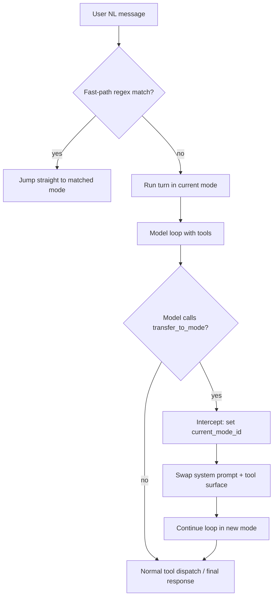

# RFC: Handoff-as-Tool-Call Routing

Status: Draft
Date: 2026-07-16
Author: Lisa Framework

## Problem

The current router (`kernel/router.py:plan_route`) is a **separate stateless
planner** that runs before every natural-language turn. It has structural
limitations that the industry has moved past:

1. **Blind to conversation context.** The planner receives a normalized message
   and a short `conversation_excerpt_markdown` — no full chat history, no active
   workflow state, no FSM stage. It cannot resolve references like "write *that*
   to a markdown document" where "that" refers to the prior turn's output.

2. **No composition.** The fast-path disqualifier (`_FAST_PATH_MULTI_INTENT_RE`)
   rejects messages containing "and", "also", "plus", "then", "vs". The
   model-bounded planner picks exactly one mode. The architecture cannot express
   "do two things in one turn."

3. **No handoff-back.** Once routed to `markdown`, there is no mechanism for the
   markdown agent to say "I'm done, transfer back to default."
   `current_mode_id` stays `markdown` until the user manually `/commands` or the
   router moves them.

4. **Extra model call per turn.** The planner is a separate LLM call before the
   real turn. The handoff pattern folds routing into the main turn's tool-call
   loop — zero extra calls.

5. **Modes are opaque to the planner.** The planner sees `description` +
   `route_hints` + `fast_path_patterns`, not the actual tool surface. It cannot
   know "default mode already has `write_file` available — no need to switch."

## Industry Survey

Four patterns are in production across major frameworks:

| Pattern | Who ships it | Routing decision lives in | Extra call/turn | Stateful |
| --- | --- | --- | --- | --- |
| Separate stateless planner | Lisa (current) | Dedicated pre-turn planner | Yes (1 planner call) | No |
| Handoff / swarm | OpenAI Agents SDK (ex-Swarm), LlamaIndex `AgentWorkflow`, LangGraph swarm | Current agent calls `transfer_to_X` tool | No | Chat history carries |
| Supervisor / orchestrator | LangGraph supervisor, LlamaIndex orchestrator, CrewAI `@router` | Top-level agent calls sub-agents as tools | No | Supervisor state |
| Custom planner | LlamaIndex pattern 3, CrewAI Flows | LLM emits structured plan; code parses + executes | Yes | Yes |

**The converged direction is handoff-as-tool-call.** OpenAI Swarm's entire
model is two primitives: `Agent` + handoff. An agent returns another `Agent`
from a function call and the loop transfers control. The Agents SDK is the
production evolution. LlamaIndex's `AgentWorkflow` does the same with
`can_handoff_to=["WriteAgent"]` declarations. LangGraph's swarm multi-agent
architecture is the same idea in graph form.

The supervisor/orchestrator pattern is the fallback when central control and
composition are needed — the orchestrator calls sub-agents as tools, sub-agents
always return to it, and it can call several in one turn.

The separate-stateless-planner pattern (Lisa's) is the **least common** in
current frameworks. It is the most latent and the most brittle because it
decides ownership blind.

## Recommended Pattern: Handoff-as-Tool-Call

Adapt the handoff pattern to Lisa's existing architecture. The key insight:
**Lisa already has an intercepted-tool-call precedent** —
`transition_stage` in `kernel/turn_runner.py:1532`. The workflow FSM advances
when the model calls `transition_stage` as a tool; the turn loop intercepts it
before the MCP/operation dispatch branches and calls `apply_transition` in-process.
A `transfer_to_mode` tool follows the same pattern.

### Design

#### Phase A: Minimal handoff (re-run turn in new mode)

The simplest implementation that eliminates the separate planner:

1. **Inject `transfer_to_mode` tool** into every routable mode's tool surface.
   This tool is injected by the turn runner (like `transition_stage`), not
   declared in each mode's `allowed_tool_ids`. It bypasses the allowlist.

2. **Intercept the tool call.** When the model calls `transfer_to_mode` with
   `target_mode_id`, the turn loop:
   - Sets `runtime.current_mode_id = target_mode_id` (via the same setter as
     `hosts/core/commands.py:296`).
   - Records `handoff_to = target_mode_id` on `TurnResult`.
   - Returns a tool result: "Transferred to mode: {target_mode_id}. Continue
     handling the user's request in this mode."

3. **Host re-runs the turn.** `_execute_mode_turn` in `handle_message.py` checks
   `TurnResult.handoff_to`. If set, it re-runs the turn in the new mode with the
   same user message. Chat history persists (it already does — modes swap the
   system prompt, not the history).

4. **Deprecate `plan_route`.** The separate planner is removed. Natural-language
   turns start in `current_mode_id` (defaulting to `default`). The model decides
   to hand off by calling `transfer_to_mode` if the current mode's tools can't
   handle the request. No extra model call.

#### Phase B: True mid-turn handoff (Swarm style)

Phase A re-runs the turn, costing one extra completion. Phase B eliminates
that by swapping the system prompt + tool surface **mid-turn** without leaving
the tool-call loop:

1. On `transfer_to_mode` interception, swap `messages[0]` (system prompt) to
   the new mode's `_mode.md` body.
2. Rebuild the tool schema list for the new mode's `allowed_tool_ids`.
3. Continue the loop — the next `hooks.complete` call uses the new prompt +
   tools. The model picks up where it left off, now equipped with the right
   tools.

This is the OpenAI Swarm pattern: the agent loop continues, only the system
prompt and tool surface change. Chat history is unchanged.

### What changes

| Component | Change |
| --- | --- |
| `kernel/turn_runner.py:TurnResult` | Add `handoff_to: str \| None = None` |
| `kernel/turn_runner.py` | Add `_TRANSFER_TOOL_NAME = "transfer_to_mode"` constant |
| `kernel/turn_runner.py` tool-call loop | Add interception block (following `transition_stage` precedent at line 1532) |
| `kernel/turn_runner.py` schema injection | Inject `transfer_to_mode` schema for all routable modes, bypassing `allowed_tool_ids` |
| `hosts/core/handle_message.py` `_execute_mode_turn` | Check `TurnResult.handoff_to`, re-run in new mode (Phase A) |
| `kernel/router.py` `plan_route` | Deprecate, then remove (hard cutover) |
| `kernel/router.py` fast-path regex | Keep as zero-cost hint that short-circuits to a mode without a tool-call round-trip |

### What stays

- **Fast-path regex** — kept as an optional zero-cost hint. If a message
  matches a mode's `fast_path_patterns`, jump straight to that mode without
  even a tool-call round-trip. This is a *hint* that short-circuits the
  handoff, not a *gate* that blocks it.
- **Slash commands** (`/markdown`, `/search`) — unchanged, string parser.
- **`/deep` prefix** — unchanged, default mode + deep model.
- **Explicit `/mode` switching** — unchanged, sets `current_mode_id` directly.
- **`start_mode` bypass for real owning modes** — unchanged. Only `default` is
  exempt (see `ROUTER_DESIGN.md` §3).

### Migration: hard cutover

Per the project's "no compat or migration" preference:

1. Remove `plan_route` and its call site in `handle_message.py`.
2. Remove the router planner prompt, verifier prompt, and `RouteDecision`
   model.
3. Remove `_try_router_shortcut` and `_try_router_clarification`.
4. Natural-language turns go directly to `current_mode_id` (defaulting to
   `default`). The model hands off via `transfer_to_mode` if needed.
5. Keep `fast_path_patterns` as the deterministic short-circuit.

### Why this is better

| Limitation | Current (planner) | Proposed (handoff) |
| --- | --- | --- |
| Conversation context | Blind (short excerpt only) | Full chat history in the loop |
| Composition | Disqualified (one mode per turn) | Model calls multiple tools across modes |
| Handoff-back | None | Model calls `transfer_to_mode: default` |
| Extra model call | 1 planner call per NL turn | 0 (folding routing into the tool loop) |
| Mode opacity | Sees description only | Sees actual tool surface, knows what's available |

## Open Questions

1. **Should `transfer_to_mode` be one generic tool or per-mode tools?**
   OpenAI Swarm uses per-agent `transfer_to_X` functions. A single
   `transfer_to_mode(target_mode_id)` is simpler and avoids schema bloat.
   Recommendation: single generic tool with an enum of routable mode IDs.

2. **Should the fast path still run before the turn?** Yes — it's zero-cost
   (regex, no model call) and short-circuits the obvious cases. But it's a
   *hint*, not a *gate*: if it misses, the model can still hand off mid-turn.

3. **What about the `start_mode` bypass?** Keep it for real owning modes
   (learn, coding, research). The `default` exemption (already implemented)
   means `start_mode: default` lets the model decide via handoff. A pinned
   `start_mode: learn` keeps the user in `learn` until they `/switch` or the
   learn agent hands off.

4. **Supervisor pattern for composition?** Phase A/B handle simple handoff.
   If composition ("search AND write markdown") becomes common, a future
   Phase C could add a supervisor mode that calls sub-modes as tools — but
   this is out of scope for the initial cutover.

## References

- OpenAI Swarm: <https://github.com/openai/swarm> (handoff primitive)
- OpenAI Agents SDK: <https://github.com/openai/openai-agents-python> (production evolution)
- LlamaIndex multi-agent patterns: <https://developers.llamaindex.ai/python/framework/understanding/agent/multi_agent/>
- LangGraph multi-agent: <https://langchain-ai.github.io/langgraph/concepts/multi_agent/>
- Lisa `transition_stage` precedent: `kernel/turn_runner.py:1532`
- Lisa router design: `docs/ROUTER_DESIGN.md`
