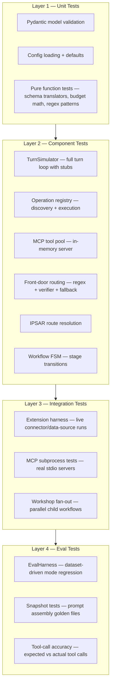

# Testing Framework Specification

Status: Proposed 2026-07-05
Owner: Architecture

This document specifies the Lisa testing framework — a layered test infrastructure
that builds on the existing `kernel/testing/` package to add turn simulation, eval
harnesses, snapshot testing, and MCP integration testing. The goal is a testing
experience where mode authors, extension authors, and kernel contributors can all
validate their work with minimal boilerplate and maximum confidence.

## Design Verdicts

| Question | Answer |
| --- | --- |
| Replace `kernel/testing/`? | **No.** The existing `extension_harness.py`, `stubs.py`, and `import_boundaries.py` are solid. Build on top of them. |
| Eval framework: build or adopt? | **Build a minimal one.** The eval harness is ~300 lines of Python, not a product. It uses CSV/JSONL datasets and simple pass/fail assertions. Adopting a full eval framework (LangSmith, Braintrust) is a host decision, not a kernel concern. |
| Snapshot testing: which tool? | **pytest-snapshot or inline golden files.** The kernel already uses pytest. Golden files live next to test files as `*.snapshot.txt` or `*.snapshot.json`. |
| MCP integration tests: subprocess or in-memory? | **In-memory first.** An `InMemoryMCPServer` that implements the MCP stdio protocol over `asyncio` queues. No subprocess spawning in unit tests. Subprocess tests are a separate integration suite. |
| Where do test helpers live? | **`kernel/testing/` for kernel-level helpers; `lisa_sdk/testing/` for SDK-level helpers.** Packs and extensions import from `lisa_sdk.testing`. |

## Layered Test Architecture



## Part 1 — TurnSimulator

### Purpose

A `TurnSimulator` class that lets tests drive full turns through `run_turn()` with
complete control over every external dependency. This is the highest-leverage
addition — it unblocks testing for the front-door router, IPSAR, FSM, and the full
turn loop without requiring real models, real MCP servers, or real memory stores.

### Location

`kernel/testing/turn_simulator.py`

### API

```python
@dataclass
class SimulatedModel:
    """One simulated model response in a turn sequence."""
    content: str = ""
    tool_calls: list[SimulatedToolCall] | None = None
    """If set, the simulator returns these tool calls instead of content."""


@dataclass
class SimulatedToolCall:
    """One tool call the simulated model requests."""
    tool_id: str
    tool_name: str
    arguments: dict[str, Any]


@dataclass
class SimulatedToolResult:
    """The result the simulator returns for a tool call."""
    tool_id: str
    content: str
    is_error: bool = False


class TurnSimulator:
    """Drives a full turn through run_turn() with complete stub control.

    The simulator owns:
    - A sequence of model responses (content or tool_calls)
    - A tool result map (tool_name → SimulatedToolResult)
    - A memory store (in-memory list, scoped by user/workspace/surface)
    - A content registry (in-memory dict of path → content)
    - Slice tuning (disabled by default)

    Usage::

        sim = TurnSimulator()
        sim.given_model_responses([
            SimulatedModel(tool_calls=[
                SimulatedToolCall("call_1", "web_search", {"q": "test"})
            ]),
            SimulatedModel(content="Here is the result."),
        ])
        sim.given_tool_result("web_search", SimulatedToolResult(
            tool_id="call_1",
            content='[{"title": "Result", "url": "https://example.com"}]',
        ))

        result = await sim.run_turn(mode_id="default", query="search for test")
        assert result.response_text == "Here is the result."
        assert result.tool_call_count == 1
    """

    def __init__(
        self,
        *,
        content_registry: dict[str, str] | None = None,
        slice_tuning: SliceTuning | None = None,
    ) -> None: ...

    # ── Configuration methods ──────────────────────────────────────

    def given_model_responses(self, responses: list[SimulatedModel]) -> None:
        """Set the sequence of model responses for the next turn.

        Each call to hooks.complete() consumes the next response in the
        sequence. If the sequence is exhausted, the simulator raises
        SimulatorExhaustedError.
        """

    def given_tool_result(
        self, tool_name: str, result: SimulatedToolResult
    ) -> None:
        """Register a tool result for a given tool name.

        When the model requests tool_name, the simulator returns this
        result. The tool_id in the result must match the tool_id in the
        simulated tool call, or the simulator raises ToolMismatchError.
        """

    def given_memory_entries(
        self, entries: list[MemoryRecord]
    ) -> None:
        """Pre-populate the in-memory store for recall tests."""

    def given_content(self, path: str, text: str) -> None:
        """Register authored content for the in-memory content registry."""

    # ── Execution ─────────────────────────────────────────────────

    async def run_turn(
        self,
        *,
        mode_id: str,
        query: str,
        surface: SurfaceContext | None = None,
        max_tool_iterations: int = 10,
    ) -> TurnResult:
        """Execute one turn and return the TurnResult."""

    # ── Assertion helpers ──────────────────────────────────────────

    @property
    def model_call_count(self) -> int:
        """How many times hooks.complete() was called."""

    @property
    def tool_calls_made(self) -> list[tuple[str, dict[str, Any]]]:
        """Every (tool_name, arguments) pair dispatched during the turn."""

    @property
    def memories_stored(self) -> list[MemoryRecord]:
        """Every memory record written during the turn."""

    @property
    def operations_executed(self) -> list[str]:
        """Every operation_id executed during the turn (pre, post, entry)."""

    @property
    def last_system_prompt(self) -> str | None:
        """The assembled system prompt from the last complete() call.

        Useful for snapshot testing prompt assembly.
        """
```

### What TurnSimulator replaces in existing tests

The current `test_turn_runner.py` uses ad-hoc stubs (`_make_stub_complete`,
`_stub_execute_operation`, inline memory lists). `TurnSimulator` replaces all of
these with a single, composable fixture. Existing tests should be migrated to use
`TurnSimulator` as part of this work.

### New tests TurnSimulator enables

| Test target | What it validates |
| --- | --- |
| `frontdoor.py` | Fast-path regex match → correct mode; verifier confirmation; model-bounded fallback; structured-output retry; fallback to default |
| `ipsar.py` | Slash-command parsing; pattern-matched mode detection; default fallback |
| `ipsar_fsm.py` | Stage transitions; operation lifecycle (entry → pre-turn → post-turn); mode kind dispatch (chat vs action vs workflow) |
| `turn_runner.py` | Full pre-turn → tool loop → post-turn with memory; slice hooks firing; context assembly |
| `operations/registry.py` | `.operation.md` discovery; `.yml` config loading; `execute_operation` with context |
| `web_search.py` | Search query assembly; result parsing; error handling |
| `surf_workflow.py` | Session creation; page tracking; TTL; trimming; persistence |

---

## Part 2 — EvalHarness

### Purpose

A lightweight eval framework for dataset-driven mode regression testing. Mode
authors define a CSV or JSONL dataset of inputs and expected behaviors, and the
harness runs each case through a mode, collects results, and produces a pass/fail
report.

### Design principles

- **Minimal and self-contained.** No external eval service dependency. CSV/JSONL
  in, JSON report out.
- **Mode-agnostic.** Works with any mode (chat, action, workflow). The dataset
  specifies the mode.
- **Assertion-based, not LLM-as-judge.** Assertions are deterministic: "response
  contains X", "response does not contain Y", "tool X was called", "mode was Y".
  LLM-as-judge is a host concern.
- **Composable with TurnSimulator.** The eval harness uses `TurnSimulator` under
  the hood. Real-model eval is a separate concern (host-owned).

### Location

`kernel/testing/eval_harness.py`

### Dataset format

#### CSV (`eval_dataset.csv`)

```csv
case_id,mode_id,query,expected_mode,expected_tools,expected_contains,expected_not_contains,notes
search_basic,search,what is python asyncio,search,web_search,asyncio,,basic search dispatch
chat_default,default,hello,default,,hello,error,simple chat fallback
deep_research,discuss,explain monads,discuss,,monad,,"deep mode for complex topic"
```

#### JSONL (`eval_dataset.jsonl`)

```jsonl
{"case_id": "search_basic", "mode_id": "search", "query": "what is python asyncio", "expected_mode": "search", "expected_tools": ["web_search"], "expected_contains": ["asyncio"], "expected_not_contains": [], "notes": "basic search dispatch"}
{"case_id": "chat_default", "mode_id": "default", "query": "hello", "expected_mode": "default", "expected_tools": [], "expected_contains": ["hello"], "expected_not_contains": ["error"], "notes": "simple chat fallback"}
```

### API

```python
@dataclass
class EvalCase:
    """One evaluation case from a dataset."""
    case_id: str
    mode_id: str
    query: str
    expected_mode: str | None = None
    expected_tools: list[str] = field(default_factory=list)
    expected_contains: list[str] = field(default_factory=list)
    expected_not_contains: list[str] = field(default_factory=list)
    model_responses: list[SimulatedModel] | None = None
    tool_results: dict[str, SimulatedToolResult] | None = None
    notes: str = ""


@dataclass
class EvalResult:
    """The outcome of one eval case."""
    case_id: str
    passed: bool
    mode_id: str
    query: str
    actual_mode: str | None = None
    actual_response: str = ""
    actual_tools: list[str] = field(default_factory=list)
    failures: list[str] = field(default_factory=list)
    """Human-readable descriptions of each failed assertion."""
    duration_ms: int = 0


@dataclass
class EvalReport:
    """Aggregate report for a full eval run."""
    dataset_path: str
    total_cases: int
    passed: int
    failed: int
    errored: int
    results: list[EvalResult]
    duration_ms: int = 0

    @property
    def pass_rate(self) -> float:
        """Fraction of cases that passed (0.0–1.0)."""


class EvalHarness:
    """Runs a dataset through simulated turns and collects results.

    Usage::

        harness = EvalHarness()
        harness.load_csv("path/to/dataset.csv")
        # or: harness.load_jsonl("path/to/dataset.jsonl")

        report = await harness.run()
        print(f"Pass rate: {report.pass_rate:.0%}")
        for result in report.results:
            if not result.passed:
                print(f"  FAIL {result.case_id}: {result.failures}")
    """

    def __init__(
        self,
        *,
        content_registry: dict[str, str] | None = None,
        slice_tuning: SliceTuning | None = None,
    ) -> None: ...

    def load_csv(self, path: str | Path) -> None:
        """Load eval cases from a CSV file."""

    def load_jsonl(self, path: str | Path) -> None:
        """Load eval cases from a JSONL file."""

    def add_case(self, case: EvalCase) -> None:
        """Add a single eval case programmatically."""

    async def run(self) -> EvalReport:
        """Execute all loaded cases and return an aggregate report."""

    async def run_case(self, case: EvalCase) -> EvalResult:
        """Execute a single case and return its result."""
```

### Assertion types

| Field | Assertion | Failure message |
| --- | --- | --- |
| `expected_mode` | `actual_mode == expected_mode` | `Expected mode '{expected}' but got '{actual}'` |
| `expected_tools` | Every tool in the list was called at least once | `Expected tool '{tool}' was not called` |
| `expected_contains` | Every string appears in `response_text` (case-insensitive) | `Expected response to contain '{text}'` |
| `expected_not_contains` | No string appears in `response_text` (case-insensitive) | `Response contains forbidden text '{text}'` |

All assertions for a case run; a case fails if *any* assertion fails. All failures
are collected in `EvalResult.failures`.

### Integration with pytest

```python
# kernel/tests/eval/test_default_mode.py
from kernel.testing.eval_harness import EvalHarness

import pytest

@pytest.mark.eval
@pytest.mark.asyncio
async def test_default_mode_eval_suite() -> None:
    harness = EvalHarness()
    harness.load_csv("kernel/tests/eval/datasets/default_mode.csv")
    report = await harness.run()
    assert report.failed == 0, (
        f"Eval suite failed: {report.failed}/{report.total_cases} cases\n"
        + "\n".join(
            f"  {r.case_id}: {r.failures}"
            for r in report.results
            if not r.passed
        )
    )
```

### Dataset conventions

| Convention | Rule |
| --- | --- |
| Location | `kernel/tests/eval/datasets/{mode_id}.csv` or `{mode_id}.jsonl` |
| Naming | One dataset per mode; `{mode_id}.csv` for the primary suite |
| Case IDs | `{mode_id}_{scenario}` — e.g., `search_basic`, `search_no_results` |
| Model responses | Per-case `model_responses` override the harness default; if unset, the harness uses `SimulatedModel(content="")` (empty response) |
| Tool results | Per-case `tool_results` override the harness default; if unset, the harness returns `SimulatedToolResult(tool_id=call.tool_id, content="{}")` |

---

## Part 3 — Snapshot Testing

### Purpose

Golden-file testing for assembled system prompts. Given a mode, surface context, and
memory state, assert that the assembled system prompt matches a previously-approved
snapshot. This catches prompt regressions immediately — a mode author changes a
`_mode.md` or a stage `.md` file, the snapshot test fails, and the diff shows
exactly what changed.

### Location

Snapshots live next to their test files:

```plaintext
kernel/tests/snapshots/
    default_mode_system_prompt.snapshot.txt
    search_mode_system_prompt.snapshot.txt
    discuss_mode_system_prompt.snapshot.txt
    frontdoor_system_prompt.snapshot.txt
```

### Mechanism

Use `TurnSimulator.last_system_prompt` to capture the assembled prompt, then compare
against the golden file:

```python
# kernel/tests/snapshots/test_prompt_snapshots.py
from kernel.testing.turn_simulator import TurnSimulator, SimulatedModel

import pytest

SNAPSHOT_DIR = Path(__file__).resolve().parent


def _assert_snapshot(snapshot_name: str, actual: str) -> None:
    """Compare actual against the golden file. Fail with a unified diff."""
    snapshot_path = SNAPSHOT_DIR / f"{snapshot_name}.snapshot.txt"
    if snapshot_path.exists():
        expected = snapshot_path.read_text(encoding="utf-8")
        assert actual == expected, (
            f"Snapshot mismatch for {snapshot_name}.\n"
            f"To update, delete the snapshot file and re-run the test.\n"
            f"Expected length: {len(expected)}, Actual length: {len(actual)}"
        )
    else:
        # First run: write the snapshot
        snapshot_path.parent.mkdir(parents=True, exist_ok=True)
        snapshot_path.write_text(actual, encoding="utf-8")
        pytest.skip(f"Snapshot created for {snapshot_name}. Re-run to verify.")


@pytest.mark.snapshot
@pytest.mark.asyncio
async def test_default_mode_system_prompt() -> None:
    sim = TurnSimulator()
    sim.given_model_responses([SimulatedModel(content="ok")])
    sim.given_content("modes/default/_mode.md", "...")  # real content from packs
    sim.given_content("modes/default/default.md", "...")

    await sim.run_turn(mode_id="default", query="hello")

    _assert_snapshot("default_mode_system_prompt", sim.last_system_prompt or "")
```

### Snapshot update workflow

1. Developer changes a mode's prompt assets
2. They run `pytest -m snapshot`
3. Tests fail with a diff showing the prompt change
4. Developer reviews the diff — if intentional, deletes the old snapshot file
5. Re-run; new snapshot is written; test passes
6. Commit the new snapshot alongside the prompt change

### What gets snapshot-tested

| Snapshot | Captures |
| --- | --- |
| `{mode_id}_system_prompt` | Full assembled system prompt for each mode |
| `frontdoor_system_prompt` | The front-door routing prompt (boilerplate + mode catalog + hints) |
| `memory_recall_prompt` | The memory recall assembly (context + recalled memories) |
| `workshop_synthesis_prompt` | The workshop result synthesis prompt |

---

## Part 4 — In-Memory MCP Server

### Purpose

An `InMemoryMCPServer` that implements the MCP JSON-RPC protocol over `asyncio`
queues. Tests can register tools, read tool calls, and push results without spawning
subprocesses. This is the foundation for MCP tool pool integration tests.

### Location

`kernel/testing/mcp_stubs.py`

### API

```python
@dataclass
class RegisteredTool:
    """A tool registered on the in-memory MCP server."""
    name: str
    description: str
    input_schema: dict[str, Any]
    handler: Callable[[dict[str, Any]], Awaitable[dict[str, Any]]] | None = None
    """If set, called with arguments; must return MCP content items.
    If None, the test must push results manually via push_tool_result()."""


class InMemoryMCPServer:
    """An MCP-compatible server that runs entirely in-process.

    Implements the MCP JSON-RPC protocol over asyncio queues so tests
    can drive tool discovery and dispatch without subprocesses.

    Usage::

        server = InMemoryMCPServer(server_id="test-server")
        server.register_tool(RegisteredTool(
            name="echo",
            description="Echo back the input",
            input_schema={
                "type": "object",
                "properties": {"text": {"type": "string"}},
                "required": ["text"],
            },
            handler=lambda args: {"content": [{"type": "text", "text": args["text"]}]},
        ))

        config = server.as_client_config()
        pool = MCPToolPool([config])
        await pool.start()
        tools = await pool.list_tools()
        assert tools[0].name == "echo"
        result = await pool.call_tool("echo", {"text": "hello"})
        assert result.content[0].text == "hello"
    """

    def __init__(self, server_id: str = "in-memory") -> None: ...

    def register_tool(self, tool: RegisteredTool) -> None:
        """Register a tool that the server will advertise and dispatch."""

    def as_client_config(self) -> MCPClientConfig:
        """Return an MCPClientConfig that connects to this in-memory server.

        The config uses a special command/args that the MCPToolPool
        recognizes as in-process rather than subprocess.
        """

    @property
    def tool_calls_received(self) -> list[tuple[str, dict[str, Any]]]:
        """Every (tool_name, arguments) pair received since creation."""

    def push_tool_result(
        self, tool_name: str, result: dict[str, Any], is_error: bool = False
    ) -> None:
        """Push a result for a pending tool call. For tools registered
        without a handler, the test drives responses manually."""

    async def aclose(self) -> None:
        """Clean up queues."""
```

### MCPToolPool integration

The `MCPToolPool` gains a sentinel config value for in-memory servers:

```python
# In MCPClientConfig:
# When command == "__in_memory__", the pool looks up the server
# from an internal registry keyed by server_id.
MCPClientConfig(
    server_id="test-server",
    command="__in_memory__",
    args=[],
)
```

`InMemoryMCPServer.as_client_config()` returns this sentinel config. The pool's
`start()` method checks for the sentinel and wires the in-memory transport instead
of spawning a subprocess.

### New tests this enables

| Test target | What it validates |
| --- | --- |
| `MCPToolPool` | Start/stop lifecycle; tool catalog merging across servers; tool dispatch routing; error propagation; server disconnect recovery |
| `schema_translator.py` | MCP → OpenAI round-trip; MCP → Anthropic round-trip; exotic JSON-Schema keyword handling; unsupported type fallback |
| Turn runner MCP path | Full turn with MCP tools: list_tools → translate → complete → tool_calls → translate back → call_tool → append → loop |

---

## Part 5 — Test Taxonomy and Markers

### pytest markers

| Marker | Scope | Purpose |
| --- | --- | --- |
| `unit` | Layer 1 | Pure function tests, model validation, config defaults |
| `component` | Layer 2 | TurnSimulator tests, operation registry, MCP pool, front-door, IPSAR, FSM |
| `integration` | Layer 3 | Extension harness live tests, MCP subprocess tests, workshop fan-out |
| `eval` | Layer 4 | Dataset-driven mode regression, snapshot tests |
| `snapshot` | Layer 4 subset | Golden-file prompt assembly tests |
| `slow` | Cross-layer | Tests that take >1 second (subprocess spawns, network calls) |

### Test file conventions

| What | Where |
| --- | --- |
| Kernel unit tests | `kernel/tests/test_{module}.py` |
| Kernel component tests | `kernel/tests/test_{module}.py` (same file, `component` marker) |
| Kernel integration tests | `kernel/tests/integration/test_{module}.py` |
| Eval datasets | `kernel/tests/eval/datasets/{mode_id}.csv` |
| Snapshots | `kernel/tests/snapshots/{name}.snapshot.txt` |
| SDK tests | `lisa_sdk/tests/test_{module}.py` |
| Extension tests | `sdk_extensions/{ext}/tests/test_{module}.py` |
| Pack tests | `sdk_packs/{pack}/tests/` (new — packs currently have no tests) |

### CI integration

```powershell
# Unit + component (fast, no network)
uv run pytest -m "unit or component" -x

# Integration (may need credentials or local servers)
uv run pytest -m "integration" --run-slow

# Eval + snapshot (may need content roots wired)
uv run pytest -m "eval or snapshot"

# Full suite (excluding slow)
uv run pytest -m "not slow"
```

---

## Part 6 — What Gets Built and in What Order

### Phase 1 — TurnSimulator (highest leverage)

| Deliverable | Location |
| --- | --- |
| `TurnSimulator` class | `kernel/testing/turn_simulator.py` |
| `SimulatedModel`, `SimulatedToolCall`, `SimulatedToolResult` | `kernel/testing/turn_simulator.py` |
| Migrate existing `test_turn_runner.py` to use `TurnSimulator` | `kernel/tests/test_turn_runner.py` |
| New tests: `test_frontdoor.py` | `kernel/tests/test_frontdoor.py` |
| New tests: `test_ipsar.py` | `kernel/tests/test_ipsar.py` |
| New tests: `test_ipsar_fsm.py` | `kernel/tests/test_ipsar_fsm.py` |
| New tests: `test_operations_registry.py` | `kernel/tests/test_operations_registry.py` |

### Phase 2 — In-Memory MCP Server

| Deliverable | Location |
| --- | --- |
| `InMemoryMCPServer`, `RegisteredTool` | `kernel/testing/mcp_stubs.py` |
| `MCPToolPool` in-memory transport support | `kernel/tools/mcp_client.py` |
| New tests: `test_mcp_client.py` | `kernel/tests/test_mcp_client.py` |
| New tests: `test_schema_translator.py` | `kernel/tests/test_schema_translator.py` |

### Phase 3 — EvalHarness + Snapshots

| Deliverable | Location |
| --- | --- |
| `EvalHarness`, `EvalCase`, `EvalResult`, `EvalReport` | `kernel/testing/eval_harness.py` |
| Snapshot helper `_assert_snapshot` | `kernel/testing/snapshot_helpers.py` |
| Eval dataset: `default` mode | `kernel/tests/eval/datasets/default.csv` |
| Eval dataset: `search` mode | `kernel/tests/eval/datasets/search.csv` |
| Eval dataset: `discuss` mode | `kernel/tests/eval/datasets/discuss.csv` |
| Snapshot tests for all mode system prompts | `kernel/tests/snapshots/test_prompt_snapshots.py` |
| Snapshot test for front-door prompt | `kernel/tests/snapshots/test_prompt_snapshots.py` |

### Phase 4 — Pack and Extension Test Infrastructure

| Deliverable | Location |
| --- | --- |
| `lisa_sdk/testing/__init__.py` — re-exports from `kernel.testing` | `lisa_sdk/testing/__init__.py` |
| Pack test template | `sdk_packs/core/tests/` |
| Extension test template updates | Existing extension test files |

---

## Part 7 — What Does NOT Go in This Spec

| Out of scope | Why |
| --- | --- |
| Real-model eval (LLM-as-judge) | Host concern. The kernel provides deterministic eval; hosts add semantic eval on top. |
| CI/CD pipeline configuration | Ops concern. This spec defines markers and commands; CI wiring is separate. |
| Performance/load testing | Separate concern. The eval harness is for correctness, not throughput. |
| Test coverage enforcement (coverage thresholds) | Separate concern. Add `pytest-cov` thresholds after the test suite is populated. |
| Browser automation testing | Deferred to MCP Phase 6 (MCP-native browser automation). |
| Streaming turn tests | Deferred until streaming is implemented in the turn runner. |
