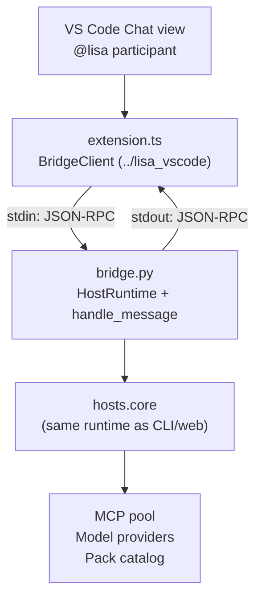

# Lisa VS Code Host Guide

The VS Code host (`hosts/vscode`) provides a Chat participant (`@lisa`) inside
VS Code's built-in Chat view. It spawns a Python subprocess (the stdio bridge)
that wraps the same transport-neutral `hosts.core` runtime as the CLI and web
hosts.

## Architecture

The VS Code host has two parts:

1. **Python bridge** (`hosts/vscode/bridge.py`) — a headless stdio subprocess
   that reads JSON-RPC requests from stdin, executes turns via
   `hosts.core.handle_message`, and writes JSON responses to stdout. Logging
   goes to a file (never stderr — stderr is reserved for VS Code diagnostics).

2. **TS extension shell** (sibling repo `lisa_vscode`, see
   [github.com/lisa-framework/vscode-extension](https://github.com/lisa-framework/vscode-extension))
   — a minimal VS Code extension that spawns the Python bridge, registers a
   Chat participant (`@lisa`), and pipes messages back and forth. The extension
   does no business logic — it's pure transport. It is checked out at
   `../lisa_vscode` (a sibling of this repo) and connected only by the JSON-RPC
   stdio contract below.



## Quick Start

### Prerequisites

- VS Code 1.90.0 or later
- Python 3.11+ in the workspace `.venv`
- The Lisa framework workspace synced (`uv sync --extra dev`)

### Step 1: Build the extension

The TypeScript extension now lives in a sibling repo at `../lisa_vscode`
(git origin: `github.com/lisa-framework/vscode-extension`). Clone it if you
haven't already:

```powershell
git clone https://github.com/lisa-framework/vscode-extension.git ../lisa_vscode
cd ../lisa_vscode
pnpm install
pnpm run compile
```

This produces `out/extension.js` from `src/extension.ts`.

> **pnpm**: The extension uses `pnpm` as its package manager. The
> `package.json` declares `"packageManager": "pnpm@9.7.1"` and the
> `.npmrc` sets `node-linker=hoisted` so VS Code can resolve the
> compiled extension's dependencies. If you don't have pnpm:
>
> ```powershell
> npm install -g pnpm
> ```

### Step 2: Install the extension in VS Code

**Option A — Launch a development host (recommended for testing):**

```powershell
# Press F5 in VS Code with the ../lisa_vscode folder open
# OR:
code --extensionDevelopmentPath=C:\Code\lisa_vscode
```

This opens a new VS Code window with the extension loaded. The `@lisa` Chat
participant should appear in the Chat view.

**Option B — Package and install:**

```powershell
# Package (pnpm runs the prepublish script automatically)
cd ../lisa_vscode
pnpm run package

# Install
code --install-extension lisa-vscode-0.1.0.vsix
```

> **`--no-dependencies`**: When packaging with `vsce`, pass this flag
> to skip dependency resolution — `pnpm` handles that via `pnpm install`.
> The extension has no runtime npm dependencies (only devDependencies
> for TypeScript compilation), so the `.vsix` only needs the compiled
> `out/extension.js`.

### Step 3: Chat with @lisa

1. Open the Chat view in VS Code (`Ctrl+Shift+P` → "Chat: Open Chat").
2. Type `@lisa` to select the Lisa Chat participant.
3. Send a message — it routes through the full Lisa pipeline (router
   routing, model completion, MCP tools, memory recall).

```plaintext
@lisa hello
@lisa /search recent Python packaging guidance
@lisa /help
@lisa /debug context
```

All host commands work the same as in the CLI: `/help`, `/settings`, `/tokens`,
`/debug`, `/consolidate`, `/checkpoint`, `/restore`, `/checkpoints`, `/pack`,
`/deep`.

## Configuration

### Environment Variables

The VS Code bridge reads the same `LISA_*` env vars as the CLI host. The
extension spawns the bridge with `python -m hosts.vscode.bridge --data-dir
<globalStoragePath>`, so set the `lisa.pythonPath` setting to this repo's
`.venv` Python so the `hosts.vscode.bridge` module is importable:

```json
{
  "lisa.pythonPath": "C:\\Code\\lisa\\.venv\\Scripts\\python.exe"
}
```

(Replace `C:\\Code\\lisa` with your clone path.)

The `.env` file at the project root is loaded automatically. If your `.env`
is elsewhere, set the env vars in VS Code's `settings.json` or in your terminal
environment before launching VS Code.

### Model Manifest

The bridge reads the active model manifest from `<data-dir>/models.yaml`.
Generate and manage it with host commands:

```text
/models discover
/models apply
/models show
/models reload
```

`/models discover` writes `<data-dir>/models.proposed.yaml` first so you can
edit it before applying.

### Data Directory

The bridge stores artifacts, memory, logs, and thread history in the data
directory. By default this is `<workspace>/artifacts/`. The extension passes
the VS Code `globalStoragePath` as the `--data-dir` argument to the bridge,
so data persists across sessions.

### Logging

The bridge logs to `<data-dir>/vscode-bridge.log` — never to stderr. To view
logs:

```powershell
Get-Content artifacts\vscode-bridge.log -Tail 50 -Wait
```

## Bridge Protocol

The TS extension and Python bridge communicate over stdio with one JSON object
per line.

### Request (stdin → bridge)

```json
{"id": 1, "method": "turn", "params": {"message": "hello"}}
```

### Response (bridge → stdout, matches request `id`)

```json
{"id": 1, "result": {"text": "Hello! How can I help?", "data": null, "is_error": false}}
```

### Stage notification (bridge → stdout, during a turn, no `id`)

```json
{"method": "notify", "params": {"stage": "router", "data": {"shortcut": "direct_response"}}}
```

### Error notification (bridge → stdout, non-fatal, no `id`)

```json
{"method": "error", "params": {"message": "Operation error: ..."}}
```

### Shutdown

```json
{"id": 2, "method": "shutdown"}
```

The bridge also shuts down gracefully on stdin EOF.

## Running the Bridge Standalone

You can run the bridge directly for testing without VS Code:

```powershell
# Start the bridge
uv run python -m hosts.vscode.bridge --data-dir artifacts

# Then type JSON-RPC messages on stdin (one per line):
{"id": 1, "method": "turn", "params": {"message": "/help"}}

# The response appears on stdout:
{"id": 1, "result": {"text": "Lisa Framework Host\n\n...", "data": null, "is_error": false}}

# To shut down:
{"id": 2, "method": "shutdown"}
```

This is useful for debugging the bridge without the VS Code extension layer.

## Extension Commands

| Command | Title | Description |
| --- | --- | --- |
| `lisa.turn` | "Lisa: Send Message" | Opens the Chat view with `@lisa` selected |

The extension also contributes a Chat participant:

| Participant | Name | Description |
| --- | --- | --- |
| `lisa-framework.lisa` | `@lisa` | Chat with the Lisa framework |

## MCP Integration

The VS Code host can also expose the framework's MCP servers (`lisa-context`,
`lisa-content`, `lisa-catalog`, `lisa-memory`, `lisa-guard`, `lisa-storage`)
to VS Code's built-in MCP client. Add them to `.vscode/mcp.json` in your
workspace (the CLI, web, and VS Code hosts all share the same six MCP
servers; add only the ones you want surfaced to Copilot Chat):

```json
{
  "servers": {
    "lisa-context": {
      "type": "stdio",
      "command": "uv",
      "args": ["run", "lisa-context", "--data-dir", "artifacts"]
    },
    "lisa-content": {
      "type": "stdio",
      "command": "uv",
      "args": ["run", "lisa-content", "--data-dir", "artifacts"]
    }
  }
}
```

This gives Copilot Chat direct access to the framework's MCP tools — memory
recall, content catalog, guard rails — without going through the `@lisa`
participant. The two paths are complementary:

- **`@lisa` Chat participant** — full Lisa pipeline (router routing,
  model completion, context assembly, operations, memory recall, checkpoints)
- **MCP servers in Copilot Chat** — raw tool access (Copilot calls
  `lisa-context.memory_search` directly, no router routing)

## Troubleshooting

### The @lisa participant doesn't appear

- Make sure the extension is installed or running in development mode.
- Check the VS Code Output panel for extension errors.
- Verify the bridge spawns correctly: run
  `uv run python -m hosts.vscode.bridge --data-dir artifacts` manually.

### Turns return errors

- Check `artifacts/vscode-bridge.log` for Python-side errors.
- Run `uv run lisa verify` to check the environment.
- Make sure your `.env` has `LISA_*` provider credentials set.
- Make sure `<data-dir>/models.yaml` is valid (or run `/models discover` then `/models apply`).

### The bridge process crashes

- Check stderr in the VS Code Output panel (look for "lisa-bridge stderr").
- The bridge needs the full `.venv` — make sure `uv sync --extra dev` has
  been run.
- The bridge needs `setup_framework` to succeed — make sure all packs are
  installed and the MCP manifest is valid.

## Comparison: CLI vs Web vs VS Code

| Feature | CLI (`lisa`) | Web (`lisa-web`) | VS Code (`@lisa`) |
| --- | --- | --- | --- |
| Entry point | `lisa` | `lisa-web desktop` | VS Code Chat `@lisa` |
| Transport | Rich console | aiohttp + browser | stdio JSON-RPC |
| Streaming | Token-by-token | Not yet (v1) | Not yet (v1) |
| Debug rendering | Rich panels | JSON `last_turn_context` | Chat markdown |
| `/help`, `/debug` | ✅ | ✅ | ✅ |
| `/pack` management | ✅ | ✅ | ✅ |
| Session context | Auto-discover | Auto-discover | Auto-discover |
| Tray support | ❌ | ✅ (optional) | ❌ |
| MCP pool lifecycle | REPL event loop | aiohttp `on_startup` | Bridge event loop |

All three hosts share the same `hosts.core` runtime — same `.env`, same model
manifests, same MCP servers, same pack catalog, same session context
auto-discovery. The only difference is the transport layer.
