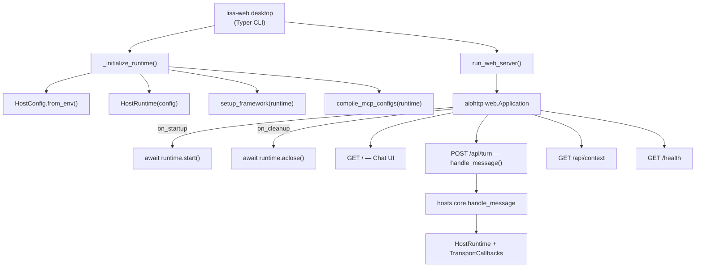

# Lisa Web Host Guide

The web host (`hosts/web`) runs a localhost aiohttp server with a browser-based
chat UI. It wraps the same transport-neutral `hosts.core` runtime as the CLI host,
so it uses the same `.env`, model manifests, pack policy, and MCP server pool.

## Quick Start

```powershell
# Start the web server (opens a browser tab automatically)
uv run lisa-web desktop

# Without auto-opening a browser
uv run lisa-web desktop --no-open-browser

# Custom host/port
uv run lisa-web desktop --host 0.0.0.0 --port 9000

# With a specific auth token (otherwise generated at startup)
uv run lisa-web desktop --token my-secret-token
```

The server prints the URL with the token query parameter. If you didn't disable
auto-open, a browser tab launches automatically. If you closed it, the URL looks
like:

```plaintext
http://127.0.0.1:8765/?token=<generated-token>
```

## Configuration

The web host accepts the same runtime flags as the CLI host. All of these are
optional — defaults come from `.env` and `HostConfig.from_env()`.

| Flag | Default | Purpose |
| --- | --- | --- |
| `--host` | `127.0.0.1` | Bind address |
| `--port` | `8765` | Bind port |
| `--token` | Generated | Auth token for API requests |
| `--no-open-browser` | `false` | Skip auto-opening a browser tab |
| `--debug` | `false` | Emit debug context per turn |
| `--log-level` | From `LISA_LOG_LEVEL` or `info` | Log threshold |
| `--log` | None | JSONL turn log file |
| `--host-log` | `<data-dir>/host.log` | Stdlib host log file |
| `--data-dir` | `LISA_DATA_DIR` or `<cwd>/artifacts` | Data root for artifacts, memory, logs |
| `--memory-db` | `<data-dir>/memory.json` | Memory database path |
| `--thread-dir` | `<data-dir>/threads` | Thread log directory |
| `--no-thread` | `false` | Disable thread persistence |
| `--session-context` | None | User context slug or file path |
| `--timezone` | `LISA_TIMEZONE` or system-local | IANA timezone |
| `--state-snapshot` | None | JSON snapshot file for compact context |
| `--streaming` | `none` | Streaming mode (not yet wired for web) |

## Environment Variables

The web host reads the same `LISA_*` env vars as the CLI host. Set them in a
`.env` file at the project root (loaded automatically via `python-dotenv`).

### Provider credentials

```env
LISA_AZURE_OPENAI_ENDPOINT=https://<resource>.openai.azure.com/
LISA_AZURE_OPENAI_API_KEY=<key>
LISA_AZURE_OPENAI_API_VERSION=2024-10-21

LISA_OPENAI_API_KEY=<key>
LISA_ANTHROPIC_API_KEY=<key>
LISA_ANTHROPIC_BASE_URL=https://api.anthropic.com
LISA_ANTHROPIC_VERSION=2023-06-01

LISA_GOOGLE_API_KEY=<key>
LISA_GOOGLE_API_BASE_URL=https://generativelanguage.googleapis.com/v1beta3/models

LISA_OLLAMA_HOST=127.0.0.1:11434
```

### Model manifest

```env
# Use the cloud models manifest (Ollama cloud models)
LISA_MODELS_FILE=models.yaml
```

Two manifests ship in `hosts/core/`:

| File | Models | Use case |
| --- | --- | --- |
| `models.yaml` | Local Ollama (`gemma3:latest`, `llama3.2:latest`) | Local development |
| `models-cloud.yaml` | Cloud Ollama (`gemma4:cloud`, `glm-5.2:cloud`) | Cloud inference |

### Session context

The web host auto-discovers `session_context.md` or a `session_context/`
directory in the CWD or the data directory. You can also pass an explicit path:

```powershell
uv run lisa-web desktop --session-context my-context
```

## API Endpoints

The web server exposes four routes:

### `GET /` — Chat UI

Returns the inline HTML chat page. The token is passed as a query parameter
(`?token=<token>`).

### `POST /api/turn` — Execute a turn

```bash
curl -X POST http://127.0.0.1:8765/api/turn \
  -H "Content-Type: application/json" \
  -H "X-Lisa-Token: <token>" \
  -d '{"message": "hello"}'
```

Response:

```json
{
  "response_text": "Hello! How can I help?",
  "last_turn_context": { ... },
  "is_error": false
}
```

The `X-Lisa-Token` header must match the token generated at startup (or the one
you passed via `--token`). Requests without a valid token get `401 Unauthorized`.

### `GET /api/context?token=<token>` — Last turn context

Returns the diagnostic context from the most recent turn as JSON. Useful for
debugging or building a custom UI.

### `GET /health` — Liveness probe

Returns `200 OK` with no body. Use this for health checks or container
orchestration.

## System Tray (Optional)

The web host ships with an optional system tray launcher that manages the web
server subprocess. Install the tray extras first:

```powershell
uv sync --extra dev
uv pip install -e hosts/web --extras tray
```

Then run the tray:

```powershell
uv run python -m hosts.web.tray
```

The tray icon provides:

- **Open** — opens the browser to the web UI
- **Restart** — restarts the web server subprocess
- **Open Logs** — opens the logs directory
- **Quit** — stops the server and exits

## How It Works



The runtime lifecycle is bound to the aiohttp event loop — `runtime.start()` runs
in `on_startup` and `runtime.aclose()` runs in `on_cleanup`, both inside the same
event loop that executes turns. This satisfies the anyio cross-loop cancel-scope
rule.

## Custom Frontend

The web host serves a minimal inline HTML chat page. To use a custom frontend:

1. Build your own HTML/JS page.
2. Send `POST` requests to `/api/turn` with the `X-Lisa-Token` header.
3. Read the response JSON for the reply text and turn context.

The API is intentionally simple — one endpoint, JSON in, JSON out. You can build
a React/Vue/Svelte frontend, a curl script, or a Postman collection on top of it.

## Verification

```powershell
# Check that the web host is properly configured
uv run lisa verify

# Start the server and test a turn
uv run lisa-web desktop
# Then in another terminal:
curl -X POST http://127.0.0.1:8765/api/turn \
  -H "Content-Type: application/json" \
  -H "X-Lisa-Token: <token-from-startup-output>" \
  -d '{"message": "/help"}'
```
