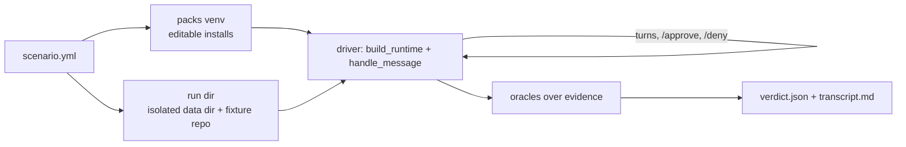

# e2etest — live end-to-end pack scenarios (`lisa-e2e`)

`e2etest` drives a **real** `HostRuntime` with a **live model** through a
scripted pack workflow, then judges the outcome from on-disk evidence. It is
the layer above [`packstest`](../packstest/README.md):

| Layer | Drives | Model | Answers |
| --- | --- | --- | --- |
| `packstest` evals | one tool in-process | none | "Does the tool honor its contract?" |
| `lisa-e2e` scenarios | the whole runtime + `handle_message` | live | "Can Lisa actually complete the workflow?" |

Use `packstest` for fast, deterministic regressions. Use `lisa-e2e` when the
question is whether routing, handoffs, approvals, policy, memory, sandboxing,
and the pack's tools work together for a real model.

## How a run works



1. **Packs venv** — `.e2e/cache/packs-venv-<hash>` holds editable installs of
   kernel/sdk/mcp_server plus the scenario's `packs`, sourced from
   [`packs.yml`](packs.yml). Editable means a pack fix is live on the next run.
   It is rebuilt only when the pack set or source paths change.
2. **Run dir** — `.e2e/runs/<scenario-id>/<UTC stamp>/` (gitignored). Contains
   a fresh `data/` dir used as `LISA_DATA_DIR`, the fixture repo copied to
   `workspace/<name>` with a git history and a bare `remote.git`.
   Only `config/models.yaml` and `.env` are read from the base data dir
   (`~/.lisa`, override with `LISA_E2E_BASE_DATA_DIR`).
3. **Driver** — boots the runtime in-process, sends each scripted turn, then
   follows up until the turn finishes:
   - approval pending → `/approve <id>` or `/deny <id>` per the scenario rules
     (the real approval path, not a policy bypass);
   - yield → `yield_reply`, only if `max_yield_replies` allows;
   - pause/stop exit → `continue_message`, only if `max_continues` allows.
4. **Oracles** — assertions over the thread log, memory DB, code-change
   artifacts, runtime log, and git. They never trust the model's prose.
5. **Bundle** — `verdict.json` (first failure first), `transcript.md`
   (exchanges + per-turn receipts), `outcome.json`, and the whole `data/` dir.

## Running the existing scenarios

From the framework checkout:

```bash
uv sync --frozen --extra dev            # once
uv run --frozen lisa-e2e run ../packs-wip/coding/lisa_packs/coding/tests/e2e/review_fix_commit.scenario.yml
```

| Scenario | Workflow |
| --- | --- |
| `coding/review-fix-commit` | knowledge-capturing review → worktree → patch → required check → commit, verified by re-running the tests outside Lisa |

Options:

- `--rebuild-venv` — force a packs-venv rebuild (after editing `packs.yml` or a
  pack's dependencies; source edits do not need it).
- `--runs-dir DIR` — write bundles elsewhere.

Exit codes: `0` pass, `1` an oracle failed, `2` setup error (bad scenario,
missing base `models.yaml`, venv build failure).

A run takes minutes and costs real tokens. Live runs vary between attempts, so
confirm a fix with more than one passing run before calling it done.

## Debugging a failed run

1. Read `verdict.json` → `first_failure` (oracle, args, detail).
2. Read `transcript.md` for the exchange sequence, approvals, and the
   per-turn receipt list.
3. Go to the raw evidence in `data/`:
   - `logs/runtime.jsonl` — warnings/errors (operation timeouts, validation
     failures, truncation retries);
   - `data/threads/*.current.jsonl` — every turn's transcript, tool calls with
     exact arguments, `turn_input` requests, provenance;
   - `state/code-change-artifacts.json` — WorkProduct state, check records;
   - `data/memory.db` — what memory actually stored.
4. Reproduce the failing piece **deterministically** before fixing: replay the
   exact tool arguments from the thread against `git`/the tool, or boot the
   runtime and call the pool directly (no model, seconds):

   ```python
   rt = build_runtime(host_kind="e2e", data_dir=..., session_context=..., in_process_mcp=True)
   await rt.start(); await rt.resources.mcp_tool_pool.call_tool("memory.add", {...})
   ```

5. Fix the root cause (pack, kernel, or runtime), add a regression test at the
   lowest layer that reproduces it, then rerun the scenario.

Never loosen an oracle to get green. If the harness mis-modelled a contract,
fix the harness and add a test in [`tests/`](tests).

## Writing a scenario

Scenarios live **in the pack**, next to its tests:

```text
<pack>/tests/e2e/
  conftest.py                 # collect_ignore_glob = ["fixtures/*"]
  <name>.scenario.yml
  session_context.md          # template; ${...} placeholders are substituted
  fixtures/<repo>/            # optional seed repo (planted defect, sample data)
```

`conftest.py` keeps pytest from collecting fixture code (which is deliberately
broken). Give fixture repos a realistic `.gitignore`.

### Scenario file reference

```yaml
id: <pack>/<workflow>            # bundle dir name; defaults to the file stem
session_context: session_context.md
fixture:
  repo: fixtures/<repo>          # optional; becomes a git repo with a bare origin
packs: [lisa-pack-...]           # keys of e2etest/packs.yml installed into the venv
policy: policy.yaml              # optional; default is empty `mode: ask`
env: {NAME: value}               # optional extra process env
turns:                           # user messages, in order
  - "..."
approvals:
  approve: [tool_id, ...]        # "*" approves everything not denied
  deny: [tool_id, ...]           # unlisted targets are denied
  max_decisions: 20
budgets:
  max_messages: 16               # every message sent, including /approve
  max_continues: 0               # replies to pause exits
  max_yield_replies: 0           # replies to model questions
  wall_clock_s: 1800
continue_message: continue
yield_reply: Proceed with your best judgment.
oracles:
  <phase>:                       # free-form grouping shown in the verdict
    - <oracle_name>: {args}
```

`session_context.md` placeholders: `${WORKSPACE}` (fixture repo path),
`${WORKSPACE_PARENT}` (where coding worktrees go), `${RUN_DIR}`. Mirror the
real session the pack targets, but name it uniquely (`name: e2e-<pack>`) so
live policy rules keyed on a workspace id do not apply.

### Oracle reference

Conversation hygiene:

| Oracle | Args | Passes when |
| --- | --- | --- |
| `not_aborted` | — | no budget was exceeded |
| `no_turn_errors` | — | no exchange errored |
| `no_operator_exit` | — | no pause/stop/terminate exit |
| `no_unanswered_yield` | — | the conversation did not end on a question |
| `no_runtime_errors` | `ignore: [regex]` | no error-level record in `runtime.jsonl` |
| `max_exchanges` | `n` | at most `n` messages were sent |

Capability and knowledge:

| Oracle | Args | Passes when |
| --- | --- | --- |
| `receipt` | `capability` (id or list), `min` | ≥ `min` effect receipts for those capabilities |
| `memory_recorded` | `mentions_any`, `min` | ≥ `min` stored memories mention any term |

Code change (coding pack WorkProduct + git; needs a `fixture.repo`):

| Oracle | Args | Passes when |
| --- | --- | --- |
| `workproduct_committed` | — | an artifact has a `commit_sha` |
| `branch_prefix` | `prefix` | the committed branch starts with `prefix` |
| `main_untouched` | — | local and remote `main` equal the fixture's initial commit |
| `diff_touches` | `paths`, `exact` | the commit changes `paths` (and nothing else when `exact`) |
| `checks_current` | — | every required check passed at the artifact revision and committed tree |
| `worktree_clean` | — | the owned worktree is clean and at the commit |
| `baseline_fails` | `argv`, `timeout_s` | `argv` fails on the fixture baseline (the defect is real) |
| `independent_check` | `argv`, `timeout_s` | `argv` passes on a fresh checkout of the commit, outside Lisa |

An unknown oracle name fails the run, so typos surface immediately.

### Design rules for good scenarios

- **Assert outcomes, not prose.** Prefer receipts, stored records, git state,
  and an independent check over text matching.
- **Prove the fixture.** Pair every "fixed" oracle with a baseline oracle that
  shows the starting state was actually broken.
- **Verify outside Lisa.** End-state checks (`independent_check`, a re-read of
  the ledger/file) must not reuse the tool path under test.
- **Exercise approvals for real.** Approve the effectful tools the workflow
  needs; deny the ones it must not reach (e.g. `coding_push`).
- **Default to strict budgets.** `max_continues: 0` and `max_yield_replies: 0`
  make stalls and capability gaps fail loudly instead of being papered over.
- **Keep fixtures tiny and deterministic.** Stdlib-only test commands, no
  network, one planted defect per workflow.

### Adding a new pack to the harness

1. Add the pack's source path to [`packs.yml`](packs.yml) (relative to that
   file). The `packs` list in a scenario may only name keys from it.
2. If the scenario needs an assertion the oracle table lacks, add it to
   [`oracles.py`](src/e2etest/oracles.py) with the `@oracle("name")`
   decorator and a test in [`tests/test_harness.py`](tests/test_harness.py)
   that covers both pass and fail.

## Gotchas

- The coding pack only runs checks under a bwrap floor with
  `execution: sandbox` and `persistence: direct-write`, and the worktree parent
  (`${WORKSPACE_PARENT}`) must be bound `rw`.
- The base `.env` is loaded without overriding the process env; location
  overrides (`LISA_PROFILE`, `LISA_THREAD_DIR`, `LISA_SESSION_CONTEXT_PATH`,
  `LISA_MCP_LOG_PATH`) are cleared so a run can never touch live state.
- Run one scenario per process; the runtime keeps process-global registries.
