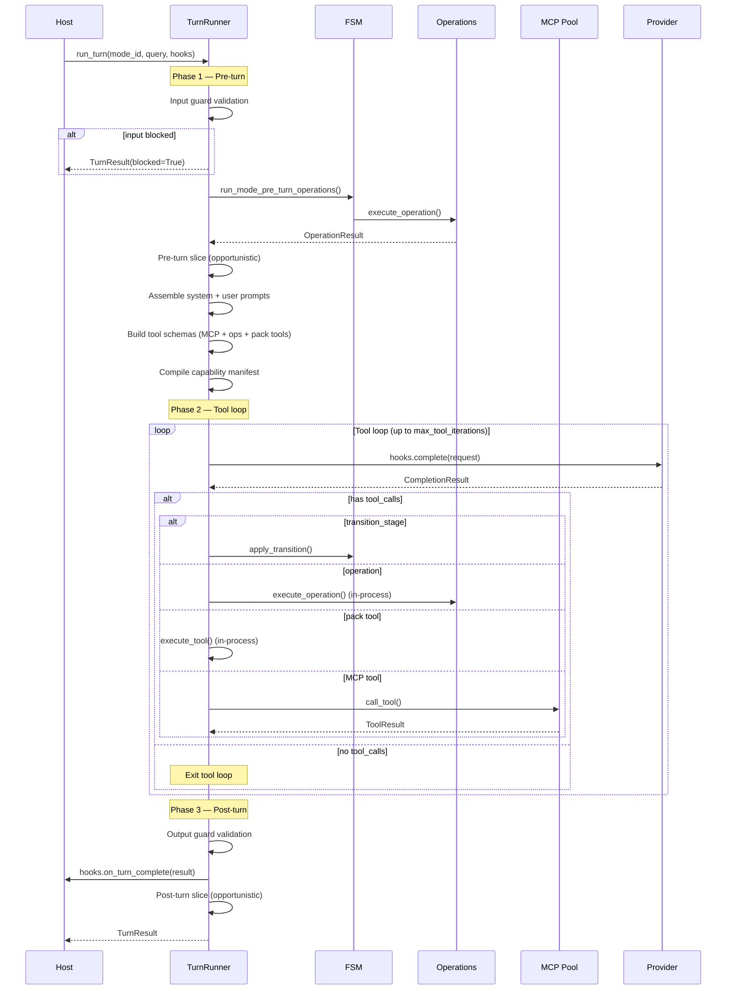
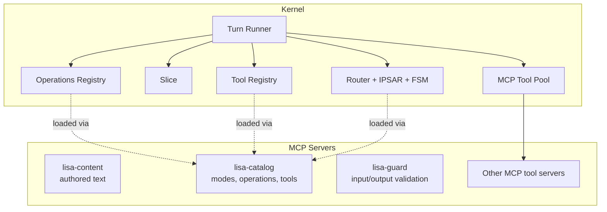
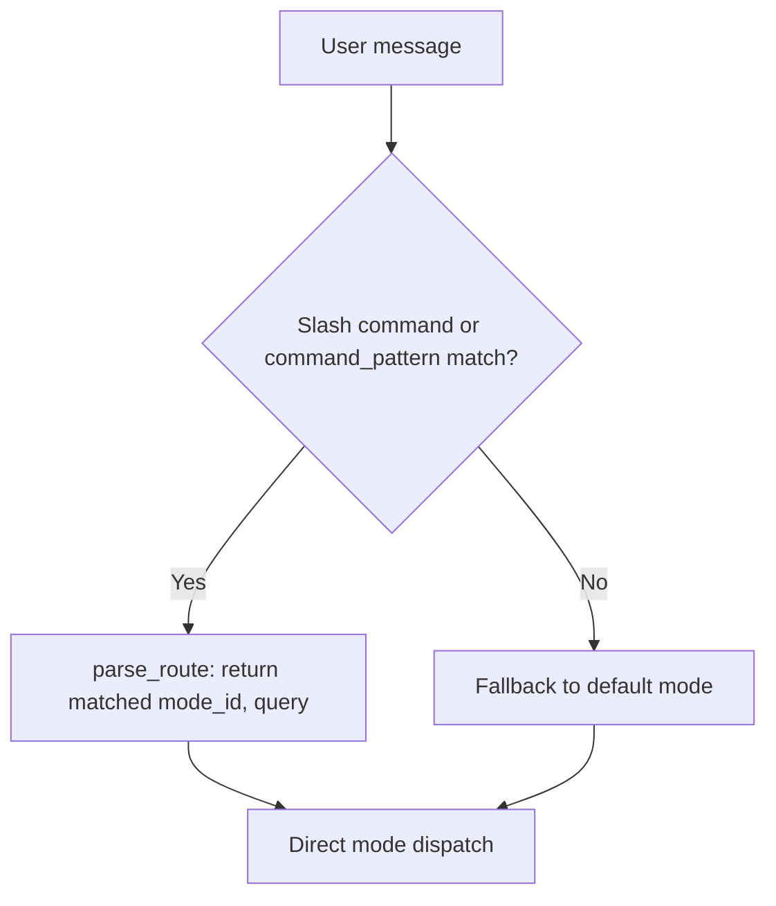
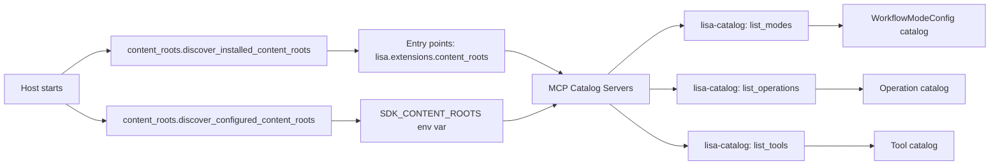

# Kernel Architecture

`lisa-kernel` is the runtime-neutral engine at the center of the Lisa Framework.

## Design Philosophy

The kernel is **runtime-neutral** by design. It owns all contracts, abstractions, and core built-ins. It imports nothing from host apps, SDK extensions, or private packages. Hosts inject concrete implementations through protocols and callbacks.

Key principles:

- **Contracts over implementations**: The kernel defines Pydantic models, protocols, and dataclasses. Hosts provide the concrete wiring (model completion, tool execution, MCP backend policy). Packs provide behavior such as memory recall and synthesis workflows.
- **No compat or migration layers**: When a pattern changes, old code goes away. No shim layers, no dual-path code.
- **Externalize aggressively**: Defaults minimally; configurability is essential. If a feature requires host-specific logic, it should be a callback or protocol seam, not an `if` statement in the kernel code.

## Module Map

### Core Engine

| Module | Responsibility |
| --- | --- |
| `turn_runner.py` | The single model+tool loop shared by all hosts. Executes pre-turn → tool loop → post-turn phases. Hosts wire behavior through `TurnHooks` and `ContextSeams`. The phase implementations live in the `turn_phases/` subpackage. |
| `workflow_instance.py` | Durable, cross-mode, cross-turn `WorkflowInstance` for multi-step workflow chains. Carries `declared_steps`, `completed_steps`, `current_step_id`. Created via two paths: `plan_workflow_op` (model-authored steps from `plan` mode) and `adhoc` (kernel-compiled from routing targets). Hydrated into the ephemeral `chain_satisfied` set at turn start so a yield → "continue" resume sees the remaining gap. See [docs/ROUTER_DESIGN.md §5c](../docs/ROUTER_DESIGN.md#5c-durable-workflow-chains-ad-hoc-vs-planned). |
| `ipsar.py` | IPSAR mode routing. `parse_route` matches a user message against each mode's `command_pattern` regex and returns `(mode_id, query)`; falls back to `"default"` when no pattern matches. Regex-only — no model calls. |
| `ipsar_fsm.py` | Workflow FSM loader and runtime. Loads mode definitions from the `lisa-catalog` MCP server (never touches the filesystem directly). Validates stage transitions, synthesizes the routing-transition table (`synthesize_routing_transitions` — full routable mesh), provides operation lifecycle hooks, and parses front-matter from instruction markdown. |
| `model_router_discovery.py` | Discovers per-iteration model routers via the `lisa.extensions.model_routers` entry-point group. Each router applies CEL rules to pick a model for a single iteration. |
| `model_router_config_discovery.py` | Discovers pack-seeded router config via `lisa.extensions.model_router_configs`. First-pack-wins merge. |
| `slice_provider_discovery.py` | Discovers slice providers via the `lisa.extensions.slice_providers` entry-point group. |
| `slice.py` | Opportunistic house-keeping system. Budget is `base + max_deferred * (1 - 0.5^(gap/half_life))`, clamped to `hard_cap_ms`. |

### Contracts & Models

| Module | Responsibility |
| --- | --- |
| `models.py` | All runtime-neutral Pydantic contracts: surface context, operation/tool execution, workflow FSM, fork fan-out (`ForkTarget`/`ForkChildResult`), delegation, memory, unified state, context evidence, anomaly alerts, capability manifest, introspection snapshots, token usage events, call ledger, and approval contracts. |
| `provider_core.py` | Provider gateway abstractions: `AzureOpenAIGateway`, `AnthropicGateway`, `GoogleGeminiGateway`, `BedrockGateway`, `OpenAICompatibleGateway`, completion/embedding request/result dataclasses, streaming support, message normalization, and usage extraction. |
| `extension_runtime.py` | Minimal extension runtime surface: `ExtensionRuntimeContext` for host services injection and the `ExtensionContextItemBuilder` callable shape. The bottom half is `kernel.intake.contracts.ProcessingLoop`. |

### Discovery & Configuration

| Module | Responsibility |
| --- | --- |
| `content_roots.py` | Discovers pack and extension roots from `lisa.extensions.content_roots` entry points and `SDK_CONTENT_ROOTS` env var. Supports pack exclusion via `excluded_packs`. |
| `model_manifest.py` | Loads and validates model manifests (YAML/JSON). Resolves models by key, model_id, alias, or display_alias. Supports per-mode model overrides via `mode_models`. |
| `config.py` | Kernel-owned settings: `sdk_content_roots`, declarative-completion defaults, turn-runner iteration budgets, guard caps, mapper scoring weights, and the shared chars-per-token estimate. Loads from environment with unknown-key filtering and an optional `LISA_` prefix. Surface identity defaults and per-lane context budgets live on the host (`host/config.py`). |
| `pack_activation.py` | Shared helpers for reading disabled-pack state from `installed-packs.json` and `LISA_DISABLED_PACKS` env var. Used by all entry-point discovery mechanisms. |
| `pack_configuration.py` | Immutable, pack-scoped configuration resolved from a session plan. `SessionPackConfigurationResolver` freezes configuration at construction time. |
| `session_plan.py` | Strict session-manifest contracts (`SessionManifestV2`) and deterministic plan compilation. Defines `SessionPlan`, `PackSelection`, `ResourceSelection`, `ContextPlan`, and related models. |

### Built-in Capabilities

| Module | Responsibility |
| --- | --- |
| `tools/mcp_client.py` | MCP tool-pool/client transport for stdio and HTTP servers. `MCPToolPool` manages subprocess lifecycle (spawn, health check, restart, graceful shutdown). Supports warm (long-lived) and cold (per-turn) pools, synthetic tools, and namespaced tool names. |
| `tools/registry.py` | In-process tool registry. Tools are discovered from packs via the `lisa-catalog` MCP server and dispatched in-process through imported implementation modules. |
| `tools/schema_translator.py` | Translates MCP tool schemas to/from provider-specific formats (OpenAI function-calling, Anthropic tool-use). |
| `tools/synthetic.py` | Synthetic tool builders for host-owned aliases. `mcp_alias_tool` creates well-known names (e.g. `memory.search`) that redirect to MCP server tools with optional argument/result mapping. |
| `openai_function_tools.py` | OpenAI function-tool schema builder with strict-mode support. |
| `state_providers.py` | `BlankStateProvider` for hosts that don't need state or opportunistic house-keeping. |
| `telemetry.py` | OpenTelemetry span helpers. |
| `token_usage.py` | Durable token-usage telemetry: `TokenUsageTelemetryHandler` appends events as JSONL, plus coercion helpers. |
| `approval.py` | Exact-action approval contracts. `ApprovalInvocation`, `ApprovalReceipt`, `ApprovalService` protocol, `InMemoryApprovalService`, digest construction, and receipt validation. |
| `capability_manifest.py` | Dynamic capability manifest compiler. Cross-references live tool schemas against operation/tool catalogs to produce a deterministic `CapabilityManifest` for the current turn. |
| `code_artifacts.py` | Pack-neutral artifacts for approved local code changes. `CodeChangeArtifact`, `CodeChangeArtifactStore` protocol, and `CodeCheckRecord`. |
| `recovery.py` | Durable recovery contracts for interrupted dispatch work items. `RecoveryRecord`, `RecoveryIdentity`, `RecoveryService` protocol, and state/retry/scope enums for write-ahead lifecycle tracking. |
| `host_commands.py` | Protocol for pack-registered host command handlers. `HostCommandHandler`, `HostCommandSpec`, and `PackCommandEntry`. |
| `host_command_discovery.py` | Discovery for pack-registered host commands via `lisa.extensions.host_commands` entry points. |

### Subpackages

| Subpackage | Responsibility |
| --- | --- |
| `operations/` | Operation registry for discovering and executing operations from packs via the `lisa-catalog` MCP server. Includes `registry.py` (discovery, execution, tool-schema building), `declarative.py` (prompt-authored operations runtime), and `structured_output.py` (JSON parsing with retry). |
| `intake/` | External data collection contracts: `SignalCollector` (stateless, repeatable monitors), `ProcessingLoop` (background processing chains triggered after collection), and `connector_discovery.py` (entry-point discovery). The bottom half is a one-shot process triggered by a systemd timer or cron. |
| `seams/` | Host-injection protocols: `StateProvider`, `InputGuard`, `OutputGuard`, `ContentRegistry`, `ModelPolicy`, `ModelRouter`, `ProviderGatewayProvider`, `EventBus`, `DataSanitizer`, `ExtensionItemBuilder`, plus `CompleteFn`, `ResolveModelFn`, `ExecuteToolFn`, and `ExecuteOperationFn` callable protocols. |
| `context/` | Public default implementations of kernel context seams and in-process context assembly: `MCPContentRegistry`, `MCPModeCatalog`/`MCPOperationCatalog`/`MCPToolCatalog`, `MCPInputGuard`/`MCPOutputGuard`, `ManifestModelPolicy`, `KernelProviderGatewayProvider`, `InProcessEventBus`, `PassThroughSanitizer`, `NoOpExtensionItemBuilder`, `PassThroughInputGuard`/`PassThroughOutputGuard`, plus `context_broker.py` (query-aware brokerage over `UnifiedState`), `context_budget.py` (token budget allocation), `context_frames.py` (authored context-frame helpers), `context_mapper.py` (deterministic candidate mapping and selection), `models.py` (immutable mapper contracts including `ContextBudgetSnapshot`), `context_keys.py` (turn-local context key constants), and `provenance.py` (XML-tagged context envelopes). |
| `mcp_launch/` | MCP launch contract: `policy.py` (approved server specs, `EnvPolicy`, `CwdPolicy`, `ToolPolicy`, `ProxyPolicy`, `MCPServerRegistry`), `compiler.py` (runtime adapter compiling specs into `MCPClientConfig`), `tool_filter.py` (allow/deny filtering), and `server_manifest.py` (declarative YAML manifest loader for external MCP servers and memory backends). |
| `turn_phases/` | The extracted turn-pipeline implementation, split out of `turn_runner.py`: `_fork.py` (fork fan-out + budget division), `_post_turn.py`, `_routing_hint.py` (capability-manifest-aware proactive routing hint + `plan` action escalation + `is_plan_escalation_hint` guard for the ad-hoc instance block), `_tool_schemas.py`, `_turn_state.py` (per-iteration model resolution: router → `ModelPolicy.choose` duck-type → static model). |
| `testing/` | `extension_harness.py` for validating signal collectors without a host app, `endpoint_registry.py`, `import_boundaries.py`, and `stubs.py`. |

## Turn Execution Flow

A turn through the kernel follows this path:



### Turn Phases in Detail

**Phase 1 — Pre-turn:**

1. **Input guard**: `ContextSeams.input_guard.validate()` runs before anything else. A block short-circuits the turn.
2. **Action mode fast path**: If the mode is an action mode with entry operations, those run immediately and the turn returns.
3. **Pre-turn operations**: `run_mode_pre_turn_operations()` executes mode-bound pre-turn operations.
4. **Pre-turn slice**: Opportunistic house-keeping fires (bounded by the pressure curve).
5. **Prompt assembly**: System prompt is assembled from mode instruction + optional stage instruction. Tool schemas are built from MCP-discovered tools, in-process operations, and pack-contributed tools. A capability manifest is compiled from the live tool surface.
6. **User context**: `assemble_user_context` injects host-specific context (surface blocks, memory recall, self-model, etc.).

**Phase 2 — Tool loop:**

1. Model completion via `hooks.complete` (or `hooks.complete_stream` for streaming).
2. Tool calls are dispatched by kind: `transition_stage` → FSM transition, operation → in-process `execute_operation`, pack tool → in-process `execute_tool`, everything else → MCP pool.
3. A `CallLedger` enforces per-target `max_calls_per_turn` uniformly across all dispatch branches.
4. A `TurnBudget` (when set) enforces tool call, token, and wall-time limits.
5. Stuck-session guard: after 4 turns in the same stage, a nudge is injected; after 6, tools are stripped to force a final response.
6. Per-iteration model selection: when the host wires `ModelPolicy.choose`, the loop can switch models mid-turn.

**Phase 3 — Post-turn:**

1. **Output guard**: `ContextSeams.output_guard.validate()` runs. Blocked outputs are replaced with a safe fallback and a `guardrail.audit` event is published.
2. **`on_turn_complete`**: Host persists the turn (thread history, conversation digest, provenance).
3. **Post-turn slice**: Opportunistic house-keeping fires (skipped if output was blocked).

## TurnHooks

`TurnHooks` is a dataclass that hosts populate with callbacks. Every hook is optional — hosts wire only what they need. The kernel provides sensible defaults for all hooks.

### Model Resolution & Completion

| Hook | Purpose |
| --- | --- |
| `resolve_model` | Resolve a model alias to a model definition. Default: stub with `model_id="default"`. |
| `complete` | Execute a model completion. **Required** — raises `NotImplementedError` if not wired. |
| `complete_stream` | Streaming completion (async generator yielding `StreamedChunk`). v1 streams tokens only; tool-call streaming deferred to v2. |

### Prompt Assembly

| Hook | Purpose |
| --- | --- |
| `assemble_system_prompt` | Build the system prompt from mode instruction + optional stage instruction. Default: mode instruction only. |
| `assemble_user_context` | Build user-specific context injected before the query. Receives the live `CapabilityManifest`. Default: empty string. |

### MCP Tool Infrastructure

| Hook | Purpose |
| --- | --- |
| `mcp_tool_servers` | List of `MCPClientConfig` for per-turn (cold) MCP servers. Default: empty list. |
| `mcp_tool_pool` | Optional host-owned long-lived `MCPToolPool` for warm servers. When set, reused across turns. |

### Operation & Tool Dispatch

| Hook | Purpose |
| --- | --- |
| `execute_operation` | Execute a named operation. Default: delegates to `kernel.operations.registry.execute_operation`. |

### Post-Turn

| Hook | Purpose |
| --- | --- |
| `on_turn_complete` | Called after every successful turn with `(mode_id, query, response_text, messages, effect_receipts)`. Default: no-op. |

### Opportunistic House-Keeping (Slice)

| Hook | Purpose |
| --- | --- |
| `slice_tuning` | `SliceTuning` instance controlling budget shape and trigger modes. |
| `pre_turn_slice` | Slice fired before the model call. |
| `post_turn_slice` | Slice fired after the response is committed. |
| `explicit_slice` | Slice fired only when explicitly requested. |
| `last_slice_finished_at` | Monotonic timestamp of the last completed slice. |

### Workflow FSM

| Hook | Purpose |
| --- | --- |
| `workflow_position` | Returns the current `WorkflowPosition` for the active user/surface — the single durable workflow object (inter-mode plan + intra-mode stage pointer). Required for stage instructions to be injected into prompts. |
| `workflow_position_updater` | Persists an updated `WorkflowPosition` after a `transition_stage` call (stage advance or mode handoff) or a turn-start position creation. |
| `fork_fn` | Executes a parallel fork fan-out (`transition_stage` `fork:` target). Default: `_default_fork_fn` wraps `kernel.turn_phases._fork` and fans children out via `asyncio.TaskGroup`. |
| `delegate_fn` | Executes one sequential delegate sub-turn. Default: `_default_delegate_fn` recurses into `run_turn` as a `sub_turn_kind="delegate"` child. |

### Host State & Services

| Hook | Purpose |
| --- | --- |
| `state_provider` | Returns a `UnifiedState` for the current host session. |
| `pack_configuration_resolver` | Session-owned resolver for immutable pack configuration. |
| `approval_service` | Host-owned persistence for exact-action approval. |
| `code_change_artifact_store` | Host-owned store for coding workflow artifacts. |
| `introspect` | Returns an `IntrospectSnapshot` from the host's live runtime. |

### Identity Fields

`TurnHooks` also carries ambient identity fields: `workspace_id`, `user_id`, `user_slug`, `user_name`, `principal_key`, `conversation_id`, `surface_type`, `surface_id`, `memory_scope`, and `session_plan_digest`.

## ContextSeams

`ContextSeams` is a dataclass bundled inside `TurnHooks` that inverts the private `app.*` dependencies the kernel previously took. Every seam has a public default implementation shipped under `kernel.context`; production hosts override any of them.

| Seam | Protocol | Default | Purpose |
| --- | --- | --- | --- |
| `content_registry` | `ContentRegistry` | `MCPContentRegistry` | Load authored text assets from content roots via `lisa-content` MCP server. |
| `model_policy` | `ModelPolicy` | `ManifestModelPolicy` | Resolve model aliases and check availability from a model manifest. |
| `provider_gateways` | `ProviderGatewayProvider` | `KernelProviderGatewayProvider` | Return provider gateway classes by name. |
| `event_bus` | `EventBus` | `InProcessEventBus` | Lightweight pub/sub for salience events and guardrail audits. |
| `data_sanitizer` | `DataSanitizer` | `PassThroughSanitizer` | Apply redaction before memory writes or context assembly. |
| `extension_item_builder` | `ExtensionItemBuilder` | `NoOpExtensionItemBuilder` | Build context evidence records from installed extensions. |
| `input_guard` | `InputGuard` | `PassThroughInputGuard` | Validate user input before the model call (Phase 1). |
| `output_guard` | `OutputGuard` | `PassThroughOutputGuard` | Validate model output before it reaches the user (Phase 3). |

### Guardrails

The kernel defines two guardrail seams. Both default to pass-through so public hosts run without a private safety pipeline. MCP-backed implementations (`MCPInputGuard`, `MCPOutputGuard`) are also available, delegating to a `lisa-guard` MCP server.

A `GuardResult` carries `allowed: bool`, an optional `blocked_reason`, an optional `sanitized_text` (for rewriting input/output in place), and `annotations` for provider-specific metadata.

- **Input block**: the turn short-circuits with `TurnResult(blocked=True)` and the `blocked_reason` as the response text. The model is never called and the pre-turn slice does not fire.
- **Output block**: the response is replaced with a safe fallback, a `guardrail.audit` event is published on the `EventBus`, and the post-turn slice is skipped. `on_turn_complete` still fires with the safe-fallback text.
- **Sanitization**: when `sanitized_text` is set, the original text is replaced in place for the remainder of the turn.

Enterprise implementations (Azure AI Content Safety, AWS Bedrock Guardrails, Cloudflare AI Gateway, Presidio PII redaction, custom regex) are host-owned; the kernel only defines the contract and the insertion points.

## MCP-Native Architecture

The kernel is MCP-native for content loading and external tool execution. Content (modes, operations, tools, authored text) is loaded through `lisa-content` and `lisa-catalog` MCP servers. External tools run through MCP servers managed by `MCPToolPool`. The kernel never touches the filesystem directly for content discovery.

In-process dispatch is used for operations and pack-contributed tools — these are discovered via MCP but executed in-process for performance and to give them access to host callbacks.



### Content Loading

All content access is mediated through MCP servers:

- **`lisa-content`**: Handles `read_authored_text` and `invalidate_cache`. Used by `MCPContentRegistry`.
- **`lisa-catalog`**: Handles `list_modes`, `list_operations`, and `list_tools`. Used by `MCPModeCatalog`, `MCPOperationCatalog`, and `MCPToolCatalog`.

The kernel imports implementation modules locally using `module_path` fields from catalog responses — the MCP server does the filesystem scanning; the kernel does the Python import.

### Tool Dispatch

Tools are dispatched through three paths, tried in order:

1. **`transition_stage`**: Intercepted by the turn loop for FSM transitions.
2. **Operation catalog**: Dispatched in-process via `hooks.execute_operation`.
3. **Tool catalog**: Dispatched in-process via `tools.registry.execute_tool` if the tool has an `implementation_module`; otherwise falls through to MCP.
4. **MCP pool**: Everything else goes through `pool.call_tool`.

Synthetic tools (host-owned aliases like `memory.search`) are registered on the pool and dispatch to MCP server tools with optional argument/result mapping.

## Route Resolution

For natural-language turns (non-slash-commands), the host resolves the mode through `ipsar.parse_route` — a pure-regex matcher. It iterates each mode's `command_pattern` and returns the first match as `(mode_id, query)`; when no pattern matches it falls back unconditionally to `("default", text)`. There is no verifier model and no model-bounded routing retry here.

Per-iteration model selection (a separate concern from mode routing) is handled by the CEL-based model router discovered via `lisa.extensions.model_routers`; see `sdk/src/sdk/router/README.md` and `../docs/ROUTER_DESIGN.md`.



The proactive routing hint (`turn_phases/_routing_hint.py`) runs after a turn and may fork to another routable mode or escalate to a `plan` action mode based on capability/ intent tags — see `../docs/ROUTER_DESIGN.md` §5.

## The Slice System

The slice system (`slice.py`) is the kernel's approach to background work. Instead of cron or wall-clock timers, it uses a **pressure model**: the longer it has been since the last slice finished, the more budget the next slice gets.

```plaintext
budget_ms = base_budget_ms + max_deferred_ms * (1 - 0.5^(gap_seconds / pressure_half_life_seconds))
```

The budget is clamped to `hard_cap_ms`. The policy is split between pre-turn and post-turn shares (default: 30% pre-turn, 70% post-turn).

Slice modes:

- `NEVER`: slicing is disabled
- `PRE_TURN`: run before each turn
- `POST_TURN`: run after each turn
- `EXPLICIT`: run only when explicitly requested

This pattern is the canonical approach for all opportunistic house-keeping: reindex, eviction, sync, compaction. Heartbeat-driven jobs (wall-clock bound) stay on traditional schedulers.

## Pack and Extension Discovery



Extensions are discovered through their own entry-point groups:

- `lisa.extensions.content_roots` — pack and extension content roots
- `lisa.extensions.signal_connectors` — signal collectors for the bottom half
- `lisa.extensions.processing_loops` — background processing chains
- `lisa.extensions.host_commands` — pack-registered slash commands
- `lisa.extensions.model_routers` — per-iteration CEL model routers
- `lisa.extensions.model_router_configs` — pack-seeded router config
- `lisa.extensions.slice_providers` — opportunistic house-keeping slice providers

All discovery mechanisms respect the disabled-pack exclusion set from `pack_activation.py`.

## Bottom Half: Intake & Processing

The bottom half is a one-shot process (`lisa intake`) triggered by a systemd timer or cron — no long-running threads.

1. **Signal Collectors** (`intake/connectors.py`): Stateless, repeatable monitors for external systems (Cloudflare, GitHub, Stripe, etc.). Each returns a typed Pydantic snapshot.
2. **Processing Loops** (`intake/contracts.py`): Background processing chains triggered after collection. Produce `ProcessedState` that gets merged into `UnifiedState`.
3. **State Store** (host-owned): Where processed results land. The top half (turn loop) reads from here via `hooks.state_provider`.

## Host Responsibilities

A real host must inject concrete implementations for these seams:

| Seam | Kernel contract | Example |
| --- | --- | --- |
| Model completion | `TurnHooks.complete` | Azure OpenAI, OpenAI, Anthropic, Ollama |
| Model resolution | `TurnHooks.resolve_model` | Manifest-based or database-backed |
| Tool execution | MCP tool servers | Web search, surf, custom tools |
| Operation execution | `TurnHooks.execute_operation` | `operations.registry.execute_operation` |
| Memory | MCP memory server with synthetic aliases | SQLite-backed MCP store, Mem0 |
| Input guard | `ContextSeams.input_guard` | `PassThroughInputGuard` (default), `MCPInputGuard`, Azure AI Content Safety, Bedrock Guardrails |
| Output guard | `ContextSeams.output_guard` | `PassThroughOutputGuard` (default), `MCPOutputGuard`, Azure AI Content Safety, Bedrock Guardrails, Presidio |
| Content registry | `ContextSeams.content_registry` | `MCPContentRegistry` (default) |
| Model policy | `ContextSeams.model_policy` | `ManifestModelPolicy` (default) |
| Provider gateways | `ContextSeams.provider_gateways` | `KernelProviderGatewayProvider` (default) |
| Event bus | `ContextSeams.event_bus` | `InProcessEventBus` (default) |
| Data sanitizer | `ContextSeams.data_sanitizer` | `PassThroughSanitizer` (default) |
| Transport adapter | Host-owned | Teams, Slack, WebSocket, console |
| Scheduler | Host-owned | For signal connector polling and heartbeat jobs |

The shared host runtime (`host`) is the reference host. It wires a minimal subset of these seams for local development and pack authoring, shared by the CLI and web transport hosts.

## Privacy Model

The kernel models privacy explicitly in its contracts:

- `SurfaceContext` carries `surface_type`, `surface_id`, and `memory_scope`.
- Memory writes and recalls are scoped by the active surface and memory scope.
- Shared surfaces must not receive personal context unless a host implements explicit, audited sharing semantics.
- Proactive delivery targets are host-owned and must be explicit.

Prompt wording is not a privacy control. Hosts must enforce scope in storage keys, retrieval filters, and delivery routing.

## Testing

The kernel ships with:

- `kernel/tests/`: unit tests for contracts, FSM validation, route parsing, slice math, provider gateways, MCP adapters, guardrails, streaming, and turn runner behavior.
- `kernel/testing/extension_harness.py`: public harness for validating signal collectors without a host app.
- `kernel/testing/import_boundaries.py`: import-boundary test shared across all packages.

Import-boundary tests across all packages (`sdk/tests/test_import_boundaries.py`, extension `tests/test_import_boundaries.py`) enforce that public packages never import private app modules.

## Operations

Operations are the **behavior layer** of the Lisa framework. They sit between modes
(which own routing and personality) and tools (which are low-level atomic capabilities).
An operation is a reusable, mode-gated, timeout-bounded unit of work that the kernel
can schedule automatically or offer to the model as a callable.

For step-by-step authoring instructions see [`../sdk/AUTHORING.md`](../sdk/AUTHORING.md).

### What an operation is — and what it is not

| Concept | Role | Example |
| --- | --- | --- |
| **Mode** | User-facing route; owns personality, FSM, and operation bindings | `stripe`, `search`, `discuss` |
| **Operation** | Internal reusable behavior bound to one or more modes | `stripe_status`, `web_search` |
| **Internal tool** | Atomic capability; single Python call; no orchestration | `web_search` (tool), `gmail_create_draft` |
| **MCP server tool** | External capability accessed over stdio/HTTP via the MCP protocol | `memory.add`, `memory.search`, `brave.search` |

Operations are **not** user-facing routes. A user never types the name of an operation;
a mode decides when to invoke it. Operations may call internal tools or MCP tools, but
tools cannot call operations.

### Two operation kinds

The `execution_kind` field on `OperationDefinition` (`kernel/models.py`) determines
which runtime is used.

#### Runtime operations (`execution_kind: "runtime"`, default)

Authored as a YAML metadata file plus a Python implementation module. The Python
`async def execute(ctx)` function can do anything: read cached state, call tools,
run multi-step logic, validate YAML, or compose a completion call with custom retry
logic. Use this when behavior must be deterministic, non-LLM, or require branching
that is too complex to express in prose.

```plaintext
operations/stripe_status/
├── stripe_status.yml   ← metadata (operation_id, description, mode_allowlist, …)
└── stripe_status.py    ← async def execute(ctx: OperationExecutionContext) -> OperationResult
```

Real examples: `lisa_packs/stripe/operations/stripe_status/`,
`lisa_packs/github/operations/github_status/`.

#### The `OperationHost` typed seam

Operations interact with the host through a single typed seam: `ctx.host`.
The `OperationHost` Protocol (`kernel/seams/protocols.py`) declares the
methods operations may call — `complete` (LLM call), `resolve_model`,
`read_authored_text` (authored content), `execute_tool`, `execute_operation`,
`generate_image`, `introspect`. The host wires a concrete adapter
(`_CallableHost` in `kernel/seams/host_adapter.py`) that delegates each
method to the corresponding host-side callable.

The completion result carries a `truncated: bool | None` signal that is set
authoritatively by the provider adapter (not guessed from `finish_reason`
strings): `True` = model stopped mid-output, `False` = clean stop, `None` =
adapter cannot tell. Operations that synthesize long-form output use this
to decide whether to issue a continuation pass.

#### Declarative (prompt) operations (`execution_kind: "prompt"`)

Authored as a single Markdown file whose YAML front matter carries the same metadata
fields and whose body is the LLM instruction. The `DeclarativeOperationModule` runtime
(`kernel/operations/declarative.py`) executes the operation by feeding the Markdown
body to the model as a system instruction and running a constrained tool loop. Use this
when the behavior is primarily an LLM task — synthesize, research, reflect — and the
only "logic" is "call these tools, then produce structured output following these rules."

```plaintext
operations/research/
└── web_research.operation.md   ← YAML front matter + Markdown body
```

A sibling `.py` file may optionally supply a Pydantic `response_format_model` class
without exposing an `execute` function. The catalog loader recognises that shape and
skips it as a runtime entry point, using it only as the response contract for the
declarative runtime.

Real examples: `lisa_packs/search/operations/research/web_research.operation.md`,
`sdk/packs/introspect/operations/self_model/reflect_self.operation.md`.

**Precedence rule:** if a directory contains both `<stem>.operation.md` and
`<stem>.py`, the Markdown operation takes precedence and the Python file is treated as
a response-format model only.

### Lifecycle and execution hooks

A mode binds operations in its `_mode.md` front matter under four hooks:

```yaml
entry_operation_ids: [checkout_context]   # run once on mode entry (action modes)
pre_turn_operation_ids: [web_briefing]    # run before every model completion
allowed_operation_ids: [recall, summarize] # callable by the model as tools
post_turn_operation_ids: [synthesize_learning] # run after every turn
```

The turn runner dispatches hooks in order: entry → pre-turn → model+tool loop
(where the model may call `allowed_operation_ids`) → post-turn. Pre-turn and post-turn
exceptions are caught and logged rather than aborting the turn; entry exceptions follow
the mode's `entry_failure_policy` (default `"abort"`).

Mode-bound operations are authoritative: listing an `operation_id` in any of the four
hook lists grants it permission for that mode regardless of its own `mode_allowlist`.
The operation's `mode_allowlist` is a secondary grant used when the mode does not
explicitly list the operation.

### How the model calls operations

Operations listed in `allowed_operation_ids` are advertised to the model as OpenAI
function-tool schemas during the turn, alongside internal pack tools and MCP tools.
The turn runner calls `build_operation_tool_schemas(mode_id)` to build those schemas
from each operation's optional `Parameters` Pydantic class. When the model emits a
tool call whose name matches an operation in the catalog, the turn runner dispatches
it to `execute_operation` (in-process) rather than to the MCP pool.

Modes with `tools_authoritative: true` (the default) expose **only** operations and
tools that are explicitly bound or allowlisted. A mode with an empty
`allowed_operation_ids` list will not offer any operation to the model, even if the
operations declare that mode in their `mode_allowlist`.

### Default-available and exportable capabilities

Two pack-authored flags on operation and tool YAML control cross-pack visibility
and ambient availability:

- **`exportable`** (default `false`) — when `true`, a capability (operation or
  tool) may be referenced by modes in *other* packs. When `false`, the capability
  is private to its owning pack; a foreign mode that lists it in
  `allowed_operation_ids` / `allowed_tool_ids` is rejected at startup by
  `validate_export_boundaries` (`kernel/operations/registry.py`). The check is a
  generic rule over `provider_id` + `exportable`; the kernel never names
  capability ids.
- **`default_available`** (default `false`) — when `true`, the SDK catalog loader
  (`sdk/content/_catalog.py :: _merge_default_capabilities`) auto-merges the
  capability id into every mode's effective `allowed_operation_ids` /
  `allowed_tool_ids` *before* the kernel sees them. This lets a pack ship ambient
  capabilities (e.g. `recall_memory`) without forcing every mode author to
  re-list them. The merge is idempotent (set union) and happens entirely in the
  SDK layer; the kernel's `tools_authoritative` filter is unchanged.

Modes opt out via three front-matter keys:

- **`accept_default_capabilities`** (default `true`) — when `false`, the mode keeps
  its explicit allowlists untouched and inherits no ambient capabilities. Set
  this to `false` for a mode that genuinely wants zero tools.
- **`excluded_operation_ids`** / **`excluded_tool_ids`** (default `[]`) — subtract
  specific ambient ids from the merge while keeping the rest. Does not affect ids
  the mode lists explicitly in `allowed_operation_ids` / `allowed_tool_ids`.

The kernel distinguishes the *authored* allowlists
(`authored_allowed_operation_ids` / `authored_allowed_tool_ids`) from the merged
*effective* ones (`allowed_operation_ids` / `allowed_tool_ids`) so that
`mode_completion_effects` (`kernel/operations/registry.py`) checks only the
authored set plus `mode_allowlist`-admitted capabilities — a chat-only mode that
inherits `recall_memory` is not misflagged as requiring tools to complete.

```yaml
# recall.yml — ambient + exported
operation_id: recall_memory
exportable: true
default_available: true
```

```yaml
# web_search.tool.yml — exported but not ambient (costly)
tool_id: web_search
exportable: true
# default_available omitted (false) — modes opt in via allowed_tool_ids
```

### Tool capability budget: `tool_ids`

Every operation declares which tools it may use via `tool_ids`. This serves two
purposes:

1. **Schema injection** — before the operation executes, the registry builds
   `OperationExecutionContext.tool_schemas` from those declared tools so the
   operation's own LLM calls see the right function schemas.
2. **Enforcement for declarative operations** — the registry wraps
   `ctx.host.execute_tool` with `_wrap_declarative_tool_executor`, which rejects any
   tool call outside the declared set at runtime
   (`kernel/operations/registry.py: _wrap_declarative_tool_executor`).

Runtime operations receive the same `ctx.host.execute_tool`, but Python code is not
mechanically prevented from calling an undeclared tool through other paths. Honor the
contract; it is the basis for capability auditing.

```yaml
# stripe_status.yml
operation_id: stripe_status
description: Fetch the current Stripe account status.
tool_ids: [stripe_status]
mode_allowlist: [default, discuss, learn]
```

### Discovery and registration

The `lisa-catalog` MCP server (`mcp_server/catalog/`) scans all discovered content
roots via `sdk.content.build_operation_catalog_json`. The kernel calls
`list_operations` on startup through `register_operation_mcp(config)`, which populates
`_OPERATION_CATALOG` in `kernel/operations/registry.py` and validates every entry.

Content roots come from `lisa.extensions.content_roots` entry points registered in
each pack's `pyproject.toml`, plus any paths in the `SDK_CONTENT_ROOTS` environment
variable. Duplicate `operation_id` values across roots require an explicit session
provider selection in `LISA_SESSION_PROVIDER_SELECTIONS`; the catalog loader raises
`CatalogCollisionError` otherwise.

### Validation at startup

`validate_operation_catalog` enforces:

- Every `operation_id` is unique within the catalog.
- Every entry has a non-empty `description`.
- Every runtime operation has an implementation module with `async def execute(ctx)`.
- Every declarative operation has a non-empty `instruction_body`.
- `max_calls_per_turn >= 0` and `timeout_seconds >= 0`.
- Every `tool_id` in `tool_ids` exists in the tool catalog (if the tool catalog is
  already loaded when the operation catalog is validated).

### Execution details

`execute_operation(operation_id, ctx)` in `kernel/operations/registry.py`:

1. Looks up the `OperationDefinition`; raises `OperationExecutionError` if absent.
2. Checks mode permission via `_is_operation_allowed_for_mode`.
3. Injects `ctx.preferred_model_id` from the definition.
4. Builds `ctx.tool_schemas` from declared `tool_ids`.
5. Wraps `ctx.host.execute_tool` to enforce the tool allowlist (declarative only).
6. Calls `definition.implementation_module.execute(ctx)` under `asyncio.wait_for`
   when `timeout_seconds > 0`.
7. Emits a `ToolExecutionTelemetry` event via `ctx.event_bus` with duration and status.
8. Accepts `str` or `OperationResult` return values; raises on anything else.

### Operation vs. tool: the short version

| | Operation | Internal tool |
| --- | --- | --- |
| **Purpose** | Behavior: orchestrate, reason, persist | Capability: one atomic action |
| **Author format** | `.yml` + `.py` or `.operation.md` | `.tool.yml` + `.py` |
| **Discovered from** | `operations/` subdirs in content roots | `tools/` subdirs in content roots |
| **Model-callable** | When listed in `allowed_operation_ids` | When listed in `allowed_tool_ids` |
| **Can call tools** | Yes, via `ctx.host.execute_tool` | No |
| **LLM turn** | Optional (prompt ops use the model internally) | Never (pure Python) |
| **Return type** | `OperationResult` | `ToolResult` |
| **Execution kind** | `"runtime"` or `"prompt"` | `"runtime"` only |

For step-by-step authoring, examples, the metadata reference, and the testing
checklist see [`../sdk/AUTHORING.md`](../sdk/AUTHORING.md).

## Further Reading

- [`docs/BOUNDARIES.md`](../docs/BOUNDARIES.md) — public/private boundary definition
- [`sdk/README.md`](../sdk/README.md) — the SDK's role in the architecture and its module map
- [`docs/PACK_AUTHORING_GUIDE.md`](../docs/PACK_AUTHORING_GUIDE.md) — how to create modes, operations, content packs, signal connectors, and processing loops
- [`host/`](../host/) — transport-neutral runtime; CLI host usage lives in [`lisa-host-cli`](https://github.com/Lisa-Framework/lisa-host-cli) and `../lisa-hosts/` docs
- [`packstest/README.md`](../packstest/README.md) — in-process pack test/eval harness for verifying pack changes
