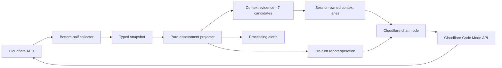

# lisa-pack-cloudflare

Cloudflare infrastructure assessment and investigation for [Lisa](https://github.com/TheMigusGroup/lisa-framework) — a two-plane pack that continuously monitors Cloudflare zone health in the bottom half, then opens scoped, read-only MCP access to the full Cloudflare API for targeted investigation in the top half.

> **Report, then investigate.** Every turn in `cloudflare` mode starts with a cached, deterministic assessment from the bottom-half snapshot. The model synthesizes a report first, then uses the `cloudflare.*` MCP tools only when the user asks to investigate a specific finding in detail.

## What it provides

| Layer | Name | Kind | Purpose |
| --- | --- | --- | --- |
| Mode | `cloudflare` | chat | `/cloudflare` — cached report, then live MCP investigation |
| Operation | `cloudflare_assessment` | runtime (pre-turn) | Deterministic report from cached snapshot via `assess()` |
| Connector | `CloudflareSignalCollector` | signal | Polls Cloudflare GraphQL + REST APIs for zone/worker/edge metrics |
| Processing | `CloudflareProcessingLoop` | processing | Emits alerts for critical-severity assessment findings |
| Evidence | `build_context_evidence` | context | Atomizes assessment into 7 stable lane-ready candidates |
| MCP Server | `cloudflare-api` | HTTP (cold) | Cloudflare Code Mode API at `mcp.cloudflare.com/mcp` |
| Alias | `cloudflare.search` | synthetic | Discover Cloudflare API endpoints via Code Mode |
| Alias | `cloudflare.execute` | synthetic | Call Cloudflare API endpoints (read-only token) |
| Alias | `cloudflare.docs` | synthetic | Search Cloudflare developer documentation |
| Session Plan | `cloudflare.md` | v2 reference | Lane definitions for `incidents` / `cloudflare_state` / `history` / `general` |

The pack is discovered via the `lisa.extensions.content_roots` entry point. The signal connector is registered via `lisa.extensions.signal_connectors`, the processing loop via `lisa.extensions.processing_loops`, and the context evidence builder via `lisa.extensions.context_evidence`.

## Install

### As a workspace dependency

Already included in the framework workspace `pyproject.toml`:

```toml
dependencies = [
    # ...existing deps...
    "lisa-pack-cloudflare",
]
```

Reinstall:

```powershell
uv sync --extra dev
```

### For local development (no publish)

Point `SDK_CONTENT_ROOTS` at the pack folder:

```powershell
$env:SDK_CONTENT_ROOTS = "C:\Code\lisa_framework\lisa_pack_cloudflare"
uv run lisa modes
```

## Configure

The pack reads environment variables:

| Variable | Required | Default | Purpose |
| --- | --- | --- | --- |
| `CLOUDFLARE_API_TOKEN` | yes | — | Cloudflare API token for the signal connector (read:zone, read:worker) |
| `CLOUDFLARE_ZONE_ID` | yes | — | Zone ID to monitor |
| `CLOUDFLARE_ACCOUNT_ID` | no | — | Account ID for worker script inventory |
| `CLOUDFLARE_MCP_API_TOKEN` | no | — | Read-only API token for the MCP server (must be read-only) |

**Two separate tokens by design.** The connector token (`CLOUDFLARE_API_TOKEN`) polls the GraphQL Analytics API on the bottom-half tick. The MCP token (`CLOUDFLARE_MCP_API_TOKEN`) is used by the top-half model for live investigation. The MCP token **must be read-only** — the `cloudflare.execute` tool can issue mutating API requests, and read-only enforcement is at the Cloudflare token scope, not the prompt or tool allowlist.

Create tokens at the [Cloudflare API token dashboard](https://dash.cloudflare.com/profile/api-tokens).

Example:

```powershell
$env:CLOUDFLARE_API_TOKEN = "<connector token with read:zone, read:worker>"
$env:CLOUDFLARE_ZONE_ID = "<zone ID>"
$env:CLOUDFLARE_ACCOUNT_ID = "<account ID>"
$env:CLOUDFLARE_MCP_API_TOKEN = "<read-only token for investigation>"
```

## Use

### Status report (no MCP round-trip)

```powershell
uv run lisa once "/cloudflare"
```

1. The router matches `/cloudflare` to the `cloudflare` chat mode.
2. The pre-turn operation `cloudflare_assessment` runs — reads the cached snapshot, projects it through `assess()`, and renders a deterministic markdown report.
3. The model synthesizes a concise health summary from the report.
4. No MCP calls are made — the report is entirely from the bottom-half cache.

### Investigation (live MCP)

```powershell
uv run lisa once "/cloudflare why is edge 5xx elevated?"
```

1. The pre-turn assessment runs as above.
2. The model sees the assessment's findings and investigation anchors (zone_id, account_id, failing scripts).
3. The model calls `cloudflare.search` to discover relevant Cloudflare API endpoints.
4. The model calls `cloudflare.execute` with a small JavaScript snippet against the discovered endpoint.
5. The model cites the API response data in its answer.

### Reference session plan

The pack ships a v2 session plan at `content/session_contexts/cloudflare.md`. Copy it into your data directory or working directory and launch with it:

```powershell
Copy-Item lisa_pack_cloudflare\content\session_contexts\cloudflare.md .\cloudflare.md
uv run lisa once --session-context cloudflare "/cloudflare"
```

This activates the session-owned context mapper with `incidents` / `cloudflare_state` / `history` / `general` lanes so Cloudflare alerts reach the `incidents` lane globally while healthy Cloudflare detail is only admitted in `cloudflare` mode.

## Architecture: two-plane design



### Bottom half (continuous observation)

The signal connector polls Cloudflare's GraphQL Analytics API and REST endpoints on the host's bottom-half tick. It collects zone status, edge traffic (4xx/5xx), worker inventory and performance, Pages deployments, WAF events, D1/KV/Durable Objects metrics, and top traffic paths.

The collected snapshot is projected through `assess()` — a pure function with no I/O — into typed findings:

| Finding | evidence_type | Salience when healthy |
| --- | --- | --- |
| `cloudflare:health` | `connector_status` | 0.0 |
| `cloudflare:traffic` | `traffic` | 0.0 |
| `cloudflare:workers` | `workers` | 0.0 |
| `cloudflare:deployments` | `deployments` | 0.0 |
| `cloudflare:security` | `security` | 0.0 |
| `cloudflare:data` | `data` | 0.0 |
| `cloudflare:investigation-handoff` | `investigation_handoff` | 0.0 |

Healthy findings have `salience_score=0.0` so the session-owned context mapper drops them outside `cloudflare` mode. Critical-severity findings produce alerts that reach the `incidents` lane globally.

### Top half (MCP investigation)

The `cloudflare` mode is `mode_kind: chat` with `tools_authoritative: true` and `allowed_tool_ids` restricted to three generic aliases:

| Alias | Native tool | Purpose |
| --- | --- | --- |
| `cloudflare.search` | `search` | Write JavaScript to query the Cloudflare API spec and find endpoints |
| `cloudflare.execute` | `execute` | Write JavaScript to call Cloudflare API endpoints (read-only) |
| `cloudflare.docs` | `docs` | Search Cloudflare developer documentation |

The MCP server is cold (`warm: false`) — it is only connected when the `cloudflare` mode is active. The turn runner's mode-aware cold activation ensures the remote server is never spawned for non-Cloudflare turns.

## Why Code Mode instead of product-specific MCP servers

Cloudflare offers both a Code Mode API server (`mcp.cloudflare.com/mcp`) and product-specific servers (DNS Analytics, GraphQL, Workers Bindings, Workers Observability, etc.). This pack uses Code Mode only.

| Approach | Tools | Schema tokens | Coverage |
| --- | --- | --- | --- |
| Code Mode (this pack) | 3 | ~1,100 | All 2,500+ Cloudflare API endpoints |
| Product servers (e.g. DNS Analytics + GraphQL + Workers Observability) | 40-80+ | 10,000-50,000+ | Subsets of the same API |

**Code Mode covers everything the product servers expose.** The `execute` tool can call any Cloudflare API endpoint — including every DNS Analytics query, every GraphQL analytics query, every Workers Observability endpoint. The model writes a small JavaScript snippet against `cloudflare.request()` and gets the result back. Product servers just wrap those same calls behind typed tool definitions.

**Token cost matters for a chat mode.** The `cloudflare` mode runs every turn with the pre-turn assessment (free, cached) plus the MCP tool surface. With Code Mode, that surface is 3 tools at ~1.1k tokens. Adding product servers would add 40-80+ tool schemas — potentially 10k-50k+ tokens — to every `cloudflare` mode turn, even when the user is just asking for a status summary.

**The bottom half already covers the data.** The connector polls DNS analytics, Workers observability, WAF events, Pages deployments, D1, KV, and Durable Objects. The assessment gives the model those findings for free. The MCP surface is for targeted follow-up, not bulk data collection.

**When product servers would make sense:**

- If the model consistently struggles to write correct Code Mode JavaScript for a specific investigation pattern
- If a product server exposes a capability that `execute` cannot reach (none currently do)
- If we build a separate `cloudflare-build` mode for Workers development (where Workers Bindings would be a genuinely useful curated development surface, not an investigation surface)

## Project layout

```plaintext
lisa_pack_cloudflare/
  __init__.py
  config.py                     — CloudflareSettings (env-owned)
  connector.py                  — CloudflareSignalCollector (API collection)
  assessment.py                 — Pure assess() projector
  models.py                     — CloudflareMetrics, Finding, CloudflareAssessment
  context_evidence.py           — Atomized evidence builder
  processing.py                 — Alert detection from assessment findings
  mcp_servers.yaml              — Code Mode HTTP server + aliases
  pyproject.toml
  modes/
    cloudflare/
      _mode.md                  — chat mode with pre-turn + MCP bindings
  operations/
    cloudflare_assessment/
      __init__.py
      cloudflare_assessment.py  — pre-turn report operation
      cloudflare_assessment.yml
  content/
    prompts/
      cloudflare_assessment.md  — system prompt
    session_contexts/
      cloudflare.md             — reference v2 session plan
  tests/
    test_catalog.py             — catalog discovery
    test_assessment.py          — pure projector tests
    test_context_evidence.py    — atomized evidence tests
    test_cloudflare_config.py   — settings tests
    test_import_boundaries.py   — no app.* import check
```

## Test

```powershell
uv run pytest lisa_pack_cloudflare/tests/ -q
```

Tests are deterministic (no live API calls):

- `test_catalog.py` — mode is `chat`, `pre_turn_operation_ids`, `allowed_tool_ids`, operation discovered
- `test_assessment.py` — `assess()` with ok/degraded/unconfigured snapshots, stable finding IDs, salience=0 when healthy
- `test_context_evidence.py` — 7 stable candidates, correct source/collector, `system_observed` provenance
- `test_cloudflare_config.py` — env var loading, separate MCP token
- `test_import_boundaries.py` — no `app.*` imports

## Boundaries

- No `app.*` imports — the pack is self-contained for externalization
- No `sdk` or `kernel` config reads — env-owned settings only
- No host transport imports — discovered via entry points
- No schedulers — the connector runs on the host's bottom-half tick
- No compat shims — `cloudflare_status` was hard-cut to `cloudflare_assessment`
- No mutating operations — the MCP token is read-only by contract
- No product-specific MCP servers — Code Mode covers the full API at ~1.1k tokens

## License

MIT — see [root LICENSE](../LICENSE).

## Status

**Experimental** — the two-plane design (bottom-half evidence + top-half MCP investigation) is a reference implementation for how packs should integrate with the framework's context lanes and MCP tool surface. Planned additions:

- A separate `cloudflare-change` workflow mode with a write-token, explicit approval stage, and audit output for mutating operations
- OAuth interactive auth for the MCP server (currently bearer-token only)
- Assessment-driven investigation suggestions (the model proactively offers to investigate critical findings)
